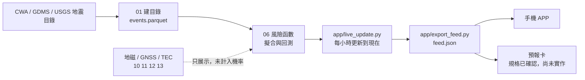

# 地震風險評估專題

用地震目錄估計「接下來一段時間，某個地方發生某個規模以上地震的機率」，並用歷史資料回測、公開驗證。
**這是機率預報，不是預警，也不是預言**：機率通常很小，卡片與畫面都會並列「平常值」當對照。

> **舊版 README 已淘汰**：先前描述的 PowerShell 加權總和評分（`scripts/*.ps1`）沒有科學依據，已由下面的連續式風險函數取代。這些腳本還留在 `scripts/`，只是歷史紀錄，**不要用來得出對外結論**（審查報告 Q2、Q3）。

## 目前的系統

| 子系統 | 位置 | 做什麼 |
|---|---|---|
| 資料管線（Python） | `pipeline/src/` | 建地震目錄、清理特徵、估完整規模、回測、前兆資料處理 |
| 連續式風險函數 v1.1 | `pipeline/src/eqforecast/hazard.py`、`pipeline/src/06_hazard_model.py` | 簡化版 ETAS 型模型：長期背景＋近期活動加成，再換算成任意規模與時間長度的機率 |
| 風險 APP（電腦版） | `app/` | Streamlit 展示、每小時更新、匯出 `feed.json` |
| 手機 APP（PWA） | 另一個 repo：[earthquake-risk-app](https://github.com/Azazelowo/earthquake-risk-app) | 讀 `feed.json`，在手機上算規模換算與範圍加總 |
| 自動化 | `.github/workflows/` | 每小時更新 feed、測試、每日報告檢查、碎形日報封存 |



## 模型回答什麼，以及它的限制

- 回答：「從現在起 T 這麼久之內，這個區域發生規模 m 以上地震的機率」。m 與 T 可任意指定。
- 回測（2015-01-01 ～ 2026-09-30）：以 7 天、M≥5 為例，AUC 0.936，預測／實際 0.96；資訊增益對均勻 2.31、對「只有背景」0.64。完整表格見 [`docs/reports/hazard_v1/README.md`](docs/reports/hazard_v1/README.md)。
- 增益大部分來自「大地震後會有餘震」這個已知規律，**不是預測主震**。
- 只涵蓋定位品質良好的地震（外海 gap 大的地震不在內）；不分震源深度；M6.5 以上樣本極少，是外推。
- 地磁、GNSS、TEC 等前兆資料目前**只處理與展示，沒有計入機率**；回測證明有增益才會納入。
- 已知待處理項目與證據，見 [`docs/audit/2026-11-17_全面審查.md`](docs/audit/2026-11-17_全面審查.md)。

## 資料來源

| 類別 | 來源 | 用途 |
|---|---|---|
| 地震目錄 | 中央氣象署（CWA）與 GDMS 正式目錄、CWA 有感報告、USGS | 模型主要輸入；暫時資料補最近的缺口 |
| 地磁 | GDMS MAGNET（IAGA-2002） | 前兆研究（`10_process_magnet.py`） |
| GNSS／TEC | GDMS GNSS（RINEX）、CWA 太空天氣 | 前兆研究（`11_process_gnss_tec.py`、`00_download_space_weather.py`） |

資料檔不進版控（體積大、來源有各自條款）。目錄欄位與跨來源比對規則見 [`docs/phase2/catalog_event_matching_spec.md`](docs/phase2/catalog_event_matching_spec.md)。

## 管線步驟（`pipeline/src/`）

| 檔案 | 作用 |
|---|---|
| `01_build_catalog.py` | 合併 CWA XML 與 GDMS CSV，輸出 `events.parquet`、`event_matches.parquet` |
| `02_clean_features.py` | B2：把地磁與 TEC 轉成 0.2° 格網、逐日的特徵 |
| `03_train_backtest.py` | B3：基準模型與回測 |
| `04_estimate_mc.py` | 估計完整規模 Mc |
| `05_compare_runs.py` | 比較不同設定的結果 |
| `06_hazard_model.py` | 連續式風險函數：擬合、回測、輸出最新一期風險 |
| `07_hazard_precursor.py` | 前兆特徵加入風險函數的對照試驗 |
| `10`–`13_*.py` | 地磁、GNSS／TEC 處理、品質報告、視覺化 |
| `fetch_usgs.py` | 抓 USGS 目錄，整理成統一欄位 |

各檔開頭的說明寫了輸入、輸出與為什麼這樣做。

## 本地重現

```bash
pip install -r requirements.txt
python -m unittest discover -s pipeline/tests
```

- 需要 Python 3.13（`requirements.txt` 註明已測試版本，不支援 3.15 alpha）。
- 在 Windows 中文版終端機（cp950）執行時，輸出的特殊符號不會再讓程式中斷（`pipeline/src/safe_console.py`）。
- 重跑模型與 APP 的步驟見 [`app/README.md`](app/README.md) 與各步驟檔頭；需要的資料檔不在版控內，缺檔時程式會說明缺什麼。

## 自動化（`.github/workflows/`）

| 檔案 | 作用 |
|---|---|
| `hourly-feed.yml` | 每小時更新風險資料並發布 `feed.json` 到 `feed` 分支（需要 Secret `CWA_API_KEY`） |
| `pipeline-tests.yml` | 推送與 PR 時跑單元測試 |
| `daily-report-check.yml`、`fractal-archive.yml` | 每日報告缺漏檢查、碎形日報封存 |
| `risk-assessment.yml` | 舊 PowerShell 流程的 workflow：評估 job 只能手動觸發；裡面的 tests job 仍會在推送時執行（和 `pipeline-tests.yml` 重複，審查 Q5） |

## 文件地圖

| 想知道 | 看哪裡 |
|---|---|
| 專案現況與歷史脈絡 | [`docs/PROJECT_OVERVIEW.md`](docs/PROJECT_OVERVIEW.md)、[`docs/專案現況白話報告.md`](docs/專案現況白話報告.md) |
| 模型與回測結果 | [`docs/reports/hazard_v1/README.md`](docs/reports/hazard_v1/README.md) |
| 審查發現與待辦 | [`docs/audit/2026-11-17_全面審查.md`](docs/audit/2026-11-17_全面審查.md) |
| 預報卡規格（預先登記、計分、失效標準） | [`docs/phase2/forecast_card_spec.md`](docs/phase2/forecast_card_spec.md) |
| 系統分析與設計文件 | `docs/sad/`、`docs/uml/` |
| 協作規則與技能 | [`AGENTS.md`](AGENTS.md)、[`SKILLS.md`](SKILLS.md) |

## 版控習慣

完成有意義的變更後提交，訊息寫清楚「為什麼」；用分支嘗試新假設，驗證後再合併。
