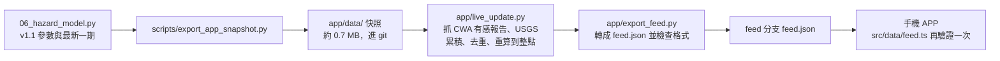

# app/：手機 APP 的資料後端（Phase 2）

手機 APP（另一個 repo：`earthquake-risk-app`）不在手機上跑模型，只讀這裡每小時產生的 `feed.json`，
在手機上做規模換算、範圍加總與卜瓦松機率。這個資料夾負責「把模型輸出變成 feed.json」。



| 檔案 | 用途 |
|---|---|
| `data/` | 快照：參數（`params.json`）、每格期望數、回測表、M≥3.5 基礎目錄、近期地震。用 `scripts/export_app_snapshot.py` 從 `pipeline/data/hazard/` 產生 |
| `hazard_core.py` | 計算核心（和 APP 的 `src/core/hazard.ts` 對應）；`background_rescale` 定義「平常」 |
| `live_update.py` | 正式目錄之後的暫時資料：CWA 有感報告（需 `CWA_API_KEY`）＋ USGS；同參數重算到整點；評估缺口造成的低估 |
| `export_feed.py` | 轉成 feed.json，寫出前用 `check_feed` 檢查（和手機端 `validateFeed` 相同的重點） |

## 每小時自動更新

`.github/workflows/hourly-feed.yml` 每小時第 17 分執行，結果推到 **`feed` 分支**（只保留最新的一個 commit），
APP 讀 `https://raw.githubusercontent.com/<repo>/feed/feed.json`。需要在 repo 的
Settings → Secrets and variables → Actions 設定 `CWA_API_KEY`；沒設時只用 USGS（M4 以上）。

## 本機執行

```bash
python scripts/export_app_snapshot.py
```

```bash
python app/live_update.py
```

```bash
python app/export_feed.py
```

第一行在重新訓練模型（`06_hazard_model.py`）之後執行；後兩行產生 `app/live/` 與 `app/feed/feed.json`（不進 git）。

## 為什麼這樣設計

- **手機端計算**：後端只給每格的期望數（約 120 KB），任意規模、時間、範圍都在手機上算，伺服器零成本。
- **兩道檢查**：發布前 `check_feed`、手機端 `validateFeed`。每小時自動發布，壞掉的資料不能直接送到使用者手機。
- **事件母體與模型一致**：快照的基礎目錄和擬合參數時一樣，只用定位良好的事件（`params.json` 的 `event_quality`）。
