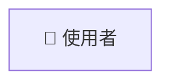
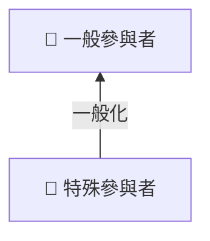
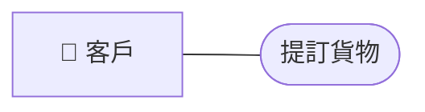

# 第六章 UML基礎圖形 學習筆記

本文件依據系統分析與設計課程第六章投影片內容，補充所需的圖片（使用 Mermaid 語法）、表格與說明，方便零經驗的學生直接閱讀與學習。

> Mermaid 沒有專用的使用案例圖（use case diagram）語法，以下用 flowchart 模擬：
> 參與者用 `👤` 標示，使用案例用橢圓（`([ ])`）表示。

## 目錄

- [圖6-1 參與者的圖示符號](#圖6-1-參與者的圖示符號)
- [圖6-2 使用一般化關係表達參與者的繼承歸屬關係](#圖6-2-使用一般化關係表達參與者的繼承歸屬關係)
- [圖6-3 使用案例符號](#圖6-3-使用案例符號)
- [圖6-4 參與者和使用案例搭配的圖形範例](#圖6-4-參與者和使用案例搭配的圖形範例)

## 圖6-1 參與者的圖示符號

*說明：* 參與者（Actor）在 UML use case diagram 中以棒人符號表示，代表與系統互動的外部實體（可以是人、其他系統或硬體）。

## 圖6-2 使用一般化關係表達參與者的繼承歸屬關係

*說明：* 使用一般化（generalization）關係表示參與者之間的繼承，子參與者繼承父參與者的行為與職責。UML 中以空心三角形箭頭指向父參與者。

## 圖6-3 使用案例符號

*說明：* 使用案例（Use Case）以橢圓形表示，寫入案例名稱。

## 圖6-4 參與者和使用案例搭配的圖形範例

*說明：* 參與者與使用案例之間以實線連線，表示參與者參與該使用案例。
