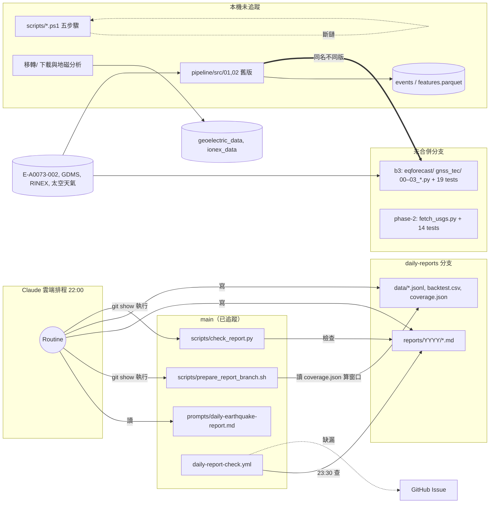

# 專案全面稽核報告 — 地震風險評估專題

| 項目 | 內容 |
|---|---|
| 稽核日期 | 2026-11-05 |
| 範圍 | ① `main` 分支（6 檔）② 主工作目錄 `破專題/` 全部檔案（471 檔、639 MB，含未追蹤與已忽略）③ `daily-reports` 分支 ④ 5 條未合併的 `claude/*` 分支 |
| 排除 | `.git/`、`node_modules/`、`.claude/worktrees/`（其他工作階段的副本） |
| 方法 | 全量盤點腳本（大小、SHA-1 去重、空檔）、逐檔閱讀所有程式／設定／主要文件、實際執行測試與語法檢查 |
| 遠端 | `Azazelowo/earthquake-risk-project`（公開 repo） |

**閱讀方式**：每個問題有編號（如 `L2`），位置寫成「檔案:行號」。路徑若不在 `main` 上，一律相對於 `破專題/`。嚴重度：**高**＝已知會出錯或會誤導結論；**中**＝特定條件下出錯或維護風險；**低**＝品質／一致性。

**驗證狀態標記**：【實測】＝本次實際執行確認；【閱讀】＝讀程式碼判斷，未執行；【需確認】＝推論，建議人工驗證。

---

## A. 專案摘要

### A.1 一句話

專案目前是**三套彼此沒接起來的系統**放在同一個資料夾：只有「每日地震日報」真正在 `main` 上運作；「風險評估模型」的較新版本只存在未合併分支；本機工作目錄則是一份未納入版控、和分支版本已分歧的舊版程式，加上大量資料、課堂筆記與暫存檔。

### A.2 子系統一覽

| 子系統 | 所在位置 | 狀態 | 測試 |
|---|---|---|---|
| ① 每日地震日報（Claude 雲端排程） | `main`：`prompts/`、`scripts/*.sh/.py`、`.github/workflows/daily-report-check.yml`；產出在 `daily-reports` 分支 | **運作中**（11-02、11-04 有報告；11-03 漏跑已用補收機制回補） | 無 |
| ② Python 地震預測 pipeline（B3 基準模型、GNSS-TEC、USGS 擷取） | 分支 `claude/b3-baseline-model-6e563a`、`claude/phase-2-data-source-comparison-b140f9` | **未合併**；測試通過 | 19＋14 個，全數通過【實測】 |
| ③ 本機舊版 pipeline＋PowerShell 流程 | 主工作目錄 `pipeline/src/`、`scripts/*.ps1`（未追蹤） | **無法執行**（語法、邏輯、輸入檔皆有問題） | 無 |
| ④ 前兆資料蒐集工具（地電、GIM、地磁殘差） | `移轉/`（未追蹤） | 可運作，品質最好；地電下載有資料缺口 | 無（有 `--demo` 自我檢查） |
| ⑤ 課程文件（SA&D 各章、UML、提案簡報） | 根目錄、`Chapter0x/`、`docs/` | 未追蹤；部分內容損毀 | — |

### A.3 最需要處理的 5 件事

1. **把分支 ② 合併進 `main`，刪掉本機舊版 ③**（V1、V2、L6）。現在本機 `pipeline/data/events.parquet` 很可能是有時區錯誤的舊邏輯產物。
2. **`02_clean_features.py` 找不到資料時會寫入亂數假資料**，檔名和真實結果一樣（L5）。
3. **PowerShell 腳本在 Windows PowerShell 5.1 下根本無法解析**，且欄位檢查邏輯永遠不觸發（L1、L2、L3）。
4. **`.gitignore` 沒有擋下指導同意書、簡報、原始資料**，而 repo 是公開的（V3）。
5. **地電資料在 11-05 約 00:15–10:30 永久缺漏**，因為排程沒跑，而資料源只保留最近一段時間（L13）。

---

## B. 目錄樹

### B.1 邏輯結構（人工整理）

```text
破專題/                              ← git 主工作目錄（branch: main）
├── 【main 已追蹤：6 檔】
│   ├── .github/workflows/daily-report-check.yml
│   ├── .gitignore
│   ├── AGENTS.md                    ← 本機有未提交修改（V6）
│   ├── prompts/daily-earthquake-report.md
│   └── scripts/{check_report.py, prepare_report_branch.sh}
│
├── 【程式碼：未追蹤】
│   ├── scripts/*.ps1 (5)            ← PowerShell 風險評估流程
│   ├── pipeline/src/01_*.py, 02_*.py← 舊版（分支上有新版）
│   ├── pipeline/data/*.parquet      ← 產出物
│   ├── 移轉/*.py, *.ps1, *.cmd      ← 前兆資料下載與分析工具
│   ├── notebooks/analysis.ipynb
│   ├── gen.js, check_path.py, path_check.py, test_write*.py
│   ├── temp_mermaid/                ← mermaid-cli 暫存
│   └── .github/workflows/risk-assessment.yml
│
├── 【資料：未追蹤／部分已忽略，約 620 MB】
│   ├── E-A0073-002/                 ← CWA 目錄 XML 1990–2025
│   ├── GDMS地震目錄/、earthquake_data/
│   ├── GDMSdata/、測地法/、地震預測/測地法/  ← 同一批 RINEX 存了 3 份
│   ├── 地震預測/                    ← 文獻 PDF、太空天氣、9 個空子目錄
│   └── 移轉/geoelectric_data/、ionex_data/、geomag_demo/
│
├── 【文件：未追蹤】
│   ├── README.md, SKILLS.md, final_report.md, project_report.md
│   ├── docs/{analysis, uml}/, Chapter01–08/, chapter6/
│   └── 根目錄 30+ 個課堂表格與 Mermaid 圖（圖3-x、XP/Scrum/RUP 表）
│
└── 【雜項／暫存：未追蹤】
    ├── *.pptx/pdf/docx/xlsx (11)   ← 含「丟掉*.pptx」、指導同意書
    ├── chapter*_pages*.txt、output*.txt、tree.txt、temp.*
    └── outputs/（空）

daily-reports 分支：reports/2026/{11-02,11-04}.md、data/{events,predictions}.jsonl、backtest.csv、coverage.json
```

完整的自動產生目錄樹（含每個資料夾的檔案數與大小）見**附錄 1**。

---

## C. 檔案清單

### C.1 統計

| 類別 | 檔案數 | 大小 | 說明 |
|---|---:|---:|---|
| 程式碼（.py/.ps1/.sh/.js/.cmd/.ipynb） | 20 | < 0.2 MB | 其中只有 2 支在 `main` |
| 設定（.yml/.json/.gitignore） | 6 | < 0.1 MB | 無 `requirements.txt`、無 `.gitattributes` 在 `main` |
| 文件（.md/.mmd） | 95 | < 0.2 MB | |
| 資料（.csv/.xml/.min/.24o/.gz/.parquet/.INX/.txt） | ~290 | ~600 MB | |
| 圖片（.png） | 34 | ~4 MB | |
| Office／PDF | 28 | ~150 MB | 含 14 份文獻 PDF |
| **合計** | **471** | **639 MB** | `main` 追蹤 6 檔、已忽略 53 檔、未追蹤 412 檔 |

### C.2 程式與設定逐檔用途

| 檔案 | 版控 | 用途 | 健康度 |
|---|---|---|---|
| `prompts/daily-earthquake-report.md` | main | 日報任務的完整規格（資料源、回測規則、報告格式、安全規則） | 良好，有 2 處矛盾（D1、D5） |
| `scripts/prepare_report_branch.sh` | main | 建 `daily-reports` worktree、依 `data/coverage.json` 計算檢索窗口與補收 | 良好，有邊界問題（D2、D3） |
| `scripts/check_report.py` | main | 偵測報告被 shell 展開吃字 | 良好，Windows 編碼問題（D4） |
| `.github/workflows/daily-report-check.yml` | main | 23:30 檢查當日報告，缺漏自動開 issue | 良好（D7） |
| `scripts/Import-EarthquakeCatalog.ps1` | 未追蹤 | 匯入並檢查地震目錄 | 檢查邏輯失效（L2） |
| `scripts/Compute-Baseline.ps1` | 未追蹤 | 30 天基線 | 無法執行（L1、L3） |
| `scripts/Ingest-Precursors.ps1` | 未追蹤 | 前驅資料整併 | 無法執行（L1、L3） |
| `scripts/Risk-Scoring.ps1` | 未追蹤 | 加權評分與文字摘要 | 無法執行（L1、L4） |
| `scripts/Visualize-Results.ps1` | 未追蹤 | 呼叫 Python 繪圖 | 輸入檔不存在（L4） |
| `pipeline/src/01_build_catalog.py` | 未追蹤 | 合併 CWA XML＋GDMS CSV | 舊版有時區與篩選錯誤（L6） |
| `pipeline/src/02_clean_features.py` | 未追蹤 | 前驅特徵格網化、加權 | 會產生假資料（L5） |
| `移轉/geomag_residual.py` | 未追蹤 | 地磁局部異常殘差分析 | 良好；設定路徑不存在（L14） |
| `移轉/geoelectric_download.ps1` | 未追蹤 | CWA 地電場每小時下載與歸檔 | 良好；排程缺口（L13） |
| `移轉/gim_download.ps1` | 未追蹤 | CDDIS IONEX 下載與解壓 | 良好 |
| `移轉/verify_files.ps1`、`run_geomag.cmd` | 未追蹤 | 搬移完整性檢查、啟動器 | 良好 |
| `.github/workflows/risk-assessment.yml` | 未追蹤 | 執行 PS 流程的 CI | 未進版控，跑了也會失敗（L4） |
| `notebooks/analysis.ipynb` | 未追蹤 | 讀風險分數做探索 | 內容損毀（L9） |
| `gen.js` | 未追蹤 | 產生第六章筆記 | 語法錯誤（L7） |
| `check_path.py`、`path_check.py`、`test_write.py`、`test_write2.py` | 未追蹤 | 除錯暫存 | 應刪除（L12） |
| `temp_mermaid/package*.json` | 未追蹤 | 渲染 Mermaid 用的 `@mermaid-js/mermaid-cli` | 暫存，建議收進 `tools/` |
| `docs/uml/index.json` | 未追蹤 | UML 文件索引 | 9 個引用檔全部存在 ✓ |

全部 471 個檔案的逐檔清單（路徑、大小、版控狀態、用途）見**附錄 2**。

---

## D. 缺失報告

### D.1 遺失檔案（被引用但不存在）

| 引用處 | 缺少的路徑 | 影響 |
|---|---|---|
| `scripts/Import-EarthquakeCatalog.ps1:7`、`Compute-Baseline.ps1:7`、`SKILLS.md:10` | `earthquake_data/CWA_catalog.csv` | PS 流程第一步就中止 |
| `scripts/Ingest-Precursors.ps1:16`、`SKILLS.md:48` | `precursor_data/`（7 個 CSV） | PS 流程第三步中止 |
| `scripts/Risk-Scoring.ps1:8` | `outputs/features_normalized.csv` | **沒有任何腳本會產生它**，流程斷鏈 |
| `notebooks/analysis.ipynb`、`SKILLS.md:107` | `outputs/risk_scores.csv`、`output/` | 筆記本無法執行 |
| `pipeline/src/02_clean_features.py:14-15` | `地震預測/雨量`、`地震預測/氣壓` | 該前驅被跳過 |
| `pipeline/src/02_clean_features.py:11,13` | `地震預測/地磁及地電流`、`電離層電子密度變化`（存在但**是空目錄**） | 同上 |
| `移轉/geomag_residual.py:48,51,57` | `移轉/geomag_data/{ref,tgns}/`、`Kp_ap_since_1932.txt` | 只能跑 `--demo` |
| `Chapter07/README.md:7-10,14-16` | 列出的 10 個檔名中 **7 個對不上**：`類別圖.mmd`、`物件圖.mmd`、`元件圖.mmd`、`部署圖.mmd` 實際叫 `圖7-3_類別圖.mmd`、`圖7-9_…物件圖範例.md` 等；`圖7-1`、`7-2`、`7-5` 寫 `.mmd` 但實際是 `.md`。表 7-1～7-3 正確 | 文件導覽失效【實測】 |
| `main` 分支 | `README.md`、`requirements.txt`、`.gitattributes`、任何測試 | 新成員無法從 repo 了解或重現專案 |
| `daily-reports` 分支 | `reports/2026/2026-11-03.md` | 已知漏跑；依設計不補檔，事件已併入 11-04 補收 |

`移轉/` 以 `verify_files.ps1` 比對 SHA256 清單：**0 遺失**、19 變更、18 新增【實測】。變更與新增全是地電下載任務追加的 CSV 與 log，屬預期。

### D.2 空白檔案與空目錄

- **空白檔案（0 bytes）：無**【實測】。
- **空目錄（12 個）**【實測】：`outputs/`、`專案檔案/`、`新增資料夾/`，以及 `地震預測/` 下的 `土壤氣體濃度觀測`、`地殼變動連續觀測`、`地磁及地電流`、`地震波速度`、`地震活動`、`岩石破壞與地殼熱流量測定`、`活斷層及褶曲`、`電離層電子密度變化`、`驗潮`。`地震預測/` 下的 9 個看起來是依前兆分類預建的資料夾；`新增資料夾/`、`專案檔案/` 可直接刪除。前兆資料夾則因為git 不會追蹤空目錄，建議各放一個 `README.md` 說明預定放什麼資料、從哪取得。

### D.3 重複檔案（SHA-1 完全相同）【實測】

| 重複組 | 份數 | 浪費 | 建議保留 |
|---|---:|---:|---|
| NDH5 RINEX `ndh5092–098*.24o`：`GDMSdata/GDMSdata/*/`、`測地法/GNSS_ETEC/`、`地震預測/測地法/GNSS_ETEC/` | 3 | 74 MB | `地震預測/測地法/GNSS_ETEC/`（與 aux 檔同處） |
| `earthquake_data/raw/` 與 `processed/` 的 `地震活動彙整_cwa_*.csv`、`地震紀錄_usgs_*.csv` | 2 | 3 MB | `raw/`；processed 不該放未處理的副本 |
| `report_figures/*.png` 與 `earthquake_data/processed/*.png` | 2 | 52 KB | 擇一 |
| `workflow.mmd`：根目錄、`Chapter02/`、`docs/`、`temp_mermaid/` | 4 | — | `docs/workflow.mmd` |
| `圖3-12_迭代的系統開發模式.mmd` ＝ `圖3-12_迭代系統開發模式.mmd` | 2 | — | 擇一 |
| `丟掉3.pptx` ＝ `115-1 實務專題 期初提案口頭報告.pptx` | 2 | 0.4 MB | 刪 `丟掉3.pptx` |
| `temp.png` ＝ `Chapter02/images/系統開發模式的演進.png` | 2 | — | 刪 `temp.png` |

**內容近似（非位元相同）**：
- `final_report.md` 與 `project_report.md`：同一份報告的兩個版本，且都有吃字（L8）。
- `GDMS地震目錄/GDMScatalog (1–17).csv`（76 MB）與 `earthquake_data/raw/GDMS地震目錄_cwa_*.csv`（80 MB）：檔名顯示是同一批資料重新命名；大小不同，【需確認】是否只是格式差異。
- 根目錄 `圖3-5/3-6/3-7` 各有兩種版本（「封裝範例」vs「物件導向的封裝圖示範例」）。

---

## E. 驗證報告

### E.1 引用路徑驗證

| 檢查 | 結果 |
|---|---|
| 所有 `.md` 的相對連結（共 2 個） | 全部有效 |
| `docs/uml/index.json` 的 9 個檔案 | 全部存在 |
| 腳本與文件中的檔案路徑 | 10 處失效，見 D.1 |
| `prompts/` 對 `scripts/` 的引用（以 `git show origin/main:...` 取用） | 有效；兩個腳本都在 `main` |
| `gen.js:3,78` 硬編碼 `C:/Users/.../Desktop/高科大/...` | **錯誤**：專案實際在 `OneDrive/Desktop/` 下 |
| `output.log` 記錄的路徑 `破專題\..\..\地震預測` | 錯誤：當時從根目錄執行副本，`BASE_DIR` 多跳兩層 |

### E.2 匯入依賴

| 元件 | 依賴 | 宣告位置 | 問題 |
|---|---|---|---|
| 日報腳本 | bash、git、python3（僅標準函式庫） | 無 | — |
| 本機 pipeline | pandas、numpy、pyarrow | **`main` 上無** | 本機全域 Python 3.13.17 **沒有安裝 pandas**【實測】 |
| 分支 pipeline | pandas 3.1.0、numpy 2.5.4、pyarrow 26.0.0、scikit-learn 1.9.1、scipy 1.18.1、matplotlib 3.11.2 | 兩條分支各有一份**內容相同**的 `requirements.txt` | 已用此清單建 venv 跑測試成功 |
| PS 流程 | pandas、matplotlib、seaborn、folium | 只寫在 workflow 與 README | seaborn、folium 不在 requirements |
| `geomag_residual.py` | numpy、pandas、matplotlib | 檔頭註解 | — |
| Mermaid 渲染 | `@mermaid-js/mermaid-cli ^12` | `temp_mermaid/package.json` | 位置像暫存 |
| `SKILLS.md:137` | `folium.plugins.HeatMap` | — | 未 `import folium.plugins`，範例會 AttributeError【閱讀】 |

### E.3 環境設定

| 項目 | 現況 | 問題 |
|---|---|---|
| Python | 本機 3.13.17；分支註明 3.13 測試 | `README.md:25` 寫 Python 3、`risk-assessment.yml` 用 3.11，不一致 |
| PowerShell | `README.md:25` 宣稱 5.1 以上 | 3 支腳本在 5.1 無法解析（L1） |
| Node | v24.19.0 | 僅 mermaid-cli 使用 |
| 機密 | `CWA_API_KEY`（雲端環境變數）、`~/.cwa_opendata_key`、`~/_netrc`（Earthdata） | 都不在 repo 內 ✓；無 `.env.example` 說明需要哪些變數 |
| 行尾 | `core.autocrlf=true`，無 `.gitattributes`；工作區全部是 CRLF【實測】 | `.sh` 若在本機直接執行會因 `\r` 失敗；目前以 `git show` 取 blob 執行（LF）所以未出事 |
| 儲存位置 | 整個專案（含 `.git/`、持續寫入的地電 CSV）在 **OneDrive 同步資料夾** | OneDrive 同步 `.git/` 與頻繁寫入的檔案容易產生衝突副本或鎖定錯誤【需確認：目前未見症狀】 |

### E.4 模組關聯性



**觀察**：
- 日報系統 ① 和模型 ② 之間**沒有資料交換**。日報的 `events.jsonl`（USGS／CWA 即時）和模型用的歷史目錄（CWA XML＋GDMS）是兩套不同的事件來源；`phase-2` 分支的 `fetch_usgs.py` 是讓兩者接上的自然切入點。
- `移轉/` 產出的地電、IONEX、地磁資料目前**沒有任何下游程式讀取**。
- 本機舊版 pipeline 和分支新版**檔名相同、內容不同**；直接合併時，未追蹤的本機檔案會擋住 checkout（git 會拒絕覆寫未追蹤檔）。

### E.5 README 與實際專案一致性

`README.md`（未追蹤，`main` 上沒有 README）：

| README 內容 | 實際 | 判定 |
|---|---|---|
| 第 1 行 `$@`、第 53 行 `@` | PowerShell here-string 寫檔殘留 | ✗ 損毀 |
| 主要步驟只有 5 支 PS 腳本（18–22 行） | 實際運作中的是日報系統；模型在 Python 分支 | ✗ 過時 |
| 「每次推送 main 會由 GitHub Actions 執行」（39 行） | `risk-assessment.yml` 未進版控；執行也會因缺資料失敗 | ✗ 不實 |
| 「各腳本皆以 Test-Path 檢查」（46 行） | 有，但欄位檢查因 L2 失效 | △ |
| 「風險分數會列出不確定度說明」（48 行） | `Risk-Scoring.ps1` 沒有任何不確定度輸出 | ✗ 不實 |
| 「網路下載會記錄 URL、時間、版本」（47 行） | PS 腳本沒有下載功能；`移轉/` 的下載器只記錄部分 | ✗ |
| 資料來源列 8 類前驅 | 實際有資料的：CWA/GDMS 目錄、RINEX、太空天氣、地電、IONEX；地下水、潮汐、應變皆無 | △ 規劃而非現況 |
| 未提及 | 日報系統、`daily-reports` 分支、`移轉/` 工具、分支上的 B3 模型 | ✗ 缺漏 |

`final_report.md`／`project_report.md` 第 5–15 行同樣描述不存在的 CI；`docs/analysis/feasibility_study.md` 以「PowerShell 處理資料」作為技術可行性依據，也已不符現況。

### E.6 API 文件整理

本專案**沒有自己對外提供的 API**。以下整理專案**呼叫的外部 API** 與**內部介面**（皆依程式碼與提示檔原文整理，未另外查證端點現況）。

#### 外部 API

| 服務 | 端點 | 認證 | 使用者 | 備註 |
|---|---|---|---|---|
| USGS FDSN Event | `https://earthquake.usgs.gov/fdsnws/event/1/query?format=geojson&starttime=…&minmagnitude=…`（可加 `minlatitude/maxlatitude/minlongitude/maxlongitude`、`latitude/longitude/maxradiuskm`） | 無 | 日報 1.1、3.2；`fetch_usgs.py`（分支） | 回測用 preferred magnitude |
| CWA 開放資料 datastore | `https://opendata.cwa.gov.tw/api/v1/rest/datastore/{E-A0015-001 \| E-A0016-001 \| O-A0002-001}?format=JSON` | Header `Authorization: $CWA_API_KEY` | 日報 1.1、2.2 | 顯著有感／小區域有感地震、自動雨量站 |
| CWA 開放資料 fileapi | `https://opendata.cwa.gov.tw/fileapi/v1/opendataapi/O-B0065-003?Authorization=…&format=XML` | Query 參數 | `移轉/geoelectric_download.ps1:32,79` | 腳本註解寫保留約 2 小時，下載紀錄顯示約 1 小時（L13）；授權碼在 URL 上（L16） |
| NOAA SWPC | `https://services.swpc.noaa.gov/products/noaa-planetary-k-index.json` | 無 | 日報 2.2 | Kp |
| NASA CDDIS | `https://cddis.nasa.gov/archive/gnss/products/ionex/{yyyy}/{doy}/…` | Earthdata（`~/_netrc`） | `移轉/gim_download.ps1:25` | |
| Blogger feed | `https://quakeforecast.blogspot.com/feeds/posts/default?alt=rss&max-results=15` | 無 | 日報 2.1 | 民間預測來源 |
| arXiv | `https://arxiv.org/list/physics.geo-ph/recent` | 無 | 日報 1.2 | |
| GitHub REST | `repos/{repo}/contents/{path}?ref=daily-reports`、`gh issue list/create` | `GITHUB_TOKEN` | `daily-report-check.yml` | |

#### 內部介面

| 介面 | 格式 | 產生者 → 使用者 | 規格位置 |
|---|---|---|---|
| `${TMPDIR:-/tmp}/daily_report_env.sh` | `export K='V'`：`WT`、`TODAY`、`WINDOW_START_UTC`、`WINDOW_END_UTC`、`COVERED_UNTIL_UTC`、`CATCHUP` | `prepare_report_branch.sh` → 日報代理 | [prepare_report_branch.sh:12-18](../scripts/prepare_report_branch.sh#L12-L18) |
| `data/coverage.json` | `{"last_window_end_utc", "report"}` | 日報第 6 節 → 下一次 prepare | [prompt:32](../prompts/daily-earthquake-report.md#L32) |
| `data/events.jsonl` | `id, source, time_utc, lat, lon, depth_km, mag, mag_type, url` | 日報 1.1 → 3.1 回測 | [prompt:74](../prompts/daily-earthquake-report.md#L74) |
| `data/predictions.jsonl` | `id, source, post_url, posted_at, window_start/end, region_text, region_list, lat, lon, radius_km, mag_min/max, claim_quote, group_id, status` | 日報 2.1 → 3.1 | [prompt:107-122](../prompts/daily-earthquake-report.md#L107-L122) |
| `data/backtest.csv` | `prediction_id, source, raw_post_count, window_start, window_end, matched_event_id, match_basis, time_offset_h, distance_km, mag_type, mag_error, status, base_rate_p, checked_at` | 日報 3.1 → 3.4 | [prompt:198](../prompts/daily-earthquake-report.md#L198) |
| `check_report.py <report.md>` | exit 0／1，stdout `suspect: line N: …` | CLI | [check_report.py](../scripts/check_report.py) |
| `pipeline/data/events.parquet` | `time, lat, lon, depth, ml, gap, source, event_id, *_rounded` | `01_build_catalog.py` → 下游 | 僅程式碼 |
| `geomag_residual.py [--demo]` | 輸出 `residual_{comp}.png`、`residual_{comp}_daily.csv` | CLI | 檔頭 docstring |

建議：把上表的內部介面移成 `docs/interfaces.md`（或 JSON Schema），提示檔改為引用它。目前格式定義只寫在提示檔的自然語言中，改格式時沒有東西能自動檢查舊資料。

### E.7 測試覆蓋率

| 範圍 | 測試數 | 結果 | 行覆蓋率 |
|---|---:|---|---|
| `main`（日報腳本） | 0 | — | 0% |
| 本機 `pipeline/`、`scripts/*.ps1`、`移轉/` | 0 | — | 0%（`test_write*.py` 不是單元測試） |
| 分支 `b3-baseline-model` | 19 | **全部通過**【實測】 | **21%**（1978 行中 410 行） |
| 分支 `phase-2-data-source-comparison` | 14 | **全部通過**【實測】 | **89%**（`fetch_usgs.py`） |

`b3` 分支模組明細【實測，`coverage.py`】：

| 模組 | 覆蓋率 | 模組 | 覆蓋率 |
|---|---:|---|---:|
| `eqforecast/targets.py` | 100% | `eqforecast/models.py` | **0%** |
| `eqforecast/splits.py` | 93% | `eqforecast/report.py`（291 行） | **0%** |
| `gnss_tec/orbit.py` | 86% | `gnss_tec/rinex.py` | **0%** |
| `eqforecast/metrics.py` | 80% | `gnss_tec/aux_data.py` | **0%** |
| `eqforecast/grid.py` | 79% | `00_download_space_weather.py` | **0%** |
| `eqforecast/decluster.py` | 78% | `01_build_catalog.py`、`02_clean_features.py` | **0%** |
| `eqforecast/config.py` | 73% | `03_train_backtest.py`、`case_ndh5_tec.py` | **0%** |
| `eqforecast/features.py` | 64% | `gnss_tec/tec.py` | 40% |

**最該補的測試**：`01_build_catalog.py`（時區與去重已出過錯，最值得鎖住）、`gnss_tec/rinex.py`（解析器，可用小段合成 RINEX 測）、`models.py`、`prepare_report_branch.sh` 的窗口計算（把內嵌 Python 抽成函式就能單元測試）。

### E.8 版本控制忽略規則

**`.gitignore`（main）問題**：

| 行 | 問題 | 建議 |
|---|---|---|
| 43、52 | `*.class` 重複 | 刪一行 |
| 28 | `.lcov/*` 不是常見目錄；`coverage/` 已涵蓋 | 改為 `.coverage`、`htmlcov/` |
| 40 | `vendor/`、46 `bin/` 對本專案無意義，可能誤擋未來目錄 | 視需要刪除 |
| — | 缺 `outputs/`、`*.parquet`、`.venv/`、`venv/`、`.ipynb_checkpoints/`、`.pytest_cache/` | 新增 |
| — | 缺原始資料目錄：`E-A0073-002/`、`GDMS*/`、`earthquake_data/`、`地震預測/`、`測地法/`、`移轉/*_data/` | 新增（資料改用 manifest＋下載腳本重現） |
| — | 缺 `*.pptx`、`*.docx`、`*.xlsx`、`*.pdf`（尤其 `NKUST CCET_實務專題指導同意書.docx`） | **repo 是公開的**，這些含個資或授權受限內容，一定要擋 |
| — | 缺 `temp*`、`output*.txt`、`chapter*_pages*.txt`、`tree.txt`、`丟掉*` | 或直接刪檔 |

**`.git/info/exclude`**：只有 `.claude/worktrees/`。若改在 `.gitignore` 加 `.claude/worktrees/`，其他協作者也能受惠。

**目前沒被忽略、`git add -A` 會一起加進去的大檔**：`earthquake_data/processed/GDMS_merged_all.xlsx`（72.5 MB，超過 GitHub 單檔 50 MB 警告線）、`地震預測/台灣活動斷層潛勢圖…pdf`（34.8 MB）、`台灣地震帶_compressed.pdf`（31.3 MB）。

### E.9 每日日報系統（main）詳細檢查

| 編號 | 嚴重度 | 位置 | 問題 | 修正建議 |
|---|---|---|---|---|
| D1 | 中 | [prompt:55-56](../prompts/daily-earthquake-report.md#L55-L56) | USGS 查詢範例寫 `starttime=<UTC 24h 前>`，與第 0 節「檢索窗口一律用 `WINDOW_START_UTC`」矛盾；補收時代理可能照表只查 24 小時【閱讀】 | 改為 `starttime=$WINDOW_START_UTC&endtime=$WINDOW_END_UTC` |
| D2 | 低～中 | [prepare_report_branch.sh:30](../scripts/prepare_report_branch.sh#L30) | `worktree add -B` 會把本地 `daily-reports` 重設為遠端；若前次 commit 成功但 push 失敗，本地那份報告會被丟棄。雲端環境每次都是新的，影響主要在本機執行時【閱讀】 | 重設前先 `git rev-list origin/daily-reports..daily-reports`，有未推送 commit 就保留並記錄 |
| D3 | 低 | [prepare_report_branch.sh:42](../scripts/prepare_report_branch.sh#L42) | `PYTHONIOENCODING=utf-8 python -I`：`-I` 隱含 `-E`，**環境變數被忽略**，stdout 仍是 cp950【實測】。目前輸出全為 ASCII 所以沒出錯 | 改 `"$PY" -I -X utf8 -` |
| D4 | 低 | [prompt:286-287](../prompts/daily-earthquake-report.md#L286-L287)、[check_report.py:30,35](../scripts/check_report.py#L30) | 在 Windows 上印出含 cp950 以外字元的可疑行時 `UnicodeEncodeError`，exit 1 被誤判為「報告有問題」【實測】；沒帶參數時 `IndexError`【實測】；此處用 `/tmp` 而其他地方用 `${TMPDIR:-/tmp}` | 腳本開頭 `sys.stdout.reconfigure(encoding="utf-8")`、檢查 `len(sys.argv)`；提示檔統一 `${TMPDIR:-/tmp}` 並用 `-X utf8` |
| D5 | 低 | [prompt:155](../prompts/daily-earthquake-report.md#L155) | `group_id` 只定義了地區清單＋`mag_min` 的格式；點位預測（`region_list=null`）或 `mag_min=null` 時格式未定義，代理會各自發揮【閱讀】 | 補規則，例如點位用 `P<lat>_<lon>_r<km>`，無規模用 `Mna` |
| D6 | 低 | [prepare_report_branch.sh:65-67](../scripts/prepare_report_branch.sh#L65-L67) | 漏跑超過 7 天時，超出部分**靜默遺失**；第一次執行（無 coverage.json）以 main 最後 commit 時間推算，可能誤標為「前次排程未執行」【閱讀】 | 輸出 `GAP_UNRECOVERED_FROM/TO`，提示檔要求寫進報告 |
| D7 | 低 | [daily-report-check.yml:30](../.github/workflows/daily-report-check.yml#L30) | 手動觸發的 `date` 輸入沒驗證格式（以環境變數傳入，**沒有注入風險** ✓）；GitHub 排程可能延遲數十分鐘。【需確認】公開 repo 60 天無活動會停用排程，每日 push 到 `daily-reports` 應算活動 | 加 `[[ $TODAY =~ ^[0-9]{4}-[0-9]{2}-[0-9]{2}$ ]]` |
| D8 | 低 | `daily-reports` 本地分支 | 本地停在 `14f683d`，落後遠端 2 個 commit | 無害；可 `git branch -f daily-reports origin/daily-reports` |

**做得好的地方**（值得沿用到其他子系統）：
- 固定步驟抽成腳本，不讓代理每次重寫（`prepare_report_branch.sh:4-6` 有寫明原因）。
- 授權碼外洩檢查只回傳命中與否，不印出值（[prompt:284](../prompts/daily-earthquake-report.md#L284)）。
- 數字一律由程式從 `data/` 重算，並在寫完後再比對一次（[prompt:42](../prompts/daily-earthquake-report.md#L42)）。
- 基準率檢查（Poisson）避免把高發生率地區的「命中」當成預測能力（[prompt:200-212](../prompts/daily-earthquake-report.md#L200-L212)）。
- 獨立於排程之外的缺漏監控（GitHub Actions 開 issue）。

### E.10 本機程式（未追蹤）詳細檢查

| 編號 | 嚴重度 | 位置 | 問題 | 修正建議 |
|---|---|---|---|---|
| L1 | **高** | `scripts/Compute-Baseline.ps1`、`Ingest-Precursors.ps1`、`Risk-Scoring.ps1` | 檔案是**無 BOM 的 UTF-8**；Windows PowerShell 5.1 以系統 ANSI（cp950）讀取，中文字串破壞語法：分別 3／4／1 個解析錯誤。以 UTF-8 解析則 0 錯誤【實測】 | 存成 UTF-8 **with BOM**，或規定用 PowerShell 7 |
| L2 | **高** | `Import-EarthquakeCatalog.ps1:24`、`Ingest-Precursors.ps1:50`、`Risk-Scoring.ps1:61`、`SKILLS.md:19` | `-Not $obj.Names -contains $col`：`-Not` 先作用在陣列上得到 `$false`，再 `-contains` → 永遠 `$false`，**缺欄位永遠檢查不到**【實測】 | 改 `$col -notin $obj.PSObject.Properties.Name` |
| L3 | **高** | `Ingest-Precursors.ps1:57,62`；`Compute-Baseline.ps1:26` | 對 `Import-Csv` 物件指定不存在的屬性（`ObsTime`、`Source`）會拋例外【實測】；`Compute-Baseline` 對整個陣列呼叫 `ParseExact`，必定進 catch 並結束 | 用 `Add-Member` 或 `Select-Object *, @{n='ObsTime';e={…}}`；逐列轉換 |
| L4 | **高** | `Risk-Scoring.ps1:8`、`Compute-Baseline.ps1:59`、`Ingest-Precursors.ps1:76` | 流程斷鏈：沒有步驟產生 `features_normalized.csv`；寫入 `.\outputs\` 前沒建立目錄（目前碰巧有空的 `outputs/`） | 若保留 PS 流程，補「正規化」步驟；**建議改以 Python pipeline 取代**（見 F） |
| L5 | **高** | `pipeline/src/02_clean_features.py:175-191`、`114-131` | 找不到資料時用 `np.random.rand()` 產生假特徵，**寫入與真實結果同名的 `features.parquet`**，沒有任何標記；`output.log` 顯示目前那份就是假資料。另外 `combine_features` 用 `zip(PRECURSOR_FOLDERS.keys(), dfs)` 對位，有前驅被跳過時欄名會錯位【閱讀】 | 沒資料就失敗退出；或輸出到 `features.DEMO.parquet` 並在檔內加 `is_synthetic` 欄；傳 `(name, df)` 配對而非靠順序 |
| L6 | 中 | `pipeline/src/01_build_catalog.py:30-31, 95-97` | CWA 時間去掉 `+08:00` 後與 GDMS 混用（時區錯位）；Gap 過濾連目標大地震一起刪掉。**分支已修**（`5820e24`、`2715835`），但本機仍是舊版，`events.parquet`（8 MB）可能是舊邏輯產物 | 合併分支後重產 `events.parquet` |
| L7 | 中 | `gen.js:19-77` | `node --check` 失敗【實測】：模板字串的反引號與 `${}` 被 shell 吃掉（與日報曾發生的同一類問題）；`gen.js:3,78` 路徑錯誤 | 已產出 `chapter6/chapter6.md`，此腳本可直接刪除 |
| L8 | 中 | `final_report.md:69,86-90`、`project_report.md:73` | `\r`、`\e` 被當成跳脫字元吃掉（「eport_figures」「arthquake_data」）；兩檔重複 | 合併成一份，修正路徑 |
| L9 | 中 | `notebooks/analysis.ipynb` | cell 內容是字面上的 `\n`（被跳脫兩次），開啟後程式會擠成一行【實測】；讀取不存在的 `../outputs/risk_scores.csv` | 重建筆記本 |
| L10 | 中 | `README.md:1,53` | 見 E.5 | 重寫（見 G） |
| L11 | 中 | `Chapter07/README.md:7-10,14-16` | 10 個檔名中 7 個對不上（見 D.1） | 依實際檔名更新 |
| L12 | 低 | 根目錄 | 除錯／暫存檔散落：`check_path.py`、`path_check.py`（功能重複）、`test_write*.py`（會在專案**外**寫 `test.parquet`）、`output*.txt`(8)、`chapter*_pages*.txt`(11)、`pages*.txt`、`temp.mmd`、`temp.png`、`page-01.png`、`tree.txt`（1.4 MB 過時 cp950 快照）、`丟掉*.pptx`(3) | 刪除，或移到 `_scratch/` 並忽略 |
| L13 | 中 | `移轉/geoelectric_data/download_log.txt` | 11-05 **00:15 → 11:32** 之間沒有執行。每次成功執行都只取得 64,800 筆新資料（18 站 × 3,600 秒＝1 小時），連中斷 11 小時後的 11:32 那次也一樣，表示資料源實際只保留約 1 小時（腳本註解寫 2 小時）。所以約 00:15–10:30 的 1 Hz 資料**永久缺漏**【實測：log】。排程的 `StartWhenAvailable` 只會補跑一次，補不回已過期的資料 | 確認電腦睡眠設定；或把下載移到雲端／常開主機；在 log 中記錄每次取得的資料起訖時間，方便偵測缺口 |
| L14 | 低 | `移轉/geomag_residual.py:57` | 預期 `Kp_ap_since_1932.txt`（每 3 小時一列，第 8 欄為 Kp），但專案裡只有 `Kp_ap_Ap_SN_F107_since_1932.txt`（每日一列，欄位不同）。若直接把路徑改指這個檔，`read_kp` 讀到的第 8 欄**不是**3 小時 Kp，且不會報錯【需確認：依 GFZ 兩種檔案格式判斷】 | 下載正確檔案，或在 `read_kp` 檢查欄數 |
| L15 | 低 | `移轉/manifest_sha256.csv:2` | 清單包含 `__pycache__/*.pyc` | `verify_files.ps1` 的 `$Skip` 加入 `__pycache__` |
| L16 | 低 | `移轉/geoelectric_download.ps1:79-80` | 授權碼放在 URL query，會出現在 `curl.exe` 命令列（同機其他程序可見）；CWA fileapi 是否接受 header 認證【需確認】 | 若 API 支援，改用 header |

### E.11 版本控制狀態

| 編號 | 嚴重度 | 問題 |
|---|---|---|
| V1 | **高** | `main` 只有 6 個檔案；其餘程式碼（18 支）、設定（4 個）與文件（93 個）都沒有版控，任何誤刪都無法還原。 |
| V2 | **高** | 5 條未合併分支，關係如下。`b3` 已包含 `project-overview-consolidation` 與 `modest-dirac` 的全部 commit；`phase-2` 與 `b3` 各自新增**內容相同**的 `requirements.txt` 與**跑相同測試**的 CI（`pipeline-tests.yml` 註解自己寫了「合併後刪掉其中一個」）。`earthquake-catalog-cross-agency-matching` 只在本機，沒有推到遠端。 |
| V3 | **高** | 見 E.8：公開 repo 但 `.gitignore` 沒擋個資文件與大檔。 |
| V4 | 中 | 無 `.gitattributes`（E.3）。 |
| V5 | 中 | 專案位於 OneDrive（E.3）。 |
| V6 | 低 | 主工作目錄 `AGENTS.md` 有未提交修改：加上 BOM、刪掉結尾換行、最後一句的全形「。」變成半形「.」。看起來是編輯器副作用，屬退化，建議 `git checkout -- AGENTS.md` 還原。 |

```text
main ─┬─ b3-baseline-model (7)  ⊃ project-overview-consolidation (4) = modest-dirac (4)
      ├─ phase-2-data-source-comparison (2)   ← 與 b3 有相同 requirements.txt
      ├─ earthquake-catalog-cross-agency-matching (2, 僅本機)
      └─ daily-reports (8, 長期分支，不合併)
（括號內為領先 main 的 commit 數）
```

---

## F. 重構建議

依「先止血、再整併、後擴充」排序。每一步都可以單獨完成、單獨驗證。

### F.1 第一階段：止血（不改程式邏輯）

| # | 動作 | 為什麼 | 風險 |
|---|---|---|---|
| 1 | 補 `.gitignore`（E.8 清單）＋ 新增 `.gitattributes`（`* text=auto eol=lf`、`*.ps1 text eol=crlf`、二進位檔 `binary`） | 防止個資與大檔進公開 repo；固定行尾 | 低。加 `.gitattributes` 後工作區檔案會被重新正規化，可能出現一次性的行尾 diff |
| 2 | 還原本機 `AGENTS.md`（V6） | 退化修改 | 無 |
| 3 | 把 `pipeline/data/features.parquet` 改名為 `features.DEMO.parquet` 或刪除 | 避免假資料被當真（L5） | 無 |
| 4 | 刪除或移走 L12 列出的暫存檔、D.3 的重複檔（RINEX 只留一份可省 74 MB） | 降低雜訊 | 低。刪除前先確認沒有腳本引用（本稽核讀過的程式碼中沒有任何一支引用 `GDMSdata/` 或根目錄 `測地法/`；`02_clean_features.py` 用的是 `地震預測/測地法/`） |

#### F.1 執行紀錄（2026-11-06）

| # | 實際做法 | 與原建議的差異與理由 | 還原方式 |
|---|---|---|---|
| 1 | 新增 `.gitattributes`（只固定 `.sh/.py/.yml` 為 LF、`.ps1/.cmd/.bat` 為 CRLF、Office／圖片／parquet 為 binary）。`git add --renormalize` 確認**沒有改動任何已追蹤檔案的內容**。忽略規則改寫進本機 `.git/info/exclude` | **沒有改 `.gitignore`**：PR #1（`claude/b3-baseline-model`）已在 `.gitignore` 加上幾乎相同的規則，另開一份只會造成合併衝突。`.git/info/exclude` 立即生效、不進版控；內容與 PR #1 相同，另外補上 PR #1 沒涵蓋的 `移轉/geoelectric_data/`、`ionex_data/`、`geomag_demo/`。驗證：主工作目錄 `git add -A --dry-run` 不再包含任何 `.pdf/.pptx/.docx/.xlsx`、原始資料或 parquet | 刪除 `.gitattributes`；`.git/info/exclude` 的原始版本備份在稽核工作階段的暫存目錄。PR #1 合併後，`exclude` 裡標註的那段可以刪除 |
| 2 | 還原主工作目錄 `AGENTS.md` | 先把未提交的修改存成 `_archive/2026-11-06_audit/AGENTS.md.uncommitted.patch` | `git apply _archive/2026-11-06_audit/AGENTS.md.uncommitted.patch`（已驗證可套用） |
| 3 | `pipeline/data/features.parquet` → `features.SYNTHETIC_DO_NOT_USE.parquet`，同目錄新增 `README_features.txt` 說明 | 改名前確認：10 筆、單一網格 22.0N/120.0E、2024-01-01～01-10、所有值介於 0–1，與 dummy 程式完全一致 | 改回原檔名 |
| 4 | 50 個檔案（78.9 MB）搬到 `_archive/2026-11-06_audit/`，保留原相對路徑，**沒有刪除任何檔案**。清單與 SHA-1 在 `_archive/2026-11-06_audit/MOVES.csv` | 重複檔搬移前重新比對雜湊，只搬和保留版本完全相同的檔案（全部相符，0 筆跳過）。`GDMSdata/` 與根目錄 `測地法/` 搬空後已移除，RINEX 只保留在 `地震預測/測地法/GNSS_ETEC/`。**沒有動**：`report_figures/`（`final_report.md` 有連結）、`Chapter02/workflow.mmd` 與根目錄 `圖3-x`（PR #1 會改放到 `coursework/`）、`earthquake_data/` 的重複 CSV（PR #1 合併後會被忽略） | 依 `MOVES.csv` 搬回原路徑 |

**稽核之後新出現、刻意沒動的**：`analysis/`（11-05 22:49–23:02 新增的月地震數季節性分析，屬進行中的工作，裡面有 `process_seismicity_fixed{,2,3}.py` 三個版本，之後可整理成一支）、`temp_names.txt`。

**`_archive/` 目前已被忽略**：確認不再需要之後，可以直接刪除整個資料夾，釋出約 79 MB。

### F.2 第二階段：整併分支

| # | 動作 | 為什麼 |
|---|---|---|
| 5 | 先處理本機與分支同名的未追蹤檔（`pipeline/src/01,02`、`scripts/*.ps1`、`docs/`…）：移到 `_legacy/` 或刪除 | 否則 checkout／merge 時 git 會拒絕覆寫 |
| 6 | 合併順序：`b3-baseline-model` → `phase-2-data-source-comparison`（解 `requirements.txt` 衝突，刪掉重複的 CI job）→ 推送並合併 `earthquake-catalog-cross-agency-matching` | `b3` 涵蓋最多；`phase-2` 的 `fetch_usgs.py` 是日報與模型接軌的關鍵 |
| 7 | 刪除已被 `b3` 涵蓋的 `project-overview-consolidation`、`modest-dirac` | 減少分支混淆 |
| 8 | 合併後重跑 `01_build_catalog.py` 重產 `events.parquet` | 舊產物可能帶時區錯誤（L6） |

### F.3 第三階段：結構調整

建議目標結構：

```text
earthquake-risk-project/
├── README.md               ← 重寫：三個子系統、怎麼跑、資料怎麼取得
├── AGENTS.md / SKILLS.md
├── requirements.txt        ← 單一份
├── .gitignore / .gitattributes / .env.example
├── .github/workflows/
│   ├── daily-report-check.yml
│   └── pipeline-tests.yml  ← 單一份測試 CI
├── prompts/                ← 日報規格
├── scripts/
│   ├── daily_report/       ← prepare_report_branch.sh、check_report.py（+ tests）
│   └── catalog_matching/
├── pipeline/
│   ├── src/eqforecast/、gnss_tec/、fetch_usgs.py …
│   ├── configs/
│   └── tests/
├── collectors/             ← 現在的「移轉/」：地電、GIM、地磁殘差（英文目錄名）
├── data/                   ← 全部忽略；只放 README 與 manifest（來源、取得方式、SHA256）
├── docs/
│   ├── interfaces.md       ← E.6 的內部介面規格
│   ├── analysis/、uml/
│   └── course/             ← Chapter01–08、圖3-x、各種表（課堂筆記集中）
└── _legacy/                ← PowerShell 流程（若要保留做課堂展示）
```

**設計理由**：
- **PowerShell 流程降級到 `_legacy/`**：它的功能（匯入、基線、加權評分）已被 Python `eqforecast` 以更嚴謹的方式（去叢集、時間切分回測、指標）實作；同時維護兩套等於兩倍錯誤面。若課程要求 PowerShell，保留但標明「教學示範」。
- **資料不進 git，但進 manifest**：`移轉/verify_files.ps1` 的 SHA256 清單做法很好，推廣到所有資料目錄，再配一支下載／重建腳本，就能在不上傳 600 MB 的情況下重現。
- **目錄名改英文**：Windows cp950 環境下中文路徑已造成多次問題（`output.log` 亂碼、`tree.txt` 編碼、Python 輸出錯誤）。

### F.4 程式層級

| 對象 | 建議 |
|---|---|
| `prepare_report_branch.sh` 內嵌 Python | 抽成 `scripts/daily_report/window.py`，純函式 `compute_window(now, covered) -> dict`，加單元測試（補收、7 天上限、同日重跑） |
| `check_report.py` | 修 D4；加測試（正常段落、被吃字段落、表格對齊空白不誤報） |
| 提示檔中的固定步驟 | 延續目前「從提示檔搬到腳本」的方向：回測判定（3.1 的 hit/partial/miss、3.2 基準率）是確定性邏輯，適合寫成 `scripts/daily_report/backtest.py`，讓代理只負責呼叫與敘述。這能降低每次執行的幻覺風險，也讓規則可測試 |
| `02_clean_features.py` | 修 L5；或直接以 `eqforecast/features.py` 取代 |
| 所有寫檔腳本 | 統一 UTF-8；PowerShell 用 BOM；Python 用 `-X utf8` 或 `encoding=` |

---

## G. 後續開發建議

### G.1 風險清單

| # | 風險 | 可能性 | 影響 | 對策 | 對應 |
|---|---|---|---|---|---|
| R1 | 指導同意書、簡報等含個資檔案被 `git add -A` 推到**公開** repo | 中 | 高（無法完全撤回） | 立刻補 `.gitignore`；考慮 pre-commit 檢查副檔名 | V3 |
| R2 | 亂數假特徵被當成真實結果寫進報告或簡報 | 中 | 高（研究結論錯誤） | 改名／加標記；沒資料就失敗 | L5 |
| R3 | 本機未追蹤程式誤刪或硬碟故障，無法還原 | 中 | 高 | 盡快合併分支、清理後納管 | V1 |
| R4 | 使用舊版 `events.parquet`（時區錯位）訓練或回測 | 中 | 高 | 合併後重產並記錄產生時的 commit | L6 |
| R5 | 地電／其他即時資料持續出現無法回補的缺口 | 高 | 中 | 雲端或常開主機排程；缺口偵測 | L13 |
| R6 | 日報補收時只查 24 小時，漏收事件 | 低 | 中 | 修 D1 | D1 |
| R7 | OneDrive 同步造成 `.git` 損毀或衝突副本 | 低 | 高 | 把 repo 移出 OneDrive，資料另行備份 | V5 |
| R8 | 兩套 CI 重複執行、或 PS 流程 CI 每次都失敗造成警示疲乏 | 中 | 低 | 合併時只留一份 | V2 |
| R9 | 文件（README、可行性研究、期中報告）描述與實作不符，口試時被問倒 | 高 | 中 | 重寫 README，報告引用實際架構 | E.5 |
| R10 | 民間預測回測的「命中」被誤讀為預測能力 | 低 | 中 | 已有基準率檢查 ✓；報告中保留【事實】【推測】標記 | — |

### G.2 建議路線（依優先序）

1. **本週**：F.1 止血四項；修 D1、D3、D4（都是一兩行的修改）。
2. **合併**：F.2；合併後在 `main` 跑 `python -m unittest discover -s pipeline/tests`，確認 33 個測試仍全數通過。
3. **README 重寫**：以本文件 A、B、E.4、E.6 為底，說明三個子系統的「為什麼」（例如為何日報與模型分開、為何資料不進 git、為何要做基準率檢查）。
4. **資料可重現性**：每個資料目錄一份 `README.md`＋manifest；把 `移轉/` 的下載器整理到 `collectors/`。
5. **接軌**：用 `fetch_usgs.py` 讓日報的事件與模型的事件目錄共用同一套擷取與去重邏輯（`catalog-matching` 分支已有 CWA×USGS 比對參數，可直接用）。
6. **測試**：依 E.7 補 `01_build_catalog`、`rinex`、`models`、日報窗口計算；目標先把 `b3` 的 21% 提到 50%。
7. **把日報的回測規則程式化**（F.4），讓代理的工作從「照規則算」變成「呼叫腳本、解讀結果」。

### G.3 本稽核的限制

- 文獻 PDF、簡報、Excel、圖片只檢查了存在、大小與重複，**沒有檢查內容**。
- 課堂筆記類 `.md`／`.mmd`（約 90 個）只檢查連結與檔名引用，沒有逐一審閱內容正確性；Mermaid 語法未逐一渲染驗證。
- 資料檔只做重複比對，**沒有驗證資料內容**（例如目錄是否有缺年份、欄位是否完整）。
- 未合併分支只執行了測試與看 diff 統計，**沒有逐行審查**分支上的新程式碼。
- 外部 API 端點依程式碼整理，**沒有實際連線確認**目前是否仍可用。

---

（以下附錄由盤點腳本自動產生，反映 2026-11-05 當下的檔案狀態。）

## 附錄 1：完整目錄樹（自動產生）

> 範圍：`破專題/` 主工作目錄，排除 `.git/`、`node_modules/`、`.claude/`。括號內為「檔案數，大小」。資料目錄只列到資料夾層級，個別檔案見附錄 2。

```text
破專題/
    .github/  (2, 0.0 MB)
        workflows/  (2, 0.0 MB)
    Chapter01/  (2, 0.0 MB)
    Chapter02/  (24, 0.1 MB)
        images/  (10, 0.1 MB)
    Chapter05/  (9, 0.0 MB)
    Chapter07/  (12, 0.0 MB)
    Chapter08/  (6, 0.0 MB)
    E-A0073-002/  (39, 49.9 MB)
    GDMSdata/  (7, 36.9 MB)
        GDMSdata/  (7, 36.9 MB)
            ndh50920.24o/  (1, 5.5 MB)
            ndh50930.24o/  (1, 4.2 MB)
            ndh50940.24o/  (1, 5.5 MB)
            ndh50950.24o/  (1, 5.4 MB)
            ndh50960.24o/  (1, 5.4 MB)
            ndh50970.24o/  (1, 5.4 MB)
            ndh50980.24o/  (1, 5.5 MB)
    GDMS地震目錄/  (17, 76.4 MB)
    chapter6/  (1, 0.0 MB)
    docs/  (24, 1.3 MB)
        analysis/  (5, 0.0 MB)
        uml/  (18, 1.3 MB)
    earthquake_data/  (29, 158.1 MB)
        processed/  (5, 75.7 MB)
        raw/  (13, 79.7 MB)
        資料分析/  (11, 2.7 MB)
    notebooks/  (1, 0.0 MB)
    outputs/  (0, 0.0 MB)  ← 空目錄
    pipeline/  (4, 8.0 MB)
        data/  (2, 8.0 MB)
        src/  (2, 0.0 MB)
    prompts/  (1, 0.0 MB)
    report_figures/  (2, 0.1 MB)
    scripts/  (7, 0.0 MB)
    temp_mermaid/  (3, 0.1 MB)
    地震預測/  (73, 207.5 MB)
        土壤氣體濃度觀測/  (0, 0.0 MB)  ← 空目錄
        地殼變動連續觀測/  (0, 0.0 MB)  ← 空目錄
        地磁及地電流/  (0, 0.0 MB)  ← 空目錄
        地震波速度/  (0, 0.0 MB)  ← 空目錄
        地震活動/  (0, 0.0 MB)  ← 空目錄
        太空天氣指數/  (38, 29.2 MB)
            raw/  (38, 29.2 MB)
                gfz/  (1, 5.5 MB)
                omni2/  (37, 23.7 MB)
        岩石破壞與地殼熱流量測定/  (0, 0.0 MB)  ← 空目錄
        活斷層及褶曲/  (0, 0.0 MB)  ← 空目錄
        測地法/  (21, 37.8 MB)
            GNSS_ETEC/  (7, 36.9 MB)
            aux/  (14, 0.9 MB)
                brdc/  (7, 0.4 MB)
                dcb/  (7, 0.4 MB)
        電離層電子密度變化/  (0, 0.0 MB)  ← 空目錄
        驗潮/  (0, 0.0 MB)  ← 空目錄
    專案檔案/  (0, 0.0 MB)  ← 空目錄
    新增資料夾/  (0, 0.0 MB)  ← 空目錄
    測地法/  (7, 36.9 MB)
        GNSS_ETEC/  (7, 36.9 MB)
    移轉/  (126, 52.6 MB)
        __pycache__/  (1, 0.0 MB)
        geoelectric_data/  (39, 36.1 MB)
            CHCH/  (2, 1.4 MB)
            DABA/  (2, 1.5 MB)
            DAHU/  (2, 1.4 MB)
            ENAN/  (2, 1.4 MB)
            FENL/  (2, 1.4 MB)
            HERM/  (2, 1.4 MB)
            HUAL/  (2, 1.3 MB)
            KAOH/  (2, 1.5 MB)
            KUOL/  (2, 1.4 MB)
            LIOQ/  (2, 1.5 MB)
            LISH/  (2, 1.5 MB)
            PULI/  (2, 1.4 MB)
            RUEY/  (2, 1.4 MB)
            SHCH/  (2, 1.4 MB)
            SHRL/  (2, 1.5 MB)
            TOCH/  (2, 1.5 MB)
            WANL/  (2, 1.4 MB)
            YULI/  (2, 1.4 MB)
            raw/  (1, 10.2 MB)
        geomag_demo/  (74, 11.2 MB)
            output/  (2, 0.3 MB)
            ref/  (70, 7.3 MB)
            tgns/  (1, 3.6 MB)
        ionex_data/  (3, 5.1 MB)
```

## 附錄 2：完整檔案清單（自動產生）

共 471 個檔案，639.0 MB。「用途」對程式與設定檔為逐檔判讀；資料檔依所在目錄推定。

| # | 路徑 | 大小 | 版控狀態 | 用途 |
|---|---|---:|---|---|
| 1 | `.github/workflows/daily-report-check.yml` | 2.1 KB | main 已追蹤 | CI：每晚 23:30 檢查日報是否產出，缺漏開 issue |
| 2 | `.github/workflows/risk-assessment.yml` | 1.1 KB | 未追蹤 | CI：PowerShell 風險評估流程（未進版控，無法執行） |
| 3 | `.gitignore` | 0.6 KB | main 已追蹤 | 版控忽略規則 |
| 4 | `115-1 實務專題 期初提案口頭報告.pptx` | 422.5 KB | 未追蹤 | 課程行政／簡報文件 |
| 5 | `115-1_實務專題_期初提案.pdf` | 1.3 MB | 未追蹤 | 課程行政／簡報文件 |
| 6 | `115-1_實務專題_期初提案.pptx` | 1.9 MB | 未追蹤 | 課程行政／簡報文件 |
| 7 | `115-1_實務專題_期初提案_地震風險評估APP.pptx` | 1.3 MB | 未追蹤 | 課程行政／簡報文件 |
| 8 | `115-1實務專題_學生版v.1.pdf` | 313.6 KB | 未追蹤 | 課程行政／簡報文件 |
| 9 | `115-1實務專題發表順序.xlsx` | 25.9 KB | 未追蹤 | 課程行政／簡報文件 |
| 10 | `AGENTS.md` | 3.3 KB | main 已追蹤 | AI 代理行為規範 |
| 11 | `Chapter01/use_case_diagram.mmd` | 1.0 KB | 未追蹤 | 系統分析與設計課堂筆記／圖表 |
| 12 | `Chapter01/需求規格說明.md` | 4.0 KB | 未追蹤 | 系統分析與設計課堂筆記／圖表 |
| 13 | `Chapter02/images/同步模式流程.png` | 10.2 KB | 未追蹤 | 系統分析與設計課堂筆記／圖表 |
| 14 | `Chapter02/images/漸增模式流程.png` | 10.5 KB | 未追蹤 | 系統分析與設計課堂筆記／圖表 |
| 15 | `Chapter02/images/瀑布模式流程.png` | 4.9 KB | 未追蹤 | 系統分析與設計課堂筆記／圖表 |
| 16 | `Chapter02/images/瀑布模式風險.png` | 2.4 KB | 未追蹤 | 系統分析與設計課堂筆記／圖表 |
| 17 | `Chapter02/images/系統開發模式的演進.png` | 8.9 KB | 未追蹤 | 系統分析與設計課堂筆記／圖表 |
| 18 | `Chapter02/images/螺旋模式流程.png` | 5.7 KB | 未追蹤 | 系統分析與設計課堂筆記／圖表 |
| 19 | `Chapter02/images/資訊系統生命週期.png` | 3.7 KB | 未追蹤 | 系統分析與設計課堂筆記／圖表 |
| 20 | `Chapter02/images/資訊系統生命週期與風險評估.png` | 2.8 KB | 未追蹤 | 系統分析與設計課堂筆記／圖表 |
| 21 | `Chapter02/images/雛型模式流程.png` | 10.0 KB | 未追蹤 | 系統分析與設計課堂筆記／圖表 |
| 22 | `Chapter02/images/雛型系統特色.png` | 10.1 KB | 未追蹤 | 系統分析與設計課堂筆記／圖表 |
| 23 | `Chapter02/workflow.mmd` | 0.5 KB | 未追蹤 | 系統分析與設計課堂筆記／圖表 |
| 24 | `Chapter02/同步模式流程.mmd` | 0.3 KB | 未追蹤 | 系統分析與設計課堂筆記／圖表 |
| 25 | `Chapter02/漸增模式流程.mmd` | 0.4 KB | 未追蹤 | 系統分析與設計課堂筆記／圖表 |
| 26 | `Chapter02/漸增模式特色.md` | 0.4 KB | 未追蹤 | 系統分析與設計課堂筆記／圖表 |
| 27 | `Chapter02/瀑布模式流程.mmd` | 0.2 KB | 未追蹤 | 系統分析與設計課堂筆記／圖表 |
| 28 | `Chapter02/瀑布模式風險.mmd` | 0.4 KB | 未追蹤 | 系統分析與設計課堂筆記／圖表 |
| 29 | `Chapter02/生命週期階段風險評估表.md` | 0.8 KB | 未追蹤 | 系統分析與設計課堂筆記／圖表 |
| 30 | `Chapter02/發展模式比較表.md` | 1.6 KB | 未追蹤 | 系統分析與設計課堂筆記／圖表 |
| 31 | `Chapter02/系統開發模式的演進.mmd` | 0.3 KB | 未追蹤 | 系統分析與設計課堂筆記／圖表 |
| 32 | `Chapter02/螺旋模式流程.mmd` | 0.2 KB | 未追蹤 | 系統分析與設計課堂筆記／圖表 |
| 33 | `Chapter02/資訊系統生命週期.mmd` | 0.2 KB | 未追蹤 | 系統分析與設計課堂筆記／圖表 |
| 34 | `Chapter02/資訊系統生命週期與風險評估.mmd` | 0.5 KB | 未追蹤 | 系統分析與設計課堂筆記／圖表 |
| 35 | `Chapter02/雛型模式流程.mmd` | 0.3 KB | 未追蹤 | 系統分析與設計課堂筆記／圖表 |
| 36 | `Chapter02/雛型系統特色.mmd` | 0.4 KB | 未追蹤 | 系統分析與設計課堂筆記／圖表 |
| 37 | `Chapter05/UML圖種類與用途.md` | 0.9 KB | 未追蹤 | 系統分析與設計課堂筆記／圖表 |
| 38 | `Chapter05/元件圖_範例.mmd` | 0.2 KB | 未追蹤 | 系統分析與設計課堂筆記／圖表 |
| 39 | `Chapter05/物件圖_範例.mmd` | 0.2 KB | 未追蹤 | 系統分析與設計課堂筆記／圖表 |
| 40 | `Chapter05/說明.md` | 0.9 KB | 未追蹤 | 系統分析與設計課堂筆記／圖表 |
| 41 | `Chapter05/部署圖_範例.mmd` | 0.2 KB | 未追蹤 | 系統分析與設計課堂筆記／圖表 |
| 42 | `Chapter05/類別圖_多型.mmd` | 0.2 KB | 未追蹤 | 系統分析與設計課堂筆記／圖表 |
| 43 | `Chapter05/類別圖_封裝.mmd` | 0.2 KB | 未追蹤 | 系統分析與設計課堂筆記／圖表 |
| 44 | `Chapter05/類別圖_抽象化與繼承.mmd` | 0.3 KB | 未追蹤 | 系統分析與設計課堂筆記／圖表 |
| 45 | `Chapter05/類別圖_關係.mmd` | 0.1 KB | 未追蹤 | 系統分析與設計課堂筆記／圖表 |
| 46 | `Chapter07/README.md` | 1.0 KB | 未追蹤 | 系統分析與設計課堂筆記／圖表 |
| 47 | `Chapter07/圖7-10_線上商品訂購之元件圖範例.md` | 0.7 KB | 未追蹤 | 系統分析與設計課堂筆記／圖表 |
| 48 | `Chapter07/圖7-11_部署圖範例.md` | 0.5 KB | 未追蹤 | 系統分析與設計課堂筆記／圖表 |
| 49 | `Chapter07/圖7-1_UML2.5視圖規範.md` | 0.3 KB | 未追蹤 | 系統分析與設計課堂筆記／圖表 |
| 50 | `Chapter07/圖7-2_UML實際涵蓋的視圖.md` | 0.5 KB | 未追蹤 | 系統分析與設計課堂筆記／圖表 |
| 51 | `Chapter07/圖7-3_類別圖.mmd` | 0.5 KB | 未追蹤 | 系統分析與設計課堂筆記／圖表 |
| 52 | `Chapter07/圖7-4_學校系所與學生的類別圖.mmd` | 1.0 KB | 未追蹤 | 系統分析與設計課堂筆記／圖表 |
| 53 | `Chapter07/圖7-5_分析與設計階段類別圖差異.md` | 0.7 KB | 未追蹤 | 系統分析與設計課堂筆記／圖表 |
| 54 | `Chapter07/圖7-9_描述學校與系所關係的物件圖範例.md` | 0.7 KB | 未追蹤 | 系統分析與設計課堂筆記／圖表 |
| 55 | `Chapter07/表7-1結構塑模視圖用途與組成.md` | 2.9 KB | 未追蹤 | 系統分析與設計課堂筆記／圖表 |
| 56 | `Chapter07/表7-2行為塑模視圖用途與組成.md` | 2.1 KB | 未追蹤 | 系統分析與設計課堂筆記／圖表 |
| 57 | `Chapter07/表7-3分析與設計階段之類別圖比較.md` | 1.3 KB | 未追蹤 | 系統分析與設計課堂筆記／圖表 |
| 58 | `Chapter08/使用者介面流程.mmd` | 0.4 KB | 未追蹤 | 系統分析與設計課堂筆記／圖表 |
| 59 | `Chapter08/實體關係圖.mmd` | 0.9 KB | 未追蹤 | 系統分析與設計課堂筆記／圖表 |
| 60 | `Chapter08/系統架構圖.mmd` | 0.3 KB | 未追蹤 | 系統分析與設計課堂筆記／圖表 |
| 61 | `Chapter08/系統設計規格說明.md` | 0.7 KB | 未追蹤 | 系統分析與設計課堂筆記／圖表 |
| 62 | `Chapter08/處理規範表.md` | 0.6 KB | 未追蹤 | 系統分析與設計課堂筆記／圖表 |
| 63 | `Chapter08/資料流程圖.mmd` | 0.6 KB | 未追蹤 | 系統分析與設計課堂筆記／圖表 |
| 64 | `E-A0073-002/CWA-EQ-Catalog-1990.xml` | 1.7 MB | 未追蹤 | CWA 地震目錄 XML（1990–2025）與資料集說明 |
| 65 | `E-A0073-002/CWA-EQ-Catalog-1991.xml` | 1.4 MB | 未追蹤 | CWA 地震目錄 XML（1990–2025）與資料集說明 |
| 66 | `E-A0073-002/CWA-EQ-Catalog-1992.xml` | 1.1 MB | 未追蹤 | CWA 地震目錄 XML（1990–2025）與資料集說明 |
| 67 | `E-A0073-002/CWA-EQ-Catalog-1993.xml` | 1.1 MB | 未追蹤 | CWA 地震目錄 XML（1990–2025）與資料集說明 |
| 68 | `E-A0073-002/CWA-EQ-Catalog-1994.xml` | 1.6 MB | 未追蹤 | CWA 地震目錄 XML（1990–2025）與資料集說明 |
| 69 | `E-A0073-002/CWA-EQ-Catalog-1995.xml` | 1.2 MB | 未追蹤 | CWA 地震目錄 XML（1990–2025）與資料集說明 |
| 70 | `E-A0073-002/CWA-EQ-Catalog-1996.xml` | 1.4 MB | 未追蹤 | CWA 地震目錄 XML（1990–2025）與資料集說明 |
| 71 | `E-A0073-002/CWA-EQ-Catalog-1997.xml` | 1.0 MB | 未追蹤 | CWA 地震目錄 XML（1990–2025）與資料集說明 |
| 72 | `E-A0073-002/CWA-EQ-Catalog-1998.xml` | 1.0 MB | 未追蹤 | CWA 地震目錄 XML（1990–2025）與資料集說明 |
| 73 | `E-A0073-002/CWA-EQ-Catalog-1999.xml` | 4.0 MB | 未追蹤 | CWA 地震目錄 XML（1990–2025）與資料集說明 |
| 74 | `E-A0073-002/CWA-EQ-Catalog-2000.xml` | 1.4 MB | 未追蹤 | CWA 地震目錄 XML（1990–2025）與資料集說明 |
| 75 | `E-A0073-002/CWA-EQ-Catalog-2001.xml` | 1.1 MB | 未追蹤 | CWA 地震目錄 XML（1990–2025）與資料集說明 |
| 76 | `E-A0073-002/CWA-EQ-Catalog-2002.xml` | 1.5 MB | 未追蹤 | CWA 地震目錄 XML（1990–2025）與資料集說明 |
| 77 | `E-A0073-002/CWA-EQ-Catalog-2003.xml` | 1.2 MB | 未追蹤 | CWA 地震目錄 XML（1990–2025）與資料集說明 |
| 78 | `E-A0073-002/CWA-EQ-Catalog-2004.xml` | 1.1 MB | 未追蹤 | CWA 地震目錄 XML（1990–2025）與資料集說明 |
| 79 | `E-A0073-002/CWA-EQ-Catalog-2005.xml` | 1.2 MB | 未追蹤 | CWA 地震目錄 XML（1990–2025）與資料集說明 |
| 80 | `E-A0073-002/CWA-EQ-Catalog-2006.xml` | 1.2 MB | 未追蹤 | CWA 地震目錄 XML（1990–2025）與資料集說明 |
| 81 | `E-A0073-002/CWA-EQ-Catalog-2007.xml` | 1.2 MB | 未追蹤 | CWA 地震目錄 XML（1990–2025）與資料集說明 |
| 82 | `E-A0073-002/CWA-EQ-Catalog-2008.xml` | 1.2 MB | 未追蹤 | CWA 地震目錄 XML（1990–2025）與資料集說明 |
| 83 | `E-A0073-002/CWA-EQ-Catalog-2009.xml` | 1.2 MB | 未追蹤 | CWA 地震目錄 XML（1990–2025）與資料集說明 |
| 84 | `E-A0073-002/CWA-EQ-Catalog-2010.xml` | 964.1 KB | 未追蹤 | CWA 地震目錄 XML（1990–2025）與資料集說明 |
| 85 | `E-A0073-002/CWA-EQ-Catalog-2011.xml` | 1.0 MB | 未追蹤 | CWA 地震目錄 XML（1990–2025）與資料集說明 |
| 86 | `E-A0073-002/CWA-EQ-Catalog-2012.xml` | 868.5 KB | 未追蹤 | CWA 地震目錄 XML（1990–2025）與資料集說明 |
| 87 | `E-A0073-002/CWA-EQ-Catalog-2013.xml` | 924.1 KB | 未追蹤 | CWA 地震目錄 XML（1990–2025）與資料集說明 |
| 88 | `E-A0073-002/CWA-EQ-Catalog-2014.xml` | 836.5 KB | 未追蹤 | CWA 地震目錄 XML（1990–2025）與資料集說明 |
| 89 | `E-A0073-002/CWA-EQ-Catalog-2015.xml` | 1.1 MB | 未追蹤 | CWA 地震目錄 XML（1990–2025）與資料集說明 |
| 90 | `E-A0073-002/CWA-EQ-Catalog-2016.xml` | 1.1 MB | 未追蹤 | CWA 地震目錄 XML（1990–2025）與資料集說明 |
| 91 | `E-A0073-002/CWA-EQ-Catalog-2017.xml` | 861.1 KB | 未追蹤 | CWA 地震目錄 XML（1990–2025）與資料集說明 |
| 92 | `E-A0073-002/CWA-EQ-Catalog-2018.xml` | 1.2 MB | 未追蹤 | CWA 地震目錄 XML（1990–2025）與資料集說明 |
| 93 | `E-A0073-002/CWA-EQ-Catalog-2019.xml` | 936.2 KB | 未追蹤 | CWA 地震目錄 XML（1990–2025）與資料集說明 |
| 94 | `E-A0073-002/CWA-EQ-Catalog-2020.xml` | 1.3 MB | 未追蹤 | CWA 地震目錄 XML（1990–2025）與資料集說明 |
| 95 | `E-A0073-002/CWA-EQ-Catalog-2021.xml` | 2.0 MB | 未追蹤 | CWA 地震目錄 XML（1990–2025）與資料集說明 |
| 96 | `E-A0073-002/CWA-EQ-Catalog-2022.xml` | 2.3 MB | 未追蹤 | CWA 地震目錄 XML（1990–2025）與資料集說明 |
| 97 | `E-A0073-002/CWA-EQ-Catalog-2023.xml` | 1.7 MB | 未追蹤 | CWA 地震目錄 XML（1990–2025）與資料集說明 |
| 98 | `E-A0073-002/CWA-EQ-Catalog-2024.xml` | 3.3 MB | 未追蹤 | CWA 地震目錄 XML（1990–2025）與資料集說明 |
| 99 | `E-A0073-002/CWA-EQ-Catalog-2025.xml` | 1.8 MB | 未追蹤 | CWA 地震目錄 XML（1990–2025）與資料集說明 |
| 100 | `E-A0073-002/file.csv` | 2.1 KB | 未追蹤 | CWA 地震目錄 XML（1990–2025）與資料集說明 |
| 101 | `E-A0073-002/manifest.csv` | 0.1 KB | 未追蹤 | CWA 地震目錄 XML（1990–2025）與資料集說明 |
| 102 | `E-A0073-002/schema-file.csv` | 0.1 KB | 未追蹤 | CWA 地震目錄 XML（1990–2025）與資料集說明 |
| 103 | `GDMSdata/GDMSdata/ndh50920.24o/ndh50920.24o` | 5.5 MB | 未追蹤 | GNSS RINEX 觀測檔（NDH5 站，2024 DOY 092–098） |
| 104 | `GDMSdata/GDMSdata/ndh50930.24o/ndh50930.24o` | 4.2 MB | 未追蹤 | GNSS RINEX 觀測檔（NDH5 站，2024 DOY 092–098） |
| 105 | `GDMSdata/GDMSdata/ndh50940.24o/ndh50940.24o` | 5.5 MB | 未追蹤 | GNSS RINEX 觀測檔（NDH5 站，2024 DOY 092–098） |
| 106 | `GDMSdata/GDMSdata/ndh50950.24o/ndh50950.24o` | 5.4 MB | 未追蹤 | GNSS RINEX 觀測檔（NDH5 站，2024 DOY 092–098） |
| 107 | `GDMSdata/GDMSdata/ndh50960.24o/ndh50960.24o` | 5.4 MB | 未追蹤 | GNSS RINEX 觀測檔（NDH5 站，2024 DOY 092–098） |
| 108 | `GDMSdata/GDMSdata/ndh50970.24o/ndh50970.24o` | 5.4 MB | 未追蹤 | GNSS RINEX 觀測檔（NDH5 站，2024 DOY 092–098） |
| 109 | `GDMSdata/GDMSdata/ndh50980.24o/ndh50980.24o` | 5.5 MB | 未追蹤 | GNSS RINEX 觀測檔（NDH5 站，2024 DOY 092–098） |
| 110 | `GDMS地震目錄/GDMScatalog (1).csv` | 7.8 MB | 未追蹤 | GDMS 地震目錄原始下載（分段 CSV） |
| 111 | `GDMS地震目錄/GDMScatalog (10).csv` | 2.9 MB | 未追蹤 | GDMS 地震目錄原始下載（分段 CSV） |
| 112 | `GDMS地震目錄/GDMScatalog (11).csv` | 3.6 MB | 未追蹤 | GDMS 地震目錄原始下載（分段 CSV） |
| 113 | `GDMS地震目錄/GDMScatalog (12).csv` | 4.5 MB | 未追蹤 | GDMS 地震目錄原始下載（分段 CSV） |
| 114 | `GDMS地震目錄/GDMScatalog (13).csv` | 3.4 MB | 未追蹤 | GDMS 地震目錄原始下載（分段 CSV） |
| 115 | `GDMS地震目錄/GDMScatalog (14).csv` | 5.0 MB | 未追蹤 | GDMS 地震目錄原始下載（分段 CSV） |
| 116 | `GDMS地震目錄/GDMScatalog (15).csv` | 5.1 MB | 未追蹤 | GDMS 地震目錄原始下載（分段 CSV） |
| 117 | `GDMS地震目錄/GDMScatalog (16).csv` | 2.8 MB | 未追蹤 | GDMS 地震目錄原始下載（分段 CSV） |
| 118 | `GDMS地震目錄/GDMScatalog (17).csv` | 5.3 MB | 未追蹤 | GDMS 地震目錄原始下載（分段 CSV） |
| 119 | `GDMS地震目錄/GDMScatalog (2).csv` | 3.2 MB | 未追蹤 | GDMS 地震目錄原始下載（分段 CSV） |
| 120 | `GDMS地震目錄/GDMScatalog (3).csv` | 3.4 MB | 未追蹤 | GDMS 地震目錄原始下載（分段 CSV） |
| 121 | `GDMS地震目錄/GDMScatalog (4).csv` | 6.0 MB | 未追蹤 | GDMS 地震目錄原始下載（分段 CSV） |
| 122 | `GDMS地震目錄/GDMScatalog (5).csv` | 5.6 MB | 未追蹤 | GDMS 地震目錄原始下載（分段 CSV） |
| 123 | `GDMS地震目錄/GDMScatalog (6).csv` | 5.5 MB | 未追蹤 | GDMS 地震目錄原始下載（分段 CSV） |
| 124 | `GDMS地震目錄/GDMScatalog (7).csv` | 5.4 MB | 未追蹤 | GDMS 地震目錄原始下載（分段 CSV） |
| 125 | `GDMS地震目錄/GDMScatalog (8).csv` | 3.7 MB | 未追蹤 | GDMS 地震目錄原始下載（分段 CSV） |
| 126 | `GDMS地震目錄/GDMScatalog (9).csv` | 3.2 MB | 未追蹤 | GDMS 地震目錄原始下載（分段 CSV） |
| 127 | `NKUST CCET_實務專題指導同意書.docx` | 19.5 KB | 未追蹤 | 課程行政／簡報文件 |
| 128 | `OOP語言特性表.md` | 0.7 KB | 未追蹤 | 系統分析與設計課堂筆記／圖表 |
| 129 | `README.md` | 2.7 KB | 未追蹤 | 專案說明（過時，僅描述 PowerShell 流程） |
| 130 | `RUP階段與目標表.md` | 0.9 KB | 未追蹤 | 系統分析與設計課堂筆記／圖表 |
| 131 | `SKILLS.md` | 4.5 KB | 未追蹤 | PowerShell／Python 範例片段（含錯誤） |
| 132 | `Scrum角色與職責表.md` | 0.8 KB | 未追蹤 | 系統分析與設計課堂筆記／圖表 |
| 133 | `Scrum角色表.md` | 0.4 KB | 未追蹤 | 系統分析與設計課堂筆記／圖表 |
| 134 | `XP實踐表.md` | 1.3 KB | 未追蹤 | 系統分析與設計課堂筆記／圖表 |
| 135 | `chapter1_pages1-10.txt` | 1.0 KB | 未追蹤 | 系統分析與設計課堂筆記／圖表 |
| 136 | `chapter1_pages1-5.txt` | 0.5 KB | 未追蹤 | 系統分析與設計課堂筆記／圖表 |
| 137 | `chapter2_pages1-10.txt` | 0.9 KB | 未追蹤 | 系統分析與設計課堂筆記／圖表 |
| 138 | `chapter2_pages11-20.txt` | 0.7 KB | 未追蹤 | 系統分析與設計課堂筆記／圖表 |
| 139 | `chapter2_pages21-25.txt` | 0.4 KB | 未追蹤 | 系統分析與設計課堂筆記／圖表 |
| 140 | `chapter2_pdfplumber_pages1-5.txt` | 0.5 KB | 未追蹤 | 系統分析與設計課堂筆記／圖表 |
| 141 | `chapter2_pdfplumber_pages6-10.txt` | 0.4 KB | 未追蹤 | 系統分析與設計課堂筆記／圖表 |
| 142 | `chapter2_pdfplumber_pages8-10.txt` | 0.3 KB | 未追蹤 | 系統分析與設計課堂筆記／圖表 |
| 143 | `chapter3_full.txt` | 2.1 KB | 未追蹤 | 系統分析與設計課堂筆記／圖表 |
| 144 | `chapter3_pages1-10.txt` | 1.0 KB | 未追蹤 | 系統分析與設計課堂筆記／圖表 |
| 145 | `chapter3_pages11-22.txt` | 1.1 KB | 未追蹤 | 系統分析與設計課堂筆記／圖表 |
| 146 | `chapter6/chapter6.md` | 1.3 KB | 未追蹤 | 系統分析與設計課堂筆記／圖表 |
| 147 | `chapter6_raw.txt` | 5.6 KB | 未追蹤 | 系統分析與設計課堂筆記／圖表 |
| 148 | `check_path.py` | 0.2 KB | 未追蹤 | 除錯用：路徑檢查 |
| 149 | `data_fields_explanation.md` | 1.6 KB | 未追蹤 | 說明文件 |
| 150 | `docs/analysis/dfd_level0.mmd` | 1.6 KB | 未追蹤 | 系統分析文件 |
| 151 | `docs/analysis/feasibility_study.md` | 2.6 KB | 未追蹤 | 系統分析文件 |
| 152 | `docs/analysis/glossary.md` | 2.3 KB | 未追蹤 | 系統分析文件 |
| 153 | `docs/analysis/stakeholder_analysis.md` | 2.0 KB | 未追蹤 | 系統分析文件 |
| 154 | `docs/analysis/system_context_diagram.mmd` | 1.0 KB | 未追蹤 | 系統分析文件 |
| 155 | `docs/uml/01_use_case_diagram.mmd` | 1.3 KB | 未追蹤 | UML 圖（Mermaid 原始檔或輸出圖） |
| 156 | `docs/uml/01_use_case_diagram.png` | 104.5 KB | 未追蹤 | UML 圖（Mermaid 原始檔或輸出圖） |
| 157 | `docs/uml/02_class_diagram.mmd` | 3.3 KB | 未追蹤 | UML 圖（Mermaid 原始檔或輸出圖） |
| 158 | `docs/uml/02_class_diagram.png` | 264.9 KB | 未追蹤 | UML 圖（Mermaid 原始檔或輸出圖） |
| 159 | `docs/uml/03_sequence_diagram.mmd` | 2.9 KB | 未追蹤 | UML 圖（Mermaid 原始檔或輸出圖） |
| 160 | `docs/uml/03_sequence_diagram.png` | 307.3 KB | 未追蹤 | UML 圖（Mermaid 原始檔或輸出圖） |
| 161 | `docs/uml/04_activity_diagram.mmd` | 2.2 KB | 未追蹤 | UML 圖（Mermaid 原始檔或輸出圖） |
| 162 | `docs/uml/04_activity_diagram.png` | 126.9 KB | 未追蹤 | UML 圖（Mermaid 原始檔或輸出圖） |
| 163 | `docs/uml/05_component_diagram.mmd` | 3.2 KB | 未追蹤 | UML 圖（Mermaid 原始檔或輸出圖） |
| 164 | `docs/uml/05_component_diagram.png` | 103.2 KB | 未追蹤 | UML 圖（Mermaid 原始檔或輸出圖） |
| 165 | `docs/uml/06_deployment_diagram.mmd` | 2.3 KB | 未追蹤 | UML 圖（Mermaid 原始檔或輸出圖） |
| 166 | `docs/uml/06_deployment_diagram.png` | 80.1 KB | 未追蹤 | UML 圖（Mermaid 原始檔或輸出圖） |
| 167 | `docs/uml/07_state_machine_diagram.mmd` | 2.7 KB | 未追蹤 | UML 圖（Mermaid 原始檔或輸出圖） |
| 168 | `docs/uml/07_state_machine_diagram.png` | 234.8 KB | 未追蹤 | UML 圖（Mermaid 原始檔或輸出圖） |
| 169 | `docs/uml/08_requirements_table.md` | 3.4 KB | 未追蹤 | UML 圖（Mermaid 原始檔或輸出圖） |
| 170 | `docs/uml/09_data_dictionary.md` | 5.8 KB | 未追蹤 | UML 圖（Mermaid 原始檔或輸出圖） |
| 171 | `docs/uml/index.json` | 1.0 KB | 未追蹤 | UML 文件索引 |
| 172 | `docs/uml/test.png` | 12.2 KB | 未追蹤 | UML 圖（Mermaid 原始檔或輸出圖） |
| 173 | `docs/workflow.mmd` | 0.5 KB | 未追蹤 | Mermaid 圖 |
| 174 | `earthquake_data/processed/GDMS_merged_all.xlsx` | 72.5 MB | 未追蹤 | 地震目錄處理後資料／圖 |
| 175 | `earthquake_data/processed/ml_histogram.png` | 18.7 KB | 未追蹤 | 地震目錄處理後資料／圖 |
| 176 | `earthquake_data/processed/monthly_counts.png` | 33.3 KB | 未追蹤 | 地震目錄處理後資料／圖 |
| 177 | `earthquake_data/processed/地震活動彙整_cwa_earthquake_1990_2026.csv` | 2.0 MB | 未追蹤 | 地震目錄處理後資料／圖 |
| 178 | `earthquake_data/processed/地震紀錄_usgs_earthquake_1990_2026.csv` | 1.1 MB | 未追蹤 | 地震目錄處理後資料／圖 |
| 179 | `earthquake_data/raw/GDMS地震目錄_cwa_earthquake_1990_1995.csv` | 3.1 MB | 未追蹤 | 地震目錄原始資料（已命名） |
| 180 | `earthquake_data/raw/GDMS地震目錄_cwa_earthquake_1995_2000.csv` | 9.4 MB | 未追蹤 | 地震目錄原始資料（已命名） |
| 181 | `earthquake_data/raw/GDMS地震目錄_cwa_earthquake_2000_2005.csv` | 9.7 MB | 未追蹤 | 地震目錄原始資料（已命名） |
| 182 | `earthquake_data/raw/GDMS地震目錄_cwa_earthquake_2005_2010.csv` | 8.0 MB | 未追蹤 | 地震目錄原始資料（已命名） |
| 183 | `earthquake_data/raw/GDMS地震目錄_cwa_earthquake_2010_2013.csv` | 10.2 MB | 未追蹤 | 地震目錄原始資料（已命名） |
| 184 | `earthquake_data/raw/GDMS地震目錄_cwa_earthquake_2014.csv` | 3.0 MB | 未追蹤 | 地震目錄原始資料（已命名） |
| 185 | `earthquake_data/raw/GDMS地震目錄_cwa_earthquake_2015_2017.csv` | 7.8 MB | 未追蹤 | 地震目錄原始資料（已命名） |
| 186 | `earthquake_data/raw/GDMS地震目錄_cwa_earthquake_2017_2019.csv` | 7.1 MB | 未追蹤 | 地震目錄原始資料（已命名） |
| 187 | `earthquake_data/raw/GDMS地震目錄_cwa_earthquake_2019_2022.csv` | 6.8 MB | 未追蹤 | 地震目錄原始資料（已命名） |
| 188 | `earthquake_data/raw/GDMS地震目錄_cwa_earthquake_2022_2025.csv` | 6.3 MB | 未追蹤 | 地震目錄原始資料（已命名） |
| 189 | `earthquake_data/raw/GDMS地震目錄_cwa_earthquake_2025_2026.csv` | 5.1 MB | 未追蹤 | 地震目錄原始資料（已命名） |
| 190 | `earthquake_data/raw/地震活動彙整_cwa_earthquake_1990_2026.csv` | 2.0 MB | 未追蹤 | 地震目錄原始資料（已命名） |
| 191 | `earthquake_data/raw/地震紀錄_usgs_earthquake_1990_2026.csv` | 1.1 MB | 未追蹤 | 地震目錄原始資料（已命名） |
| 192 | `earthquake_data/資料分析/Code_Generated_Image (1).png` | 318.8 KB | 未追蹤 | GDMS 探索性分析報告與圖 |
| 193 | `earthquake_data/資料分析/Code_Generated_Image (2).png` | 255.8 KB | 未追蹤 | GDMS 探索性分析報告與圖 |
| 194 | `earthquake_data/資料分析/Code_Generated_Image (3).png` | 256.9 KB | 未追蹤 | GDMS 探索性分析報告與圖 |
| 195 | `earthquake_data/資料分析/Code_Generated_Image.png` | 653.2 KB | 未追蹤 | GDMS 探索性分析報告與圖 |
| 196 | `earthquake_data/資料分析/GDMS_analysis_report.md` | 5.5 KB | 未追蹤 | GDMS 探索性分析報告與圖 |
| 197 | `earthquake_data/資料分析/GDMS_annual_thresholds.csv` | 1.2 KB | 未追蹤 | GDMS 探索性分析報告與圖 |
| 198 | `earthquake_data/資料分析/gdms_annual_thresholds.png` | 111.4 KB | 未追蹤 | GDMS 探索性分析報告與圖 |
| 199 | `earthquake_data/資料分析/gdms_depth_distribution.png` | 42.4 KB | 未追蹤 | GDMS 探索性分析報告與圖 |
| 200 | `earthquake_data/資料分析/gdms_magnitude_distribution.png` | 46.3 KB | 未追蹤 | GDMS 探索性分析報告與圖 |
| 201 | `earthquake_data/資料分析/gdms_monthly_counts.png` | 48.2 KB | 未追蹤 | GDMS 探索性分析報告與圖 |
| 202 | `earthquake_data/資料分析/gdms_spatial_map.png` | 966.6 KB | 未追蹤 | GDMS 探索性分析報告與圖 |
| 203 | `final_report.md` | 5.8 KB | 未追蹤 | 專案報告（有吃字，與 project_report.md 重複） |
| 204 | `gen.js` | 6.3 KB | 未追蹤 | 第六章筆記產生器（語法錯誤、硬編碼路徑） |
| 205 | `notebooks/analysis.ipynb` | 1.0 KB | 未追蹤 | 分析筆記（內容跳脫錯誤、輸入檔不存在） |
| 206 | `output.log` | 1.9 KB | 已忽略 | 02_clean_features 執行紀錄（路徑錯誤） |
| 207 | `output.txt` | 5.2 KB | 未追蹤 | PDF 文字擷取或執行輸出暫存 |
| 208 | `output2.txt` | 3.4 KB | 未追蹤 | PDF 文字擷取或執行輸出暫存 |
| 209 | `output_t04.txt` | 2.7 KB | 未追蹤 | PDF 文字擷取或執行輸出暫存 |
| 210 | `output_t05.txt` | 7.4 KB | 未追蹤 | PDF 文字擷取或執行輸出暫存 |
| 211 | `output_t06.txt` | 6.1 KB | 未追蹤 | PDF 文字擷取或執行輸出暫存 |
| 212 | `output_t07.txt` | 12.8 KB | 未追蹤 | PDF 文字擷取或執行輸出暫存 |
| 213 | `output_t08.txt` | 2.8 KB | 未追蹤 | PDF 文字擷取或執行輸出暫存 |
| 214 | `output_t09.txt` | 2.4 KB | 未追蹤 | PDF 文字擷取或執行輸出暫存 |
| 215 | `page-01.png` | 281.7 KB | 未追蹤 | 圖片 |
| 216 | `pages11-20.txt` | 1.0 KB | 未追蹤 | PDF 文字擷取或執行輸出暫存 |
| 217 | `pages21-28.txt` | 0.7 KB | 未追蹤 | PDF 文字擷取或執行輸出暫存 |
| 218 | `path_check.py` | 0.4 KB | 未追蹤 | 除錯用：路徑檢查（與 check_path.py 重複） |
| 219 | `pipeline/data/events.parquet` | 8.0 MB | 未追蹤 | 01_build_catalog 產出 |
| 220 | `pipeline/data/features.parquet` | 14.2 KB | 未追蹤 | 02_clean_features 產出（可能為亂數假資料） |
| 221 | `pipeline/src/01_build_catalog.py` | 4.6 KB | 未追蹤 | Python：合併 CWA XML＋GDMS 目錄（舊版） |
| 222 | `pipeline/src/02_clean_features.py` | 9.4 KB | 未追蹤 | Python：前驅特徵格網化（無資料時產生亂數假資料） |
| 223 | `precursor_data_explanation.md` | 3.9 KB | 未追蹤 | 說明文件 |
| 224 | `project_report.md` | 6.2 KB | 未追蹤 | 專案報告（有吃字，與 final_report.md 重複） |
| 225 | `prompts/daily-earthquake-report.md` | 20.0 KB | main 已追蹤 | 每日日報排程任務提示檔（核心規格） |
| 226 | `report_figures/ml_histogram.png` | 18.7 KB | 未追蹤 | 報告用圖（與 processed 重複） |
| 227 | `report_figures/monthly_counts.png` | 33.3 KB | 未追蹤 | 報告用圖（與 processed 重複） |
| 228 | `scripts/Compute-Baseline.ps1` | 1.9 KB | 未追蹤 | PS 流程 2：30 天基線 |
| 229 | `scripts/Import-EarthquakeCatalog.ps1` | 1.8 KB | 未追蹤 | PS 流程 1：匯入地震目錄 |
| 230 | `scripts/Ingest-Precursors.ps1` | 2.6 KB | 未追蹤 | PS 流程 3：前驅資料整併 |
| 231 | `scripts/Risk-Scoring.ps1` | 4.0 KB | 未追蹤 | PS 流程 4：加權評分 |
| 232 | `scripts/Visualize-Results.ps1` | 3.8 KB | 未追蹤 | PS 流程 5：視覺化 |
| 233 | `scripts/check_report.py` | 1.3 KB | main 已追蹤 | 日報文字損毀檢查 |
| 234 | `scripts/prepare_report_branch.sh` | 3.3 KB | main 已追蹤 | 建立 daily-reports worktree、計算檢索窗口 |
| 235 | `temp.mmd` | 0.3 KB | 未追蹤 | Mermaid 圖 |
| 236 | `temp.png` | 8.9 KB | 未追蹤 | 圖片 |
| 237 | `temp_mermaid/package-lock.json` | 89.5 KB | 未追蹤 | npm 鎖定檔 |
| 238 | `temp_mermaid/package.json` | 0.3 KB | 未追蹤 | mermaid-cli 依賴宣告（暫存用途） |
| 239 | `temp_mermaid/workflow.mmd` | 0.5 KB | 未追蹤 | Mermaid 圖 |
| 240 | `test_write.py` | 0.3 KB | 未追蹤 | 除錯用：寫 parquet 測試（非單元測試） |
| 241 | `test_write2.py` | 0.7 KB | 未追蹤 | 除錯用：寫 parquet 測試（非單元測試） |
| 242 | `tree.txt` | 1.4 MB | 未追蹤 | 過時的 tree /f 快照（cp950） |
| 243 | `workflow.mmd` | 0.5 KB | 未追蹤 | Mermaid 圖 |
| 244 | `丟掉.pptx` | 1.1 MB | 未追蹤 | 課程行政／簡報文件 |
| 245 | `丟掉2.pptx` | 1.7 MB | 未追蹤 | 課程行政／簡報文件 |
| 246 | `丟掉3.pptx` | 422.5 KB | 未追蹤 | 課程行政／簡報文件 |
| 247 | `圖3-12_迭代的系統開發模式.mmd` | 0.8 KB | 未追蹤 | 系統分析與設計課堂筆記／圖表 |
| 248 | `圖3-12_迭代系統開發模式.mmd` | 0.8 KB | 未追蹤 | 系統分析與設計課堂筆記／圖表 |
| 249 | `圖3-13_RUP各階段作業分配表.md` | 0.6 KB | 未追蹤 | 系統分析與設計課堂筆記／圖表 |
| 250 | `圖3-13_RUP各階段的作業分配.mmd` | 1.6 KB | 未追蹤 | 系統分析與設計課堂筆記／圖表 |
| 251 | `圖3-14_極限開發基本活動迭代.mmd` | 0.3 KB | 未追蹤 | 系統分析與設計課堂筆記／圖表 |
| 252 | `圖3-15_XP開發工作的一天.mmd` | 0.5 KB | 未追蹤 | 系統分析與設計課堂筆記／圖表 |
| 253 | `圖3-2_物件導向程式發展歷史.mmd` | 0.2 KB | 未追蹤 | 系統分析與設計課堂筆記／圖表 |
| 254 | `圖3-4_物件導向程式概念.mmd` | 0.1 KB | 未追蹤 | 系統分析與設計課堂筆記／圖表 |
| 255 | `圖3-5_封裝範例.mmd` | 0.5 KB | 未追蹤 | 系統分析與設計課堂筆記／圖表 |
| 256 | `圖3-5_物件導向的封裝圖示範例.mmd` | 0.2 KB | 未追蹤 | 系統分析與設計課堂筆記／圖表 |
| 257 | `圖3-6_物件導向的繼承圖示範例.mmd` | 0.3 KB | 未追蹤 | 系統分析與設計課堂筆記／圖表 |
| 258 | `圖3-6_繼承範例.mmd` | 0.4 KB | 未追蹤 | 系統分析與設計課堂筆記／圖表 |
| 259 | `圖3-7_多型範例.mmd` | 0.5 KB | 未追蹤 | 系統分析與設計課堂筆記／圖表 |
| 260 | `圖3-7_物件導向的多型圖示範例.mmd` | 0.2 KB | 未追蹤 | 系統分析與設計課堂筆記／圖表 |
| 261 | `圖3-8_敏捷開發流程.mmd` | 0.1 KB | 未追蹤 | 系統分析與設計課堂筆記／圖表 |
| 262 | `圖3-9_Scrum開發流程.mmd` | 0.4 KB | 未追蹤 | 系統分析與設計課堂筆記／圖表 |
| 263 | `地震預測/Aftershock forecasts based on incomplete earthquake catalogues_ ETASI model application to the 2023 SE T&#x00FC;rkiye earthquake sequence.pdf` | 1.5 MB | 未追蹤 | 文獻／參考資料 PDF |
| 264 | `地震預測/How well can we predictearthquake site response sofar Machine learning vsphysics-based modeling.pdf` | 16.3 MB | 未追蹤 | 文獻／參考資料 PDF |
| 265 | `地震預測/IASPEI Seismic Format (ISF).pdf` | 209.8 KB | 未追蹤 | 文獻／參考資料 PDF |
| 266 | `地震預測/Identification_of_Earthquake_Precursors_origin_and.pdf` | 1.4 MB | 未追蹤 | 文獻／參考資料 PDF |
| 267 | `地震預測/Improved Aftershock Forecasts Using Mainshock.pdf` | 3.0 MB | 未追蹤 | 文獻／參考資料 PDF |
| 268 | `地震預測/New Manual of Seismological Observatory Practice (NMSOP-2).pdf` | 1.7 MB | 未追蹤 | 文獻／參考資料 PDF |
| 269 | `地震預測/Operational Earthquake Forecasting - State of Knowledge and Guidelines for Utilization.pdf` | 131.7 KB | 未追蹤 | 文獻／參考資料 PDF |
| 270 | `地震預測/Study on Mine Earthquake Prediction Based onNumerical Simulation of Rock Fracture Evolution.pdf` | 10.0 MB | 未追蹤 | 文獻／參考資料 PDF |
| 271 | `地震預測/TEC Prediction Using Cross‐Attention SpatiotemporalFeature Weighted BiConvLSTM and Improved Pre‐Earthquake Anomaly Detection.pdf` | 19.8 MB | 未追蹤 | 文獻／參考資料 PDF |
| 272 | `地震預測/The IASPEI procedure for the evaluation of earthquake precursors.pdf` | 266.3 KB | 未追蹤 | 文獻／參考資料 PDF |
| 273 | `地震預測/gem_knowledge_base_guide.pdf` | 995.2 KB | 未追蹤 | 文獻／參考資料 PDF |
| 274 | `地震預測/利用機器學習進行異常偵測溫泉水的水化學.pdf` | 19.2 MB | 未追蹤 | 文獻／參考資料 PDF |
| 275 | `地震預測/台灣地震帶_compressed.pdf` | 31.3 MB | 未追蹤 | 文獻／參考資料 PDF |
| 276 | `地震預測/台灣活動斷層潛勢圖精進與震源構造特性評估(總結報告書).pdf` | 34.8 MB | 未追蹤 | 文獻／參考資料 PDF |
| 277 | `地震預測/太空天氣指數/raw/gfz/Kp_ap_Ap_SN_F107_since_1932.txt` | 5.5 MB | 未追蹤 | GFZ Kp／ap／F10.7 指數 |
| 278 | `地震預測/太空天氣指數/raw/omni2/omni2_1990.dat.gz` | 452.8 KB | 已忽略 | NASA OMNI2 太空天氣年檔（已忽略） |
| 279 | `地震預測/太空天氣指數/raw/omni2/omni2_1991.dat.gz` | 461.0 KB | 已忽略 | NASA OMNI2 太空天氣年檔（已忽略） |
| 280 | `地震預測/太空天氣指數/raw/omni2/omni2_1992.dat.gz` | 435.0 KB | 已忽略 | NASA OMNI2 太空天氣年檔（已忽略） |
| 281 | `地震預測/太空天氣指數/raw/omni2/omni2_1993.dat.gz` | 391.5 KB | 已忽略 | NASA OMNI2 太空天氣年檔（已忽略） |
| 282 | `地震預測/太空天氣指數/raw/omni2/omni2_1994.dat.gz` | 454.5 KB | 已忽略 | NASA OMNI2 太空天氣年檔（已忽略） |
| 283 | `地震預測/太空天氣指數/raw/omni2/omni2_1995.dat.gz` | 693.3 KB | 已忽略 | NASA OMNI2 太空天氣年檔（已忽略） |
| 284 | `地震預測/太空天氣指數/raw/omni2/omni2_1996.dat.gz` | 688.5 KB | 已忽略 | NASA OMNI2 太空天氣年檔（已忽略） |
| 285 | `地震預測/太空天氣指數/raw/omni2/omni2_1997.dat.gz` | 687.6 KB | 已忽略 | NASA OMNI2 太空天氣年檔（已忽略） |
| 286 | `地震預測/太空天氣指數/raw/omni2/omni2_1998.dat.gz` | 730.7 KB | 已忽略 | NASA OMNI2 太空天氣年檔（已忽略） |
| 287 | `地震預測/太空天氣指數/raw/omni2/omni2_1999.dat.gz` | 712.8 KB | 已忽略 | NASA OMNI2 太空天氣年檔（已忽略） |
| 288 | `地震預測/太空天氣指數/raw/omni2/omni2_2000.dat.gz` | 725.0 KB | 已忽略 | NASA OMNI2 太空天氣年檔（已忽略） |
| 289 | `地震預測/太空天氣指數/raw/omni2/omni2_2001.dat.gz` | 695.6 KB | 已忽略 | NASA OMNI2 太空天氣年檔（已忽略） |
| 290 | `地震預測/太空天氣指數/raw/omni2/omni2_2002.dat.gz` | 682.4 KB | 已忽略 | NASA OMNI2 太空天氣年檔（已忽略） |
| 291 | `地震預測/太空天氣指數/raw/omni2/omni2_2003.dat.gz` | 679.1 KB | 已忽略 | NASA OMNI2 太空天氣年檔（已忽略） |
| 292 | `地震預測/太空天氣指數/raw/omni2/omni2_2004.dat.gz` | 691.1 KB | 已忽略 | NASA OMNI2 太空天氣年檔（已忽略） |
| 293 | `地震預測/太空天氣指數/raw/omni2/omni2_2005.dat.gz` | 705.5 KB | 已忽略 | NASA OMNI2 太空天氣年檔（已忽略） |
| 294 | `地震預測/太空天氣指數/raw/omni2/omni2_2006.dat.gz` | 672.8 KB | 已忽略 | NASA OMNI2 太空天氣年檔（已忽略） |
| 295 | `地震預測/太空天氣指數/raw/omni2/omni2_2007.dat.gz` | 661.5 KB | 已忽略 | NASA OMNI2 太空天氣年檔（已忽略） |
| 296 | `地震預測/太空天氣指數/raw/omni2/omni2_2008.dat.gz` | 658.3 KB | 已忽略 | NASA OMNI2 太空天氣年檔（已忽略） |
| 297 | `地震預測/太空天氣指數/raw/omni2/omni2_2009.dat.gz` | 642.6 KB | 已忽略 | NASA OMNI2 太空天氣年檔（已忽略） |
| 298 | `地震預測/太空天氣指數/raw/omni2/omni2_2010.dat.gz` | 662.2 KB | 已忽略 | NASA OMNI2 太空天氣年檔（已忽略） |
| 299 | `地震預測/太空天氣指數/raw/omni2/omni2_2011.dat.gz` | 671.7 KB | 已忽略 | NASA OMNI2 太空天氣年檔（已忽略） |
| 300 | `地震預測/太空天氣指數/raw/omni2/omni2_2012.dat.gz` | 682.8 KB | 已忽略 | NASA OMNI2 太空天氣年檔（已忽略） |
| 301 | `地震預測/太空天氣指數/raw/omni2/omni2_2013.dat.gz` | 669.3 KB | 已忽略 | NASA OMNI2 太空天氣年檔（已忽略） |
| 302 | `地震預測/太空天氣指數/raw/omni2/omni2_2014.dat.gz` | 673.4 KB | 已忽略 | NASA OMNI2 太空天氣年檔（已忽略） |
| 303 | `地震預測/太空天氣指數/raw/omni2/omni2_2015.dat.gz` | 687.3 KB | 已忽略 | NASA OMNI2 太空天氣年檔（已忽略） |
| 304 | `地震預測/太空天氣指數/raw/omni2/omni2_2016.dat.gz` | 680.5 KB | 已忽略 | NASA OMNI2 太空天氣年檔（已忽略） |
| 305 | `地震預測/太空天氣指數/raw/omni2/omni2_2017.dat.gz` | 673.7 KB | 已忽略 | NASA OMNI2 太空天氣年檔（已忽略） |
| 306 | `地震預測/太空天氣指數/raw/omni2/omni2_2018.dat.gz` | 660.7 KB | 已忽略 | NASA OMNI2 太空天氣年檔（已忽略） |
| 307 | `地震預測/太空天氣指數/raw/omni2/omni2_2019.dat.gz` | 654.5 KB | 已忽略 | NASA OMNI2 太空天氣年檔（已忽略） |
| 308 | `地震預測/太空天氣指數/raw/omni2/omni2_2020.dat.gz` | 636.1 KB | 已忽略 | NASA OMNI2 太空天氣年檔（已忽略） |
| 309 | `地震預測/太空天氣指數/raw/omni2/omni2_2021.dat.gz` | 638.9 KB | 已忽略 | NASA OMNI2 太空天氣年檔（已忽略） |
| 310 | `地震預測/太空天氣指數/raw/omni2/omni2_2022.dat.gz` | 667.4 KB | 已忽略 | NASA OMNI2 太空天氣年檔（已忽略） |
| 311 | `地震預測/太空天氣指數/raw/omni2/omni2_2023.dat.gz` | 664.6 KB | 已忽略 | NASA OMNI2 太空天氣年檔（已忽略） |
| 312 | `地震預測/太空天氣指數/raw/omni2/omni2_2024.dat.gz` | 668.3 KB | 已忽略 | NASA OMNI2 太空天氣年檔（已忽略） |
| 313 | `地震預測/太空天氣指數/raw/omni2/omni2_2025.dat.gz` | 666.9 KB | 已忽略 | NASA OMNI2 太空天氣年檔（已忽略） |
| 314 | `地震預測/太空天氣指數/raw/omni2/omni2_2026.dat.gz` | 513.0 KB | 已忽略 | NASA OMNI2 太空天氣年檔（已忽略） |
| 315 | `地震預測/測地法/GNSS_ETEC/ndh50920.24o` | 5.5 MB | 未追蹤 | GNSS RINEX 觀測檔（NDH5 站，2024 DOY 092–098） |
| 316 | `地震預測/測地法/GNSS_ETEC/ndh50930.24o` | 4.2 MB | 未追蹤 | GNSS RINEX 觀測檔（NDH5 站，2024 DOY 092–098） |
| 317 | `地震預測/測地法/GNSS_ETEC/ndh50940.24o` | 5.5 MB | 未追蹤 | GNSS RINEX 觀測檔（NDH5 站，2024 DOY 092–098） |
| 318 | `地震預測/測地法/GNSS_ETEC/ndh50950.24o` | 5.4 MB | 未追蹤 | GNSS RINEX 觀測檔（NDH5 站，2024 DOY 092–098） |
| 319 | `地震預測/測地法/GNSS_ETEC/ndh50960.24o` | 5.4 MB | 未追蹤 | GNSS RINEX 觀測檔（NDH5 站，2024 DOY 092–098） |
| 320 | `地震預測/測地法/GNSS_ETEC/ndh50970.24o` | 5.4 MB | 未追蹤 | GNSS RINEX 觀測檔（NDH5 站，2024 DOY 092–098） |
| 321 | `地震預測/測地法/GNSS_ETEC/ndh50980.24o` | 5.5 MB | 未追蹤 | GNSS RINEX 觀測檔（NDH5 站，2024 DOY 092–098） |
| 322 | `地震預測/測地法/aux/brdc/brdc0920.24n.gz` | 59.9 KB | 已忽略 | GNSS 廣播星曆／DCB 輔助檔（已忽略） |
| 323 | `地震預測/測地法/aux/brdc/brdc0930.24n.gz` | 59.4 KB | 已忽略 | GNSS 廣播星曆／DCB 輔助檔（已忽略） |
| 324 | `地震預測/測地法/aux/brdc/brdc0940.24n.gz` | 59.6 KB | 已忽略 | GNSS 廣播星曆／DCB 輔助檔（已忽略） |
| 325 | `地震預測/測地法/aux/brdc/brdc0950.24n.gz` | 59.9 KB | 已忽略 | GNSS 廣播星曆／DCB 輔助檔（已忽略） |
| 326 | `地震預測/測地法/aux/brdc/brdc0960.24n.gz` | 60.0 KB | 已忽略 | GNSS 廣播星曆／DCB 輔助檔（已忽略） |
| 327 | `地震預測/測地法/aux/brdc/brdc0970.24n.gz` | 59.9 KB | 已忽略 | GNSS 廣播星曆／DCB 輔助檔（已忽略） |
| 328 | `地震預測/測地法/aux/brdc/brdc0980.24n.gz` | 61.1 KB | 已忽略 | GNSS 廣播星曆／DCB 輔助檔（已忽略） |
| 329 | `地震預測/測地法/aux/dcb/CAS0OPSRAP_20240920000_01D_01D_DCB.BIA.gz` | 63.9 KB | 已忽略 | GNSS 廣播星曆／DCB 輔助檔（已忽略） |
| 330 | `地震預測/測地法/aux/dcb/CAS0OPSRAP_20240930000_01D_01D_DCB.BIA.gz` | 62.4 KB | 已忽略 | GNSS 廣播星曆／DCB 輔助檔（已忽略） |
| 331 | `地震預測/測地法/aux/dcb/CAS0OPSRAP_20240940000_01D_01D_DCB.BIA.gz` | 65.5 KB | 已忽略 | GNSS 廣播星曆／DCB 輔助檔（已忽略） |
| 332 | `地震預測/測地法/aux/dcb/CAS0OPSRAP_20240950000_01D_01D_DCB.BIA.gz` | 62.6 KB | 已忽略 | GNSS 廣播星曆／DCB 輔助檔（已忽略） |
| 333 | `地震預測/測地法/aux/dcb/CAS0OPSRAP_20240960000_01D_01D_DCB.BIA.gz` | 63.2 KB | 已忽略 | GNSS 廣播星曆／DCB 輔助檔（已忽略） |
| 334 | `地震預測/測地法/aux/dcb/CAS0OPSRAP_20240970000_01D_01D_DCB.BIA.gz` | 63.0 KB | 已忽略 | GNSS 廣播星曆／DCB 輔助檔（已忽略） |
| 335 | `地震預測/測地法/aux/dcb/CAS0OPSRAP_20240980000_01D_01D_DCB.BIA.gz` | 61.0 KB | 已忽略 | GNSS 廣播星曆／DCB 輔助檔（已忽略） |
| 336 | `專題研究__期初提案研究報告封面.pptx` | 718.7 KB | 未追蹤 | 課程行政／簡報文件 |
| 337 | `專題進度甘特圖.xlsx` | 7.2 KB | 未追蹤 | 課程行政／簡報文件 |
| 338 | `敏捷宣言與原則表.md` | 1.7 KB | 未追蹤 | 系統分析與設計課堂筆記／圖表 |
| 339 | `測地法/GNSS_ETEC/ndh50920.24o` | 5.5 MB | 未追蹤 | GNSS RINEX 觀測檔（NDH5 站，2024 DOY 092–098） |
| 340 | `測地法/GNSS_ETEC/ndh50930.24o` | 4.2 MB | 未追蹤 | GNSS RINEX 觀測檔（NDH5 站，2024 DOY 092–098） |
| 341 | `測地法/GNSS_ETEC/ndh50940.24o` | 5.5 MB | 未追蹤 | GNSS RINEX 觀測檔（NDH5 站，2024 DOY 092–098） |
| 342 | `測地法/GNSS_ETEC/ndh50950.24o` | 5.4 MB | 未追蹤 | GNSS RINEX 觀測檔（NDH5 站，2024 DOY 092–098） |
| 343 | `測地法/GNSS_ETEC/ndh50960.24o` | 5.4 MB | 未追蹤 | GNSS RINEX 觀測檔（NDH5 站，2024 DOY 092–098） |
| 344 | `測地法/GNSS_ETEC/ndh50970.24o` | 5.4 MB | 未追蹤 | GNSS RINEX 觀測檔（NDH5 站，2024 DOY 092–098） |
| 345 | `測地法/GNSS_ETEC/ndh50980.24o` | 5.5 MB | 未追蹤 | GNSS RINEX 觀測檔（NDH5 站，2024 DOY 092–098） |
| 346 | `移轉/O-B0065-003.pdf` | 254.6 KB | 未追蹤 | 課程行政／簡報文件 |
| 347 | `移轉/__pycache__/geomag_residual.cpython-312.pyc` | 30.5 KB | 已忽略 | Python 快取（已忽略） |
| 348 | `移轉/geoelectric_data/CHCH/CHCH_2026-11-04.csv` | 1.3 MB | 未追蹤 | CWA 地電場 1 Hz 資料（持續追加） |
| 349 | `移轉/geoelectric_data/CHCH/CHCH_2026-11-05.csv` | 143.3 KB | 未追蹤 | CWA 地電場 1 Hz 資料（持續追加） |
| 350 | `移轉/geoelectric_data/DABA/DABA_2026-11-04.csv` | 1.3 MB | 未追蹤 | CWA 地電場 1 Hz 資料（持續追加） |
| 351 | `移轉/geoelectric_data/DABA/DABA_2026-11-05.csv` | 146.4 KB | 未追蹤 | CWA 地電場 1 Hz 資料（持續追加） |
| 352 | `移轉/geoelectric_data/DAHU/DAHU_2026-11-04.csv` | 1.3 MB | 未追蹤 | CWA 地電場 1 Hz 資料（持續追加） |
| 353 | `移轉/geoelectric_data/DAHU/DAHU_2026-11-05.csv` | 143.1 KB | 未追蹤 | CWA 地電場 1 Hz 資料（持續追加） |
| 354 | `移轉/geoelectric_data/ENAN/ENAN_2026-11-04.csv` | 1.3 MB | 未追蹤 | CWA 地電場 1 Hz 資料（持續追加） |
| 355 | `移轉/geoelectric_data/ENAN/ENAN_2026-11-05.csv` | 147.0 KB | 未追蹤 | CWA 地電場 1 Hz 資料（持續追加） |
| 356 | `移轉/geoelectric_data/FENL/FENL_2026-11-04.csv` | 1.3 MB | 未追蹤 | CWA 地電場 1 Hz 資料（持續追加） |
| 357 | `移轉/geoelectric_data/FENL/FENL_2026-11-05.csv` | 142.9 KB | 未追蹤 | CWA 地電場 1 Hz 資料（持續追加） |
| 358 | `移轉/geoelectric_data/HERM/HERM_2026-11-04.csv` | 1.3 MB | 未追蹤 | CWA 地電場 1 Hz 資料（持續追加） |
| 359 | `移轉/geoelectric_data/HERM/HERM_2026-11-05.csv` | 143.3 KB | 未追蹤 | CWA 地電場 1 Hz 資料（持續追加） |
| 360 | `移轉/geoelectric_data/HUAL/HUAL_2026-11-04.csv` | 1.2 MB | 未追蹤 | CWA 地電場 1 Hz 資料（持續追加） |
| 361 | `移轉/geoelectric_data/HUAL/HUAL_2026-11-05.csv` | 133.2 KB | 未追蹤 | CWA 地電場 1 Hz 資料（持續追加） |
| 362 | `移轉/geoelectric_data/KAOH/KAOH_2026-11-04.csv` | 1.4 MB | 未追蹤 | CWA 地電場 1 Hz 資料（持續追加） |
| 363 | `移轉/geoelectric_data/KAOH/KAOH_2026-11-05.csv` | 150.4 KB | 未追蹤 | CWA 地電場 1 Hz 資料（持續追加） |
| 364 | `移轉/geoelectric_data/KUOL/KUOL_2026-11-04.csv` | 1.2 MB | 未追蹤 | CWA 地電場 1 Hz 資料（持續追加） |
| 365 | `移轉/geoelectric_data/KUOL/KUOL_2026-11-05.csv` | 135.8 KB | 未追蹤 | CWA 地電場 1 Hz 資料（持續追加） |
| 366 | `移轉/geoelectric_data/LIOQ/LIOQ_2026-11-04.csv` | 1.3 MB | 未追蹤 | CWA 地電場 1 Hz 資料（持續追加） |
| 367 | `移轉/geoelectric_data/LIOQ/LIOQ_2026-11-05.csv` | 144.8 KB | 未追蹤 | CWA 地電場 1 Hz 資料（持續追加） |
| 368 | `移轉/geoelectric_data/LISH/LISH_2026-11-04.csv` | 1.4 MB | 未追蹤 | CWA 地電場 1 Hz 資料（持續追加） |
| 369 | `移轉/geoelectric_data/LISH/LISH_2026-11-05.csv` | 154.1 KB | 未追蹤 | CWA 地電場 1 Hz 資料（持續追加） |
| 370 | `移轉/geoelectric_data/PULI/PULI_2026-11-04.csv` | 1.2 MB | 未追蹤 | CWA 地電場 1 Hz 資料（持續追加） |
| 371 | `移轉/geoelectric_data/PULI/PULI_2026-11-05.csv` | 138.4 KB | 未追蹤 | CWA 地電場 1 Hz 資料（持續追加） |
| 372 | `移轉/geoelectric_data/RUEY/RUEY_2026-11-04.csv` | 1.3 MB | 未追蹤 | CWA 地電場 1 Hz 資料（持續追加） |
| 373 | `移轉/geoelectric_data/RUEY/RUEY_2026-11-05.csv` | 143.2 KB | 未追蹤 | CWA 地電場 1 Hz 資料（持續追加） |
| 374 | `移轉/geoelectric_data/SHCH/SHCH_2026-11-04.csv` | 1.3 MB | 未追蹤 | CWA 地電場 1 Hz 資料（持續追加） |
| 375 | `移轉/geoelectric_data/SHCH/SHCH_2026-11-05.csv` | 141.7 KB | 未追蹤 | CWA 地電場 1 Hz 資料（持續追加） |
| 376 | `移轉/geoelectric_data/SHRL/SHRL_2026-11-04.csv` | 1.4 MB | 未追蹤 | CWA 地電場 1 Hz 資料（持續追加） |
| 377 | `移轉/geoelectric_data/SHRL/SHRL_2026-11-05.csv` | 154.1 KB | 未追蹤 | CWA 地電場 1 Hz 資料（持續追加） |
| 378 | `移轉/geoelectric_data/TOCH/TOCH_2026-11-04.csv` | 1.3 MB | 未追蹤 | CWA 地電場 1 Hz 資料（持續追加） |
| 379 | `移轉/geoelectric_data/TOCH/TOCH_2026-11-05.csv` | 146.9 KB | 未追蹤 | CWA 地電場 1 Hz 資料（持續追加） |
| 380 | `移轉/geoelectric_data/WANL/WANL_2026-11-04.csv` | 1.3 MB | 未追蹤 | CWA 地電場 1 Hz 資料（持續追加） |
| 381 | `移轉/geoelectric_data/WANL/WANL_2026-11-05.csv` | 139.8 KB | 未追蹤 | CWA 地電場 1 Hz 資料（持續追加） |
| 382 | `移轉/geoelectric_data/YULI/YULI_2026-11-04.csv` | 1.2 MB | 未追蹤 | CWA 地電場 1 Hz 資料（持續追加） |
| 383 | `移轉/geoelectric_data/YULI/YULI_2026-11-05.csv` | 136.4 KB | 未追蹤 | CWA 地電場 1 Hz 資料（持續追加） |
| 384 | `移轉/geoelectric_data/download_log.txt` | 2.0 KB | 未追蹤 | CWA 地電場 1 Hz 資料（持續追加） |
| 385 | `移轉/geoelectric_data/raw/O-B0065-003_20261104_1535.xml` | 10.2 MB | 未追蹤 | CWA 地電場 1 Hz 資料（持續追加） |
| 386 | `移轉/geoelectric_data/stations.csv` | 0.4 KB | 未追蹤 | CWA 地電場 1 Hz 資料（持續追加） |
| 387 | `移轉/geoelectric_download.ps1` | 8.6 KB | 未追蹤 | CWA 地電場 O-B0065-003 每小時下載器 |
| 388 | `移轉/geomag_demo/Kp_demo.txt` | 20.2 KB | 未追蹤 | 地磁分析示範用合成資料／輸出 |
| 389 | `移轉/geomag_demo/output/residual_F.png` | 258.1 KB | 未追蹤 | 地磁分析示範用合成資料／輸出 |
| 390 | `移轉/geomag_demo/output/residual_F_daily.csv` | 2.1 KB | 未追蹤 | 地磁分析示範用合成資料／輸出 |
| 391 | `移轉/geomag_demo/ref/dmo20240202dmin.min` | 104.0 KB | 未追蹤 | 地磁分析示範用合成資料／輸出 |
| 392 | `移轉/geomag_demo/ref/dmo20240203dmin.min` | 104.0 KB | 未追蹤 | 地磁分析示範用合成資料／輸出 |
| 393 | `移轉/geomag_demo/ref/dmo20240204dmin.min` | 104.0 KB | 未追蹤 | 地磁分析示範用合成資料／輸出 |
| 394 | `移轉/geomag_demo/ref/dmo20240205dmin.min` | 104.0 KB | 未追蹤 | 地磁分析示範用合成資料／輸出 |
| 395 | `移轉/geomag_demo/ref/dmo20240206dmin.min` | 104.0 KB | 未追蹤 | 地磁分析示範用合成資料／輸出 |
| 396 | `移轉/geomag_demo/ref/dmo20240207dmin.min` | 104.0 KB | 未追蹤 | 地磁分析示範用合成資料／輸出 |
| 397 | `移轉/geomag_demo/ref/dmo20240208dmin.min` | 104.0 KB | 未追蹤 | 地磁分析示範用合成資料／輸出 |
| 398 | `移轉/geomag_demo/ref/dmo20240209dmin.min` | 104.0 KB | 未追蹤 | 地磁分析示範用合成資料／輸出 |
| 399 | `移轉/geomag_demo/ref/dmo20240210dmin.min` | 104.0 KB | 未追蹤 | 地磁分析示範用合成資料／輸出 |
| 400 | `移轉/geomag_demo/ref/dmo20240211dmin.min` | 104.0 KB | 未追蹤 | 地磁分析示範用合成資料／輸出 |
| 401 | `移轉/geomag_demo/ref/dmo20240212dmin.min` | 104.0 KB | 未追蹤 | 地磁分析示範用合成資料／輸出 |
| 402 | `移轉/geomag_demo/ref/dmo20240213dmin.min` | 104.0 KB | 未追蹤 | 地磁分析示範用合成資料／輸出 |
| 403 | `移轉/geomag_demo/ref/dmo20240214dmin.min` | 104.0 KB | 未追蹤 | 地磁分析示範用合成資料／輸出 |
| 404 | `移轉/geomag_demo/ref/dmo20240215dmin.min` | 104.0 KB | 未追蹤 | 地磁分析示範用合成資料／輸出 |
| 405 | `移轉/geomag_demo/ref/dmo20240216dmin.min` | 104.0 KB | 未追蹤 | 地磁分析示範用合成資料／輸出 |
| 406 | `移轉/geomag_demo/ref/dmo20240217dmin.min` | 104.0 KB | 未追蹤 | 地磁分析示範用合成資料／輸出 |
| 407 | `移轉/geomag_demo/ref/dmo20240218dmin.min` | 104.0 KB | 未追蹤 | 地磁分析示範用合成資料／輸出 |
| 408 | `移轉/geomag_demo/ref/dmo20240219dmin.min` | 104.0 KB | 未追蹤 | 地磁分析示範用合成資料／輸出 |
| 409 | `移轉/geomag_demo/ref/dmo20240220dmin.min` | 104.0 KB | 未追蹤 | 地磁分析示範用合成資料／輸出 |
| 410 | `移轉/geomag_demo/ref/dmo20240221dmin.min` | 104.0 KB | 未追蹤 | 地磁分析示範用合成資料／輸出 |
| 411 | `移轉/geomag_demo/ref/dmo20240222dmin.min` | 104.0 KB | 未追蹤 | 地磁分析示範用合成資料／輸出 |
| 412 | `移轉/geomag_demo/ref/dmo20240223dmin.min` | 104.0 KB | 未追蹤 | 地磁分析示範用合成資料／輸出 |
| 413 | `移轉/geomag_demo/ref/dmo20240224dmin.min` | 104.0 KB | 未追蹤 | 地磁分析示範用合成資料／輸出 |
| 414 | `移轉/geomag_demo/ref/dmo20240225dmin.min` | 104.0 KB | 未追蹤 | 地磁分析示範用合成資料／輸出 |
| 415 | `移轉/geomag_demo/ref/dmo20240226dmin.min` | 104.0 KB | 未追蹤 | 地磁分析示範用合成資料／輸出 |
| 416 | `移轉/geomag_demo/ref/dmo20240227dmin.min` | 104.0 KB | 未追蹤 | 地磁分析示範用合成資料／輸出 |
| 417 | `移轉/geomag_demo/ref/dmo20240228dmin.min` | 104.0 KB | 未追蹤 | 地磁分析示範用合成資料／輸出 |
| 418 | `移轉/geomag_demo/ref/dmo20240229dmin.min` | 104.0 KB | 未追蹤 | 地磁分析示範用合成資料／輸出 |
| 419 | `移轉/geomag_demo/ref/dmo20240301dmin.min` | 104.0 KB | 未追蹤 | 地磁分析示範用合成資料／輸出 |
| 420 | `移轉/geomag_demo/ref/dmo20240302dmin.min` | 104.0 KB | 未追蹤 | 地磁分析示範用合成資料／輸出 |
| 421 | `移轉/geomag_demo/ref/dmo20240303dmin.min` | 104.0 KB | 未追蹤 | 地磁分析示範用合成資料／輸出 |
| 422 | `移轉/geomag_demo/ref/dmo20240304dmin.min` | 104.0 KB | 未追蹤 | 地磁分析示範用合成資料／輸出 |
| 423 | `移轉/geomag_demo/ref/dmo20240305dmin.min` | 104.0 KB | 未追蹤 | 地磁分析示範用合成資料／輸出 |
| 424 | `移轉/geomag_demo/ref/dmo20240306dmin.min` | 104.0 KB | 未追蹤 | 地磁分析示範用合成資料／輸出 |
| 425 | `移轉/geomag_demo/ref/dmo20240307dmin.min` | 104.0 KB | 未追蹤 | 地磁分析示範用合成資料／輸出 |
| 426 | `移轉/geomag_demo/ref/dmo20240308dmin.min` | 104.0 KB | 未追蹤 | 地磁分析示範用合成資料／輸出 |
| 427 | `移轉/geomag_demo/ref/dmo20240309dmin.min` | 104.0 KB | 未追蹤 | 地磁分析示範用合成資料／輸出 |
| 428 | `移轉/geomag_demo/ref/dmo20240310dmin.min` | 104.0 KB | 未追蹤 | 地磁分析示範用合成資料／輸出 |
| 429 | `移轉/geomag_demo/ref/dmo20240311dmin.min` | 104.0 KB | 未追蹤 | 地磁分析示範用合成資料／輸出 |
| 430 | `移轉/geomag_demo/ref/dmo20240312dmin.min` | 104.0 KB | 未追蹤 | 地磁分析示範用合成資料／輸出 |
| 431 | `移轉/geomag_demo/ref/dmo20240313dmin.min` | 104.0 KB | 未追蹤 | 地磁分析示範用合成資料／輸出 |
| 432 | `移轉/geomag_demo/ref/dmo20240314dmin.min` | 104.0 KB | 未追蹤 | 地磁分析示範用合成資料／輸出 |
| 433 | `移轉/geomag_demo/ref/dmo20240315dmin.min` | 104.0 KB | 未追蹤 | 地磁分析示範用合成資料／輸出 |
| 434 | `移轉/geomag_demo/ref/dmo20240316dmin.min` | 104.0 KB | 未追蹤 | 地磁分析示範用合成資料／輸出 |
| 435 | `移轉/geomag_demo/ref/dmo20240317dmin.min` | 104.0 KB | 未追蹤 | 地磁分析示範用合成資料／輸出 |
| 436 | `移轉/geomag_demo/ref/dmo20240318dmin.min` | 104.0 KB | 未追蹤 | 地磁分析示範用合成資料／輸出 |
| 437 | `移轉/geomag_demo/ref/dmo20240319dmin.min` | 104.0 KB | 未追蹤 | 地磁分析示範用合成資料／輸出 |
| 438 | `移轉/geomag_demo/ref/dmo20240320dmin.min` | 104.0 KB | 未追蹤 | 地磁分析示範用合成資料／輸出 |
| 439 | `移轉/geomag_demo/ref/dmo20240321dmin.min` | 104.0 KB | 未追蹤 | 地磁分析示範用合成資料／輸出 |
| 440 | `移轉/geomag_demo/ref/dmo20240322dmin.min` | 104.0 KB | 未追蹤 | 地磁分析示範用合成資料／輸出 |
| 441 | `移轉/geomag_demo/ref/dmo20240323dmin.min` | 104.0 KB | 未追蹤 | 地磁分析示範用合成資料／輸出 |
| 442 | `移轉/geomag_demo/ref/dmo20240324dmin.min` | 104.0 KB | 未追蹤 | 地磁分析示範用合成資料／輸出 |
| 443 | `移轉/geomag_demo/ref/dmo20240325dmin.min` | 104.0 KB | 未追蹤 | 地磁分析示範用合成資料／輸出 |
| 444 | `移轉/geomag_demo/ref/dmo20240326dmin.min` | 104.0 KB | 未追蹤 | 地磁分析示範用合成資料／輸出 |
| 445 | `移轉/geomag_demo/ref/dmo20240327dmin.min` | 104.0 KB | 未追蹤 | 地磁分析示範用合成資料／輸出 |
| 446 | `移轉/geomag_demo/ref/dmo20240328dmin.min` | 104.0 KB | 未追蹤 | 地磁分析示範用合成資料／輸出 |
| 447 | `移轉/geomag_demo/ref/dmo20240329dmin.min` | 104.0 KB | 未追蹤 | 地磁分析示範用合成資料／輸出 |
| 448 | `移轉/geomag_demo/ref/dmo20240330dmin.min` | 104.0 KB | 未追蹤 | 地磁分析示範用合成資料／輸出 |
| 449 | `移轉/geomag_demo/ref/dmo20240331dmin.min` | 104.0 KB | 未追蹤 | 地磁分析示範用合成資料／輸出 |
| 450 | `移轉/geomag_demo/ref/dmo20240401dmin.min` | 104.0 KB | 未追蹤 | 地磁分析示範用合成資料／輸出 |
| 451 | `移轉/geomag_demo/ref/dmo20240402dmin.min` | 104.0 KB | 未追蹤 | 地磁分析示範用合成資料／輸出 |
| 452 | `移轉/geomag_demo/ref/dmo20240403dmin.min` | 104.0 KB | 未追蹤 | 地磁分析示範用合成資料／輸出 |
| 453 | `移轉/geomag_demo/ref/dmo20240404dmin.min` | 104.0 KB | 未追蹤 | 地磁分析示範用合成資料／輸出 |
| 454 | `移轉/geomag_demo/ref/dmo20240405dmin.min` | 104.0 KB | 未追蹤 | 地磁分析示範用合成資料／輸出 |
| 455 | `移轉/geomag_demo/ref/dmo20240406dmin.min` | 104.0 KB | 未追蹤 | 地磁分析示範用合成資料／輸出 |
| 456 | `移轉/geomag_demo/ref/dmo20240407dmin.min` | 104.0 KB | 未追蹤 | 地磁分析示範用合成資料／輸出 |
| 457 | `移轉/geomag_demo/ref/dmo20240408dmin.min` | 104.0 KB | 未追蹤 | 地磁分析示範用合成資料／輸出 |
| 458 | `移轉/geomag_demo/ref/dmo20240409dmin.min` | 104.0 KB | 未追蹤 | 地磁分析示範用合成資料／輸出 |
| 459 | `移轉/geomag_demo/ref/dmo20240410dmin.min` | 104.0 KB | 未追蹤 | 地磁分析示範用合成資料／輸出 |
| 460 | `移轉/geomag_demo/ref/dmo20240411dmin.min` | 104.0 KB | 未追蹤 | 地磁分析示範用合成資料／輸出 |
| 461 | `移轉/geomag_demo/tgns/demo_tgns.csv` | 3.6 MB | 未追蹤 | 地磁分析示範用合成資料／輸出 |
| 462 | `移轉/geomag_residual.py` | 18.2 KB | 未追蹤 | 地磁殘差分析（TGNS vs INTERMAGNET） |
| 463 | `移轉/gim_download.ps1` | 7.1 KB | 未追蹤 | CDDIS CODE GIM（IONEX）下載器 |
| 464 | `移轉/ionex_data/COD0OPSFIN_20260010000_01D_01H_GIM.INX` | 1.7 MB | 未追蹤 | IONEX 全球 TEC 圖 |
| 465 | `移轉/ionex_data/COD0OPSFIN_20260020000_01D_01H_GIM.INX` | 1.7 MB | 未追蹤 | IONEX 全球 TEC 圖 |
| 466 | `移轉/ionex_data/COD0OPSFIN_20260030000_01D_01H_GIM.INX` | 1.7 MB | 未追蹤 | IONEX 全球 TEC 圖 |
| 467 | `移轉/manifest_sha256.csv` | 12.2 KB | 未追蹤 | 移轉資料夾 SHA256 清單 |
| 468 | `移轉/run_geomag.cmd` | 0.5 KB | 未追蹤 | geomag_residual.py 啟動器 |
| 469 | `移轉/verify_files.ps1` | 2.4 KB | 未追蹤 | 搬移後 SHA256 完整性檢查 |
| 470 | `移轉/下載流程說明.md` | 6.3 KB | 未追蹤 | 說明文件 |
| 471 | `移轉/移轉操作步驟.md` | 8.0 KB | 未追蹤 | 說明文件 |
