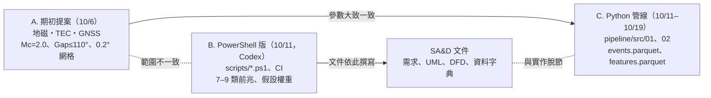
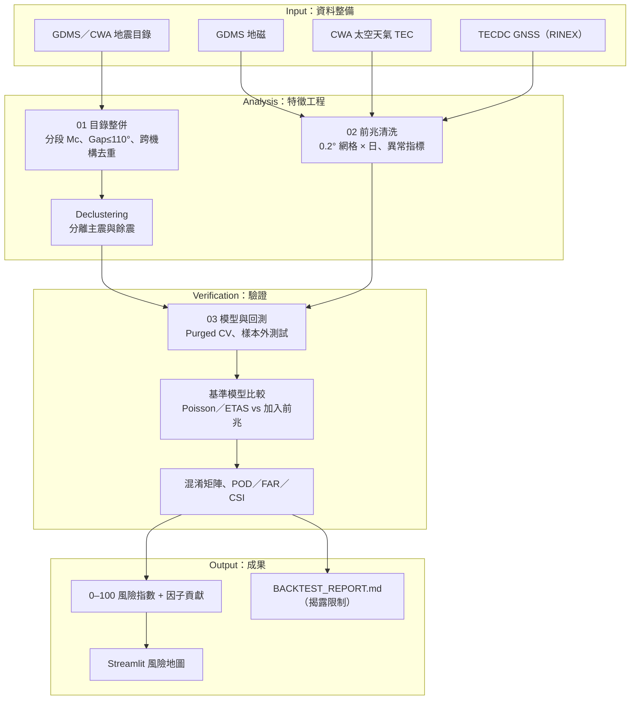

# 專案概況：基於地球物理與多維觀測資料打造地震風險評估 APP

> 彙整日期：2026-11-02
> 彙整依據：期初提案 PDF、實務專題指導同意書、專案資料夾內所有文件與程式碼、系統分析與設計課程資料
> 標記說明：**[事實]** 已從檔案直接確認；**[推測]** 由檔案內容推論，尚待驗證

---

## 為什麼需要這份文件

本專案先前由 Codex 協作，前後產生了多批文件與程式碼，彼此之間沒有對齊。這份文件的目的是：

1. 以**期初提案**為基準，釐清目前「實際做到哪裡」。
2. 標出文件之間、文件與程式碼之間的**矛盾**。
3. 對照 SA&D 課程作業要求，列出**缺口**。
4. 提出有優先順序的**下一步**。

---

## 1. 專案基本資訊 [事實]

| 項目 | 內容 |
|---|---|
| 題目 | 基於地球物理與多維觀測資料打造地震風險評估 APP |
| 學生 | 謝其展 C113196134（實務專題限 1 人） |
| 指導教授 | 高瞻科技不分系學士學位學程 許介瑋 助理教授 |
| 研究目的 | 整合地震目錄與多維觀測資料，建立可量化、可驗證、具可解釋性的地震風險分析模型 |
| 研究動機 | 現有系統偏重「震後」即時警報，缺乏「震前」區域風險評估；民間地震前兆說法缺乏量化驗證 |
| 研究範圍 | 臺灣本島及周邊海域，1990–2026 |
| 研究步驟 | 資料整備 → 特徵工程 → 模型開發 → 系統整合 → 驗證迭代 |

### 1.1 提案指定的資料來源

| 類別 | 來源 |
|---|---|
| 地震目錄 | 中央氣象署（CWA）歷史地震目錄、GDMS |
| 地磁場 | 臺灣地震與地球物理資料管理系統（GDMS） |
| 電離層全電子含量（TEC） | 中央氣象署 太空天氣作業辦公室 |
| 大地觀測（GNSS） | 台灣地震科學中心（TECDC）資料中心 |

### 1.2 提案中已完成的分析結論

| 主題 | 結論 |
|---|---|
| 完備規模 | Mc = 2.0，不考慮更小的地震 |
| 定位品質 | 方位角空隙（Gap）門檻 200° → 110° |
| 空間尺度 | 空間自相關約 54.6 km → 切成 0.2° × 0.2° 網格 |
| 深度 | 約 90% 地震集中在地殼，鎖定淺層地震 |
| 能量分布 | 前 1% 地震佔近 99% 總能量 → 聚焦 M6+ |
| 群聚性 | 係數 k = 0.658 < 1 → 納入群聚連鎖機制 |
| 驗證對象 | 以 921 等重大強震做回測 |

### 1.3 提案的預期成果

1. 整合式特徵資料集（統一時空網格）
2. 區域風險指數模型（0–100，並視覺化各因子貢獻）
3. 自我驗證報告（歷史大地震盲測、命中率／誤報率）
4. 民間前兆假說的量化驗證
5. 互動式 APP（全台網格風險地圖、趨勢圖、因子解讀）
6. 期末海報、簡報、報告

---

## 2. 目前存在的三條路線



| 路線 | 內容 | 與提案一致嗎 |
|---|---|---|
| **A. 提案** | 見第 1 節 | 基準 |
| **B. PowerShell 版** | [scripts/](../scripts)、[README.md](../README.md)、[SKILLS.md](../SKILLS.md)、[CI](../.github/workflows/risk-assessment.yml)、[docs/uml/](uml)、[docs/analysis/](analysis)、[Chapter01/](../Chapter01) | ❌ 前兆擴大為 7–9 類（加入地下水、氣壓、雨量、潮汐、地殼應變），權重為假設值 |
| **C. Python 管線** | [01_build_catalog.py](../pipeline/src/01_build_catalog.py)、[02_clean_features.py](../pipeline/src/02_clean_features.py) | ✅ 參數大致對齊（Gap 門檻除外） |

**核心問題 [事實]**：所有 SA&D 文件都以路線 B 為基礎，實際在推進的是路線 C，所以文件描述的系統和程式碼對不起來。

---

## 3. 各模組現況

### 3.1 資料

| 資料 | 位置 | 狀態 |
|---|---|---|
| GDMS 地震目錄（906,918 筆，1990-01 ~ 2026-07） | [earthquake_data/raw/](../earthquake_data/raw)、`GDMS地震目錄/`、[GDMS_merged_all.xlsx](../earthquake_data/processed/GDMS_merged_all.xlsx) | ✅ 已取得 [事實] |
| CWA XML 目錄（1990–2025） | [E-A0073-002/](../E-A0073-002) | ✅ 已取得 [事實] |
| CWA 地震活動彙整 CSV（16,747 筆） | [earthquake_data/processed/](../earthquake_data/processed) | ✅ 已取得；**Big5 編碼、中文欄名** [事實] |
| USGS 目錄 CSV（6,162 筆） | 同上 | ✅ 已取得 [事實] |
| GNSS RINEX（7 個 `.24o` 檔） | `地震預測/測地法/GNSS_ETEC/` | ⚠️ 只有原始觀測檔，尚未解析 [事實] |
| 地磁、TEC 與其他前兆 | `地震預測/` 其餘 9 個子資料夾 | ❌ **全部為空** [事實] |

### 3.2 探索性分析 [事實]

[GDMS_analysis_report.md](<../earthquake_data/資料分析/GDMS_analysis_report.md>) 是目前學術價值最高的產出，重點如下：

- 全部事件數逐年上升，但 ML≥3、ML≥4 的趨勢**不顯著**，所以「地震變多」不等於「大地震變多」。
- 年平均 ML 下降、平均深度增加，比較像**偵測能力變化**留下的痕跡，不是地殼物理變化。
- Mc 隨年代變動（1990s ≈ 2.25、2010s ≈ 1.35），**不宜全期間套用單一 Mc**。
- b 值對 Mc 門檻非常敏感（0.765 ~ 0.937）。
- 建議的流程：分段 Mc → declustering → ETAS／Poisson／NB 比較，不直接套 ARIMA 或黑箱 ML。

> ⚠️ 這份報告建議不要用單一 Mc，但提案和 `01_build_catalog.py` 都把 Mc 固定為 2.0。1990 年代的 Mc 約 2.25，固定用 2.0 會讓早期資料不完整 [推測]。

### 3.3 程式碼

| 檔案 | 狀態 | 問題 |
|---|---|---|
| [01_build_catalog.py](../pipeline/src/01_build_catalog.py) | 已產出 `events.parquet`（約 8 MB） | Gap 門檻寫 **160**，提案與甘特圖都是 **110** [事實]；CWA 與 GDMS 用「時間取到分鐘＋經緯度取到小數 4 位＋規模取到 0.1」去重，兩個機構的定位結果不同，**幾乎去不掉重複** [推測] |
| [02_clean_features.py](../pipeline/src/02_clean_features.py) | 已產出 `features.parquet`（約 14 KB） | 只讀 CSV，不讀 RINEX；前兆資料夾為空時會進入 `np.random.rand()` 的假資料分支，且沒有設定亂數種子 [事實]。因此現有 `features.parquet` **高度可能是隨機假資料** [推測，尚未用 pandas 驗證] |
| `03_train_backtest.py` | ❌ 不存在 | 甘特圖原排在 10/17–10/20 |
| [scripts/*.ps1](../scripts) | ❌ 無法執行 | 見下表 |
| [risk-assessment.yml](../.github/workflows/risk-assessment.yml) | ❌ 會失敗 | 資料沒進版控，第一步就會中止；`outputs\**` 在 Ubuntu runner 上是 Windows 路徑寫法 |
| [notebooks/analysis.ipynb](../notebooks/analysis.ipynb) | 只有樣板 | 依賴不存在的 `outputs/risk_scores.csv` |

PowerShell 腳本的具體問題 [事實]：

| 腳本 | 問題 |
|---|---|
| `Import-EarthquakeCatalog.ps1` | 預設讀 `CWA_catalog.csv`，這個檔不存在；`-Not $x -contains $_` 因運算子優先順序，永遠檢查不出缺少的欄位 |
| `Compute-Baseline.ps1` | 對整個陣列呼叫 `[datetime]::ParseExact`，會丟出例外 |
| `Ingest-Precursors.ps1` | 讀 `precursor_data/` 底下的 7 個 CSV，這些檔案都不存在 |
| `Risk-Scoring.ps1` | 權重是假設值，沒有經過歷史資料校準 |

### 3.4 方法上的疑點 [推測]

- `02_clean_features.py` 用 `risk × (1 + 0.658 × risk / 100)` 把 k 當成放大係數，沒有物理或統計依據。
- 提案寫的「布爾係數 k = 0.658」可能是指 **Weibull 形狀參數**（k < 1 代表時間上的群聚）。建議確認用詞與計算方式。
- 用 min-max 正規化後加權平均，會讓單一極端值主導整個欄位。缺值補 0 則會被當成「低風險」，而不是「未知」。

### 3.5 版本控制 [事實]

- 只有 1 個 commit：`2ac601d Initial commit: AGENTS.md and .gitignore`。
- 其他檔案（包含所有程式、文件、資料）都**還沒追蹤**。
- 有大型檔案：GDMS CSV 合計約 75 MB、XML、parquet、`node_modules/`。加入版控前要先調整 `.gitignore`，或改用 Git LFS。

---

## 4. 文件之間的矛盾與錯誤

| 類別 | 內容 | 檔案 |
|---|---|---|
| 範圍矛盾 | 需求規格寫「不包含實時地震警報功能」，UI 流程卻有「警報設定 → 通知紀錄」 | [需求規格說明](<../Chapter01/需求規格說明.md>)、[使用者介面流程](<../Chapter08/使用者介面流程.mmd>) |
| 資料來源 | 寫「國防部地磁觀測站」「FORMOSAT-5/COSMIC TEC」，提案是 GDMS 與 CWA 太空天氣辦公室 | [資料字典](uml/09_data_dictionary.md)、[元件圖](uml/05_component_diagram.mmd) |
| 機構錯誤 | 「WRA Geomagnetic」：WRA 是水利署，不負責地磁 | [use_case_diagram.mmd](../Chapter01/use_case_diagram.mmd) |
| 驗收標準 | 「命中率 > 60%、漏報率 < 30%」沒有依據，提案中也沒有 | [需求規格表](uml/08_requirements_table.md) |
| 驗證門檻 | 需求寫 M≥5.5，提案聚焦 M6+，甘特圖寫「4 大地震盲測」 | 多處 |
| 技術選型 | 需求 NF1 指定 PowerShell，甘特圖規劃 Python + LightGBM + Streamlit | [需求規格說明](<../Chapter01/需求規格說明.md>)、`專題進度甘特圖.xlsx` |
| Mermaid 語法 | ERD 的 `\|\|\|..\|{` 不合法，且全部是 1:1 關係 | [實體關係圖](<../Chapter08/實體關係圖.mmd>) |
| Mermaid 語法 | `useCaseDiagram` 不是 Mermaid 支援的圖種 | [chapter6.md](../chapter6/chapter6.md) |
| 用字 | 表頭用簡體字（过程编号、输入、输出） | [處理規範表](<../Chapter08/處理規範表.md>) |
| 錯字 | 前騨（前驅）、特影（特徵）、貨獲（貢獻）、視覚化、触發 | [狀態機圖](uml/07_state_machine_diagram.mmd) |
| 殘留字元 | 開頭與結尾殘留 `$@`、`@`、`$` | [README.md](../README.md)、[需求規格說明](<../Chapter01/需求規格說明.md>)、[use_case_diagram.mmd](../Chapter01/use_case_diagram.mmd) |
| 重複與亂碼 | 兩份報告內容幾乎相同，且有 `arthquake_data`、`eport_figures` 等跳脫字元造成的缺字 | [final_report.md](../final_report.md)、[project_report.md](../project_report.md) |

### 4.1 根目錄雜物 [事實]

| 類型 | 檔案 |
|---|---|
| PDF 抽字暫存 | `chapter*_pages*.txt`、`chapter*_pdfplumber_*.txt`、`pages*.txt`、`chapter6_raw.txt` |
| 執行紀錄 | `output*.txt`、`output.log`、`tree.txt`（1.4 MB） |
| 測試腳本 | `test_write.py`、`test_write2.py`、`check_path.py`、`path_check.py`、`gen.js` |
| 暫存圖 | `temp.mmd`、`temp.png`、`temp_mermaid/`、`page-01.png` |
| 廢棄簡報 | `丟掉.pptx`、`丟掉2.pptx`、`丟掉3.pptx` |
| 重複檔 | `圖3-5`、`圖3-6`、`圖3-7`、`圖3-12` 各有兩個版本；`測地法/`、`GDMSdata/` 與 `地震預測/測地法/` 內容重複 |
| 空資料夾 | `新增資料夾/`、`專案檔案/`、`outputs/` |
| 課堂筆記 | `Chapter02/`、`Chapter05/`、`Chapter07/`、`圖3-x`、Scrum／XP／RUP／OOP 表，和專題成果混在一起 |

---

## 5. 進度對照

### 5.1 甘特圖進度（以 2026-11-02 為準）[事實]

| 編號 | 任務 | 原訂期限 | 狀態 |
|---|---|---|---|
| A1–A4 | 資料蒐集、GDMS 分析、文獻歸檔、提案 | 9/30 | ✅ 完成 |
| B1 | `01_build_catalog.py` | 10/13 | 🔄 進行中（已有產出，Gap 門檻待修正） |
| B2 | `02_clean_features.py`（地磁／TEC／GNSS） | 10/16 | ⏳ 程式框架已有，**缺真實資料** |
| B3 | `03_train_backtest.py`（LightGBM／Logistic + Purged CV） | 10/20 | ❌ 未開始 |
| C1 | `BACKTEST_REPORT.md`（混淆矩陣、POD／FAR／CSI） | 10/24 | ❌ 未開始 |
| C2 | Streamlit MVP | 10/27 | ❌ 未開始 |
| D1 | Git 初始化、README、`requirements.txt` | 10/12 | ⚠️ repo 已建，檔案未追蹤，沒有 `requirements.txt` |
| D2 | 口試 QA 卡片 | 11/03 | ❌ 未開始 |

**結論**：B2 之後的任務大約落後 2–3 週。

### 5.2 SA&D 課程小組作業對照

> 假設：SA&D 課程的小組專題沿用本題目。如果不是，這一節可以略過。

| 作業 | 要求 | 現況 | 缺口 |
|---|---|---|---|
| 作業 1 | 組員、題目、內容 | ⚠️ | README 缺姓名與正式題目 |
| 作業 2 | 分工、甘特圖、PERT/CPM | ⚠️ | 缺專題的 PERT/CPM 圖 |
| 作業 3 | FR／NFR 各 ≥3、功能分解圖（FDD）、用例圖、≥3 個用例說明 | ⚠️ | 缺 FDD 與**文字版用例說明** |
| 作業 4 | `dfd.md`：系統環境圖 + DFD 0 層（≥3 個程序） | ⚠️ | 只有 `.mmd`，沒有 `dfd.md`；畫法是流程圖，不是 DFD 記號 |
| 作業 5 | `hw5.md`：類別圖，每個用例各一張循序圖與活動圖 | ⚠️ | 循序圖、活動圖各只有 1 張，且以整條管線為單位 |
| 作業 6 | `hw6.md`：分鏡板，含欄位型態與驗證規則 | ❌ | 沒有 |
| 作業 7 | `hw7.md`：ERD，含 ≥2 個組合實體 | ❌ | 現有 ERD 語法錯誤、沒有組合實體 |
| 期末 | 展示至少一個核心功能，含 UI 與 ERD | ❌ | Streamlit MVP 未開始 |

---

## 6. 建議的目標架構

以提案為準、以 Python 管線為主，保留可驗證性：



**設計理由**：

- **加入基準模型比較**：要證明前兆「有用」，必須比只用地震目錄的統計模型（Poisson／ETAS）表現更好。只回報命中率，無法排除「大地震本來就集中在活躍區」的效應。
- **先做 declustering**：餘震序列會讓命中率虛高（大震之後本來就有一連串地震）。
- **Purged CV**：時間序列資料若隨機切分，會把未來資訊洩漏到訓練集。
- **缺值標示成「未知」，不補 0**：前兆資料在時空上都很稀疏，補 0 會被模型解讀成「低異常」。

---

## 7. 建議的下一步

| 優先 | 工作 | 理由 | 預估工作量 |
|---|---|---|---|
| 1 | **定範圍**：前兆只做地磁、TEC、GNSS；PowerShell 版退場，改以 Python 管線為主 | 消除所有文件矛盾的根源 | 低 |
| 2 | **驗證 `features.parquet`**，並把 Gap 門檻改成 110 | 避免把假資料帶進後續分析 | 低 |
| 3 | **取得地磁與 TEC 資料**、加上 RINEX 解析 | B2／B3 唯一的阻礙 | 中–高 |
| 4 | **依 Python 管線重寫 SA&D 文件**，補齊作業 3–7 的缺口 | 課程評分需要，且文件要和實作一致 | 中 |
| 5 | **整理根目錄並建立版控**：課堂筆記移到 `coursework/`、清除暫存檔、大型資料加入 `.gitignore` 或改用 LFS、補上 `requirements.txt` | 可重現性、可維護性 | 低 |
| 6 | 實作 `03_train_backtest.py` 與 `BACKTEST_REPORT.md` | 提案的核心成果 | 高 |
| 7 | Streamlit MVP | 期末展示需要 | 中 |

### 7.1 建議的資料夾結構

```text
破專題/
├── README.md                # 專案總說明（以提案為準）
├── AGENTS.md / SKILLS.md
├── requirements.txt
├── docs/
│   ├── PROJECT_OVERVIEW.md  # 本文件
│   ├── proposal/            # 提案 PDF、PPTX、同意書
│   ├── analysis/            # 需求、可行性、利害關係人、DFD
│   ├── design/              # UML、ERD、分鏡板
│   └── reports/             # GDMS 分析、回測報告
├── pipeline/
│   ├── src/                 # 01_、02_、03_ 管線程式
│   └── data/                # 中間產物（不進版控）
├── data/
│   ├── raw/                 # 原始資料（不進版控，附下載說明）
│   └── processed/
├── app/                     # Streamlit
├── references/              # 地震預測文獻 PDF
└── coursework/              # SA&D 課堂筆記與練習
```

---

## 8. 待確認事項

| 問題 | 為什麼重要 |
|---|---|
| SA&D 小組專題是否沿用本題目？ | 決定第 5.2 節的作業缺口是否需要補 |
| 「布爾係數 k = 0.658」的正式名稱與計算方式 | 口試時可能被問到；目前程式的使用方式沒有依據 |
| 最終交付是手機 APP 還是 Web（Streamlit）？ | 提案寫 APP，甘特圖寫 Streamlit |
| 驗證門檻是 M≥5.5 還是 M6+？ | 影響樣本數與統計檢定力 |
| GDMS 地磁與 CWA TEC 資料的取得方式與授權 | 決定 B2 能否進行 |
