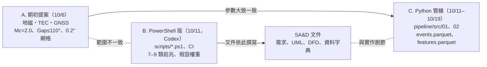
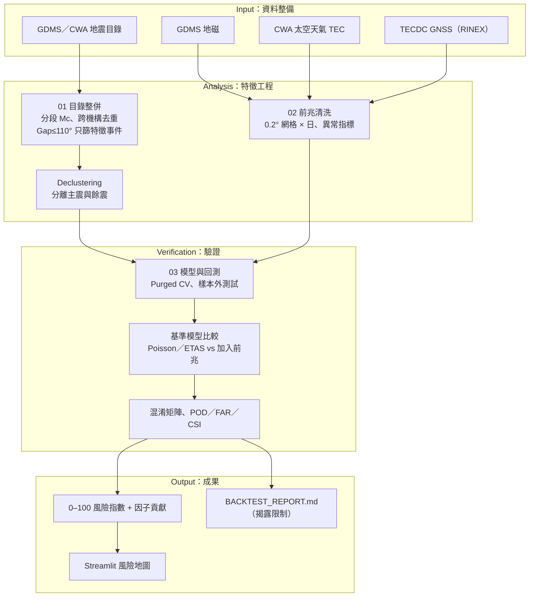

# 專案概況：基於地球物理與多維觀測資料打造地震風險評估 APP

> 彙整日期：2026-11-02（同日更新：加入範圍決定與第一輪修正結果，見第 8、9 節；第二輪：B3 基準模型、太空天氣指數、NDH5 TEC 個案，見第 10 節）
> 彙整依據：期初提案 PDF、實務專題指導同意書、專案資料夾內所有文件與程式碼、系統分析與設計課程資料
> 標記說明：**[事實]** 已從檔案直接確認；**[推測]** 由檔案內容推論，尚待驗證

---

## 為什麼需要這份文件

本專案先前由 Codex 協作，前後產生了多批文件與程式碼，彼此之間沒有對齊。這份文件的目的是：

1. 以**期初提案**為基準，釐清目前「實際做到哪裡」。
2. 標出文件之間、文件與程式碼之間的**矛盾**。
3. 對照 SA&D 課程作業要求，列出**缺口**。
4. 提出有優先順序的**下一步**。

---

## 1. 專案基本資訊 [事實]

| 項目 | 內容 |
|---|---|
| 題目 | 基於地球物理與多維觀測資料打造地震風險評估 APP |
| 學生 | 謝其展 C113196134（實務專題限 1 人） |
| 指導教授 | 高瞻科技不分系學士學位學程 許介瑋 助理教授 |
| 研究目的 | 整合地震目錄與多維觀測資料，建立可量化、可驗證、具可解釋性的地震風險分析模型 |
| 研究動機 | 現有系統偏重「震後」即時警報，缺乏「震前」區域風險評估；民間地震前兆說法缺乏量化驗證 |
| 研究範圍 | 臺灣本島及周邊海域，1990–2026 |
| 研究步驟 | 資料整備 → 特徵工程 → 模型開發 → 系統整合 → 驗證迭代 |

### 1.1 提案指定的資料來源

| 類別 | 來源 |
|---|---|
| 地震目錄 | 中央氣象署（CWA）歷史地震目錄、GDMS |
| 地磁場 | 臺灣地震與地球物理資料管理系統（GDMS） |
| 電離層全電子含量（TEC） | 中央氣象署 太空天氣作業辦公室 |
| 大地觀測（GNSS） | 台灣地震科學中心（TECDC）資料中心 |

### 1.2 提案中已完成的分析結論

| 主題 | 結論 |
|---|---|
| 完備規模 | Mc = 2.0，不考慮更小的地震 |
| 定位品質 | 方位角空隙（Gap）門檻 200° → 110° |
| 空間尺度 | 空間自相關約 54.6 km → 切成 0.2° × 0.2° 網格 |
| 深度 | 約 90% 地震集中在地殼，鎖定淺層地震 |
| 能量分布 | 前 1% 地震佔近 99% 總能量 → 聚焦 M6+ |
| 群聚性 | 係數 k = 0.658 < 1 → 納入群聚連鎖機制 |
| 驗證對象 | 以 921 等重大強震做回測 |

### 1.3 提案的預期成果

1. 整合式特徵資料集（統一時空網格）
2. 區域風險指數模型（0–100，並視覺化各因子貢獻）
3. 自我驗證報告（歷史大地震盲測、命中率／誤報率）
4. 民間前兆假說的量化驗證
5. 互動式 APP（全台網格風險地圖、趨勢圖、因子解讀）
6. 期末海報、簡報、報告

---

## 2. 目前存在的三條路線



| 路線 | 內容 | 與提案一致嗎 |
|---|---|---|
| **A. 提案** | 見第 1 節 | 基準 |
| **B. PowerShell 版** | [scripts/](../scripts)、[README.md](../README.md)、[SKILLS.md](../SKILLS.md)、[CI](../.github/workflows/risk-assessment.yml)、[docs/uml/](uml)、[docs/analysis/](analysis)、[Chapter01/](../Chapter01) | ❌ 前兆擴大為 7–9 類（加入地下水、氣壓、雨量、潮汐、地殼應變），權重為假設值 |
| **C. Python 管線** | [01_build_catalog.py](../pipeline/src/01_build_catalog.py)、[02_clean_features.py](../pipeline/src/02_clean_features.py) | ✅ 參數大致對齊（Gap 門檻除外） |

**核心問題 [事實]**：所有 SA&D 文件都以路線 B 為基礎，實際在推進的是路線 C，所以文件描述的系統和程式碼對不起來。

---

## 3. 各模組現況

### 3.1 資料

| 資料 | 位置 | 狀態 |
|---|---|---|
| GDMS 地震目錄（906,918 筆，1990-01 ~ 2026-07） | [earthquake_data/raw/](../earthquake_data/raw)、`GDMS地震目錄/`、[GDMS_merged_all.xlsx](../earthquake_data/processed/GDMS_merged_all.xlsx) | ✅ 已取得 [事實] |
| CWA XML 目錄（1990–2025） | [E-A0073-002/](../E-A0073-002) | ✅ 已取得 [事實] |
| CWA 地震活動彙整 CSV（16,747 筆） | [earthquake_data/processed/](../earthquake_data/processed) | ✅ 已取得；**Big5 編碼、中文欄名** [事實] |
| USGS 目錄 CSV（6,162 筆） | 同上 | ✅ 已取得 [事實] |
| GNSS RINEX（7 個 `.24o` 檔，NDH5，2024-04-01～07） | `地震預測/測地法/GNSS_ETEC/` | ✅ 已轉成 VTEC（`pipeline/data/tec/`），見第 10 節 [事實] |
| 太空天氣指數（Kp、ap、Dst、AE、F10.7、SN，1990 至今） | `地震預測/太空天氣指數/raw/` → `pipeline/data/space_weather_*.parquet` | ✅ 已下載（GFZ、NASA OMNI2）[事實] |
| 地磁、TEC 與其他前兆 | `地震預測/` 其餘 9 個子資料夾 | ❌ **全部為空**（申請中）[事實] |

### 3.2 探索性分析 [事實]

[GDMS_analysis_report.md](<../earthquake_data/資料分析/GDMS_analysis_report.md>) 是目前學術價值最高的產出，重點如下：

- 全部事件數逐年上升，但 ML≥3、ML≥4 的趨勢**不顯著**，所以「地震變多」不等於「大地震變多」。
- 年平均 ML 下降、平均深度增加，比較像**偵測能力變化**留下的痕跡，不是地殼物理變化。
- Mc 隨年代變動（1990s ≈ 2.25、2010s ≈ 1.35），**不宜全期間套用單一 Mc**。
- b 值對 Mc 門檻非常敏感（0.765 ~ 0.937）。
- 建議的流程：分段 Mc → declustering → ETAS／Poisson／NB 比較，不直接套 ARIMA 或黑箱 ML。

> ⚠️ 這份報告建議不要用單一 Mc，但提案和 `01_build_catalog.py` 都把 Mc 固定為 2.0。1990 年代的 Mc 約 2.25，固定用 2.0 會讓早期資料不完整 [推測]。

### 3.3 程式碼

| 檔案 | 狀態 | 問題 |
|---|---|---|
| [01_build_catalog.py](../pipeline/src/01_build_catalog.py) | ✅ 已修正並重新產出 `events.parquet` | 原本 Gap 門檻寫 160、CWA 時間沒轉 UTC（差 8 小時）導致跨來源完全去不掉重複 [事實，已修正，見第 9 節] |
| [02_clean_features.py](../pipeline/src/02_clean_features.py) | ⚠️ 程式已修正，**缺真實資料** | 原本的 `features.parquet` **確認是隨機假資料**（10 筆、單一網格、0–1 亂數）[事實]。現在沒有資料時會直接報錯；`--demo` 才產生固定種子的示範資料。只讀 CSV，RINEX 仍需先轉換 |
| [03_train_backtest.py](../pipeline/src/03_train_backtest.py) | ✅ B3 基準模型已完成 | 見第 10 節 |
| [scripts/*.ps1](../scripts) | ❌ 無法執行 | 見下表 |
| [risk-assessment.yml](../.github/workflows/risk-assessment.yml) | ✅ 已改寫 | `tests` job 在 push／PR 時以合成資料跑單元測試；PowerShell 流程改為手動觸發，缺資料時明確中止。原版引用不存在的 `powershell/setup-powershell` action，第一步就失敗 [事實] |
| [notebooks/analysis.ipynb](../notebooks/analysis.ipynb) | 只有樣板 | 依賴不存在的 `outputs/risk_scores.csv` |

PowerShell 腳本的具體問題 [事實]：

| 腳本 | 問題 |
|---|---|
| `Import-EarthquakeCatalog.ps1` | 預設讀 `CWA_catalog.csv`，這個檔不存在；`-Not $x -contains $_` 因運算子優先順序，永遠檢查不出缺少的欄位 |
| `Compute-Baseline.ps1` | 對整個陣列呼叫 `[datetime]::ParseExact`，會丟出例外 |
| `Ingest-Precursors.ps1` | 讀 `precursor_data/` 底下的 7 個 CSV，這些檔案都不存在 |
| `Risk-Scoring.ps1` | 權重是假設值，沒有經過歷史資料校準 |

### 3.4 方法上的疑點 [推測]

- `02_clean_features.py` 用 `risk × (1 + 0.658 × risk / 100)` 把 k 當成放大係數，沒有物理或統計依據。
- 程式註解寫「WBL k=0.658」，所以提案的「布爾係數」應該是 **Weibull 形狀參數 k** [推測]。
- 用 `events.parquet` 的相鄰地震間隔擬合 Weibull，**重現不出 0.658** [事實]：

  | 資料 | ML≥4 | ML≥5 | ML≥5.5 | ML≥6 |
  |---|---|---|---|---|
  | GDMS | 0.427 | 0.420 | 0.414 | 0.429 |
  | CWA XML | 0.499 | 0.505 | 0.514 | 0.540 |

- 第二輪重新驗證（研究區 21–26°N、119–123°E，去群聚前後）[事實]：ML≥5.5 原始 k = 0.483、去群聚後 0.972；ML≥6.0 原始 0.486、去群聚後 0.953。**仍然沒有任何子集落在 0.658 附近**，建議報告與口試不再引用 0.658，改用可重現的值並註明子集與方法（見 [B3 報告第 2 節](reports/b3_baseline/README.md)）。
- Weibull k 的意義 [理論]：**k = 1 是完全隨機（Poisson）**；**k < 1 代表群聚**，k 越小、群聚越明顯（大地震後短時間內接連發生很多地震，例如 921 的餘震序列）；k > 1 則代表接近週期性。所以「越接近 1 越像 921」是**反過來**的。
- 用 min-max 正規化後加權平均，會讓單一極端值主導整個欄位。缺值補 0 則會被當成「低風險」，而不是「未知」。

### 3.5 版本控制 [事實]

- `main` 只有 1 個 commit：`2ac601d Initial commit: AGENTS.md and .gitignore`，主資料夾的其他檔案都還沒追蹤。
- 分支 `claude/project-overview-consolidation-4ec507` 已收錄程式、文件與課堂筆記（不含資料），`.gitignore` 排除原始資料、parquet、RINEX、Office 與 PDF。
- 主資料夾的資料合計約 500 MB（`地震預測/` 170 MB、`earthquake_data/` 151 MB、`GDMS地震目錄/` 73 MB…），一律不進 git；程式改用環境變數 `EQ_DATA_DIR` 指向資料位置。

---

## 4. 文件之間的矛盾與錯誤

| 類別 | 內容 | 檔案 |
|---|---|---|
| 範圍矛盾 | 需求規格寫「不包含實時地震警報功能」，UI 流程卻有「警報設定 → 通知紀錄」 | [需求規格說明](<../Chapter01/需求規格說明.md>)、[使用者介面流程](<../Chapter08/使用者介面流程.mmd>) |
| 資料來源 | 寫「國防部地磁觀測站」「FORMOSAT-5/COSMIC TEC」，提案是 GDMS 與 CWA 太空天氣辦公室 | [資料字典](uml/09_data_dictionary.md)、[元件圖](uml/05_component_diagram.mmd) |
| 機構錯誤 | 「WRA Geomagnetic」：WRA 是水利署，不負責地磁 | [use_case_diagram.mmd](../Chapter01/use_case_diagram.mmd) |
| 驗收標準 | 「命中率 > 60%、漏報率 < 30%」沒有依據，提案中也沒有 | [需求規格表](uml/08_requirements_table.md) |
| 驗證門檻 | 需求寫 M≥5.5，提案聚焦 M6+，甘特圖寫「4 大地震盲測」→ **已決定以 ML≥5.5 為準** | 多處 |
| 技術選型 | 需求 NF1 指定 PowerShell，甘特圖規劃 Python + LightGBM + Streamlit | [需求規格說明](<../Chapter01/需求規格說明.md>)、`專題進度甘特圖.xlsx` |
| ✅ Mermaid 語法 | ERD 的 `\|\|\|..\|{` 不合法（已修正）；全部是 1:1 關係（待重新設計） | [實體關係圖](<../Chapter08/實體關係圖.mmd>) |
| ✅ Mermaid 語法 | `useCaseDiagram` 不是 Mermaid 支援的圖種（已改用 flowchart） | [chapter6.md](../coursework/chapter6/chapter6.md) |
| ✅ Mermaid 語法 | 另有 10 張圖因標籤含括號、`note`、`componentDiagram` 等無法解析（已修正，54 張全數通過） | 多處 |
| ✅ 用字 | 表頭用簡體字（过程编号、输入、输出） | [處理規範表](<../Chapter08/處理規範表.md>) |
| ✅ 錯字 | 前騨（前驅）、特影（特徵）、貨獲（貢獻）、視覚化、触發；需求規格的「geez 震前」 | [狀態機圖](uml/07_state_machine_diagram.mmd) |
| ✅ 殘留字元 | 35 個檔案開頭殘留 `$`、`$@`，README 結尾殘留 `@` | 多處 |
| ✅ 年代錯誤 | 圖 3-2 的 OOP 語言順序把 Python 排在 Java 後、Kotlin 排在 Swift 後 | [圖3-2](<../coursework/ch03/圖3-2_物件導向程式發展歷史.mmd>) |
| 重複與亂碼 | 兩份報告內容幾乎相同，且有 `arthquake_data`、`eport_figures` 等跳脫字元造成的缺字（已被本文件取代，未收進分支） | 主資料夾 `final_report.md`、`project_report.md` |

### 4.1 根目錄雜物 [事實]

> 分支上已不含這些檔案；主資料夾裡仍然存在，等合併時再處理（見第 9.4 節）。

| 類型 | 檔案 |
|---|---|
| PDF 抽字暫存 | `chapter*_pages*.txt`、`chapter*_pdfplumber_*.txt`、`pages*.txt`、`chapter6_raw.txt` |
| 執行紀錄 | `output*.txt`、`output.log`、`tree.txt`（1.4 MB） |
| 測試腳本 | `test_write.py`、`test_write2.py`、`check_path.py`、`path_check.py`、`gen.js` |
| 暫存圖 | `temp.mmd`、`temp.png`、`temp_mermaid/`、`page-01.png` |
| 廢棄簡報 | `丟掉.pptx`、`丟掉2.pptx`、`丟掉3.pptx` |
| 重複檔 | `圖3-5`、`圖3-6`、`圖3-7`、`圖3-12` 各有兩個版本；`測地法/`、`GDMSdata/` 與 `地震預測/測地法/` 內容重複 |
| 空資料夾 | `新增資料夾/`、`專案檔案/`、`outputs/` |
| 課堂筆記 | `Chapter02/`、`Chapter05/`、`Chapter07/`、`圖3-x`、Scrum／XP／RUP／OOP 表，和專題成果混在一起 |

---

## 5. 進度對照

### 5.1 甘特圖進度（以 2026-11-02 為準）[事實]

| 編號 | 任務 | 原訂期限 | 狀態 |
|---|---|---|---|
| A1–A4 | 資料蒐集、GDMS 分析、文獻歸檔、提案 | 9/30 | ✅ 完成 |
| B1 | `01_build_catalog.py` | 10/13 | 🔄 進行中（已有產出，Gap 門檻待修正） |
| B2 | `02_clean_features.py`（地磁／TEC／GNSS） | 10/16 | 🔄 程式完成並以 2026-10 實際資料驗證（2026-11-08）；**待下載 2018–2026 代表站資料**，清單見 [b2_download_plan](b2_download_plan/README.md) |
| B3 | `03_train_backtest.py`（LightGBM／Logistic + Purged CV） | 10/20 | ✅ 基準模型完成（只用目錄；Logistic + purge；LightGBM 留待加入前兆後再評估） |
| C1 | `BACKTEST_REPORT.md`（混淆矩陣、POD／FAR／CSI） | 10/24 | 🔄 基準部分完成：[docs/reports/b3_baseline/](reports/b3_baseline/README.md)；前兆比較待 B2 |
| C2 | Streamlit MVP | 10/27 | ❌ 未開始 |
| D1 | Git 初始化、README、`requirements.txt` | 10/12 | ⚠️ repo 已建，檔案未追蹤，沒有 `requirements.txt` |
| D2 | 口試 QA 卡片 | 11/03 | ❌ 未開始 |

**結論**：B2 之後的任務大約落後 2–3 週。

### 5.2 SA&D 課程小組作業對照

> 假設：SA&D 課程的小組專題沿用本題目。如果不是，這一節可以略過。

| 作業 | 要求 | 現況 | 缺口 |
|---|---|---|---|
| 作業 1 | 組員、題目、內容 | ⚠️ | README 缺姓名與正式題目 |
| 作業 2 | 分工、甘特圖、PERT/CPM | ⚠️ | 缺專題的 PERT/CPM 圖 |
| 作業 3 | FR／NFR 各 ≥3、功能分解圖（FDD）、用例圖、≥3 個用例說明 | ⚠️ | 缺 FDD 與**文字版用例說明** |
| 作業 4 | `dfd.md`：系統環境圖 + DFD 0 層（≥3 個程序） | ⚠️ | 只有 `.mmd`，沒有 `dfd.md`；畫法是流程圖，不是 DFD 記號 |
| 作業 5 | `hw5.md`：類別圖，每個用例各一張循序圖與活動圖 | ⚠️ | 循序圖、活動圖各只有 1 張，且以整條管線為單位 |
| 作業 6 | `hw6.md`：分鏡板，含欄位型態與驗證規則 | ❌ | 沒有 |
| 作業 7 | `hw7.md`：ERD，含 ≥2 個組合實體 | ❌ | 現有 ERD 語法錯誤、沒有組合實體 |
| 期末 | 展示至少一個核心功能，含 UI 與 ERD | ❌ | Streamlit MVP 未開始 |

---

## 6. 建議的目標架構

以提案為準、以 Python 管線為主，保留可驗證性：



**設計理由**：

- **加入基準模型比較**：要證明前兆「有用」，必須比只用地震目錄的統計模型（Poisson／ETAS）表現更好。只回報命中率，無法排除「大地震本來就集中在活躍區」的效應。
- **先做 declustering**：餘震序列會讓命中率虛高（大震之後本來就有一連串地震）。
- **Purged CV**：時間序列資料若隨機切分，會把未來資訊洩漏到訓練集。
- **缺值標示成「未知」，不補 0**：前兆資料在時空上都很稀疏，補 0 會被模型解讀成「低異常」。

---

## 7. 建議的下一步

| 優先 | 工作 | 理由 | 預估工作量 |
|---|---|---|---|
| 1 | **定範圍**：前兆只做地磁、TEC、GNSS；PowerShell 版退場，改以 Python 管線為主 | 消除所有文件矛盾的根源 | 低 |
| 2 | **驗證 `features.parquet`**，並把 Gap 門檻改成 110 | 避免把假資料帶進後續分析 | 低 |
| 3 | **取得地磁與 TEC 資料**、加上 RINEX 解析 | B2／B3 唯一的阻礙 | 中–高 |
| 4 | **依 Python 管線重寫 SA&D 文件**，補齊作業 3–7 的缺口 | 課程評分需要，且文件要和實作一致 | 中 |
| 5 | **整理根目錄並建立版控**：課堂筆記移到 `coursework/`、清除暫存檔、大型資料加入 `.gitignore` 或改用 LFS、補上 `requirements.txt` | 可重現性、可維護性 | 低 |
| 6 | 實作 `03_train_backtest.py` 與 `BACKTEST_REPORT.md` | 提案的核心成果 | 高 |
| 7 | Streamlit MVP | 期末展示需要 | 中 |

### 7.1 建議的資料夾結構

```text
破專題/
├── README.md                # 專案總說明（以提案為準）
├── AGENTS.md / SKILLS.md
├── requirements.txt
├── docs/
│   ├── PROJECT_OVERVIEW.md  # 本文件
│   ├── proposal/            # 提案 PDF、PPTX、同意書
│   ├── analysis/            # 需求、可行性、利害關係人、DFD
│   ├── design/              # UML、ERD、分鏡板
│   └── reports/             # GDMS 分析、回測報告
├── pipeline/
│   ├── src/                 # 01_、02_、03_ 管線程式
│   └── data/                # 中間產物（不進版控）
├── data/
│   ├── raw/                 # 原始資料（不進版控，附下載說明）
│   └── processed/
├── app/                     # Streamlit
├── references/              # 地震預測文獻 PDF
└── coursework/              # SA&D 課堂筆記與練習
```

---

## 8. 決策紀錄與待確認事項

### 8.1 已決定（2026-11-02）

| 問題 | 決定 | 影響 |
|---|---|---|
| 前兆資料範圍 | 只用**地震電磁學**相關資料：地磁、地電流、電離層 TEC（GNSS 只用來推算 TEC） | 文件中的 GPS 形變、地下水、氣壓、雨量、潮汐、應變全部移除；`02_clean_features.py` 已改成只讀地磁與 TEC |
| 最終交付 | **手機 APP**，網頁版作為備用 | 分鏡板與 UI 設計以手機畫面為主 |
| 驗證門檻 | **ML ≥ 5.5** | 去重後共 443 筆目標事件 |
| Gap≤110° 的用途 | **只篩選特徵事件**，目標事件不論 Gap 都保留 | 保住 203 筆原本會被刪掉的 ML≥5.5 事件（173 筆在東部外海） |

### 8.2 尚待確認

| 問題 | 為什麼重要 |
|---|---|
| ~~k = 0.658 的來源~~ | 已重新驗證仍無法重現（第 3.4 節），建議停止引用 |
| SA&D 小組專題是否沿用本題目？ | 使用者回覆：SA&D 資料夾主要用於 UML 與視覺化，小組專題**可能**沿用本題目，尚未確定 |
| GDMS 地磁與 CWA TEC 資料的取得方式與授權 | 決定 B2 能否進行 |

---

## 9. 第一輪修正紀錄（2026-11-02）

### 9.1 `features.parquet` 是假資料 [事實]

10 筆、只有一個網格（22.0°N, 120.0°E）、2024-01-01 至 01-10，所有特徵都是 0–1 的亂數。原因是前兆資料夾全空，程式默默進入示範分支。現在沒有資料時會直接報錯。

### 9.2 `events.parquet` 的時區錯誤 [事實]

- CWA XML 的時間是台灣時間（`1999-09-21T01:47:16+08:00`），原程式直接切掉 `+08:00`；GDMS 是 UTC（`1999-09-20 17:47:15`）。
- 兩邊差 8 小時，跨來源去重完全失效：**ML≥5.5 的 488 筆 CWA 事件中有 247 筆和 GDMS 重複**，921 被算兩次。
- 修正後：先轉 UTC，再用「60 秒內、0.3° 內」判定同一事件，移除 72,222 筆 CWA 重複事件。

| 階段 | 全部事件 | ML≥5.5 |
|---|---|---|
| 修正前 `events.parquet`（Gap≤160、有重複） | 274,169 | 740 |
| 修正後、Gap 過濾前 | 403,934 | 443 |
| 修正後、Gap≤110 一律刪除（第一版） | 124,776 | 240 |
| **修正後、Gap 只篩特徵（目前版本）** | **124,979** | **443** |

第一版用 Gap≤110 刪除所有事件，會刪掉 203 筆 ML≥5.5，其中 173 筆在 121.5°E 以東（東部外海，測站方位涵蓋不足），包括 2004 年 ML 7.1（Gap 243°）與 1996 年 ML 7.07（Gap 186°）。目前版本改成：

- `use_for_features`：Gap≤110 或未知，共 124,776 筆，用來計算特徵。
- `is_target`：ML≥5.5、不論 Gap，共 443 筆，作為回測目標。
- Gap>110 且 ML<5.5 的 278,955 筆兩種用途都用不到，不輸出。

### 9.3 其他修正

| 項目 | 內容 |
|---|---|
| `02_clean_features.py` | 前兆只留地磁與 TEC；`--demo` 才產生假資料，且固定亂數種子、輸出到另一個檔名並標記 `is_demo` |
| 路徑 | 兩支程式都改用 `EQ_DATA_DIR` 讀資料，輸出到專案的 `pipeline/data/` |
| `requirements.txt` | 新增；以 Python 3.13 實測（3.15 alpha 沒有對應的 numpy） |
| `pipeline/README.md` | 新增執行說明與已知限制 |
| 文件 | 見第 4 節打 ✅ 的項目 |
| 課堂筆記 | 移到 `coursework/`；刪除重複的圖 3-12 與兩份重複的 `workflow.mmd` |

### 9.4 主資料夾尚未處理

這次的修改都在分支上。主資料夾的檔案還沒動，合併前需要：

1. 把主資料夾中和分支同名的未追蹤檔案（例如 `pipeline/src/*.py`、`Chapter01/`）先移到 `_archive/`，否則 `git merge` 會拒絕覆蓋。
2. 第 4.1 節的雜物也一起移到 `_archive/`（已在 `.gitignore` 中排除）。
3. 舊的 `pipeline/data/events.parquet` 有重複事件，合併後要重新執行 `01_build_catalog.py`。

---

## 10. 第二輪：B3 基準模型、太空天氣、NDH5 個案（2026-11-02）

### 10.1 B3 基準模型（只用地震目錄）[事實]

程式在 [pipeline/src/03_train_backtest.py](../pipeline/src/03_train_backtest.py) 與 [pipeline/src/eqforecast/](../pipeline/src/eqforecast)，
設計說明見 [pipeline/README.md](../pipeline/README.md)，完整數字見 [B3 報告](reports/b3_baseline/README.md)。

| 項目 | 決定 | 理由 |
|---|---|---|
| 目標 | 0.2° 網格 × 30 天預報窗內，有無 ML≥5.5 **去群聚後的主震** | 預報餘震太容易，會讓任何模型（包括前兆）看起來很準 |
| 去群聚 | Gardner–Knopoff，前震視窗 0.1 × T | 研究區 370 筆 ML≥5.5 → 128 筆主震；Weibull k 從 0.48 變成 0.97（接近隨機），代表群聚已移除 |
| 時間切分 | 訓練 1991–2012、驗證 2013–2017、測試 2018–2026/07；跨界的預報窗丟掉 | 避免時間洩漏；測試期含 2022 池上、2024 花蓮 |
| 警報 | 每個發布時間點，對分數前 τ 的網格發警報 | 不偷看未來的分數分布；不同模型在相同警報成本下比較 |
| 特徵 | ML≥3、只用 t0 之前的事件、以「占全區比例」表示 | ML≥3 高於各年代 Mc；比例抵銷測站變密造成的計數成長 |

**測試集結果（去群聚目標，37 個目標網格窗）**

| 模型 | ASS（隨機 = 0.5） | POD @ τ=5% | POD @ τ=10% |
|---|---|---|---|
| 隨機警報 | 0.494 | 0.00 | 0.05 |
| 相對強度 RI（長期活動度） | 0.775 | 0.16 | 0.30 |
| 邏輯斯迴歸（目錄特徵） | 0.770 | 0.11 | 0.38 |

- RI 與邏輯斯迴歸都顯著優於隨機（RI 相對隨機 ΔASS = +0.28，95% CI [+0.17, +0.40]）；兩者之間沒有顯著差異（ΔASS −0.006 [−0.027, +0.017]）。
- **不去群聚**時，邏輯斯迴歸的測試 ASS 從 0.770 升到 0.864，POD@5% 從 0.11 升到 0.37。這段差距就是「預報餘震」造成的虛胖。
- 自我檢查：加入純雜訊特徵 → ΔASS +0.002（不顯著）；加入用答案合成的作弊特徵 → ΔASS +0.072 [+0.030, +0.109]（顯著）。代表比較方法不會產生假發現，也有能力偵測真正的改善。
- 敏感度：0.5° 網格（ASS 0.75）、只取深度 ≤ 40 km（ASS 0.80）的結論相同，見 [b3_cell0p5](reports/b3_cell0p5/README.md)、[b3_shallow40](reports/b3_shallow40/README.md)。

**對前兆研究的意義 [推測]**：前兆模型要打敗的不是隨機，而是 ASS ≈ 0.77 的「長期活動度」基準。
在相同 τ 下，POD 必須顯著高於邏輯斯迴歸基準（McNemar），才能說前兆有額外資訊。

### 10.2 太空天氣指數 [事實]

[00_download_space_weather.py](../pipeline/src/00_download_space_weather.py) 下載 GFZ Kp（1932 至今）與 NASA OMNI2 每小時資料（1990 至今），
整理成每小時與每日表，含磁暴旗標（Kp≥5、Dst≤−50 nT）與「擾動日」旗標（Kp≥4 或 Dst≤−30 nT）。
OMNI 與 GFZ 的 Kp 交叉比對，99.99% 的小時一致。用途：B2 處理 TEC 與地磁時排除磁暴日，或當作控制變數。

### 10.3 NDH5 TEC 個案（單一案例，不是證據）[事實]

[case_ndh5_tec.py](../pipeline/src/case_ndh5_tec.py) 與 [pipeline/src/gnss_tec/](../pipeline/src/gnss_tec)，報告在 [case_ndh5_2024hualien](reports/case_ndh5_2024hualien/README.md)。

- 測站距震央約 16 km。`ndh50930.24o`（4/2）只到 18:37 GPS 時，**地震前 5.3 小時沒有資料**。
- 衛星 DCB 正負號由資料判定（全天殘差 2–4 TECU 對 15–16 TECU）；接收機偏差改用黎明前估計，逐日全距從 14 TECU 降到 4 TECU。
- **2026-11-08 更新**：改用 `E:\123\GNSS_ETEC` 的 21 天（2024-03-17～04-07；03-31 在 GDMS 上沒有資料）重跑，4/1–4/2 有 13 天的「前 15 天」背景。
  原本「震前 4/1 有 3.5 小時正異常」在正式背景下**不成立**（4/1、4/2 高於上界的比例皆為 0%）。
  超界最多的是 03-29（震前 4 天、地磁寧靜，33%）；震前 17 天平均超界 9%，震後 5 天 11%，沒有差別。
  3/21–3/27 有磁暴（3/24 Kp 8.3、Dst −128 nT），報告另附「擾動日不當背景」的敏感度表，結論相同。
  詳見 [case_ndh5_2024hualien](reports/case_ndh5_2024hualien/README.md)。單一事件，仍不能當作證據。

### 10.4 版本控制

這個分支（`claude/b3-baseline-model-6e563a`）已合併 `claude/project-overview-consolidation-4ec507`，所以包含第 9 節的所有修正。
資料、下載檔與 `pipeline/data/` 仍不進版控；報告與圖（`docs/reports/`）進版控。

### 10.5 待辦

| 優先 | 工作 | 卡在哪裡 |
|---|---|---|
| 1 | ~~補 NDH5 2024-03-17～03-31 的 RINEX，重跑個案~~ ✅ 2026-11-08 完成（GNSS_ETEC 測網只到 2024-04-07，無法延伸到 4 月底） | — |
| 2 | B2：程式已完成（`10_`、`11_`、`02_`、`b3_precursor.json`）；下載 2018–2026 代表站資料後執行。「第 3.2 節的改法」所指文件仍待確認 | 等使用者依 [b2_download_plan](b2_download_plan/README.md) 下載 |
| 3 | 決定目標深度條件（目前不限；提案說「鎖定淺層」） | 需要使用者決定 |
