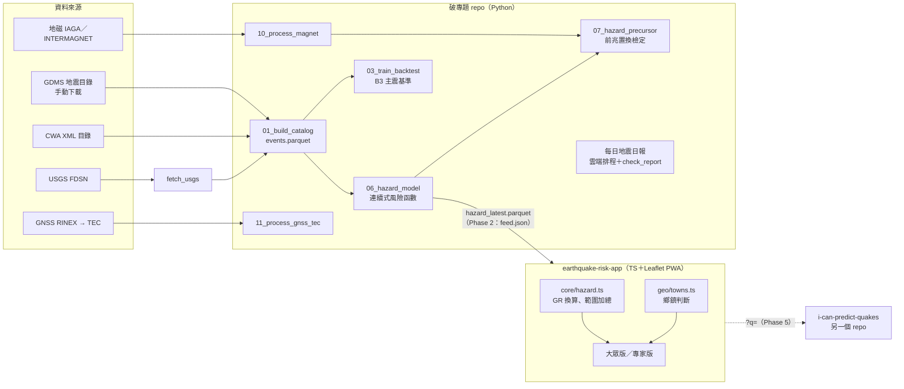

# 全面審查報告（2026-11-17）

| 項目 | 內容 |
|---|---|
| 範圍 | ① `破專題` main（f372f92）② `earthquake-risk-app` main（96cd43f）③ `claude/hazard-app` 分支的 `app/hazard_core.py`（APP 計算核心的 Python 對照版） |
| 排除 | `coursework/`（課堂筆記）、`docs/reports/` 圖檔、SA&D 講義 PDF（只借用方法） |
| 對照 | `docs/PROJECT_AUDIT.md`（2026-11-05 舊稽核） |
| 方法 | 單人分段逐檔閱讀；能實測的實測 |

**證據標記**：【實測】＝實際執行確認；【閱讀】＝讀程式判斷；【需確認】＝推論，附驗證方法。
**嚴重度**：P0＝會讓對外結論錯誤；P1＝特定條件下出錯或誤導；P2＝精度、一致性；P3＝風格。

**不適用項目**（清單有、專案裡沒有，不硬寫）：React（APP 是 Vite＋TS＋Leaflet、無框架）、GeoTIFF、PGA／PGV／震度換算（兩個 repo 都沒有實作，見 1.5 節的建議）。

---

## 第 1 段：地震風險模型與 GIS 正確性

### 1.1 模型在做什麼（一句話）

`pipeline/src/eqforecast/hazard.py` 是一個**簡化版的 ETAS 型短期機率模型**：
每格發生率＝平滑過的長期背景＋依大森定律衰減的近期活動加成，再用古騰堡–芮克特（G-R）規模分布換成任意規模，用卜瓦松換成機率。APP（`src/core/hazard.ts`）只負責在手機上做規模換算、範圍加總與顯示。

這個架構本身是業界與學界認可的路線（同類方法有 ETAS、STEP、CSEP 的測試流程）。下面的問題都是**實作細節與資料處理**，不是方向錯誤。

### 1.2 模型問題

| # | 嚴重度 | 位置 | 問題 | 證據 | 改善方式 |
|---|---|---|---|---|---|
| M1 | **P0**【需確認】 | `pipeline/src/01_build_catalog.py:251-254` → `eqforecast/hazard.py:159` | **目錄篩選規則混用，會把 b 值壓低**。`events.parquet` 保留了「gap ≤ 110° 的事件」加上「ML ≥ 5.5 不論 gap」。風險模型直接用全部 ML ≥ 3.5 事件。結果是 3.5–5.5 的地震被定位品質篩掉一部分（外海最多），5.5 以上卻全數保留，所以大地震的比例被人為放大。 | 回測報告的 b＝0.775（`docs/reports/hazard_v1/README.md`），低於一般台灣區域常見的 0.9–1.0【需確認】。M≥6 的「預測／實際」是 1.5 到 1.8 倍（同一份報告），方向符合「b 偏低 → 高估大地震」。 | 風險模型改用單一篩選規則：全部事件都用 `use_for_features`，或全部都不篩 gap。然後重新估 b 值、重跑 `06_hazard_model.py`。驗證方法：用訓練期資料，分別對「全部」和「只用 gap ≤ 110」計算 Aki–Utsu b 值並比較。 |
| M2 | **P0** | APP `src/state.ts:59`（`MAGS = [4,5,6,7]`）、`hazard.ts:27` | **M7 是用 b＝0.775 從 M3.5 外推 3.5 級**。和 b＝1.0 相比，M7 的機率會高約 10^(0.225×3.5)≈6 倍。另外 CWA 的 ML 在大地震時會飽和，「ML 7」和一般人理解的「規模 7」（Mw）不是同一件事。 | `isVerified` 對 m ≥ 6.5 已標成「外推估計」（`hazard.ts:171-176`），但數字本身仍然直接顯示。 | 先修 M1。大規模段改用 Mw 目錄估計（USGS 或 CWA Mw），或採用截尾 G-R（設最大規模）。M7 改成只顯示量級（例如「約千分之幾」），或加上誤差範圍。 |
| M3 | **P1**【閱讀】 | `eqforecast/hazard.py:309-311`；報告參數 | **擬合參數卡在搜尋範圍邊界**。alpha＝0.2（範圍下限）、p＝0.8（範圍下限）、sigma_bg＝0.5（範圍下限）。報告第 3 點自己也寫了「在邊界代表範圍要放寬」，但還沒有處理。alpha＝0.2 遠低於一般 ETAS 文獻的值（約 1.0–2.0，以 log10 規模為單位）【需確認】，代表「大地震後的餘震」被低估，這和 M≥6、1 天的「增益（對只有背景）」＝ −0.09 一致。 | `docs/reports/hazard_v1/README.md` 參數表與回測表 | 放寬搜尋範圍（alpha 0–2、p 0.6–1.5、sigma_bg 0.25–3），或改成連續最佳化（目前 mu、K 已經用 Nelder-Mead，形狀參數可以一起放進去）。 |
| M4 | P1【閱讀】 | `06_hazard_model.py:80` | **「對均勻」的增益不公平**。完整模型和只有背景的模型都做了滾動校準（第 74-79 行），均勻對照卻用訓練期的固定發生率、沒有校準。只要測試期的地震總數和訓練期不同，「增益（對均勻）」就會被高估。 | 程式碼 | 均勻對照也乘上同一套 `recalibration_factor`，或改用「測試期之前已知的總數」重新計算。 |
| M5 | P1【閱讀】 | `hazard-app:app/hazard_core.py:74-86`、`06_hazard_model.py:113-114` | **「平常」的機率被近期校準倍率污染**。匯出的 `n_bg` 是 `a × f`，其中 f 是**完整模型**的滾動校準倍率；APP 再乘上 mu_bg／mu。大地震後 f 會變大，「平常」也跟著變大。倍數（p／pBg）不太受影響，但畫面上「平常機率」的絕對值會偏高。 | 程式碼 | 匯出時另存只有背景模型自己的校準倍率，或「平常」完全不做滾動校準（它本來就應該是長期平均）。 |
| M6 | P1【閱讀】 | `hazard.py`（全檔沒有深度條件） | **沒有考慮震源深度**。琉球隱沒帶 70–300 km 的中深層地震和 10 km 的淺層地震算成一樣的風險。對防災來說，地表搖晃主要來自淺層地震。 | `grep depth hazard.py` 沒有任何結果 | 至少提供「只算深度 ≤ 40 km」的版本（B3 已經有 `b3_shallow40` 設定可以參考），或在 APP 說明「含深層地震」。 |
| M7 | P2【閱讀】 | `06_hazard_model.py:201` | **資料時效**：發布時間是目錄最後一天的隔日（目前是 2026-09-30）。APP 接上真資料之前，「現在的風險」其實是 7 週前的。 | 回測報告 | 這已經在 APP Phase 2（每小時更新）的計畫內。Phase 2 完成前，畫面要顯示 `issued_at`（schema 已經有這個欄位）。 |
| M8 | P2【閱讀】 | `hazard.ts:145-150` | **倍數用的是機率比，不是發生率比**。p 接近 1 時倍數會被壓縮（例如 30 天、M4、大範圍）。 | 程式碼 | 改用期望次數比 n_full／n_bg，或在 p > 0.5 時改顯示期望次數。 |
| M9 | P2【閱讀】 | `hazard.py:239-256` | `trailing_factor` 每次要算約 104 次 `expected_ref`（730 天 ÷ 7 天）。正確性沒問題，但很慢，每小時更新時會是瓶頸（見第 2 段效能）。 | 程式碼 | 快取每週的 `expected_ref` 總數，增量更新。 |

### 1.3 驗證方法評估（防災資訊系統角度）

| 面向 | 現況 | 評價 |
|---|---|---|
| 時間切分 | 訓練 1995–2014、測試 2015–2026-09，所有量只用發布時間前的資料（`hazard.py:97`） | 正確，沒有偷看未來 |
| 對照組 | 均勻、只有背景 | 正確做法；但 M4 的公平性要修 |
| 指標 | 卜瓦松對數概似增益、AUC、預測／實際 | 接近 CSEP 的 L-test／N-test 思路。缺少 **N-test 的信賴區間**（目前只有點估計）和 **可靠度圖**（預測機率 vs 實際頻率） |
| 樣本量 | 在報告中標示「少於 20 個」 | 誠實；M≥6 的列不能拿來宣稱技巧 |
| 前兆 | `07_hazard_precursor.py`＋`modifier.py`：把前兆當發生率倍率，用循環平移做置換檢定 | **方法設計正確且嚴謹**（循環平移保留自相關，比逐點打亂好）。結果是負結果，報告也據實呈現 |

### 1.4 GIS 審查

| # | 嚴重度 | 位置 | 檢查項目 | 結論 |
|---|---|---|---|---|
| G1 | ✅ | `hazard.py:122-128`、`grid.py:19-27`、APP `hazard.ts:94-107` | 經緯度順序 | 三處都是 i＝緯度、j＝經度，一致。APP 的 Leaflet 也用 `[lat, lon]`（`map.ts:145`）。TopoJSON 內部是 `[經度, 緯度]`，`towns.ts:18` 有註明而且用法正確 |
| G2 | ✅ | APP `towns.ts:3` | 座標系統 | 界線來源是內政部 TWD97 經緯度（TWD97 經緯度和 WGS84 的差距在公尺以下），和 GPS 的 WGS84 可以直接比較。沒有投影座標（TM2）的混用 |
| G3 | ✅ | APP `hazard.ts:4, 32-37` | 距離計算 | Haversine，R＝6371 km，`KM_PER_DEG＝111.195` 和它一致。50 km 尺度下，球體近似的誤差 < 0.5%，可以接受 |
| G4 | ✅ | APP `hazard.ts:61-66` | 面積計算 | 有乘 cos(緯度)；0.2° 格在 21°N 和 26°N 的面積差約 7%，已經處理 |
| G5 | ✅ | APP `towns.ts:107-122, 187-204` | 點在多邊形 | 射線法、洞的處理、多重多邊形都正確；離界線「定位誤差＋簡化誤差」以內時改說「附近」，設計符合防災資訊的保守原則 |
| G6 | **P2**【閱讀，誤差為計算值】 | APP `map.ts:165`、`smooth.ts` | **平滑圖層和格子位置不一致**。`L.imageOverlay` 在 Web Mercator 中把影像線性拉伸，但影像的每一列是等緯度間隔。21–26°N 之間，中間（23.5°N）會偏移約 0.04°，**約 4–5 km**（我用 Mercator y＝asinh(tan φ) 計算）。關掉平滑時（`L.rectangle`）沒有這個問題 | 依 Mercator y 重新取樣影像列，或改用多個窄條 overlay、Leaflet 的 GridLayer。這是顯示問題，不影響點選的數字（點選時取原始格值，`smooth.ts` 開頭有說明） |
| G7 | P2【閱讀】 | `hazard.py:185-192` | **平滑核以「格」為單位**：0.2° 在南北向約 22.2 km、東西向約 20.4 km（23.5°N），所以平滑在東西向和南北向的公里寬度差約 9%（不是正圓） | 影響小。若要改正，改用公里為單位的核，或使用等面積投影網格 |
| G8 | P2【閱讀】 | `hazard.py:130-134` vs `grid.py:29-40` | **兩套 Grid 類別、兩種座標約定**：`hazard.Grid.frame()` 輸出西南角，`grid.Grid.cells()` 輸出中心點。目前各自用在不同管線，APP schema 也註明「每格西南角」（`schema.ts:217`），所以**目前沒有算錯**，但很容易混用出錯 | 合併成一個 Grid 類別，欄位名稱明確寫 `lat_sw`／`lat_c` |
| G9 | P2 | `docs/reports/hazard_v1` 限制第 4 點 | 外海發生率偏低（gap 篩選造成） | 和 M1 是同一個根因 |
| G10 | P3 | APP `state.ts:40-52` | 金門、連江在網格外，會顯示「未涵蓋」 | 處理正確 |

**行政區風險計算**：目前沒有「行政區風險」這個功能。APP 只判斷使用者所在的鄉鎮區（用來顯示文字），風險是以「圓心＋半徑」計算（`pointWeights`，10×10 子點估計面積比例）。這個做法在 50 km 尺度下合理。如果之後要做「鄉鎮區風險排行」，應該用多邊形和網格的面積交集，不能只用中心點。

### 1.5 PGA、PGV、震度：專案沒有實作，若要做的建議

目前的模型輸出的是「**規模發生機率**」（hazard 的「源」），不是「**地表搖晃**」（震度）。這兩者之間還差一個**地動預估式（GMPE）**。對一般民眾來說，震度才是可以行動的資訊。

| 項目 | 建議 | 驗證狀態 |
|---|---|---|
| 震度分級 | CWA 自 2020 年起採用新制：震度 0–4 級用 PGA，5 弱以上用 PGV 判定 | 【需確認】請以 CWA 官方震度分級表核對門檻值 |
| 台灣 GMPE | 候選：Chao et al.（2020，台灣地殼與隱沒帶地震）、Phung et al.（2020，NGA-West2 台灣調整）、Lin & Lee（2008，隱沒帶） | 【需確認】我記得這些文獻，但沒有查證細節，引用前請查原文 |
| 場址效應 | 需要 Vs30 圖（國家地震工程研究中心有台灣 Vs30 資料）【需確認】 | 盆地（台北、宜蘭）效應明顯，沒有場址修正會嚴重低估 |
| 做法 | 「每格每規模區間的發生率 × GMPE 的超越機率」積分 → 「某地點未來 T 內震度 ≥ X 的機率」，也就是簡化版的 PSHA | 工作量大，建議列為 12/9 之後的工作（和你之前「震度版有空再做」的決定一致） |

### 1.6 第 1 段小結

- **最該先修**：M1（篩選規則混用導致 b 值偏低）→ M2（M7 外推）→ M3（參數卡在搜尋邊界）。三者互相關聯，修完要重跑 `06_hazard_model.py`，並重新產生 APP 的 feed。
- **GIS 部分品質高**：座標順序、座標系統、距離、面積、點在多邊形全部正確。唯一的實際誤差是平滑圖層約 4–5 km 的偏移（G6）。
- **方法論的優點**：嚴格只用過去資料、有對照組、負結果照實報告、前兆檢定用循環平移。這些是做得比一般專題好的地方。

---

## 第 2 段：程式品質、資安、效能

### 2.1 實測結果

| 項目 | 結果 |
|---|---|
| 破專題 Python 測試（144 個） | Windows 預設編碼（cp950）：**4 個錯誤**；設 `PYTHONUTF8=1` 後**全部通過**【實測】 |
| APP 測試（vitest，44 個） | 全部通過【實測】 |
| APP 型別檢查（`tsc --noEmit`） | 通過【實測】 |
| APP 建置產物 | JS 215 KB、CSS 33 KB、鄉鎮界線 305 KB（第一次定位時才載入）【實測，未壓縮大小】 |

### 2.2 程式品質問題（P0–P3）

| # | 嚴重度 | 位置 | 問題 | 改善方式 |
|---|---|---|---|---|
| Q1 | **P1**【實測】 | `pipeline/src/stream_io.py:198, 257`、`02_clean_features.py:371, 373` | 輸出訊息用了 `⚠`、`✗` 等符號，在 Windows 終端機（cp950）上 `print` 會丟出 `UnicodeEncodeError`，**整支程式中斷**。你平常就在 Windows 上跑這些程式，所以這不是只有測試才會遇到的問題 | 在入口統一呼叫 `sys.stdout.reconfigure(encoding="utf-8", errors="replace")`，或把符號改成「[警告]」。CI 加一個 Windows runner |
| Q2 | **P1**【閱讀】 | `README.md`「主要步驟」、`scripts/*.ps1`（410 行）、`.github/workflows/risk-assessment.yml:39-71` | **README 描述的是已經淘汰的 PowerShell 流程**（加權總和評分），實際的模型是 Python 的 `06_hazard_model.py`。評審或新成員照 README 操作，會跑到錯的系統 | README 改寫成目前的架構（第 3 段有架構圖）；PowerShell 腳本移到 `legacy/`，並註明「已由 hazard 模型取代」 |
| Q3 | **P1**【閱讀】 | `scripts/Risk-Scoring.ps1:12-18` | 加權總和的權重（GPS 0.20、地磁 0.15……）是**沒有依據的魔術數字**，輸出「區域風險上升 N%」會被誤認成科學結論 | 同 Q2：標成淘汰。如果要保留，權重必須來自擬合，例如 `modifier.py` 的卜瓦松迴歸係數 |
| Q4 | P2【閱讀】 | `eqforecast/grid.py` vs `eqforecast/hazard.py:109-134` | 兩個 `Grid` 類別重複（見 G8） | 合併 |
| Q5 | P2【閱讀】 | `.github/workflows/pipeline-tests.yml:168-171` 和 `risk-assessment.yml:205-208` | 兩個 workflow 在 push 時跑**同一套**單元測試，CI 時間加倍 | 刪掉 `risk-assessment.yml` 的 tests job |
| Q6 | P2【閱讀】 | APP `src/state.ts:87` → `src/core/hazard.ts:12` | 從 localStorage 還原的 T 只檢查 `T > 0`，但 `interpHorizon` 遇到超過 30 天會**丟出例外**，整頁畫不出來。目前只有 APP 自己會寫入這個值，所以風險低；但 Phase 4 的「分享網址還原條件」會讓外部輸入走到這裡 | `sanitize` 檢查 T 是否落在 `TIMES` 範圍，m 也要限制範圍 |
| Q7 | P2【閱讀】 | APP `src/core/hazard.ts:1` | 註解說要對應「破專題 app/hazard_core.py」，但這個檔案**只存在 `claude/hazard-app` 分支**，main 上沒有。TS 和 Python 的一致性測試也還沒寫 | Phase 2 接真資料時，把 `hazard_core.py` 合進 main，並加入對照測試（同一份 feed、同一組輸入，比對兩邊的輸出） |
| Q8 | P2【閱讀】 | `06_hazard_model.py:36-39`、`hazard.py:139-149` | 規模清單、時間長度、`TRAILING_DAYS`、搜尋範圍都寫死在程式裡。B3 已經有 `pipeline/configs/*.json`，hazard 卻沒有用設定檔 | 比照 B3，改成 `configs/hazard_v1.json`，報告裡也記下用了哪個設定檔 |
| Q9 | P3【閱讀】 | `hazard.py:321` vs `:246` | 同一種「天數轉秒數」寫法不一致（`int()` vs `int(round())`）。T＝1/24 時兩者會差 1 秒 | 寫成一個共用函式 |
| Q10 | P3 | `docs/PROJECT_AUDIT.md` | 11-05 的舊稽核內容已經過時（當時 main 只有 6 個檔案），但沒有標註 | 開頭加上「已由 docs/audit/2026-11-17 取代」 |

**做得好的地方**（有證據）：Python 套件版本固定（`requirements.txt`），每個依賴都註明用途；`hazard.py`、`towns.ts` 的註解說明了「為什麼」；APP 的計算核心和畫面分開，計算部分可以單獨測試；錯誤處理會明確說出原因，例如 `towns.ts:217` 載入失敗後下次會重試。

### 2.3 資安

| # | 等級 | 位置 | 問題 | 建議 |
|---|---|---|---|---|
| S1 | **Medium**（未來） | APP `main.ts:85` 等處用 `innerHTML` 整頁重畫 | 目前所有字串都經過 `esc()`，資料也都來自自己（假資料、自己的界線檔），**現在沒有 XSS**【閱讀】。Phase 2 會顯示 CWA、USGS 的地震描述，那是外部字串，一旦漏掉一次 `esc()` 就會出問題 | 加一個 lint 規則或測試：所有外部字串一律經過 `esc()`。index.html 加上 `<meta http-equiv="Content-Security-Policy">`（GitHub Pages 不能設定 header，只能用 meta） |
| S2 | Low | APP `basemaps.ts:57-80` | CARTO 金鑰存在 localStorage，而且放在圖磚網址裡。這是 CARTO 的設計，金鑰本來就會公開，APP 的 ⓘ 頁也有提醒使用者限制網域 | 處理方式正確 |
| S3 | Low | APP `state.ts`（位置存在 localStorage） | 位置只存在本機，沒有送出（只有 `towns.ts` 的界線檔 fetch，而且是同源）【閱讀】 | 隱私設計正確 |
| S4 | Low | Python `stream_io.py:69-77, 157, 184` | 讀 zip、tar 是**串流讀成員**，沒有 `extractall`，所以沒有路徑穿越（path traversal）風險【閱讀】 | 無需處理 |
| S5 | Low | `scripts/fetch_intermagnet.py:94-96` | `subprocess.run` 用串列參數，沒有 `shell=True`，沒有命令注入 | 無需處理 |
| S6 | Low | `.github/workflows/*.yml` | 只用 `github.token`，有設 `permissions`，沒有 `pull_request_target` | 第三方 action 用版本標籤（`@v4`、`@v5`）而不是 commit SHA，屬於一般程度的供應鏈風險 |
| S7 | Medium（規模化時） | APP `basemaps.ts:29, 37` | 預設底圖用 `tile.openstreetmap.org` 和 OpenTopoMap。兩者的使用政策都**不允許大量流量的應用**【需確認：請查 OSM Tile Usage Policy】 | 1 萬使用者以上要換成國土測繪中心 WMTS（已經是選項之一），或改用付費、自架的圖磚 |
| — | 無 | 兩個 repo | 用 `git grep` 掃描 api_key、token、secret、password：**沒有發現洩漏的金鑰**【實測】 | — |

CSRF、SQL injection：**不適用**。APP 沒有後端、沒有表單送出、沒有資料庫。

### 2.4 效能

清單要求列出 Top 20。實際找到、而且有證據的只有下面 8 項，我不灌水湊數。React render 的問題不適用，因為 APP 沒有用 React。

| # | 位置 | 問題 | 原因 | 建議 | 預估改善 |
|---|---|---|---|---|---|
| E1 | `hazard.py:239-256` | `trailing_factor` 每個時間長度要重算約 104 次 `expected_ref`，匯出 10 個時間長度就是約 1,040 次 | 沒有快取 | 每週的預測總數只算一次並快取，之後增量更新 | 每小時更新的時間可以降一到兩個數量級【需確認：沒有計時】 |
| E2 | `06_hazard_model.py:69-72` | 回測時每個時間長度都重算一整串校準窗 | 同 E1 | 同 E1 | 同上 |
| E3 | `hazard.py:326-333` | 75 組格點搜尋，每組都重算全部訓練窗的 `short_term` | 每組 `(alpha, p, sigma_st)` 都要重算 | `sigma_bg` 已經提出迴圈外，`short_term` 也可以先依 `(alpha, p)` 算好未平滑的量，再分別平滑 | 約 3 倍（sigma_st 有 3 個值） |
| E4 | APP `main.ts:85` | 每次狀態改變，整頁 `innerHTML` 重畫 | 設計選擇（沒有框架） | 目前畫面很小，可以接受；Phase 3 的地震列表變長時，列表要改成局部更新 | 列表變長後才會明顯 |
| E5 | APP `hazard.ts:40-54` | `pointWeights` 每個鄰近格算 100 次 haversine；拖動半徑滑桿時會連續觸發 | 子點估計面積 | 加 debounce，或依（圓心、半徑）快取 | 小（目前只有 500 格） |
| E6 | APP `map.ts:139-149` | 不平滑時，每次重畫都新建 500 個 `L.rectangle` | 沒有重用圖層 | 改成更新樣式，或用單一 canvas | 小 |
| E7 | Python `stream_io.py:60-78` | `_ZIPS`、`_TARS` 快取開過的壓縮檔，但從來不關閉 | 為了速度刻意快取 | 處理完一站就清掉快取 | 長時間批次處理時可以避免檔案控制代碼耗盡 |
| E8 | APP 鄉鎮界線 305 KB | 第一次定位時下載 | 已經是延遲載入，而且 service worker 會快取 | 可以改用 gzip、brotli（GitHub Pages 會自動壓縮）【需確認】 | — |

---

## 第 3 段：需求、Use Case、事件分析、SRS

方法依 SA&D 課程（需求五分類、Use Case、事件表）。依據來源是**實際程式碼**，加上你 11-13、11-15 已經定案的方向（12/9 交付海報、簡報、可用的 APP；「3 中 2」的連續式風險評估）。

### 3.1 系統全貌（實際運作中的四個子系統）

**目前的斷點**：模型輸出到 APP 這一段還沒接上。APP 現在用的是 `src/data/mock.ts` 的假資料（畫面有黃色提示條）。

### 3.2 需求五分類與完成度

| 類別 | 需求 | 狀態 | 證據 |
|---|---|---|---|
| **商業**（BR） | BR1 12/9 成果展：海報、簡報、可用的 APP | 部分完成 | APP Phase 1 已上線，但用的是假資料 |
| | BR2 展示「規模、時間、地點都連續」的風險評估 | **已完成（模型端）** | `hazard.py`＋APP 的規模、時間、範圍滑桿 |
| | BR3 誠實呈現：不是預報、附基準率 | 已完成 | APP 免責聲明、`isVerified` 標籤、回測報告的基準率欄 |
| **利害關係人**（SR） | SR1 民眾：看得懂「和平常比幾倍」 | 已完成（門檻尚未驗證） | DESIGN.md §5「待辦：用回測統計各狀態出現頻率再定」 |
| | SR2 評審：看得到驗證證據 | 已完成 | `#/expert/verify`、`docs/reports/hazard_v1` |
| | SR3 位置隱私 | 已完成 | `towns.ts:1`、`state.ts:1` |
| **功能**（FR） | FR1 整併多來源目錄並去重 | 已完成 | `01_build_catalog.py`、比對規格 |
| | FR2 任意 (m, T, 範圍) 的機率 | 已完成 | `hazard.ts:121-165` |
| | FR3 即時資料（每小時以內） | **未完成** | Phase 2 |
| | FR4 地震列表、餘震機率、全台排行 | 未完成 | Phase 3 |
| | FR5 分享網址、收藏 | 未完成 | Phase 4 |
| | FR6 前兆（地磁）納入模型 | 已完成檢驗，**結果是負的** | `07_hazard_precursor.py`；不納入是正確的決定 |
| | FR7 震度（PGA／PGV） | 未完成 | 見 1.5 節 |
| **非功能**（NFR） | NFR1 可安裝、可離線（PWA） | 已完成；實機尚未驗證 | 記憶中記錄 Android、iPhone 未測 |
| | NFR2 只用發布時間前的資料 | 已完成 | `hazard.py:97` |
| | NFR3 可重現（版本固定、測試） | 部分完成 | 版本固定；Windows 編碼問題（Q1） |
| | NFR4 TS 與 Python 結果一致 | 未完成 | Q7 |
| | NFR5 可用性：手機一頁看懂 | 已完成（有試用回饋） | 11-15 定案記錄 |
| **過渡**（TR） | TR1 從 PowerShell 舊流程移轉到 Python | 程式已完成，**文件還沒跟上** | Q2 |
| | TR2 假資料 → 真資料的切換與提示 | 設計已完成（`mock` 旗標） | `schema.ts:209` |

**不合理的需求**：`Chapter01/需求規格說明.md` 的 F2（以 30 天平均 ML 當基線）、F4、F5（加權總和、「風險上升 N%」）、F7（每次 push 就跑風險評估，但資料不在版控裡）、NF1（主要用 PowerShell）。這些需求和目前的系統矛盾，**而且 F4、F5 沒有統計基礎**。如果 SA&D 作業還要用這份文件，建議改寫成 3.2 這張表的內容。

### 3.3 Actor 與 Use Case

| Actor | 實際支援？ | 說明 |
|---|---|---|
| 一般民眾 | ✅ | 大眾首頁 |
| 地震研究者、專題評審 | ✅ | 專家版、回測報告、程式碼 |
| 排程器（時間） | 部分 | 每日日報已運作；APP 的每小時更新還沒做 |
| 外部資料源（CWA、USGS、GDMS） | 部分 | GDMS 是手動下載 |
| 專題開發者（維運） | ✅ | 品質報告、`check_report.py` |
| 學校單位、防災人員 | ❌ | 沒有對應功能。依防災資訊系統原則，防災人員需要的是「區域彙整、匯出、門檻通知」，不是個人機率 |
| 系統管理員 | 不適用 | 沒有後端、沒有帳號系統 |

| UC | 名稱 | 民眾 | 研究者 | 排程 | 開發者 | 狀態 |
|---|---|:-:|:-:|:-:|:-:|---|
| UC1 | 查詢我附近的風險（定位） | ● | ○ | | | 完成 |
| UC2 | 改條件：範圍、時間、規模 | ● | ● | | | 完成 |
| UC3 | 看風險地圖、點選換圓心 | ○ | ● | | | 完成 |
| UC4 | 看機率對規模、時間的曲線 | | ● | | | 完成 |
| UC5 | 看驗證結果 | | ● | | | 完成 |
| UC6 | 安裝、離線使用 | ● | ● | | | 完成（未實機驗證） |
| UC7 | 更新模型與 feed | | | ● | ● | **未完成**（Phase 2） |
| UC8 | 重訓參數、重跑回測 | | | | ● | 完成（手動） |
| UC9 | 檢驗前兆 | | ● | | ● | 完成 |
| UC10 | 產生每日日報 | | | ● | | 完成 |
| UC11 | 看最近地震列表、餘震機率 | ● | ● | | | 未完成 |
| UC12 | 區域彙整、匯出（防災人員） | | | | | **缺漏** |

**功能重疊**：UC1 和 UC3 都能換圓心（首頁選位置、專家地圖點選），但共用同一個 state，所以不算衝突。比較大的重疊是**舊 Streamlit 版**（`claude/hazard-app` 分支）和新 APP 功能幾乎相同，Streamlit 版應該明確標成「已由 APP 取代」。

**不合理的流程**：APP 顯示「現在」的風險，但模型的發布時間是 9/30（M7）。在 Phase 2 之前，首頁應該把 `issued_at` 顯示得比資料延遲提醒更明顯。

### 3.4 事件表（Event Table）

| 事件 | 類型 | 觸發來源 | 輸入 | 處理 | 輸出 | UC |
|---|---|---|---|---|---|---|
| 使用者打開 APP | External | 民眾 | 本機狀態 | 讀 localStorage → 檢查免責聲明版本 | 說明視窗或首頁 | UC1 |
| 使用者允許定位 | External | 民眾 | GPS 座標、精度 | `describePlace` → `assessPoint` | 鄉鎮區名稱、倍數、機率 | UC1 |
| 使用者改條件 | External | 民眾、研究者 | 半徑、T、m | `pointWeights` → `regionProbability` | 新的狀態與機率 | UC2 |
| 使用者點地圖 | External | 研究者 | 經緯度 | 換圓心並重算 | 地圖與數字更新 | UC3 |
| 開發者重訓 | External | 開發者 | events.parquet | `hz.fit` → `backtest` → `export_latest` | params.json、報告 | UC8 |
| 每日 22:00 | Temporal | 排程 | 近 24 小時目錄 | 雲端排程產生日報 | daily-reports 分支 | UC10 |
| 每日 23:30 | Temporal | GitHub Actions | 日報 | `daily-report-check.yml` 檢查缺漏 | 失敗通知 | UC10 |
| 每小時（**計畫中**） | Temporal | GitHub Actions | CWA、USGS 新事件 | `live_update` → 匯出 feed | feed.json | UC7 |
| 每日 3 次 | Temporal | GitHub Actions | 碎形日報 | `archive_fractal_report.py` | 封存 | — |
| 發生 M≥5 地震（**計畫中**） | State | 資料源 | 新事件 | 近期加成跳升 | 倍數變色（黃→紅） | UC7、UC11 |
| 資料延遲超過門檻 | State | 系統 | `catalog_end`、`gap_days` | `undercountAt` | ⓘ 頁提醒 | UC1 |
| 圓心在網格外 | State | 系統 | 座標 | `coverage < 0.5` | 「目前模型未涵蓋此區域」 | UC1 |
| service worker 有新版 | State | 瀏覽器 | sw.js | `pwa.ts` | 更新提示 | UC6 |

**缺漏**：沒有「資料源失效」（CWA API 掛掉、金鑰過期）的狀態事件。Phase 2 必須加上，而且畫面要從「現在」降級顯示成「最後更新時間＋已過期」。

### 3.5 系統需求規格書（SRS，精簡版）

1. **背景**：台灣地震頻繁，但民眾只能拿到「已發生」的資訊和「長期」的危害圖（例如 50 年超越機率），中間缺少「未來幾小時到 30 天、和平常比」的短期風險資訊。
2. **目標**：提供規模、時間、範圍都連續可調的短期地震發生機率；標明和平常的差異、已驗證範圍、資料時效；不做預報、不給安全保證。
3. **利害關係人**：民眾、評審與研究者、開發者；潛在使用者有防災人員、學校。
4. **功能需求**：見 3.2 的 FR1–FR7。
5. **非功能需求**：NFR1–NFR5；另外加上**時效性**（feed 在 1 小時內更新，過期要明確標示）、**可解釋性**（每個數字都能追溯到公式與回測）、**隱私**（位置不外送）。
6. **Use Case**：見 3.3。
7. **資料流程**：見 3.1 的圖；APP 端的流程見 `earthquake-risk-app/docs/DESIGN.md` §4。
8. **系統架構**：靜態前端（GitHub Pages）＋批次後端（GitHub Actions 跑 Python）＋檔案式資料交換（feed.json）。沒有伺服器、沒有資料庫，所以成本是零、攻擊面很小。
9. **風險**：模型偏差（M1–M3）、資料延遲（M7）、外部 API 條款與限流（ExpTech、CWA）、圖磚政策（S7）、民眾誤讀（倍數被當成預報）。
10. **未來發展**：震度版（PSHA 簡化）、深度篩選、Mw 目錄、防災人員的區域彙整與匯出、推播（需要後端）。

---

## 第 4 段：架構評估、技術債、評分、Roadmap、學術評估

### 4.1 架構原則對照

| 原則 | 評估 | 證據 |
|---|---|---|
| SOLID：單一職責 | 好 | `hazard.py` 只放數學；`06_hazard_model.py` 負責流程與報告；APP 的 `core/`（計算）、`geo/`（鄉鎮）、`ui/`（畫面）分開 |
| SOLID：開放封閉、依賴反轉 | 普通 | APP 的資料來源是透過 `Feed` 介面（`schema.ts`），換成真資料不必改計算核心，這點好；Python 端用數字編號的腳本串接，沒有抽象層 |
| Clean Architecture | 部分符合 | APP 的計算核心不依賴 DOM、Leaflet，可以單獨測試；Python 的模組（`eqforecast/`）和腳本（`0x_*.py`）有分層，但腳本裡也混了報告產生邏輯（例如 `06_hazard_model.py:138-183`） |
| Feature-based | APP 符合；Python 依處理階段分（01、02…），屬於管線式結構 | 對資料科學專案來說，管線式結構是合理的選擇 |
| DDD | 不適用 | 領域小、沒有複雜的業務規則；但用詞一致（m_ref、horizon、cell），有基本的通用語言 |

### 4.2 可擴展性（1 千、1 萬、10 萬使用者）

架構是**靜態網站＋手機端計算**，使用者數量幾乎不影響後端。

| 規模 | 會先出問題的地方 |
|---|---|
| 1,000 | 沒有問題 |
| 10,000 | **底圖**：OSM、OpenTopoMap 的使用政策（S7）。feed.json 走 GitHub Pages 的 CDN，沒有問題 |
| 100,000 | 底圖必須自架或付費。GitHub Pages 有流量軟上限【需確認：官方說明約每月 100 GB】，feed 大約 500 格 × 10 個時間長度 × 2 份，每次下載數十 KB，每小時更新 → 要估算總流量。如果要做推播，就需要後端，這時架構要重新設計 |

**真正的瓶頸不在使用者數量，而在資料端**：GDMS 要手動下載（落後約 1.5 個月）、CWA 和 ExpTech 的限流與條款、GitHub Actions 排程的延遲（cron 可能延遲數分鐘到數十分鐘）。

### 4.3 技術債前 20 名（依「影響 ÷ 成本」排序）

| # | 技術債 | 嚴重度 | 成本 | 優先度 |
|---|---|---|---|---|
| 1 | M1 目錄篩選混用 → b 值偏低 | P0 | 低（改一行，重跑） | **立即** |
| 2 | Q1 Windows 編碼造成程式中斷 | P1 | 低 | **立即** |
| 3 | M3 參數卡在搜尋邊界 | P1 | 低（放寬範圍，重跑） | **立即** |
| 4 | M2 M7 外推，ML 和 Mw 混用 | P0 | 中 | 12/9 前 |
| 5 | Q2、Q3 README 描述的是舊流程 | P1 | 低 | 12/9 前 |
| 6 | M7 首頁發布時間不夠明顯 | P2 | 低 | 12/9 前 |
| 7 | 真資料接上 APP（UC7、FR3） | — | 高 | 12/9 前（BR1） |
| 8 | Q7 TS 與 Python 一致性測試；`hazard_core.py` 合進 main | P2 | 中 | 和第 7 項一起做 |
| 9 | M4 均勻對照沒有校準 | P1 | 低 | 12/9 前（簡報要用增益數字） |
| 10 | M5 「平常」被近期校準倍率污染 | P1 | 低 | 和第 7 項一起做 |
| 11 | 狀態門檻（1.5、3、10 倍）沒有用回測驗證 | P1 | 中 | 12/9 前 |
| 12 | Q6 還原狀態時沒有限制範圍 | P2 | 低 | 做分享網址之前 |
| 13 | S1 外部字串的 XSS 防護（CSP、lint） | Medium | 低 | 和第 7 項一起做 |
| 14 | E1、E2 校準倍率沒有快取 | P2 | 中 | 每小時更新之前 |
| 15 | G6 平滑圖層 4–5 km 偏移 | P2 | 中 | 12/9 後 |
| 16 | M6 沒有深度條件 | P1 | 中 | 12/9 後 |
| 17 | G8、Q4 兩個 Grid 類別 | P2 | 中 | 12/9 後 |
| 18 | Q8 hazard 沒有用設定檔 | P2 | 低 | 12/9 後 |
| 19 | Q5 CI 重複執行 | P2 | 低 | 隨時 |
| 20 | `Chapter01/需求規格說明.md` 過時 | P3 | 低 | 如果 SA&D 作業要用 |

### 4.4 評分

評分是我的主觀判斷，基準是「大學專題」，不是商用產品。

| 項目 | 分數 | 理由 |
|---|---|---|
| A. 總體 | **78** | 方法論和驗證態度明顯高於一般專題；扣分在模型偏差（M1–M3）和真資料還沒接上 |
| B. 可維護性 | 76 | 模組分層清楚、註明「為什麼」、測試 188 個；扣分在舊流程沒清掉、兩個 Grid、README 過時 |
| C. 可擴展性 | 80 | 靜態架構的成本與延展性都好；扣分在底圖政策和資料端需要手動下載 |
| D. 安全性 | 88 | 沒有後端、沒有洩漏的金鑰、有做跳脫、位置不外送；扣分在沒有 CSP、外部字串還沒有防護機制 |
| E. 技術債（越高越好） | 70 | 有 3 項立即可修的高影響項目 |
| F. 上線成熟度 | 55 | 假資料、實機尚未驗證、沒有資料源失效時的降級處理 |
| G. 功能完整度 | 65 | 以 Phase 1–5 計，完成約 1.5 個 Phase；但核心功能（連續式機率）已經完成 |

### 4.5 立即必修（建議今天到這週內完成）

1. **M1**：`06_hazard_model.py` 讀入事件後，只保留 `use_for_features`（或全部不篩），重估 b 值。先用 1.2 節的方法比較兩種 b 值，確認問題確實存在。
2. **M3**：放寬 alpha、p、sigma_bg 的搜尋範圍，然後重跑。
3. **Q1**：在所有入口腳本加上 `sys.stdout.reconfigure(encoding="utf-8", errors="replace")`。
4. **M4**：均勻對照也做滾動校準，然後重新產生回測報告（簡報會用到這些數字）。
5. **Q2**：README 換成目前的架構。

第 1、2、4 項會改變回測數字，**必須在做簡報與海報之前完成**。

### 4.6 下一版 Roadmap（倒推 12/9）

| 時間 | 工作 |
|---|---|
| 11/17–11/21 | 立即必修 1–5；重跑模型；APP 實機安裝測試 |
| 11/22–11/30 | APP Phase 2：真資料、每小時更新、TS 與 Python 對照測試、資料源失效降級、CSP |
| 12/1–12/5 | 用回測結果決定狀態門檻；Phase 3 只做「全台排行」（簡報效果最好）；海報與簡報定稿 |
| 12/6–12/8 | 凍結程式，只修錯誤；準備展示用的離線備案（例如截圖、錄影） |

### 4.7 三個月重構計畫（12/9 之後）

| 月 | 重點 |
|---|---|
| 第 1 個月 | 合併兩個 Grid；hazard 改用設定檔；刪除或封存 PowerShell 舊流程與 Streamlit 版；CI 加 Windows；校準倍率快取 |
| 第 2 個月 | 模型升級：深度篩選、改用 Mw（或截尾 G-R）、完整 ETAS 參數連續最佳化、加上 N-test 信賴區間與可靠度圖 |
| 第 3 個月 | 震度版：台灣 GMPE＋Vs30 → 「T 內震度 ≥ X 的機率」；防災人員用的鄉鎮彙整與匯出 |

### 4.8 地震工程、防災、學術角度的總評

| 問題 | 回答 |
|---|---|
| 風險模型合理嗎？ | **架構合理**（ETAS 型短期模型是國際主流），**參數有偏差**（M1–M3）。修正後就是一個可以辯護的基準模型 |
| PGA、PGV、震度換算正確嗎？ | 沒有實作，所以談不上對錯。目前的輸出是「規模發生機率」，不是「搖晃強度」。簡報時要講清楚這個差別 |
| 行政區風險計算合理嗎？ | 沒有行政區風險，只有「圓形範圍」的風險；計算方法（面積比例加權）正確 |
| GIS 符合業界標準嗎？ | 座標系統、距離、面積、點在多邊形都正確；界線來源與授權有標示。只有平滑圖層的投影偏移（G6） |
| 符合防災資訊系統的設計原則嗎？ | 大部分符合：不說安全、不用綠色、未涵蓋時不給數字、標示外推、資料延遲要揭露。缺少：資料源失效時的降級、發布時間的醒目程度 |
| 有學術競賽或畢業專題的水準嗎？ | **有，而且是中上**。主要的加分點是驗證的嚴謹度，這在同類專題裡很少見 |

**若作為不同用途：**

| 用途 | 最大優勢 | 最大缺點 |
|---|---|---|
| 碩士論文 | 完整、可重現的「前兆 vs 基準模型」檢驗框架（循環平移置換檢定），以及誠實的負結果 | 模型本身沒有新方法，ETAS 是既有方法；而且需要先修正 M1–M3、補上 CSEP 標準檢定，才經得起口試 |
| 國科會（前科技部）計畫雛型 | 端到端的系統：資料 → 模型 → 民眾 APP，加上零成本的部署架構 | 缺少震度（使用者真正需要的資訊）和防災單位的使用情境 |
| 學術競賽作品 | 「3 中 2」的連續式互動，展示效果好；誠實揭露限制，評審容易信任 | 評審可能會問「這不就是餘震機率嗎？」——簡報要主動說明：近期加成主要來自餘震規律，這是基準模型，前兆檢驗是負結果，這本身就是一個發現 |
