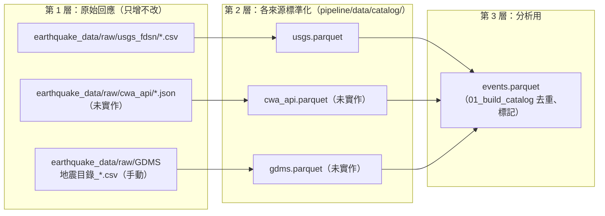

# Phase 2 資料來源比較：GDMS／CWA API／USGS FDSN

> 查證日期：2026-11-04（台灣時間）｜狀態：**已選定第一個模組（USGS FDSN），已實作**，見 §5、§7
> 範圍：地震目錄的**抓取方式**與**儲存方式**。地磁、TEC 另案處理（仍在申請中）。
> 標記：[事實] = 當天實測或讀官方規格；[推測] = 有根據但未驗證；[未確認] = 沒查到，不要當成事實。

## 1. 結論先講

三條路線**不是互相取代**，各自只能回答一種問題：

| 用途 | 唯一適合的來源 | 原因 |
|---|---|---|
| 歷史主目錄（ML≥2，有定位品質欄位） | **GDMS** | 只有它有 1973 年起的小地震與 gap／ERH／ERZ／quality |
| 最近幾週的有感地震（GDMS 還沒上架的空窗） | **CWA API** | GDMS 目錄落後約 1 個月以上；CWA API 只有最新 16 筆報告 |
| 外海、Mw、跨機構校對、隨時可重抓 | **USGS FDSN** | 免金鑰、標準化、可增量更新，但只涵蓋約 M4 以上 |

**建議第一個寫的爬取模組：USGS FDSN。** 理由：

1. 唯一能**完全自動化且不用存密碼或金鑰**的來源，今天就能寫完並測試。
2. 隨時可以重抓同一段時間（idempotent），寫壞了不會丟資料；CWA API 漏抓就永遠補不回來（只能等 GDMS）。
3. FDSN 是國際標準規格，模組寫好之後換一個 FDSN 節點（例如其他機構）只要改網址。
4. 跨機構比對回測（`scripts/catalog_matching/`）已經在用 USGS 資料，欄位對應已驗證過。

第二個寫 CWA API 輪詢器（併入每日日報流程）；GDMS **不寫爬蟲**，改寫「手動下載 CSV → 匯入」的腳本（理由見 §3.1）。

## 2. 比較表

### 2.1 取得方式

| 項目 | GDMS 地震目錄 | CWA 開放資料 API | USGS FDSN event |
|---|---|---|---|
| 端點 | `gdms.cwa.gov.tw/catalogDownload.php`（網頁表單） | `opendata.cwa.gov.tw/api/v1/rest/datastore/E-A0015-001`、`E-A0016-001` | `earthquake.usgs.gov/fdsnws/event/1/query` |
| 認證 | 會員登入（網頁 session） [事實] | 授權碼（`Authorization` header 或參數） [事實] | 不需要 [事實] |
| 介面性質 | 表單背後是內部端點 `php/dbconnect/getCatalog.php`（POST → JSON），**未公開、無文件** [事實] | 官方 REST，有 Swagger 規格 [事實] | 國際標準 FDSN Web Service [事實] |
| 未登入能否取得 | 實測回傳空陣列 `[]`（連 2024-04-02 花蓮 ML7.2 也查不到） [事實]；原因推定為未登入 [推測] | 401 [事實] | 可以 [事實] |
| 時間範圍 | 網站標示 1973-01-01 ～ **2026-09-30** [事實] | **只有最新 16 筆報告**：E-A0015-001 為 2026-09-11 ～ 11-03，E-A0016-001 為 2026-09-29 ～ 11-04；查 2024 年回傳 0 筆 [事實] | 不限；可依時間任意回補 [事實] |
| 更新延遲 | 約 1 個月以上（11/4 時最新只到 9/30） [事實] | 分鐘級（報告發布即上架） [推測] | 分鐘～小時；事件之後會被修訂（`updated` 欄位） [事實] |
| 單次上限 | 未確認 [未確認] | 回傳全部（就 16 筆） | **20,000 筆**（`count` 端點回傳 `maxAllowed`） [事實] |
| 增量更新 | 無，只能重新下載時間段 | 用 `timeFrom` 或比對 `EarthquakeNo` 去重 | `updatedafter` 參數可只抓有變動的事件 [事實] |
| 輸出格式 | JSON／CSV／TXT [事實] | JSON／XML [事實] | GeoJSON／CSV／QuakeML／text [事實] |
| 自動化難度 | 高：要存帳密、模擬登入、內部端點可能隨時改版 | 低：一個 GET；但必須**持續**跑 | 最低：一個 GET，分年切段即可 |
| 使用條款 | 需引用 DOI `10.7914/SN/T5`；是否允許程式化抓取 [未確認] | 開放資料授權 [推測，未讀全文] | 美國政府公開資料 [推測，未讀全文] |

### 2.2 資料內容

| 項目 | GDMS | CWA API | USGS（台灣框 21–26.5°N、119–123.5°E） |
|---|---|---|---|
| 收錄門檻 | 全部定位事件（ML 小至 2 以下） | **只有有感地震**（顯著＋小區域報告） | 1990–2025 共 6,290 筆，其中 M<4 只有 950 筆 → 實質上是 **M4 以上** [事實] |
| 本專案已有量 | 906,918 筆（1990-01 ～ 2026-07） [事實，PROJECT_OVERVIEW] | 0（日報有抓但沒存成目錄） | 回測用過一份 CSV（5,953 筆，21–25°N、119–124°E） |
| 時區 | UTC [事實] | **台灣時間 +08:00** [事實]（舊 `01_build_catalog.py` 差 8 小時的原因） | UTC [事實] |
| 規模 | ML | ML（芮氏規模） | 多種：Mww、mb、ML…（`magType` 欄） |
| 定位品質欄位 | `nstn` `dmin` `gap` `trms` `ERH` `ERZ` `fixed` `nph` `quality` [事實] | **沒有** | `nst` `gap` `dmin` `rms` `horizontalError` `depthError` `magError` `status` [事實] |
| 事件 ID | 無穩定 ID [推測：表單欄位沒有] | `EarthquakeNo`（只有編號報告才有） | `id`（例如 `us7000tva4`），跨版本穩定 [事實] |
| 額外資訊 | — | 各縣市／測站震度、報告圖、ShakeMap 圖 | 震源機制、PAGER、DYFI 等產品 |

### 2.3 對本專案的意義

| 面向 | GDMS | CWA API | USGS FDSN |
|---|---|---|---|
| B3 模型特徵（ML≥3、gap≤110） | ✅ 唯一可用 | ❌ 沒有 gap、門檻太高 | ❌ 門檻太高 |
| 目標事件（ML≥5.5） | ✅ 但落後 1 個月 | ✅ 即時 | ✅ 即時（但規模類型不同，不能直接比 ML） |
| 123°E 以東外海 | 未量過 [未確認]；同一機構的 CWA XML 36 年只有 61 筆 [事實，比對回測 §6]，可能也偏少 | 未量過 [未確認] | ✅ 629 筆（同期），補強主力 [事實] |
| 每日日報 | ❌ 太慢 | ✅ 已在用 | ✅ 已在用 |
| 長期風險 | 內部端點改版就壞；帳密外洩風險 | 漏跑 = 資料永久缺口（要等 GDMS 補） | 最低 |

## 3. 各來源的抓取策略

### 3.1 GDMS：不寫爬蟲，寫匯入腳本

- **為什麼不自動化**：要把會員密碼存在程式或環境變數裡、模擬登入、呼叫沒有文件的內部端點。改版就壞，而且使用條款是否允許程式化抓取 [未確認]。資料量也不需要：歷史資料已經有 90 萬筆，之後每月補一次就夠。
- **做法**：每月手動在網站下載上個月的 CSV，放進 `earthquake_data/raw/`，由 `import_gdms.py` 轉成統一欄位。
- **待辦**：向 GDMS 詢問是否提供 API 或允許程式化下載；有正式管道再改。

### 3.2 CWA API：持續輪詢、累積快照

- 每個資料集只保留最新 16 筆。實測 16 筆分別涵蓋約 7 週（E-A0015）與 5 週（E-A0016），平常每天抓一次綽綽有餘。
- **風險**：大地震後餘震密集時，16 筆可能在一天內被洗掉 [推測]。建議至少每 6 小時抓一次，或併入每日日報的同時加一個雲端排程。
- 以 `EarthquakeNo`＋`OriginTime` 去重；時間**一定要先轉 UTC** 再存。
- 這份資料只用來填「GDMS 還沒上架」的空窗；GDMS 上架後以 GDMS 為準。

### 3.3 USGS FDSN：可回補、可增量

- 回補：依年切段（台灣框每年遠少於 20,000 筆，一年一段即可），先呼叫 `count` 確認不超過上限。
- 增量：記錄上次抓取時間，用 `updatedafter=` 只抓新事件與被修訂的事件，以 `id` upsert。
- 保留 `magType`；**不可**把 USGS Mw 和 CWA ML 直接比較（日報已有同樣規則）。

## 4. 儲存方式

候選：

| 方案 | 優點 | 缺點 | 適合 |
|---|---|---|---|
| 只用 Parquet（現況） | pipeline 已在用；讀取快；檔案小 | 不能 upsert，每次要整檔重建 | 分析輸出 |
| SQLite | 單檔、免安裝、支援 upsert 與唯一鍵 | 大量分析查詢比 Parquet 慢 | 爬取暫存、去重 |
| DuckDB | 直接查 Parquet、SQL 分析快 | 多一個相依套件 | 分析查詢 |
| PostgreSQL／雲端資料庫 | 多人同時寫入、可上線服務 | 要架設與維護；目前一個人、資料 < 1 GB，用不到 | 之後若做網頁 API 再考慮 |

**建議：三層分開，全部用檔案，不架資料庫伺服器。**



為什麼這樣分：

- **第 1 層保留原始回應**：來源事後修訂或欄位解析寫錯時，可以不重新下載就重建。CWA 只保留 16 筆，原始檔是唯一備份。
- **第 2 層以 `(source, source_event_id)` 為鍵**，各來源一個 Parquet，重建只要幾秒（90 萬筆規模）。真的需要 upsert 再換 SQLite，不影響第 3 層。
- **第 3 層不變**：`01_build_catalog.py` 改成讀第 2 層，B3 模型完全不用動。
- 原始資料與 Parquet 一律不進 git（`.gitignore` 已排除 `*.parquet`），路徑沿用 `EQ_DATA_DIR`。

### 第 2 層統一欄位（草案）

| 欄位 | 型別 | 說明 |
|---|---|---|
| `time` | datetime（UTC，無時區） | 與 `events.parquet` 一致 |
| `lat` `lon` `depth` | float | |
| `mag` | float | |
| `mag_type` | str | `ML`、`Mww`、`mb`… |
| `gap` | float／NaN | CWA API 一律 NaN |
| `horiz_err_km` `depth_err_km` | float／NaN | GDMS 的 ERH／ERZ、USGS 的 horizontalError／depthError |
| `source` | str | `GDMS`、`CWA_API`、`USGS` |
| `source_event_id` | str | USGS `id`、CWA `EarthquakeNo`；GDMS 無 ID 時用時間＋座標組成 |
| `source_updated` | datetime／NaT | USGS `updated` |
| `fetched_at` | datetime（UTC） | 抓取時間，追溯用 |
| `status` | str | USGS：`reviewed`、`automatic`、`deleted`。**下游必須排除 `deleted`** |

USGS 另外保留 `event_type`、`place`、`nst`、`dmin_deg`、`rms`、`mag_error`、`net` 備查。

跨機構比對的可信度欄位（`high`／`medium`）屬於第 3 層，等「地震目錄欄位擴充提案」定案再加。

## 5. 決策紀錄

| 日期 | 問題 | 決定 | 理由 |
|---|---|---|---|
| 2026-11-04 | 第一個爬取模組 | **USGS FDSN** | 唯一能全自動、免金鑰、可重抓的來源（§1） |
| 2026-11-04 | 儲存分層與格式 | 先照 §4 三層、全用檔案（USGS 已實作） | 資料 < 1 GB、一人維護；第 1 層可離線重建 |
| | GDMS 是否自動化 | 待定（建議：不自動化，寫匯入腳本） | |
| | CWA API 輪詢頻率 | 待定（建議：至少每 6 小時） | |

## 6. 查證方式（可重跑）

```bash
# USGS：台灣框筆數與上限
curl "https://earthquake.usgs.gov/fdsnws/event/1/count?starttime=1990-01-01&endtime=2026-01-01&minlatitude=21&maxlatitude=26.5&minlongitude=119&maxlongitude=123.5&format=geojson"
```

```bash
# CWA：目前保留的報告筆數與時間範圍（需設定 CWA_API_KEY）
curl -H "Authorization: $CWA_API_KEY" "https://opendata.cwa.gov.tw/api/v1/rest/datastore/E-A0016-001?format=JSON&sort=OriginTime"
```

- GDMS 可下載範圍：`catalogDownload.php` 頁面上的「Availability」字樣。
- CWA 資料集參數：`https://opendata.cwa.gov.tw/apidoc/v1`（Swagger YAML）。

## 7. USGS 爬取模組（已實作）

程式：[pipeline/src/fetch_usgs.py](../../pipeline/src/fetch_usgs.py)｜測試：[pipeline/tests/test_fetch_usgs.py](../../pipeline/tests/test_fetch_usgs.py)（14 項，不連網）

```powershell
python pipeline\src\fetch_usgs.py backfill   # 第一次：1990-01-01 至今（台灣框約 6 秒）
python pipeline\src\fetch_usgs.py update     # 之後每天：只抓新增或被修訂的事件
python pipeline\src\fetch_usgs.py rebuild    # 不連網，用原始檔重建 Parquet
```

### 設計重點與原因

| 設計 | 原因 |
|---|---|
| 範圍 21–26.5°N、119–124°E | 每日日報框與比對回測框的聯集，涵蓋 123°E 以東外海 |
| 先呼叫 `/count`，超過 18,000 筆就把時間對半切 | 上限是 20,000，超過回 HTTP 400；留餘裕給 count 與 query 之間的新事件 |
| `update` 同時帶 `updatedafter` 與 `starttime` | 實測只帶 `updatedafter` 時預設只查 30 天（8 筆 vs 27 筆），會漏掉舊事件的修訂 |
| `update` 往前重疊 2 小時 | 避免時鐘誤差漏事件；重疊部分由 ID 去重 |
| 一律 `includedeleted=true`，刪除事件保留一列 | 才能把已撤銷的事件標記掉，而不是永遠留著舊版本 |
| 以 `source_event_id` 合併，`source_updated` 新者勝 | USGS 會事後修訂規模與位置 |
| 原始 CSV 只增不改，檔名開頭是抓取時間 | `rebuild` 依時間重放，可重現同一份 Parquet |
| 5xx／429／斷線退避重試，4xx 直接報錯 | 4xx 是查詢本身錯，重試沒用 |
| 標準函式庫 `urllib`，不加新套件 | 與 `00_download_space_weather.py` 一致 |

### 實測結果（2026-11-04）

| 檢查 | 結果 |
|---|---|
| 回補 1990-01-01 至今 | 6,809 筆（有效 6,794、已刪除 15），與 curl 直接查詢一致 [事實] |
| 強迫切成 5 段（門檻壓到 2,000） | 與一次抓完的結果逐筆相同 [事實] |
| 增量更新 → 離線重建 | 結果一致 [事實] |
| 921 集集地震 | `usp0009eq0`，1999-09-20 17:47:18 UTC，Mwc 7.7 [事實] |
| 規模類型 | mb 4,419、mwr 576、mww 279、m 223；**772 筆沒有 magType**（全在 1990–2009，其中 427 筆也沒有規模） [事實] |

### 要注意

- **下游一定要排除 `status == "deleted"`**。已刪除的紀錄包含「併入主事件後撤銷」的重複版本，例如 921 的 ISC-GEM 紀錄 `iscgem1656082`（晚 14 秒、M6.3）。沒排除的話，921 會被算兩次。
- 772 筆沒有 magType 的舊事件不能直接拿去和 CWA ML 比較，用之前要先決定怎麼處理（排除，或當成 mb）。
- 這個分支沒有 `pipeline/README.md`（它在 B3 分支上）。合併後要在 README 的步驟表補一列 `fetch_usgs.py`，並讓 `01_build_catalog.py` 讀第 2 層的 `usgs.parquet`。
