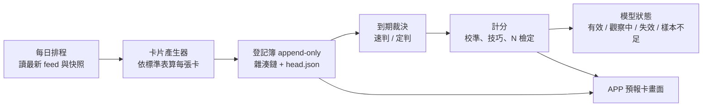

# 規格：預報卡（Forecast Card）

> 狀態：**已確認**（2026-11-18 使用者確認 §5 標準卡集合、§6.5 失效門檻由 Claude 決定並獲接受、§10 前兆不計入、§8 第一階段只做歷史類比、§13 的發布條件）。實作尚未開始。
> 依據：[`docs/reports/hazard_v1/README.md`](../reports/hazard_v1/README.md)（連續式風險函數 v1.1 回測）、[`docs/audit/2026-11-17_全面審查.md`](../audit/2026-11-17_全面審查.md)
> 程式依據：`app/hazard_core.py`（`region_probability`、`reliability`）、`app/export_feed.py`、`.github/workflows/hourly-feed.yml`、`pipeline/src/06_hazard_model.py`
> 相關：跨目錄比對規格 [`catalog_event_matching_spec.md`](catalog_event_matching_spec.md)

## 1. 為什麼要做

使用者想要「看起來像民間地震預報那樣」的輸出：時間、規模、地點、依據、成功與失效標準、可能性評估、影響性評估。

民間預報的問題不在格式，而在三件事：**事後才決定怎樣算準**、**只公布猜中的**、**沒有人算過整體命中**。
預報卡把格式留下來，把這三件事堵死：

| 民間預報常見做法 | 預報卡的做法 | 為什麼這樣才可信 |
|---|---|---|
| 成功標準事後解釋（「附近」「前後幾天」） | 發布當下就鎖定區域、規模、時間窗與裁決方式 | 標準固定，結果才不能被調整 |
| 只貼猜中的 | **固定時程發固定規格的卡**，不准挑 | 排除選擇性發表 |
| 一次命中就當成證明 | 單張卡不評對錯，**累積後看校準與技巧分數** | 機率預報的對錯只能用整批卡判斷 |
| 沒有基準 | 每張卡並列「平常值」與「均勻值」 | 沒有基準就看不出模型有沒有比常識好 |

**先講清楚的限制**：本專案做的是**機率預報**，不是「某天某地一定會震」的預言。沒有任何已證實的方法能做到後者，卡片上也不會出現那種宣稱。

## 2. 設計原則

1. **預先登記**：卡片一旦發布不可修改，只能新增「裁決」紀錄。
2. **固定規格、固定時程**：標準卡由程式依表產生，不手動挑選。
3. **機率與基準並列**：每張卡都有模型機率、平常值（只有背景）、均勻值。
4. **誠實的下限**：樣本不足就標「樣本不足」，不顯示技巧分數。
5. **前兆不進分數**：地磁、GNSS、碎形等資料，回測證明有增益之前，只能展示，不能計入機率（見 §10）。
6. **影響評估是條件式**：「若發生，可能如何」，不是預報的一部分，也不計分。

## 3. 流程

## 4. 預報卡的內容

### 4.1 七個欄位（對應使用者要的格式）

| 欄位 | 內容 | 來源 |
|---|---|---|
| 時間 | 發布時間（UTC）、時間窗長度 T（天）、結束時間 | feed 的 `issued_at` |
| 規模 | 規模門檻 m，**ML**（CWA 地方規模） | 標準表 |
| 地點 | 區域定義（圓心＋半徑，或全區網格） | 標準表 |
| 依據 | 模型版本、各因子貢獻、最近觸發事件、資料狀態 | §4.3 |
| 成功與失效標準 | §6，發布時鎖定 | 規格 |
| 可能性評估 | 機率 p、平常值 p_bg、均勻值 p_uni、倍數 | `region_probability` |
| 影響性評估 | §8，條件式 | 歷史類比（第一階段） |

### 4.2 卡片欄位定義（登記簿的一列）

| 欄位 | 型別 | 說明 |
|---|---|---|
| `card_id` | string | `F-<發布UTC yyyymmddThhmm>-<set>-<region>-M<m>-<T>d` |
| `set` | enum | `standard`（標準卡，計分）、`custom`（使用者自訂，**不計分**）、`replay`（回測回放，非預先登記，見 §9） |
| `registered` | bool | `standard`／`custom` 為 true；`replay` 為 false |
| `issued_at` | ISO 8601 Z | 發布時間（取 feed 的 `issued_at`，不取執行時間） |
| `window_end` | ISO 8601 Z | `issued_at + T` |
| `region` | object | `{id, kind, lat, lon, radius_km}`；`kind` 可為 `circle`、`all` |
| `m_min`、`mag_type` | number、string | `ML` |
| `p`、`p_bg`、`p_uni` | number | 模型、只有背景、均勻的機率 |
| `n_full`、`n_bg`、`n_uni` | number | 對應的期望地震數（卜瓦松的 λ） |
| `basis` | object | §4.3 |
| `resolution` | object | §6 的裁決設定（鎖定） |
| `model` | object | `{version, git_sha, params_hash, b, m_ref, mu, K}` |
| `data_status` | object | feed 的 `data_status`（缺口天數、暫時事件數） |
| `prev_hash`、`hash` | string | §7 雜湊鏈 |

### 4.3 「依據」要放什麼

從現有 feed 就能拆出來，不用新模型：

- **背景與近期的比例**：`n_full` 與 `n_bg` 的比值（倍數）。倍數接近 1 代表近期活動幾乎沒加成。
- **觸發事件**：發布前 30 天、區域內或附近最大的幾筆地震（feed 的 `recent`）。
- **可信度提示**：沿用 `hazard_core.reliability` 的外推與回測落差提示。
- **資料狀態**：目錄缺口天數、暫時事件數、可能低估的比例。
- **前兆資料**：只列出來（例：地磁異常旗標），並明確標註「未計入機率」。

## 5. 標準卡集合（防止挑選）

| 項目 | 設定（草案） |
|---|---|
| 發布頻率 | 每日 1 批：UTC 00 時（台北 08 時）內的快照。feed 每 15 分鐘一個快照，所以實際是 00:00／00:15／00:30／00:45 之一（排程在 00:20 跑時通常是 00:15）；**每個 UTC 日期最多一批**（`append_batch` 強制，不只比對發布時間是否相同） |
| 區域（6） | 全台網格；高雄（22.63°N, 120.30°E）、台北（25.04°N, 121.56°E）、宜蘭（24.75°N, 121.75°E）、花蓮（23.98°N, 121.60°E）、台東（22.76°N, 121.14°E），後五者半徑 50 km |
| 規模（7） | ML ≥ 4、4.5、5、5.5、6、6.5、7（7 以上） |
| 時間窗（9） | 1、2、3、5、7、10、14、20、30 天 |
| 總數 | 6 × 7 × 9 = **每天 378 張，一年約 13.8 萬張** |

**使用者確認的集合（2026-11-18）**。以下是落地時的細節，由 Claude 決定：

1. **ML ≥ 6.5 與 ≥ 7 照發，但標記並限制計分**。審查報告 M2 指出 ML 在大地震會飽和，且 M6.5 以上回測樣本極少（`hazard_core.reliability` 已有此提示）。這兩檔的卡固定標「外推、樣本極少」，只有累積事件數達到 §6.5 的門檻才計分；在那之前顯示「樣本不足」。M≥7 實務上整個專案期間都不會有足夠事件，**這是預期結果，不是缺陷**，畫面要直接說明。
2. **時間窗 5、10、20 天不在 feed 的匯出刻度上**。feed 的刻度是 1 小時、3 小時、6 小時、12 小時、1、2、3、7、14、30 天；5、10、20 天是用 `interp_horizon` 在 log–log 空間內插，不是擬合出來的。這三種卡固定帶 `interpolated: true`，統計時**和 1、2、3、7、14、30 天分開**，不合併成同一個分數。
3. **區域重疊**：台北與宜蘭兩個圓約有重疊，各區域卡分開評分，不加總，也不當成獨立樣本。全台是另一個區域。
4. **體積**：378 張／日若每張完整記錄約 700 位元組，一年約 100 MB，不適合放 git。因此登記簿改成「**批次標頭一行＋精簡卡片多行**」：模型版本、資料狀態、裁決設定只在批次標頭寫一次，每張卡只存 `card_id`、`p`、`p_bg`、`p_uni`、`n_full`、`n_bg`、`n_uni`，估計一年約 15–20 MB。**實測（2026-11-18，`app/forecast_card.py`）：一批 378 張約 62 KB，一年約 23 MB 未壓縮**（比估計高約 15%）；git 會壓縮，實際增長較小。雜湊鏈以「批次」為單位。卡片精簡鍵名：`id`、`r` 區域、`m` 規模、`T` 時間窗、`p／pb／pu` 機率（模型／平常／均勻）、`n／nb／nu` 期望數、`x` 外推、`i` 內插。
5. 區域與規模可以增減，但**變更要升級規格版本**，舊卡不改。
6. 使用者想看特定地點時，產生 `custom` 卡，**只展示、不計分**，避免事後只留好看的。

## 6. 成功與失效標準

### 6.1 事件定義（每張卡的「對或錯」）

一張卡的結果 `y`：

> `y = 1`：在 `[issued_at, window_end)` 內，區域內（震央距圓心 ≤ 半徑，邊界算內）發生至少一個 **ML ≥ m_min 的定位良好地震**。否則 `y = 0`。

固定的細節：

| 項目 | 規定 | 為什麼 |
|---|---|---|
| 事件母體 | 與模型相同：定位品質良好（`use_for_features`，方位角空隙 ≤ 110° 或未知） | 模型只預報這個母體。審查 M1、報告限制 4：外海 gap 大的地震不在模型內，用另一個母體裁決會系統性算成「漏報」 |
| 深度 | 不限 | 模型目前不分深度（審查 M6） |
| 規模型態 | 只認 ML；沒有 ML 的事件不計 | 不同尺度不可比（見跨目錄比對規格） |
| 餘震 | 計入 | v1.1 預報的是全部地震（含餘震）。**主震與餘震不能混著講**，卡片上要寫明 |
| 時間 | 採 UTC 事件時間，窗為左閉右開 | 避免邊界重複計 |

### 6.2 裁決（兩階段）

| 階段 | 時間 | 目錄 | 用途 |
|---|---|---|---|
| 速判 | `window_end + 1 天` | 暫時目錄：CWA 有感報告累積檔（`provisional_events.csv`）＋USGS | **分開計分、標「暫時」**，不併入定判統計 |
| 定判 | GDMS 正式目錄涵蓋 `window_end` 之後（見下） | GDMS 正式目錄，只用定位良好的事件 | **模型狀態與對外成績以定判為準** |

**查證結果（2026-11-18，讀程式與既有文件，未實測 GDMS 網站）**

| 待查項 | 結果 | 依據 |
|---|---|---|
| GDMS 正式目錄延遲 | **約 1 個月以上**，目前靠手動下載，審查估落後約 1.5 個月 | `docs/phase2/data_source_comparison.md` 第 37 行（11/4 時最新只到 9/30）；審查報告 4.2 |
| 暫時事件有定位品質欄位嗎 | **沒有**。暫時事件只有 `time, lat, lon, depth, ml, source, source_id, fetched_at` | `app/live_update.py` 的 `PROV_COLS` |
| 暫時目錄會漏事件嗎 | **會**。CWA API 只留最新 16 筆，漏抓補不回來；USGS 查詢門檻 M≥3.5，且是 mb 等不同規模尺度，ML−mb 在淺層約 +0.15（跨目錄比對規格） | `live_update.py`、`catalog_event_matching_spec.md` |

**對設計的影響（Claude 決定）**

1. **定判最早在視窗結束後約 1.5 個月，30 天窗約 2.5 個月。** 12/9 前不會有任何前瞻卡取得定判。所以上台時，前瞻成績**只能是速判**，必須明說「暫時目錄、尚未定判」。
2. **速判和定判的事件母體不一致**：暫時事件沒有定位品質欄位，無法套用模型用的「gap ≤ 110° 或未知」篩選。速判一律標註「含未篩定位品質的事件」，傾向多算（外海定位差的事件被算進去），所以速判的「發生率」可能比定判高。
3. **規模尺度混用**：USGS 獨有的事件（CWA 沒報的）規模多半是 mb，換成 ML 會偏低，所以 ML≥m 的速判可能少算。與上一點方向相反，兩者**無法互相抵消**，也沒有量化，所以不做修正，只在畫面標示。
4. **速判完整度自我檢查**：每次定判資料到手，用同一個視窗比較速判事件與正式事件，記錄各規模門檻的召回率與多報率。累積後才能說明速判在 ML≥4、4.5、5 各有多可靠；沒有這個數字之前，不宣稱速判完整。
5. 定判到手的流程是**手動匯入**（目前 GDMS 要手動下載）；匯入後由 `forecast_resolve.py` 一次補上所有可裁決的卡。

### 6.3 單張卡不評對錯

機率預報的單次結果不能證明模型對錯（例：p = 3% 的卡，發生也不代表準，沒發生也不代表錯）。所以單張卡只標示 `y`，並顯示「過去 p 在相近範圍的卡，實際發生率是多少」。

### 6.4 整體標準（累積計分，發布前鎖定）

對每個模型版本、每個「規模 × 時間窗」組合，只用**定判**的標準卡（速判用同一套指標另外統計，畫面標「暫時」，不併入）：

| 指標 | 定義 | 判讀 |
|---|---|---|
| 校準 | 把卡依 p 分箱，比較平均 p 與實際發生率（reliability diagram）；每箱至少 20 個事件才畫 | 偏離對角線代表高估或低估 |
| N 檢定 | 觀測事件數對 Poisson(期望總數) 的雙尾檢定，2.5%／97.5% | 超出代表總量不準 |
| 資訊增益 | 每個事件平均多得到的對數似然（nat），對均勻、對只有背景 | 沿用 `06_hazard_model.py` 的定義；> 0 代表比對照好 |
| Brier 技巧 | `1 − BS / BS_ref`（`BS = mean((p−y)²)`） | 稀有事件時零為主，只當輔助 |

**獨立性處理**：標準卡的時間窗互相重疊，且餘震會讓事件成群。顯著性檢定只用**不重疊的子樣本**（T 天窗每 T 天取一張），其餘卡僅描述性呈現；卜瓦松假設在成群下可能偏樂觀，要寫在報告裡。

### 6.5 模型狀態與失效標準（草案，第一張卡發布前定案）

| 狀態 | 條件 |
|---|---|
| 樣本不足 | 該組合近 90 天定判事件 < 20 |
| 有效 | 近 90 天 N 檢定未超出，且對只有背景的資訊增益 > 0 |
| 觀察中 | 有一項未達標 |
| **失效** | 連續兩次月評估 N 檢定超出，**或**近 90 天（事件 ≥ 20）對只有背景的資訊增益 ≤ 0 |

- 「失效」的標示會顯示在該模型版本的所有卡片上，不能隱藏。
- 門檻（90 天、20 個事件、兩次月評估）**已由使用者接受（2026-11-18）**，寫入規格版本 v1；第一張標準卡發布後不得調整，要調整只能升級規格版本、舊卡照舊規則評。
- 一個「規模 × 時間窗」組合算一個評估單位；378 張卡共有 63 個組合（7 × 9），再乘 6 個區域。**各區域分開評估，另外對「全台」做主要評估**，其餘區域事件太少時一律是「樣本不足」，這是預期結果。
- 失效後可以發布新模型版本，但新版本的紀錄從零開始，不得沿用舊版的好成績。

### 6.5.1 實作對應（`app/forecast_resolve.py`，2026-11-18）

| 規格 | 實作 |
|---|---|
| 裁決紀錄 | 另一本只能新增、同樣雜湊鏈的紀錄（`--results`），**不改登記簿**；同一張卡同一階段只裁決一次，速判與定判是兩筆 |
| 事件定義 | 窗 `[issued_at, issued_at+T)`；規模含等號；圓形邊界含等號；`all`＝整個網格（緯 21–26、經 119–123）；回報發生數、最大規模與最大的 3 筆事件 |
| 速判 | 視窗結束後 1 天才裁決，且暫時目錄的最後一次抓取要晚於視窗結束。記下視窗內相鄰兩次抓取的最大間隔，**超過 3 小時標 `maybe_missing`**（CWA API 只留最新 16 筆，間隔長就可能漏事件） |
| 定判 | 只在正式目錄涵蓋視窗結束之後才裁決；目錄用 `load_events(..., "located")`（定位良好，與模型同一母體） |
| 獨立性 | 檢定只用不重疊子樣本：同一組（區域、規模、時間窗）內，貪婪地取 T 天窗每 T 天一張 |
| N 檢定 | 觀測事件數對 Poisson(期望總數) 的雙尾檢定，p < 2.5% 於任一尾即「超出」 |
| 資訊增益 | 與回測同一個函式 `hazard.poisson_ll`，對「平常」與「均勻」各算一次 |
| 校準 | p 依 [0, 0.1%, 1%, 5%, 10%, 25%, 50%, 100%] 分箱；發生的卡少於 20 張的箱子標「樣本不足」 |
| 狀態 | 近 90 天、不重疊子樣本；「連續兩次月評估」＝這次與 30 天前各評估一次；事件 < 20 → 樣本不足；增益 ≤ 0 或連兩次 N 超出 → 失效；單次 N 超出 → 觀察中；其餘 → 有效。`custom` 卡、不同模型版本、速判／定判各自分開 |

**尚未實作**：Molchan 警示評估（§6.6，選配）、模型狀態的畫面、定判的資料取得流程（GDMS 要手動下載）。

### 6.6 可選：警示型成功標準（Molchan）

若要有「達到門檻就算警示」的玩法（例：倍數 ≥ R 且 p ≥ p0），警示規則也要發布前鎖定。評估用 **Molchan 圖**：橫軸警示占用的時空比例，縱軸漏報率；對角線代表隨機。R、p0 不得事後調整。這部分是選配，不影響標準卡。

## 7. 登記簿（讓「預先登記」可驗證）

### 7.1 儲存位置

- 新增 **`forecasts` 分支**，一般提交、**不強制推送**。
- **不能用 `feed` 分支**：`hourly-feed.yml` 每次都強制推送、只留一個提交（為了控制 repo 體積），歷史會被覆蓋。
- 檔案：
  - `registry/YYYY-MM.jsonl`：卡片，每行一張，只新增。
  - `results/YYYY-MM.jsonl`：裁決紀錄，每行一筆，引用 `card_id`。新增，不改舊行。
  - `head.json`：最新的 `hash`、卡片數、更新時間。

### 7.2 雜湊鏈

`hash = sha256(prev_hash + canonical_json(card，不含 hash))`。任何舊卡被改，後面所有 `hash` 都對不上。

### 7.3 誠實的限制

repo 擁有者**技術上仍可重寫分支歷史**。能做的緩解：

| 緩解 | 效果 | 成本 |
|---|---|---|
| 分支保護（禁止強制推送、禁止刪除） | 防誤操作與一般改寫 | GitHub 設定，使用者操作 |
| 把 `head.json` 的雜湊印在簡報與海報上並註明日期 | 現場可驗證 | 低 |
| 把 `head.json` 的快照存到第三方（例：網路檔案館） | 外部時間證據 | 需確認可行性，未驗證 |

規格不宣稱「無法竄改」，只宣稱「竄改會被偵測，前提是有人保存過先前的 head 雜湊」。

## 8. 影響性評估（條件式）

**位置**：只呈現「若 ML ≥ m 的地震發生在區域內，歷史上類似事件的情況」，不是預報，不計分。

### 第一階段（12/9 前目標）：歷史類比

- 從正式目錄找：規模在 `m ± 0.3`、震央在區域內或距離相近的歷史事件；列出時間、規模、深度、距離與次數。
- 若有感報告含各地震度，附該事件的最大震度與主要受影響縣市。**是否含震度欄位，待確認**（需讀 `live_update.py` 抓取的有感報告欄位）。
- 與「如果真的發生會怎樣」功能共用（使用者希望直接拿歷史大地震對比）。

### 第二階段（不保證 12/9 前完成）：震度估計

- 需要選定並驗證適用台灣的地動衰減式。**本規格不指定公式**：專案目前沒有 PGA、PGV 或震度換算的實作（審查報告已列為不適用項目），選用前要查證文獻並以歷史事件回測。
- 完成前，畫面上不顯示任何震度推估數字。

## 9. 回放卡（讓 12/9 有東西可看）

**問題**：標準卡從發布日起才計；到 12/9 只有約三週的前瞻資料。7 天窗約兩週後才能裁決，高雄 ML ≥ 5 的事件很可能一個都沒有，**現場拿不出有統計意義的成績**。

**做法**：用現有回測機制，對過去日期產生**回放卡**：

- 每張回放卡只用「該發布時間之前」的資料與當時能得到的參數（沿用 `06_hazard_model.py` 的滾動校準，已是只用過去資料）。
- 標記 `set = replay`、`registered = false`，畫面上固定標「回測，非預先登記」。
- 計分方式與標準卡相同，但**和標準卡分開統計**，不能合併成一個數字。

這樣上台時能呈現：校準圖、資訊增益（來自回測，見 `hazard_v1` 報告）與「前瞻卡才剛開始累積」的誠實說明。

## 10. 前兆資料的位置

| 資料 | 現況 | 規則 |
|---|---|---|
| 地磁（8 站已處理） | 尚未接進 feed 與畫面 | 先只當「依據」欄的展示項 |
| GNSS 形變（TGM）、TECDC、碎形日報 | 未納入 | 同上，來源可信度須先查證 |
| 納入機率的條件 | 在測試期的**滾動回測**中，加入後對只有背景的資訊增益有顯著提升 | 沒通過就維持展示；通過才出新模型版本，並走 §6.5 的重新計分。展示檔與來源查證見 [`precursor_sources.md`](precursor_sources.md)（`app/export_precursors.py`，固定標「未計入機率」） |

為什麼這樣規定：把資料「放進去」不等於模型變好，沒回測就計入，等於製造假訊號。

## 11. 用語規定（畫面與簡報）

- 稱「**機率預報**」或「預報卡」，不稱「預測」「預言」。
- 每張卡固定顯示：機率、平常值、倍數、這個機率範圍的歷史實際發生率、模型狀態、「非預警」標註。
- 禁止顯示：「將會發生」「不會發生」「安全」這類確定語氣。
- 要玩主題皮膚（例：成長、等級）可以，但數字與狀態一律照實顯示，主題只換外觀。

## 12. 實作範圍與影響

### 12.1 預計新增（尚未動手）

| 檔案 | 用途 |
|---|---|
| `app/forecast_card.py` | 卡片產生器（讀 feed 快照，用 `hazard_core` 算區域機率，寫登記簿） |
| `app/forecast_resolve.py` | 速判、定判、計分、模型狀態 |
| `pipeline/tests/test_forecast_card.py` | 單元測試（卡片欄位、雜湊鏈、裁決邊界、計分） |
| `.github/workflows/forecast-daily.yml` | 每日排程，推到 `forecasts` 分支（一般推送） |

### 12.2 需要修改

| 檔案 | 修改 | 原因 |
|---|---|---|
| `app/export_feed.py` 或卡片產生器 | 補**均勻對照** `n_uni` | 目前 feed 只有 `n_full`、`n_bg`；`backtest.csv` 才有均勻 |
| APP（`earthquake-risk-app`） | 預報卡畫面、模型狀態、回放卡切換 | 另一個 repo，另開 PR |

### 12.3 風險

| 風險 | 影響 | 處理 |
|---|---|---|
| GDMS 正式目錄延遲約 1.5 個月、手動下載 | 定判很晚；12/9 前沒有任何前瞻定判 | §6.2：前瞻成績只報速判並明說暫時；定判批次補裁決 |
| 速判母體與模型不一致、規模尺度混用 | 速判發生率可能偏高或偏低，方向不確定 | §6.2 第 2、3 點標註；定判後算召回率與多報率（第 4 點） |
| 排程延遲、漏跑 | 當日卡缺漏 | 產生器讀 `issued_at` 而非執行時間，漏跑時補算並標註補發；缺漏本身記錄在 `head.json` |
| 審查必修項尚未全修（b 值、參數卡邊界、均勻校準） | 卡片機率不可信 | v1.1 已修 M1、M4，M3 已放寬搜尋範圍但 alpha 仍落在下限 0（見 `hazard_v1` 報告）；M2、M5、M6 等其餘項目要在**第一張標準卡發布前**確認，否則先不發 |
| 資料量 | 每年約 13.8 萬行 JSONL | 用批次標頭加精簡卡片，估計 15–20 MB／年（§5 第 4 點）；實作時實測 |
| 擁有者可改寫歷史 | 預先登記的可信度 | §7.3 緩解，且規格不誇大 |
| 事件成群（餘震） | 檢定偏樂觀 | 用不重疊子樣本；報告註明 |
| **「倍數」處理結果（審查 M5，2026-11-18 已修）**：首批試算發現高雄所有卡的 n÷nb 約 0.71–0.73、全台 0.87–0.94，原因是「平常」用了完整模型的校準倍率（只有背景自己的倍率大 1.4–1.8 倍），「平常」被低估約 1.5–1.8 倍。修正後（`hazard.background_only_export`）：全區 7 天「平常」總量 11.29 個 M≥3.5，與近兩年平均每 7 天 11.2 個吻合；完整模型 6.24 個，與近 3–6 個月約每 7 天 6 個吻合。**倍數的意義**：模型 ÷ 近兩年平均水準，小於 1 代表現在比平均安靜，不是「比較安全」。歷史分布（全區、M≥3.5、7 天，2016–2026 每 4 週取樣、n=140，兩模型各自校準）：中位數 1.04、P10–P90＝0.69–1.46、44% 的時間小於 1、最大 3.8（2024 年花蓮地震後）；2026-09-30 的全區 0.55 低於 P10，屬於偏安靜的時期。已寫入每批標頭的 `notes`。 |
| ~~（修正前）「倍數」可能系統性小於 1~~（審查 M5） | 實測首批卡（2026-09-30 快照）：高雄所有卡的 n÷nb 都約 0.71–0.73，全台約 0.87–0.94，即使近期沒有大地震。機制（讀 `params.json` 與 `background_rescale` 得到，未另行實驗驗證）：完整模型的背景倍率 mu＝0.426，「只有背景」單獨擬合的 mu＝1.223（相差 2.87 倍）。完整模型把大部分地震歸給近期項，背景項只佔約三分之一；「平常值」則用只有背景的倍率換算回總量。所以在近期沒什麼活動的地方，完整模型的總量會比「平常值」低 | 倍數不能直接當「比平常高幾倍」解讀。第一張標準卡發布前要處理 M5，或在卡片與畫面把倍數改稱「相對只有背景模型的比值」並說明可能小於 1 |

## 13. 決定紀錄（2026-11-18，使用者確認）

| # | 決定 | 結果 |
|---|---|---|
| 1 | 標準卡集合 | 6 區域 × 7 規模 × 9 時間窗，細節見 §5 |
| 2 | 失效門檻 | 由 Claude 決定，使用者接受（§6.5） |
| 3 | 前兆資料 | 先不計入機率，回測證明有增益才計入（§10） |
| 4 | 影響評估 | 先只做歷史類比（§8 第一階段） |
| 5 | 第一張標準卡的發布條件 | **審查剩餘必修項確認後才發**，不為趕 12/9 先發 |
| 6 | 其餘細節 | 由 Claude 決定，已寫入各節 |

**發布前的檢查清單**（全部通過才發第一張標準卡）：

- [ ] 審查報告的立即必修項逐項確認：b 值、參數卡邊界（alpha 仍在下限）、均勻對照校準、Windows 編碼
- [x] 均勻對照 `n_uni`：`eqforecast/hazard.py` 的 `uniform_expected_ref`（與回測的均勻對照同一定義，單元測試通過）。**不放進 `feed.json`**，由卡片產生器自己算，避免動到手機 APP 的格式檢查
- [x] GDMS 更新延遲與暫時事件的定位品質欄位已查證（§6.2）
- [ ] `forecasts` 分支建立，並已設定禁止強制推送
- [x] 登記簿實際體積已實測：一批約 62 KB、一年約 23 MB 未壓縮（§5 第 4 點）
- [x] 測試通過：卡片欄位與雜湊鏈（`test_forecast_card.py`，18 個）、裁決邊界與計分（`test_forecast_resolve.py`，21 個）
- [x] `forecast-daily.yml` 已寫（§14）；**要你手動做的上線步驟**（建分支、設保護、打開總開關）見 §14
- [x] 「倍數」處理完畢（§12.3）：M5 已修，倍數的語意與歷史分布寫入批次標頭 `notes`

## 14. 每日排程與上線步驟

**檔案**：[`.github/workflows/forecast-daily.yml`](../../.github/workflows/forecast-daily.yml)

### 14.1 每日做什麼（UTC 00:20，台北 08:20）

| 步驟 | 內容 | 失敗時 |
|---|---|---|
| 1 | 讀 `feed` 分支累積的暫時事件與抓取紀錄，用 `live_update` 重算到最近的 15 分鐘快照（UTC 00 時內） | 整個工作失敗 |
| 2 | 發布標準卡（`forecast_card.py`） | 快照發布時間距現在超過 2 小時就**不發**，缺漏留在紀錄裡，不事後補算；同一天重跑只印「已發布過」並正常結束 |
| 3 | 速判（`forecast_resolve.py resolve --stage speed`） | 沒有成功的抓取紀錄就明確失敗 |
| 4 | 計分與模型狀態，寫成 `scores/speed.json`（標「暫時」） | — |
| 5 | 驗證登記簿與裁決紀錄的雜湊鏈，再**一般推送**到 `forecasts` 分支（絕不強制推送） | 驗證不過就不推送 |
| 6 | 最後一步：發布、速判、計分任何一項失敗，整個工作標為失敗（但前面的步驟不會被擋住） | — |

定判**不在排程裡**：GDMS 正式目錄要手動下載，匯入後手動執行 `forecast_resolve.py resolve --stage final --formal <events.parquet>`。

### 14.2 這次為了排程補的三個東西

1. **抓取紀錄 `fetch_log.csv`**：`live_update` 每次抓取寫一列（時間、USGS 與 CWA 各自成不成功、CWA 單一資料集回了幾筆）。原本速判是用暫時事件裡的 `fetched_at` 判斷有沒有連續抓取，但那只是「該事件最後一次被看到的時間」（同一事件重抓會被覆蓋），不是抓取紀錄，實際運作會誤判。`hourly-feed.yml` 現在也會把它存到 `feed` 分支。
2. **`generated_at`**：每批標頭記錄實際產生時間，和 `issued_at`（快照時間）並列，之後可以檢查「發布當下」是否名副其實。
3. **`--max-lag-hours`**（預設 2）：見上表步驟 2。

### 14.3 上線步驟（**要你手動做**，順序不能換）

1. 合併這個分支到 `main`（排程只會在預設分支上跑）。
2. GitHub → Actions → **Forecast daily** → Run workflow，勾選 `init_branch`，建立空的 `forecasts` 分支。
3. 為 `forecasts` 新增保護規則：**禁止強制推送、禁止刪除**（Settings → Rules → Rulesets，或 Branches）。**新增之後要確認狀態是 Active**：GitHub 新增 ruleset 時預設是 Disabled，Disabled 的規則完全不生效；可用 `gh api repos/<repo>/rules/branches/forecasts` 檢查，要回傳含 `deletion` 與 `non_fast_forward` 的清單，回傳 `[]` 代表沒生效。（這是「預先登記」可信度的前提，見 §7.3。）
4. 確認 §13 的發布前檢查清單**全部**通過。
5. Settings → Secrets and variables → Actions → **Variables** → 新增 `FORECAST_ISSUE_ENABLED` = `true`。**這一步之後，下一次排程就會發出第一批標準卡，無法收回。**

**排程觸發**：GitHub 內建排程在這個倉庫實測不可靠（`hourly-feed.yml` 已改由外部服務每 15 分鐘呼叫 `workflow_dispatch`）。`forecast-daily` 的 `schedule` 同樣可能延遲或被略過；超過 2 小時就不發當天的卡。若要穩定，可讓同一個外部服務在 UTC 00:20 呼叫這個工作流程的 `workflow_dispatch`（不帶 `init_branch`）；兩種觸發同一天都跑也沒關係，第二次會因為「當天已發布」直接略過。

在第 5 步之前，排程每天都會被略過（`daily` 工作的條件是這個變數為 `true`），不會寫入任何東西。

### 14.4 尚未驗證的部分

- 這個工作流程**還沒有在 GitHub 上實際跑過**。我在本機照順序跑過每個指令（含延遲拒絕、重複發布、驗證），並檢查了 YAML 語法，但 Actions 環境（權限、`checkout` 其他分支、`vars` 條件、排程的實際延遲）要第一次跑才知道。建議先手動跑 `init_branch`，再在打開總開關前手動觸發一次（會因為總開關關閉而略過，確認不出錯）。
- 排程延遲超過 2 小時的頻率不知道；若常發生，要調整 cron 時間或延遲上限（調整延遲上限會改變「預先登記」的嚴格度，要升級規格版本）。

