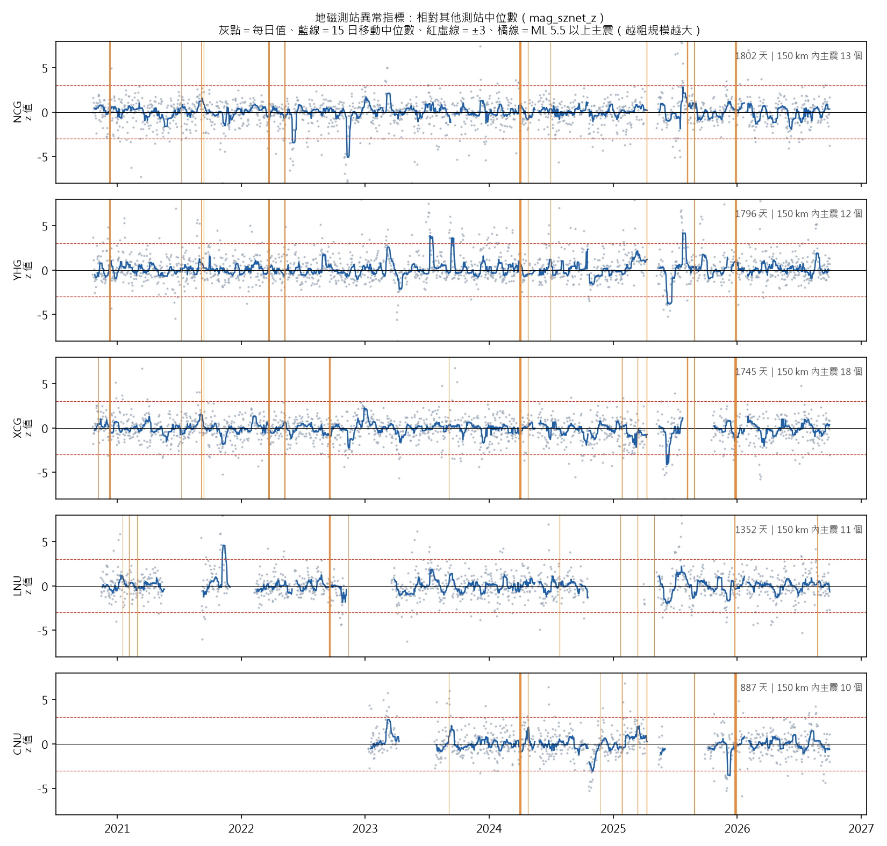
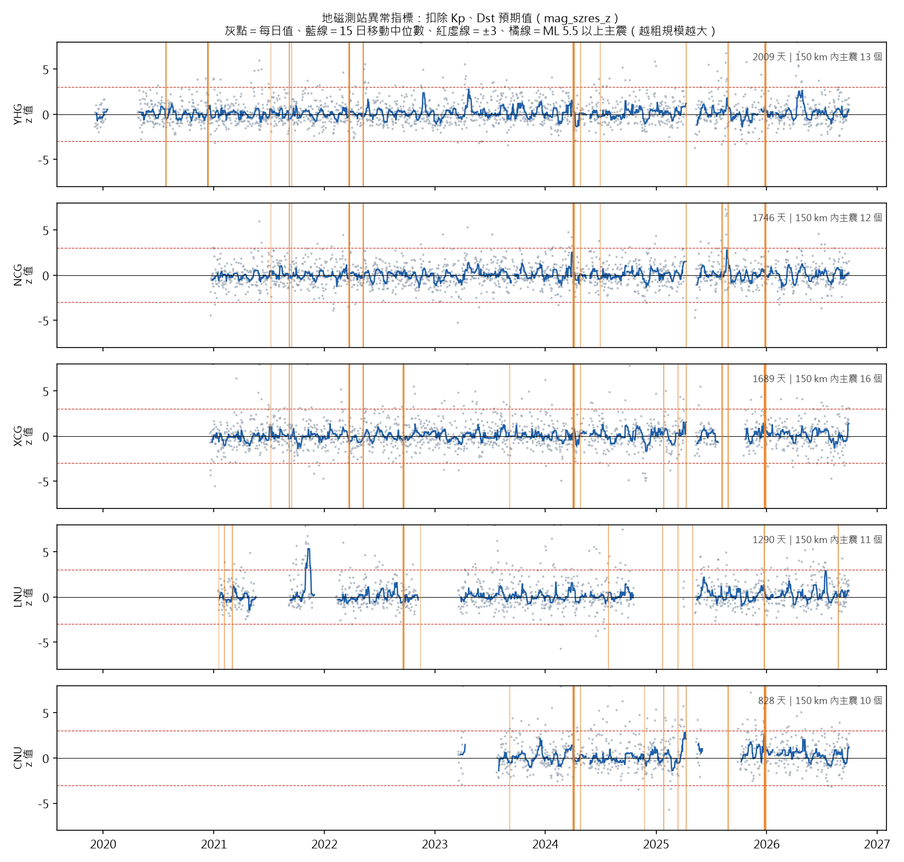
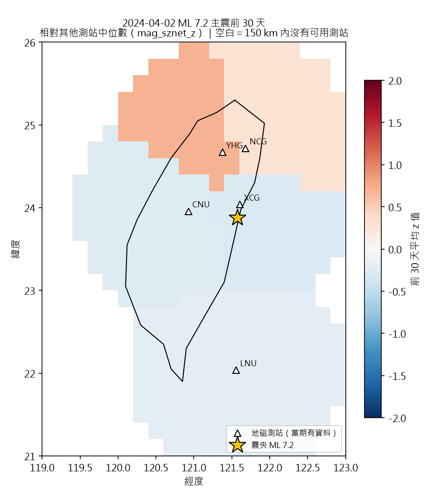
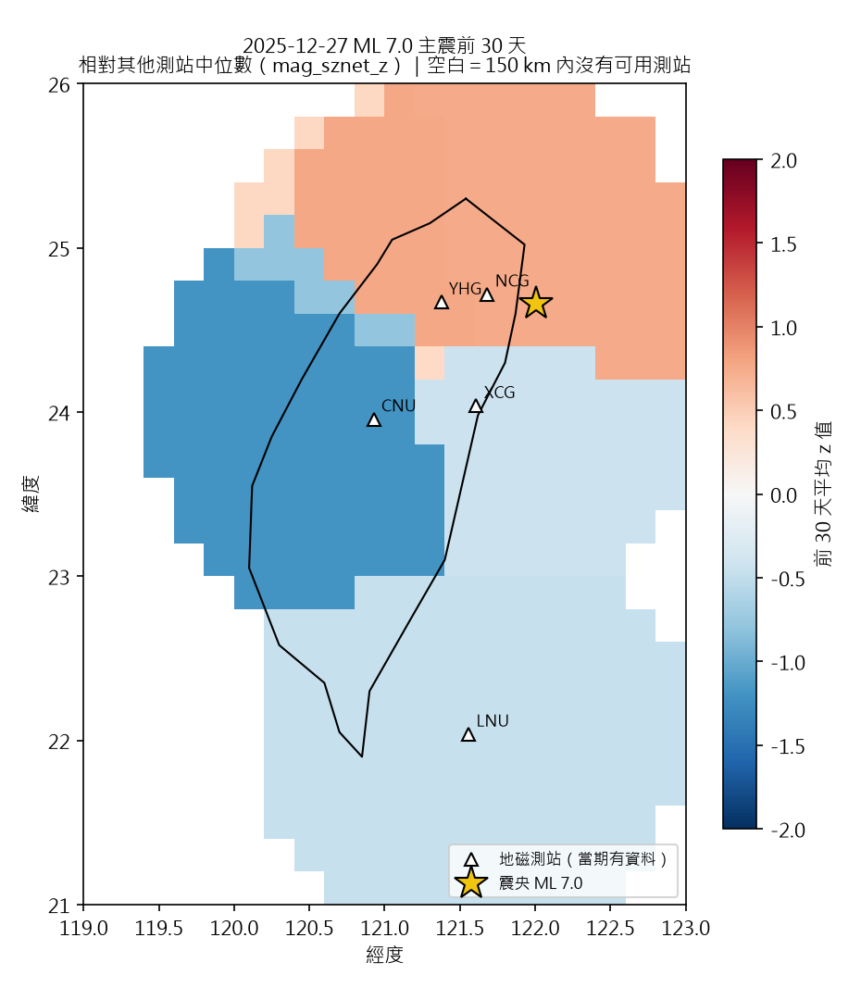
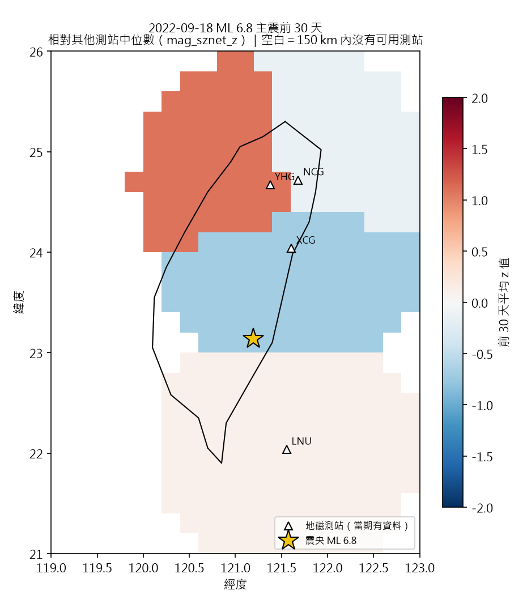
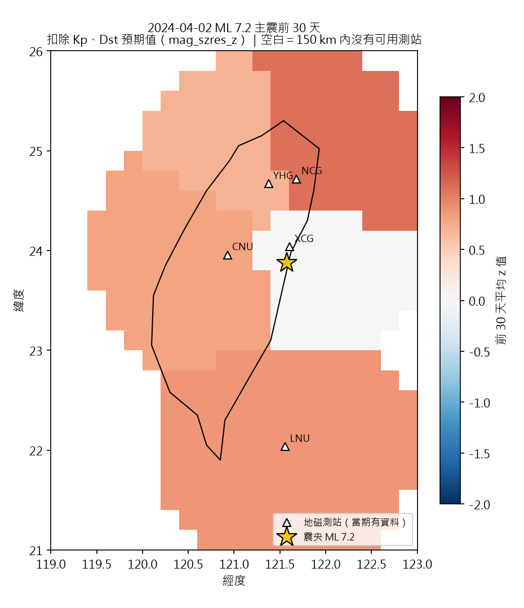
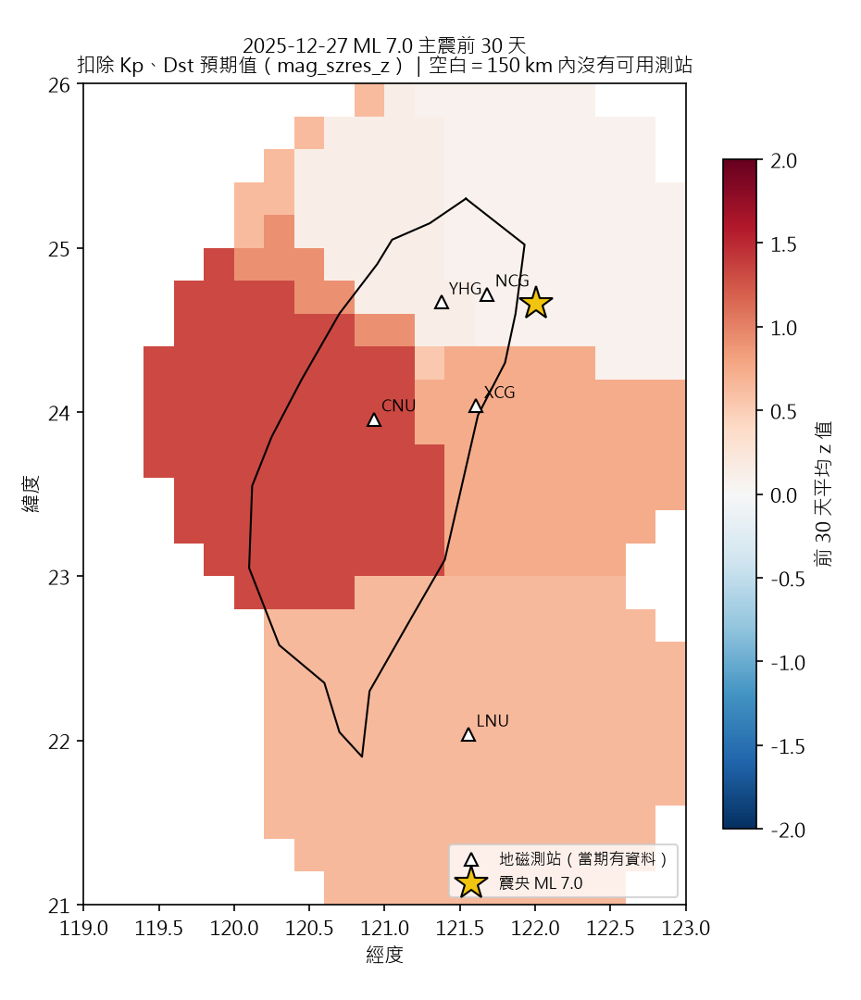
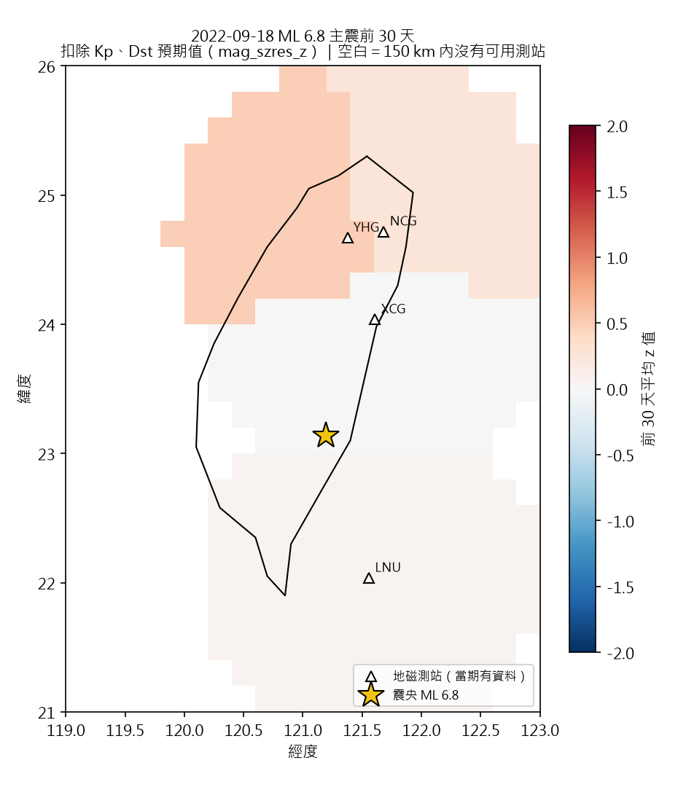

# B2 視覺化

> 由 `pipeline/src/13_visualize_precursors.py` 產生（2026-11-13 00:22）。對應需求 FR-B2-24。

**讀圖須知**：這些圖用來看資料長什麼樣，不是前兆存在的證據。單一地震前出現高值可能只是巧合；有沒有預報價值要看全部事件與隨機對照（B3 回測）。地圖只用主震發生前的資料。海岸線是手工取點的粗略輪廓，只供辨識位置。

## 測站時間序列：相對其他測站中位數

測站（依有值天數排序）：NCG、YHG、XCG、LNU、CNU

## 測站時間序列：扣除 Kp、Dst 預期值

測站（依有值天數排序）：YHG、NCG、XCG、LNU、CNU

## 網格地圖：相對其他測站中位數

## 網格地圖：扣除 Kp、Dst 預期值

