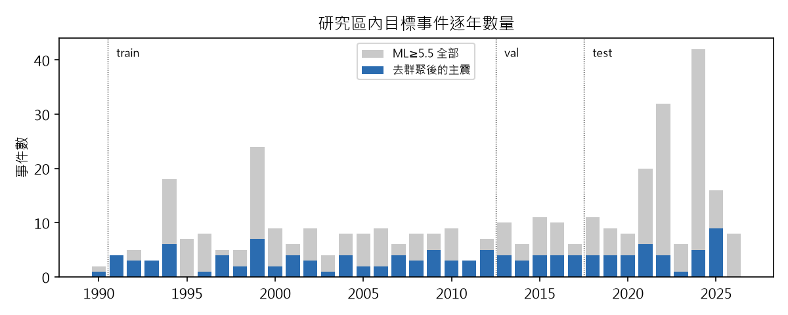
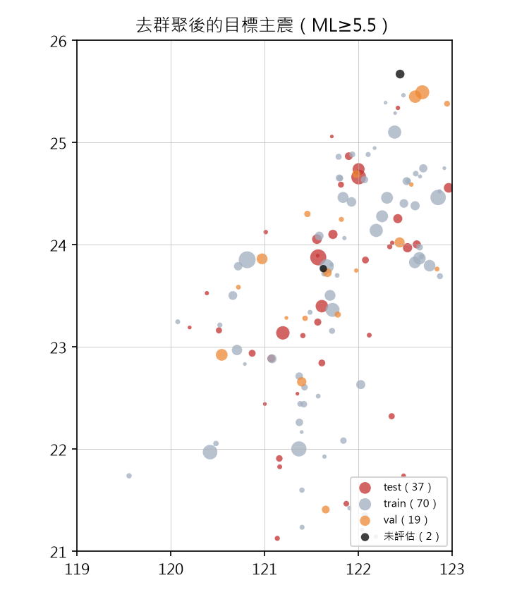
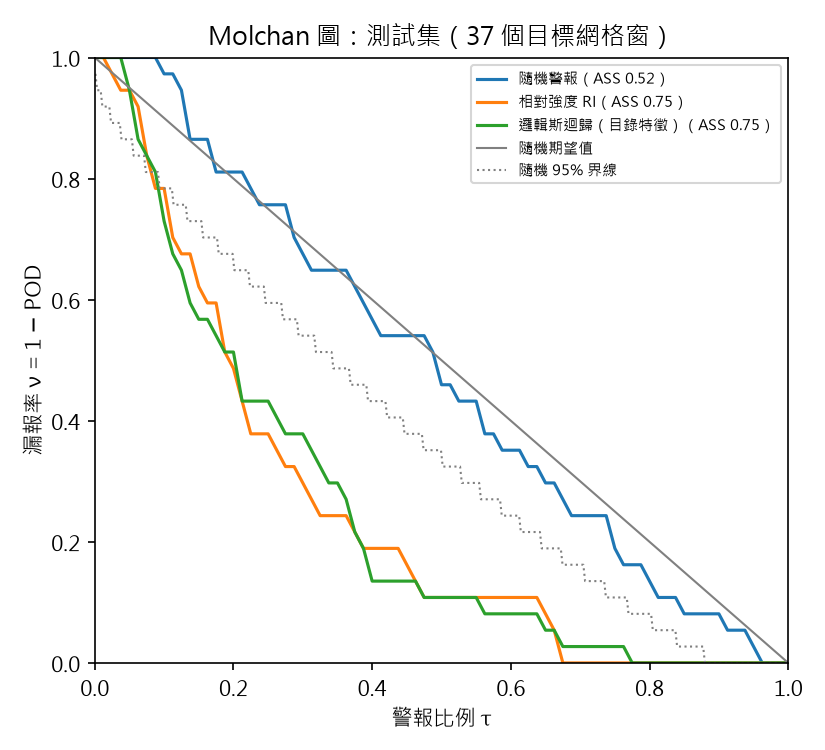

# B3 基準模型回測報告（cell0p5）

> 由 `pipeline/src/03_train_backtest.py` 自動產生於 2026-11-02 17:00，所有數字來自同目錄設定下的 `pipeline/data/b3_<tag>/metrics.json`。重新執行會覆寫本檔。

## 這份報告回答什麼

只用地震目錄，能把「下一個預報窗內，哪些網格會發生 ML≥5.5 主震」預報到什麼程度？這條基準線是之後檢驗前兆的標準：**加入前兆後，必須在相同警報比例下顯著贏過它**，才能說前兆有額外資訊。

## 1. 設定

| 項目 | 值 |
|---|---|
| 研究區 | 21.0–26.0°N、119.0–123.0°E |
| 網格 | 0.5°（10×8 = 80 格） |
| 預報窗 | 30 天，不重疊；共 433 個發布時間點（1991-01-01 起） |
| 目標事件 | ML ≥ 5.5、深度 不限、去群聚後的主震 |
| 去群聚 | gardner_knopoff，前震視窗比例 0.1 |
| 特徵事件 | ML ≥ 3.0（`events.parquet` 全部列：Gap≤110 或未知，加上 ML≥5.5 目標） |
| 時間切分 | 訓練 1991-01-01～2013-01-01、驗證 2013-01-01～2018-01-01、測試 2018-01-01～2026-07-30（右端不含） |
| 目錄期間 | 1990-01-01 ～ 2026-07-30 |

**洩漏檢查**（每個切分最後一個標籤的結束時間，都早於下一個切分的第一個發布時間）：

- train->val：標籤結束 2012-12-06 ≤ 下一段起點 2013-01-05 ✅
- val->test：標籤結束 2017-12-10 ≤ 下一段起點 2018-01-09 ✅

## 2. 去群聚

研究區內 ML≥5.5（深度不限）：**370 筆 → 主震 128 筆**（65% 屬於前震或餘震）。



**事件間隔的群聚程度**（Weibull 形狀參數 k：1 = 隨機，< 1 = 群聚；CV：1 = 隨機，> 1 = 群聚）

| 子集 | 間隔數 | Weibull k | CV |
|---|---|---|---|
| ML>=5.5 raw | 369 | 0.483 | 1.34 |
| ML>=5.5 declustered | 127 | 0.972 | 1.05 |
| ML>=6.0 raw | 119 | 0.486 | 1.39 |
| ML>=6.0 declustered | 52 | 0.953 | 0.99 |

去群聚後 k 與 CV 越接近 1，代表餘震造成的群聚被移除得越完整。

**k = 0.658 的重新驗證**：上表沒有任何子集的 k 落在 0.658 ± 0.02 內，提案也沒有記錄計算方式，所以目前**無法重現**。建議報告不要再引用 0.658，改用上表可重現的值，並註明子集與方法。

**參數敏感度**（研究區內 ML≥5.5 主震數）

| 方法 | 前震視窗比例 | 主震數 |
|---|---|---|
| gardner_knopoff | 0.0 | 146 |
| gardner_knopoff | 0.1 | 128 |
| gardner_knopoff | 1.0 | 96 |
| uhrhammer | 0.0 | 213 |
| uhrhammer | 0.1 | 204 |
| uhrhammer | 1.0 | 168 |



## 3. 樣本與目標

| 切分 | 發布次數 | 目標網格窗（去群聚） | 目標網格窗（不去群聚） |
|---|---|---|---|
| train | 267 | 70 | 143 |
| val | 60 | 19 | 42 |
| test | 104 | 37 | 99 |
| purged | 2 | — | — |

一個「網格窗」= 一個網格 × 一個預報窗。同一格同一窗有兩個主震時只算一次。

## 4. 結果（測試集、去群聚目標）



曲線越靠左下越好；落在灰色點線（隨機 95% 界線）左下方，才代表顯著優於隨機警報。

**不依賴門檻的總結**

| 模型 | 正則化 C | 驗證 ASS | 測試 ASS |
|---|---|---|---|
| 隨機警報 | — | 0.517 | **0.516** |
| 相對強度 RI | — | 0.802 | **0.753** |
| 邏輯斯迴歸（目錄特徵） | 0.010 | 0.844 | **0.750** |

**固定警報比例 τ 下的 POD／FAR／CSI**（每個發布時間點，對分數最高的 τ 比例網格發警報）

| 模型 | τ | 命中 | 誤報 | 漏報 | POD | FAR | CSI | 機率增益 | p（vs 隨機） |
|---|---|---|---|---|---|---|---|---|---|
| 隨機警報 | 1% | 0 | 104 | 37 | 0.00 | 1.000 | 0.000 | 0.0 | 1.000 |
| 隨機警報 | 2% | 0 | 208 | 37 | 0.00 | 1.000 | 0.000 | 0.0 | 1.000 |
| 隨機警報 | 5% | 0 | 416 | 37 | 0.00 | 1.000 | 0.000 | 0.0 | 1.000 |
| 隨機警報 | 10% | 1 | 831 | 36 | 0.03 | 0.999 | 0.001 | 0.3 | 0.980 |
| 相對強度 RI | 1% | 0 | 104 | 37 | 0.00 | 1.000 | 0.000 | 0.0 | 1.000 |
| 相對強度 RI | 2% | 1 | 207 | 36 | 0.03 | 0.995 | 0.004 | 1.1 | 0.608 |
| 相對強度 RI | 5% | 2 | 414 | 35 | 0.05 | 0.995 | 0.004 | 1.1 | 0.558 |
| 相對強度 RI | 10% | 8 | 824 | 29 | 0.22 | 0.990 | 0.009 | 2.2 | 0.027 |
| 邏輯斯迴歸（目錄特徵） | 1% | 0 | 104 | 37 | 0.00 | 1.000 | 0.000 | 0.0 | 1.000 |
| 邏輯斯迴歸（目錄特徵） | 2% | 0 | 208 | 37 | 0.00 | 1.000 | 0.000 | 0.0 | 1.000 |
| 邏輯斯迴歸（目錄特徵） | 5% | 2 | 414 | 35 | 0.05 | 0.995 | 0.004 | 1.1 | 0.558 |
| 邏輯斯迴歸（目錄特徵） | 10% | 10 | 822 | 27 | 0.27 | 0.988 | 0.012 | 2.7 | 0.003 |

**在驗證集選出的最佳 τ\***（驗證集 CSI 最大的 τ，原封不動套到測試集）

| 模型 | τ* | POD | FAR | CSI | p（vs 隨機） |
|---|---|---|---|---|---|
| 隨機警報 | 1.2% | 0.00 | 1.000 | 0.000 | 1.000 |
| 相對強度 RI | 5.0% | 0.05 | 0.995 | 0.004 | 0.558 |
| 邏輯斯迴歸（目錄特徵） | 2.5% | 0.00 | 1.000 | 0.000 | 1.000 |

FAR 接近 1 是預期中的：ML≥5.5 主震在單一網格窗發生的機率很低，任何警報系統的大多數警報都會落空。所以比較模型時看「相同 τ 下的 POD」與 ASS，FAR 只用來提醒使用者警報的實際可信度。

## 5. 配對比較

同一批測試目標上，挑戰者（challenger）相對於基準（baseline）：
ΔASS 以目標事件重抽樣（bootstrap）估 95% 信賴區間；固定 τ 時兩個模型的警報總數相同，多一個命中就少一個誤報，所以只比較命中，用 McNemar 精確檢定（雙尾）。

| 基準 → 挑戰者 | ΔASS [95% CI] | τ | 只有基準命中 | 只有挑戰者命中 | p |
|---|---|---|---|---|---|
| 隨機警報 → 相對強度 RI | +0.236 [+0.135, +0.333] | 1% | 0 | 0 | 1.000 |
|  |  | 2% | 0 | 1 | 1.000 |
|  |  | 5% | 0 | 2 | 0.500 |
|  |  | 10% | 1 | 8 | 0.039 |
| 相對強度 RI → 邏輯斯迴歸（目錄特徵） | -0.003 [-0.024, +0.019] | 1% | 0 | 0 | 1.000 |
|  |  | 2% | 1 | 0 | 1.000 |
|  |  | 5% | 2 | 2 | 1.000 |
|  |  | 10% | 2 | 4 | 0.688 |

## 6. 對照：不去群聚會怎樣

模型改用「全部 ML≥5.5（含餘震）」重新訓練與評估：

| 模型 | 測試 ASS（去群聚） | 測試 ASS（不去群聚） | POD@5%（去群聚） | POD@5%（不去群聚） |
|---|---|---|---|---|
| 隨機警報 | 0.516 | 0.483 | 0.00 | 0.01 |
| 相對強度 RI | 0.753 | 0.815 | 0.05 | 0.21 |
| 邏輯斯迴歸（目錄特徵） | 0.750 | 0.832 | 0.05 | 0.28 |

不去群聚時，邏輯斯迴歸的測試 ASS 高出 0.082。這段差距是「預報餘震」帶來的虛胖：前兆研究若沒有去群聚，就會把這部分誤算成前兆的功勞。

## 7. 邏輯斯迴歸係數（標準化後，訓練＋驗證期）

| 特徵 | 係數 |
|---|---|
| `f_log_days_since_m5_nbr` | -0.184 |
| `f_n4_all_nbr` | +0.149 |
| `f_n4_365d_nbr` | +0.131 |
| `f_n3_365d_cell` | +0.130 |
| `f_maxml_365d_nbr` | +0.077 |
| `f_n3_30d_nbr` | +0.073 |
| `f_n3_365d_nbr` | +0.046 |
| `f_n3_30d_cell` | -0.001 |

## 8. 限制

- **樣本少**：測試期的目標網格窗只有數十個，POD 的不確定性很大（看 p 值與信賴區間，不要只看點估計）。
- **去群聚的人為效應**：視窗法會把大地震後 L 公里、T 天內的 ML≥5.5 全部移除（M7.2 的 T 約 2.5 年），所以「近期有大地震」的網格在去群聚目標下反而較少有正樣本。模型可能學到這個人為規律。
- **規模**：Gardner–Knopoff 視窗是用矩規模推導的，這裡直接套 ML。
- **外海偵測**：特徵事件只用 Gap≤110（或未知）的事件，外海的小地震被系統性低估；目標事件則不論 Gap 都保留（B1 的決定）。
- **非平穩**：偵測能力逐年提升，特徵已改用「占全區比例」緩解，但無法完全消除。

## 9. 如何接上前兆特徵（B2 完成後）

在設定檔加入 `external_features`，重新執行即可，報告會自動多出「邏輯斯 + 前兆」與配對比較：

```json
"external_features": [
  {"name": "tec", "path": "pipeline/data/features.parquet",
   "lat_col": "lat_bin", "lon_col": "lon_bin", "time_col": "time_bin",
   "native_cell_deg": 0.2, "value_cols": ["tec"], "lookback_days": 30, "aggs": ["mean", "max"]}
]
```

前兆資料通常只涵蓋部分年份與部分網格。比較時兩個模型用的是同一批樣本，沒有前兆資料的樣本以「缺值 + 缺值指示欄」處理，不補 0。
