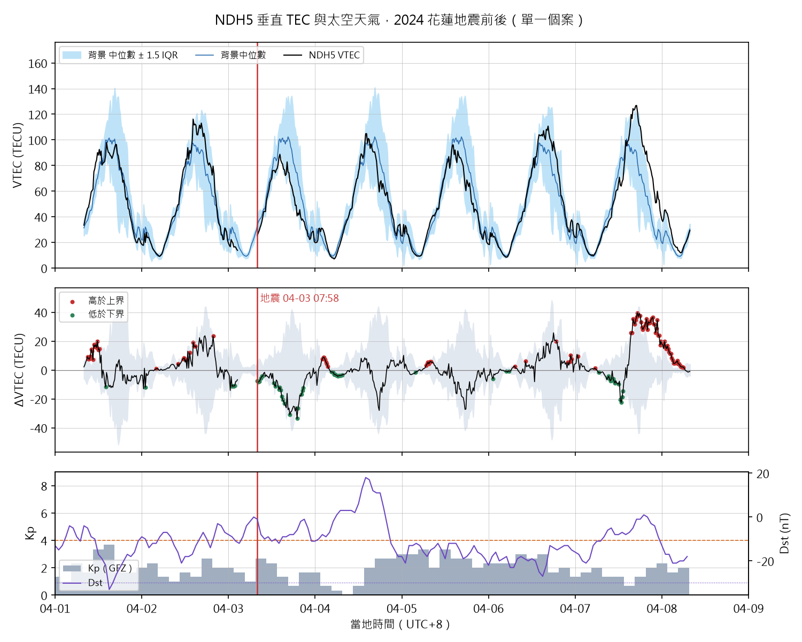

# 個案分析：NDH5 GNSS 站 TEC 與 2024 花蓮地震

> 由 `pipeline/src/case_ndh5_tec.py` 自動產生於 2026-11-02 16:59。

> ⚠ **這是單一測站、單一事件的展示案例，不能當作 TEC 前兆存在的證據。**
> 即使看到「異常」，也無法排除巧合、太陽與地磁活動、或電離層本身的日變異。
> 要回答前兆有沒有用，必須用多個事件，並在相同條件下和只用地震目錄的基準模型比較（B3）。

## 1. 資料

| 項目 | 內容 |
|---|---|
| 測站 | NDH5（SEPT POLARX4，取樣 30 秒），24.010°N、121.618°E（RINEX 標頭概略座標） |
| 地震 | 2024-04-02 23:58:09 UTC（當地 04-03 07:58），ML 7.19，深度 19.7 km，23.876°N 121.573°E（GDMS 目錄） |
| 測站與震央距離 | 16 km |
| 觀測檔 | 7 天：04-01、04-02、04-03、04-04、04-05、04-06、04-07 |
| 輔助資料 | GPS 廣播星曆、CAS 衛星 DCB（BKG 鏡像站）；Kp（GFZ）、Dst（NASA OMNI2，源自京都 WDC） |

**各觀測檔的時間範圍**

| 檔案 | 第一筆（GPS 時） | 最後一筆 | epoch 數 |
|---|---|---|---|
| ndh50920.24o | 04-01 00:00 | 04-01 23:59 | 2880 |
| ndh50930.24o | 04-02 00:00 | 04-02 18:37 | 2236 |
| ndh50940.24o | 04-03 00:00 | 04-03 23:59 | 2880 |
| ndh50950.24o | 04-04 00:00 | 04-04 23:59 | 2880 |
| ndh50960.24o | 04-05 00:00 | 04-05 23:59 | 2880 |
| ndh50970.24o | 04-06 00:00 | 04-06 23:59 | 2880 |
| ndh50980.24o | 04-07 00:00 | 04-07 23:59 | 2880 |

⚠ `ndh50930.24o` 只到 18:37 GPS 時（GPS 時比 UTC 快 18 秒），之後當天的觀測都缺失。**地震前 5.3 小時沒有資料。**原始檔就是如此，缺失原因不明，這裡不做推測。

## 2. 方法

1. 雙頻 GPS 的 P1、P2 虛擬距離與 L1、L2 載波相位計算斜向 TEC，以相位平滑碼雜訊（每個連續弧段）。
2. 衛星硬體偏差用 CAS 每日 C1W−C2W DCB 修正。DCB 的正負號不憑記憶，兩種都試，選衛星間殘差較小者（見下表）。
3. 接收機偏差用最小標準差法（Ma & Maruyama, 2003）估計，只用當地黎明前 04–07 時、仰角 ≥ 30°；每個時刻允許 VTEC 隨穿刺點緯度、經度線性變化，因為台灣位在赤道異常北峰附近，水平梯度大。
4. 垂直 TEC：單層模型（350 km）、仰角 ≥ 30°，取各衛星的中位數，再取 15 分鐘中位數。
5. 背景值：前 15 天同一時刻的中位數 ± 1.5 × IQR（常見的四分位距法，例如 Liu et al., 2004, Annales Geophysicae）。前期資料不足 10 天時，改用其他所有可用天，並標示為「暫定」。

**DCB 符號與接收機偏差的逐日檢查**

| 日期 | 選用符號 | 全天殘差（選用） | 全天殘差（另一符號） | 接收機偏差 (TECU) | 黎明前殘差 | 使用 epoch |
|---|---|---|---|---|---|---|
| 04-01 | +1 | 2.54 | 15.61 | -4.64 | 0.55 | 322 |
| 04-02 | +1 | 4.29 | 14.77 | —（該時段無資料） | — | 0 |
| 04-03 | +1 | 2.24 | 15.61 | -5.15 | 0.51 | 322 |
| 04-04 | +1 | 2.44 | 15.90 | -3.64 | 0.24 | 320 |
| 04-05 | +1 | 2.07 | 15.80 | -5.32 | 0.52 | 319 |
| 04-06 | +1 | 3.00 | 15.46 | -4.29 | 0.50 | 319 |
| 04-07 | +1 | 3.20 | 15.37 | -7.65 | 0.75 | 318 |

**接收機偏差估計時段的比較**（各日估計值的範圍；範圍越小代表越穩定）

| 估計時段 | 各日偏差 (TECU) | 全距 | 殘差中位數 |
|---|---|---|---|
| 當地 00–06 時 | -7.6, -10.6, -5.0, -7.2, -9.5, -1.9, 3.8 | 14.4 | 0.88 |
| 當地 02–06 時 | -5.8, -11.9, -5.3, -8.0, -6.6, -3.0, 0.1 | 12.0 | 0.51 |
| 當地 04–07 時（採用） | -4.6, —, -5.2, -3.6, -5.3, -4.3, -7.6 | 4.0 | 0.51 |

當地午夜前後（太陽極大期常見電漿不規則結構）估得的偏差逐日跳動大，所以改用黎明前電離層最平滑的時段。缺少該時段資料的日子（—）不納入中位數。

採用各日中位數 **-4.89 TECU**；各日範圍 -7.65 ～ -3.64（全距 4.01 TECU）。偏差的逐日變動會直接變成 VTEC 的逐日誤差，所以比這個全距小的 ΔVTEC 不宜解讀。

## 3. 結果

**每日摘要**（超界比例 = 該日 15 分鐘格中，超出背景界線的比例）

| 日期 (UTC) | 有效格數 | 高於上界 | 低於下界 | 最大 ΔVTEC | 最小 ΔVTEC | 背景 | Kp 最大 | Dst 最小 | F10.7 |
|---|---|---|---|---|---|---|---|---|---|
| 04-01 | 96 | 16% | 2% | +20.0 | -13.0 | 其他所有可用天（暫定）（6 天） | 3.67 | -33 | 120 |
| 04-02 | 75 | 9% | 4% | +23.7 | -14.1 | 其他所有可用天（暫定）（6 天） | 2.67 | -21 | 113 |
| 04-03 | 96 | 7% | 32% | +8.9 | -33.7 | 其他所有可用天（暫定）（6 天） | 2.67 | -12 | 112 |
| 04-04 | 96 | 5% | 1% | +10.1 | -28.0 | 其他所有可用天（暫定）（6 天） | 3.33 | -21 | 114 |
| 04-05 | 96 | 2% | 3% | +5.9 | -27.3 | 其他所有可用天（暫定）（6 天） | 3.33 | -23 | 121 |
| 04-06 | 96 | 8% | 1% | +25.7 | -8.1 | 其他所有可用天（暫定）（6 天） | 3.00 | -27 | 123 |
| 04-07 | 96 | 58% | 14% | +39.6 | -22.5 | 其他所有可用天（暫定）（6 天） | 2.33 | -21 | 125 |

**連續 1 小時以上超出界線的時段**

| 開始（當地） | 結束（當地） | 方向 | 時數 | 最大 \|ΔVTEC\| |
|---|---|---|---|---|
| 04-01 09:00 | 04-01 12:30 | 正（偏高） | 3.50 | 20.0 |
| 04-03 01:00 | 04-03 02:00 | 負（偏低） | 1.00 | 11.3 |
| 04-03 14:00 | 04-03 15:15 | 負（偏低） | 1.25 | 20.5 |
| 04-04 02:00 | 04-04 03:45 | 正（偏高） | 1.75 | 8.9 |
| 04-04 05:00 | 04-04 07:15 | 負（偏低） | 2.25 | 4.4 |
| 04-05 06:45 | 04-05 08:15 | 正（偏高） | 1.50 | 5.9 |
| 04-07 09:00 | 04-07 10:15 | 負（偏低） | 1.25 | 7.6 |
| 04-07 12:30 | 04-07 13:30 | 負（偏低） | 1.00 | 22.5 |
| 04-07 15:30 | 04-07 17:30 | 正（偏高） | 2.00 | 39.6 |
| 04-07 18:00 | 04-08 00:30 | 正（偏高） | 6.50 | 37.6 |
| 04-08 00:45 | 04-08 06:15 | 正（偏高） | 5.50 | 19.6 |

**觀察摘要**（只描述數據，不是結論）

- 高於上界比例最高的一天是 04-07（地震後第 5 天（UTC 日期）），58% 的時間高於上界，最大 ΔVTEC +39.6 TECU；當天 Kp 最大 2.33、Dst 最小 -21 nT。
- 震前 2 天平均超界比例（高＋低）16%；震後完整的 5 天平均 26%。
- 達到地磁擾動門檻（Kp ≥ 4 或 Dst ≤ −30 nT）的日子：04-01（Kp 3.67、Dst -33）。這些日子的 TEC 變化可能有太空天氣的成分。
- 在這 7 天內，震前日子的超界情形並沒有比其他日子突出；整週最大的正異常出現在非震前、地磁寧靜的日子，說明單日的 TEC 變異本來就可以這麼大。

## 4. 解讀時要注意

- **背景值是暫定的**：目前有 7 天觀測（04-01 ～ 04-07），地震前只有 2 天（UTC），其中有些天並不完整（見第 1 節）。背景是用「其他所有可用天」算的，其中 5 天在地震之後。只要震後幾天電離層本身偏高或偏低，震前的日子就會被判成「異常」，反之亦然。
- **隨機也會超界**：中位數 ± 1.5 IQR 在常態分布下約等於 ±2σ，每天本來就約有 4% 的時間超界；背景只用 6 天時，界線本身也很不穩，實際超界比例會更高。所以要看的是「震前是否比其他日子更常超界」，而不是「有沒有超界」。
- **太陽活動**：2024 年接近太陽極大期，電離層日變異本來就大。上表的 Kp、Dst 可以判斷有沒有磁暴；沒有磁暴也不代表沒有其他來源（例如太陽 EUV 變化、熱氣層風、行進式電離層擾動）。
- **接收機偏差**：用最小標準差法估計，逐日差異見第 2 節；小於該差異的 ΔVTEC 不應解讀。
- **單一測站**：無法區分局部與大尺度的變化。若要主張和震央有關，至少需要比較遠近不同測站的空間分布。

## 5. 下一步（取得更多資料後）

- 補齊 NDH5 在 2024-03-17 ～ 03-31 的 RINEX，讓 4/1–4/2 有真正的「前 15 天」背景值；最好延伸到 4 月底，看震後是否回到背景。
- 放進相同目錄後重新執行本程式即可，背景值會自動改用前 15 天。
- 加入幾個遠離震央的測站（例如台灣西部或離島）作為對照。
- 系統性的檢驗：把 TEC 轉成「網格 × 日」特徵，接到 B3 框架，和基準模型比較。
