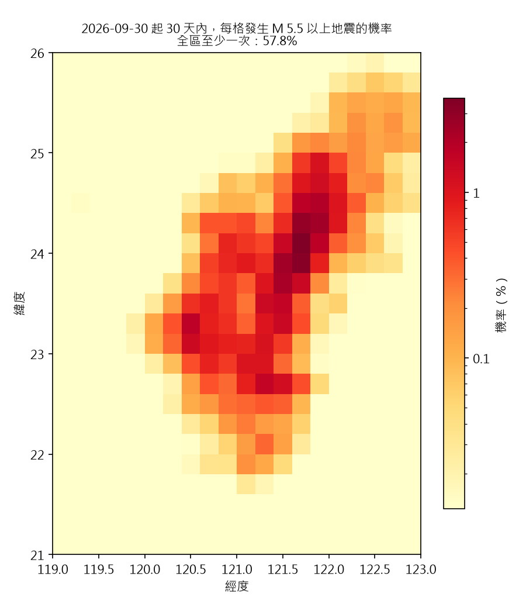

# 連續式風險函數 v1.2：回測報告

> 由 `pipeline/src/06_hazard_model.py` 產生（2026-11-21 01:42）。重新執行會覆寫本檔。

> **v1.1 的修正（2026-11-17 審查）**：① 事件母體統一（M1）② 形狀參數搜尋範圍放寬，並檢查是否落在邊界（M3）③ 均勻對照也做滾動校準（M4）。v1 的數字不能和本版直接比較。

> **v1.2（2026-11-21）**：大地震剛發生、自己的餘震還沒進目錄時，依規模加權（alpha）；加權在預報窗內以 exp(−年紀 / 0.1 天) 遞減，之後和 v1.1 相同；深度 > 40 km 不加權。這幾個參數只用訓練期主震選（`08_mainshock_response.py --fit-early`），主震後的檢驗見 `docs/reports/hazard_mainshock_response.md`，原因見 `docs/reports/hazard_v1_2_findings.md`。

## 這個模型回答什麼

「從現在起 T 這麼久之內，這一格發生規模 m 以上地震的機率是多少？」m 與 T 都可以任意指定。
做法是先估每格的發生率（以前常震的地方 ＋ 最近剛震過的地方），再用規模分布與時間長度換算。
公式與限制見 `pipeline/src/eqforecast/hazard.py` 開頭。

**和 B3 的差別**：這裡預報的是全部地震（含餘震），B3 只算去群聚後的主震。兩者的分數不能互相比較。

## 參數

- 事件母體：只用定位品質良好的事件（方位角空隙 gap ≤ 110° 或未知，`use_for_features`）；擬合、回測、匯出都用同一個母體（125,535 / 125,739 筆，各規模合計）
- 訓練期 1995-01-01 ～ 2015-01-01：1043 個 7 天的窗、4552 個 M≥3.5 地震
- 測試期 2015-01-01 ～ 2026-09-30
- b 值 0.844（只用訓練期結束前的地震）
- 背景倍率 mu = 0.426；近期加成 K = 0.04371、p = 0.7、c = 0.01 天；主震後早期反應 alpha = 1.4、倍率 A = 0.1、衰減 0.1 天（7 天窗的擬合本身選 alpha = 0）
- 平滑寬度：背景 0.5 格、近期 0.5 格（一格 0.2°）；近期加成隨規模放大 d_frac = 0（寬度² = 近期² + (d_frac × 破裂長度)²，破裂長度 L(M) = 0.01×10^(0.5M) km；d_frac = 0 即 v1.1 的固定寬度）
- 深源地震：深度 > 40 km 的地震不套用 alpha（0 = 全部套用，即 v1.1）
- 形狀參數的搜尋範圍：deep_km 0、d_frac 0、alpha 0／0.1／0.2／0.4／0.6／0.8／1／1.5、p 0.6／0.7／0.8／0.9／1／1.1／1.2／1.4、sigma_st 0.25／0.5／1、sigma_bg 0.25／0.5／1／2。⚠ 最佳值落在搜尋範圍邊界：alpha = 0（下限）。真正的最佳值可能在範圍外，或模型形式本身需要調整（見已知限制 3）。

## 回測結果（測試期）

- **三個模型（完整、只有背景、均勻）都用同一套滾動校準**，所以增益比較的是空間與時間的分布，不是「誰的總數剛好比較準」。
- **資訊增益**：每個地震平均多得到多少資訊（單位 nat；0 = 和對照一樣，越大越好）。
- **AUC**：把所有「格 × 窗」依機率排序，有地震的排在前面的程度（0.5 = 亂猜，1 = 完美）。
- **預測／實際**：模型預測的地震總數 ÷ 實際發生數（1 = 剛好，> 1 = 高估）。
- **基準率**：隨便挑一格一窗，剛好有地震的比例。任何「命中」都要和它比。

- **校準前**：沒有滾動校準時的「預測／實際」，用來看校準修正了多少。

| 規模 | 時間 | 地震數 | 基準率 | 增益（對均勻） | 增益（對只有背景） | AUC 完整 | AUC 只有背景 | 預測／實際 | 校準前 |
|---|---|---|---|---|---|---|---|---|---|
| M≥3（外推） | 1 小時 | 84 | 0.023% | 2.28 | 0.75 | 0.934 | 0.914 | 1.18 | 1.35 |
| M≥3.5 | 1 小時 | 37 | 0.009% | 3.10 | 1.19 | 0.951 | 0.944 | 1.01 | 1.16 |
| M≥4 | 1 小時 | 20 | 0.006% | 3.21 | 1.44 | 0.944 | 0.933 | 0.71 | 0.81 |
| M≥5 | 1 小時 | 4 | 0.001% | 3.79 | 1.84 | 0.973 | 0.946 | 0.51 | 0.58 |
| M≥6 | 1 小時 | 0 | 0.000% | — | — | — | — | — | — |
| M≥3（外推） | 1 天 | 2005 | 0.468% | 2.21 | 0.59 | 0.940 | 0.923 | 1.44 | 1.16 |
| M≥3.5 | 1 天 | 928 | 0.207% | 2.78 | 1.01 | 0.949 | 0.929 | 1.18 | 0.95 |
| M≥4 | 1 天 | 391 | 0.089% | 3.02 | 1.22 | 0.953 | 0.926 | 1.06 | 0.85 |
| M≥5 | 1 天 | 42 | 0.013% | 2.48 | 0.88 | 0.952 | 0.914 | 1.41 | 1.14 |
| M≥6 | 1 天 | 5 | 0.002% | 1.67 | 0.19 | 0.943 | 0.917 | 1.70 | 1.37 |
| M≥3（外推） | 7 天 | 14360 | 2.595% | 1.97 | 0.39 | 0.934 | 0.919 | 1.28 | 1.02 |
| M≥3.5 | 7 天 | 6587 | 1.200% | 2.27 | 0.60 | 0.935 | 0.918 | 1.05 | 0.84 |
| M≥4 | 7 天 | 2729 | 0.509% | 2.42 | 0.70 | 0.938 | 0.918 | 0.96 | 0.77 |
| M≥5 | 7 天 | 392 | 0.092% | 2.31 | 0.64 | 0.936 | 0.914 | 0.96 | 0.76 |
| M≥6 | 7 天 | 39 | 0.012% | 1.79 | 0.39 | 0.912 | 0.896 | 1.38 | 1.10 |
| M≥3（外推） | 30 天 | 12431 | 7.580% | 1.78 | 0.21 | 0.936 | 0.923 | 1.26 | 0.87 |
| M≥3.5 | 30 天 | 5747 | 3.997% | 1.99 | 0.34 | 0.932 | 0.916 | 1.03 | 0.71 |
| M≥4 | 30 天 | 2421 | 1.836% | 2.10 | 0.41 | 0.932 | 0.914 | 0.93 | 0.64 |
| M≥5 | 30 天 | 347 | 0.362% | 2.07 | 0.43 | 0.927 | 0.905 | 0.93 | 0.64 |
| M≥6 | 30 天 | 35 | 0.052% | 1.60 | 0.30 | 0.900 | 0.887 | 1.32 | 0.91 |

地震數少於約 20 的列，數字只能當參考。M 小於參考規模的列是往下外推，那個範圍的目錄並不完整。

## 最新一期（發布時間 2026-09-30，即目錄最後一天的隔日）

## 已知限制

1. 近期加成的技巧主要來自「大地震後會有餘震」，這是已知規律，不是預測主震。v1.2 改善的只有大地震剛發生後的幾小時；主震之前模型無法指出哪一次地震會是大地震。
2. **總數校準**：參數只用 7 天的窗擬合，直接套到其他時間長度會低估地震總數（見「校準前」欄）。現在每次發布前，會回看過去 730 天內已經結束的預報窗，用「實際 ÷ 預測」修正整體倍率（限制在 0.5–3 倍，只用過去資料）。這只修正全區總量，不改變各格的相對高低；大地震剛發生後的幾週，倍率來不及反應，仍可能低估。
3. 大森定律的 c 固定，沒有擬合；形狀參數用格點搜尋（全部組合見 `pipeline/data/hazard/fit_grid.csv`）。v1.1 的近期加成平滑寬度和規模無關，alpha 落在下限 0；v1.2 讓寬度隨破裂長度放大（d_frac），擬合仍選 d_frac = 0、alpha = 0（假設被否定）；主震後低估改由 young_days 處理，見 `docs/reports/hazard_v1_2_findings.md`。
4. 事件母體只含地震網能良好定位的地震（gap ≤ 110° 或未知）。外海 gap 大的地震（含部分大地震）不在模型裡，所以外海的機率代表「能被良好定位的地震」，實際會偏低。
5. 尚未加入地磁、TEC 等前兆；這一版是之後檢驗前兆時的對照基準。
