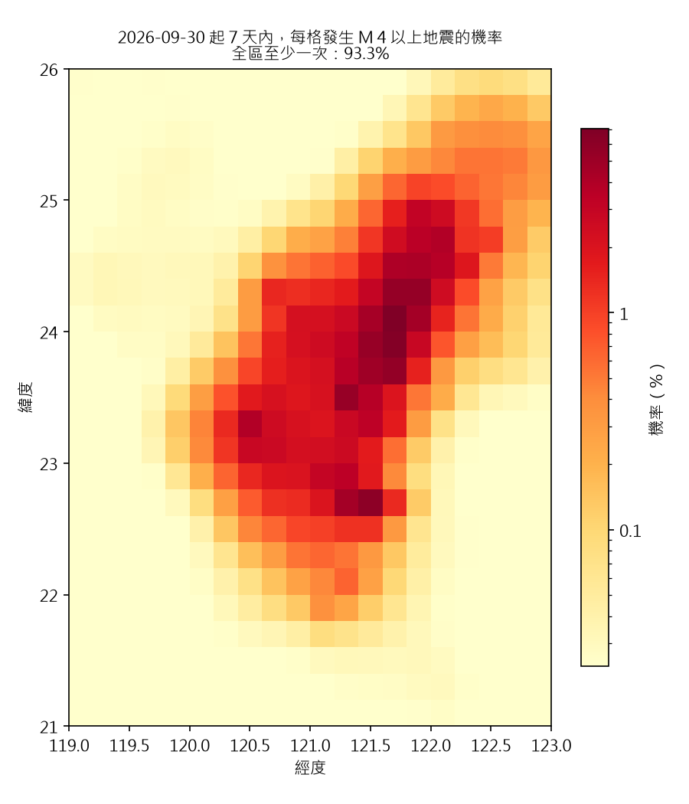
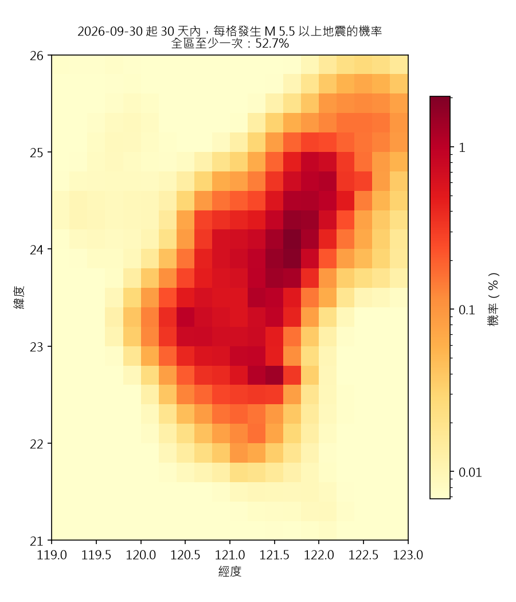

# 連續式風險函數 v1：回測報告

> 由 `pipeline/src/06_hazard_model.py` 產生（2026-11-13 00:33）。重新執行會覆寫本檔。

## 這個模型回答什麼

「從現在起 T 這麼久之內，這一格發生規模 m 以上地震的機率是多少？」m 與 T 都可以任意指定。
做法是先估每格的發生率（以前常震的地方 ＋ 最近剛震過的地方），再用規模分布與時間長度換算。
公式與限制見 `pipeline/src/eqforecast/hazard.py` 開頭。

**和 B3 的差別**：這裡預報的是全部地震（含餘震），B3 只算去群聚後的主震。兩者的分數不能互相比較。

## 參數

- 訓練期 1995-01-01 ～ 2015-01-01：1043 個 7 天的窗、4648 個 M≥3.5 地震
- 測試期 2015-01-01 ～ 2026-09-30
- b 值 0.775（只用訓練期結束前的地震）
- 背景倍率 mu = 0.747；近期加成 K = 0.02155、alpha = 0.6、p = 1、c = 0.01 天
- 平滑寬度：背景 1 格、近期 0.5 格（一格 0.2°）

## 回測結果（測試期）

- **資訊增益**：每個地震平均多得到多少資訊（單位 nat；0 = 和對照一樣，越大越好）。
- **AUC**：把所有「格 × 窗」依機率排序，有地震的排在前面的程度（0.5 = 亂猜，1 = 完美）。
- **預測／實際**：模型預測的地震總數 ÷ 實際發生數（1 = 剛好，> 1 = 高估）。
- **基準率**：隨便挑一格一窗，剛好有地震的比例。任何「命中」都要和它比。

| 規模 | 時間 | 地震數 | 基準率 | 增益（對均勻） | 增益（對只有背景） | AUC 完整 | AUC 只有背景 | 預測／實際 |
|---|---|---|---|---|---|---|---|---|
| M≥3（外推） | 1 小時 | 84 | 0.023% | 2.45 | 0.93 | 0.922 | 0.903 | 1.17 |
| M≥3.5 | 1 小時 | 37 | 0.009% | 3.41 | 1.60 | 0.947 | 0.933 | 1.08 |
| M≥4 | 1 小時 | 20 | 0.006% | 3.54 | 1.82 | 0.938 | 0.926 | 0.82 |
| M≥5 | 1 小時 | 4 | 0.001% | 4.06 | 2.29 | 0.968 | 0.932 | 0.69 |
| M≥6 | 1 小時 | 0 | 0.000% | — | — | — | — | — |
| M≥3（外推） | 1 天 | 2014 | 0.471% | 2.59 | 0.92 | 0.931 | 0.915 | 0.95 |
| M≥3.5 | 1 天 | 937 | 0.209% | 3.18 | 1.42 | 0.939 | 0.920 | 0.83 |
| M≥4 | 1 天 | 400 | 0.092% | 3.35 | 1.61 | 0.940 | 0.916 | 0.80 |
| M≥5 | 1 天 | 51 | 0.016% | 2.00 | 0.82 | 0.891 | 0.872 | 1.05 |
| M≥6 | 1 天 | 7 | 0.002% | 1.04 | -0.05 | 0.893 | 0.876 | 1.29 |
| M≥3（外推） | 7 天 | 14411 | 2.609% | 2.23 | 0.59 | 0.924 | 0.913 | 0.76 |
| M≥3.5 | 7 天 | 6638 | 1.214% | 2.52 | 0.83 | 0.925 | 0.910 | 0.68 |
| M≥4 | 7 天 | 2780 | 0.524% | 2.64 | 0.94 | 0.925 | 0.908 | 0.66 |
| M≥5 | 7 天 | 443 | 0.107% | 2.24 | 0.78 | 0.902 | 0.880 | 0.70 |
| M≥6 | 7 天 | 52 | 0.015% | 1.43 | 0.38 | 0.886 | 0.865 | 1.00 |
| M≥3（外推） | 30 天 | 12473 | 7.634% | 1.98 | 0.33 | 0.925 | 0.917 | 0.63 |
| M≥3.5 | 30 天 | 5789 | 4.054% | 2.15 | 0.45 | 0.921 | 0.909 | 0.56 |
| M≥4 | 30 天 | 2463 | 1.895% | 2.23 | 0.53 | 0.918 | 0.904 | 0.54 |
| M≥5 | 30 天 | 389 | 0.421% | 1.97 | 0.50 | 0.897 | 0.877 | 0.57 |
| M≥6 | 30 天 | 45 | 0.066% | 1.48 | 0.42 | 0.887 | 0.865 | 0.83 |

地震數少於約 20 的列，數字只能當參考。M 小於參考規模的列是往下外推，那個範圍的目錄並不完整。

## 最新一期（發布時間 2026-09-30，即目錄最後一天的隔日）

## 已知限制

1. 近期加成的技巧主要來自「大地震後會有餘震」，這是已知規律，不是預測主震。
2. **總數校準不準**：參數只用 7 天的窗擬合，再套到 1 小時與 30 天。上表「預測／實際」若明顯小於 1，代表模型低估地震總數（排序能力不受影響，但機率的絕對值偏低）。可能原因：測試期的地震活動比訓練期多、餘震再觸發的餘震沒有算進去、近期活動只回看一年。下一版要依時間長度重新校準。
3. 大森定律的 c 固定，沒有擬合；形狀參數只做粗略的格點搜尋，選到的值若在搜尋範圍邊界，代表範圍要再放寬（見 `pipeline/data/hazard/fit_grid.csv`）。
4. `events.parquet` 已先以測站包覆角（Gap）篩過，外海事件偏少，所以外海的發生率偏低。
5. 尚未加入地磁、TEC 等前兆；這一版是之後檢驗前兆時的對照基準。
