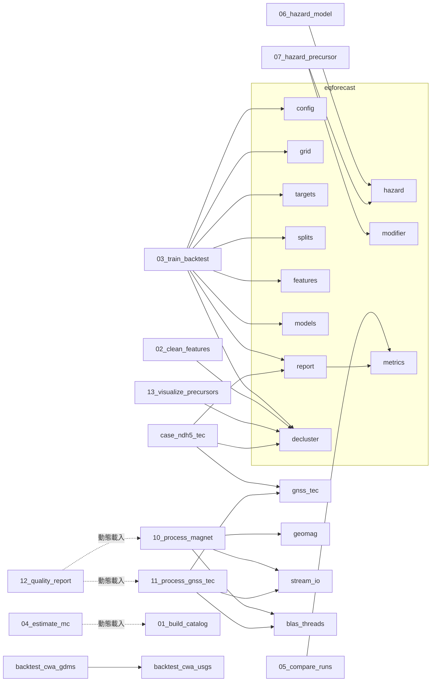

# 01 專案掃描：樹狀結構、用途、相依、是否使用、Dead Code

| 項目 | 內容 |
|---|---|
| 掃描範圍 | `破專題`（main f372f92＋本分支新增的審查文件，共 252 個版控檔案）、`earthquake-risk-app`（main 96cd43f，47 個） |
| 不在範圍 | 不進版控的資料（`pipeline/data/`、E 槽原始資料）、其他 `claude/*` 分支（只在最後一節列出狀態）、`i-can-predict-quakes`（另一個產品，只當外部系統） |
| 方法 | ① 盤點腳本（每個檔案的大小、行數、最後提交日、被哪些檔案引用）② 函式索引（全部 `def`、`class`、`export` 的行號）③ import 相依圖 ④ 讀出入資料檔名，畫資料血緣 ⑤ 逐檔閱讀 docstring 與標頭註解，重點檔案全文閱讀 |
| 狀態標記 | 🟢 使用中　🧪 實驗或研究　📄 報告產物　🟡 遺留（描述舊系統，已不符現況）　📚 課堂筆記　🔧 一次性工具 |

---

## 1. 專案樹狀結構（附用途與狀態）

```text
破專題/                                    地震風險評估專題：資料管線＋模型＋報告
├── .github/workflows/
│   ├── pipeline-tests.yml         🟢 push/PR 時跑 pipeline/tests（Python 3.13）
│   ├── risk-assessment.yml        🟡 tests job 和上一個重複；risk-assessment job 跑舊的 PowerShell 流程（只能手動觸發）
│   ├── daily-report-check.yml     🟢 每天 23:30（台北時間）檢查每日地震日報有沒有產生
│   └── fractal-archive.yml        🟢 每天 3 次封存外部「碎形日報」，留作日後驗證
├── pipeline/                              ★ 主系統（Python）
│   ├── src/
│   │   ├── 00_download_space_weather.py   🟢 太空天氣指數（Kp、Dst…，來源 GFZ、NASA OMNI）
│   │   ├── 01_build_catalog.py            🟢 整併 CWA XML＋GDMS → events.parquet（去重、gap 標記）
│   │   ├── 02_clean_features.py           🧪 地磁、TEC 站資料 → 0.2° 網格×日 前兆特徵
│   │   ├── 03_train_backtest.py           🧪 B3 警報式基準模型（主震、去群聚）回測
│   │   ├── 04_estimate_mc.py              🟢 分段完備規模 Mc → feature_min_ml_by_year.csv
│   │   ├── 05_compare_runs.py             🧪 比較多組 B3 設定
│   │   ├── 06_hazard_model.py             🟢★ 連續式風險函數：估參數、回測、匯出最新一期（APP 的資料來源）
│   │   ├── 07_hazard_precursor.py         🧪 地磁能否改善風險函數（循環平移檢定，結果為負）
│   │   ├── 10_process_magnet.py           🟢 GDMS 地磁 1 秒資料串流處理
│   │   ├── 11_process_gnss_tec.py         🟢 GNSS RINEX → 15 分鐘 VTEC
│   │   ├── 12_quality_report.py           🟢 B2 資料品質報告
│   │   ├── 13_visualize_precursors.py     🟢 前兆時間序列、網格地圖（海報素材）
│   │   ├── case_ndh5_tec.py               🧪 個案：NDH5 站 TEC 與 2024 花蓮地震
│   │   ├── fetch_usgs.py                  🟢 USGS FDSN 擷取（回補、增量、重建）
│   │   ├── stream_io.py                   🟢 邊下載邊處理邊刪除的共用工具（manifest、壓縮檔串流）
│   │   ├── blas_threads.py                🟢 限制數值函式庫只用 1 條執行緒
│   │   ├── eqforecast/                    🟢 預報框架套件
│   │   │   ├── hazard.py                  🟢★ 風險函數核心（背景＋大森定律近期加成＋G-R＋卜瓦松）
│   │   │   ├── modifier.py                🧪 前兆當發生率倍率的卜瓦松迴歸
│   │   │   ├── config.py、grid.py、targets.py、splits.py、features.py、models.py、metrics.py、report.py、decluster.py
│   │   │   │                              🧪 B3 警報式框架（設定、網格、標籤、切分、特徵、模型、Molchan 指標、報告）
│   │   ├── geomag/  iaga.py、ulf.py       🟢 IAGA-2002 讀取、ULF 特徵
│   │   └── gnss_tec/ rinex.py、orbit.py、tec.py、aux_data.py
│   │                                      🟢 RINEX 讀取、衛星軌道與穿刺點、TEC 與 DCB 校正、輔助資料下載
│   ├── configs/  b3_*.json（7 組）、feature_min_ml_by_year.csv
│   │                                      🧪 B3 實驗設定（以 --config 指定，不被檔名引用屬正常）
│   ├── tests/  12 個測試檔＋fixtures     🟢 144 個單元測試
│   └── README.md                          🟢 管線使用說明
├── scripts/
│   ├── fetch_intermagnet.py               🟢 下載遠端參考站地磁資料，交給 10_process_magnet
│   ├── archive_fractal_report.py          🟢 碎形日報封存（fractal-archive.yml 呼叫）
│   ├── check_report.py、prepare_report_branch.sh
│   │                                      🟢 每日日報排程的檢查與分支準備
│   ├── catalog_matching/                  📄 跨機構事件比對回測（CWA×USGS、CWA XML×GDMS）＋結果 CSV
│   ├── maintenance/restore_main_folder_2026-11-12.ps1
│   │                                      🔧 一次性的資料夾還原腳本
│   └── Import-EarthquakeCatalog.ps1、Compute-Baseline.ps1、Ingest-Precursors.ps1、Risk-Scoring.ps1、Visualize-Results.ps1
│                                          🟡 舊 PowerShell 加權評分流程（410 行）
├── prompts/daily-earthquake-report.md     🟢 每日地震日報雲端排程的指令稿
├── docs/
│   ├── reports/                           📄 各模型、資料品質、個案的報告（程式產生，含圖）
│   │   ├── hazard_v1/、hazard_precursor_mag/      ★ 風險函數與前兆檢定
│   │   ├── b3_*（6 組）、catalog_mc/              B3 與 Mc 實驗
│   │   ├── b2_data_quality/、b2_visuals/          B2 資料品質與視覺化
│   │   └── case_ndh5_2024hualien/                 個案
│   ├── phase2/                            🟢 資料來源比較、跨目錄比對規格
│   ├── b2_download_plan/、b2_requirements.md     🟢 B2 下載清單與需求
│   ├── PROJECT_OVERVIEW.md                🟢 專案概況（448 行，最完整的設計說明）
│   ├── 專案現況白話報告.md                🟢 給非技術讀者的現況
│   ├── PROJECT_AUDIT.md                   🟡 11-05 舊稽核（已過時）
│   ├── audit/2026-11-17_全面審查.md       🟢 第一輪審查（本次）
│   ├── sad/                               🟢 第二輪 SA&D 審查（本次）
│   ├── uml/（7 張圖＋需求表＋資料字典＋PNG）  🟡 描述舊系統（例如 RiskScore、WeightConfig），程式碼中不存在
│   ├── analysis/（DFD、環境圖、可行性、詞彙、利害關係人）  🟡 11-02 的舊版分析
│   └── workflow.mmd                       🟡 舊流程圖
├── Chapter01/、Chapter08/                 🟡 11-02 的舊 SA&D 作業（需求規格、ER 圖、DFD…）
├── coursework/（66 檔）                   📚 課堂筆記（第 2、3、5、6、7 章的圖表重繪）
├── earthquake_data/資料分析/              📄 早期 GDMS 探索分析（11-02）
├── notebooks/analysis.ipynb               🟡 讀取 ../outputs/risk_scores（舊流程的輸出，已不存在）
├── README.md                              🟡 主要步驟仍是舊的 PowerShell 流程
├── SKILLS.md                              🟡 全部是舊 PowerShell 技能
├── data_fields_explanation.md、precursor_data_explanation.md  🟡 舊版欄位說明
├── AGENTS.md                              🟢 AI 助理指引
└── requirements.txt                       🟢 Python 套件（版本固定）

earthquake-risk-app/                       手機 PWA（Vite＋TypeScript＋Leaflet）
├── .github/workflows/pages.yml            🟢 push main → 建置 → GitHub Pages
├── index.html、public/（icon、manifest）  🟢 PWA 入口與圖示
├── pwa/sw.js                              🟢 Service worker（預快取、網路優先、離線）
├── src/
│   ├── main.ts                            🟢 進入點：hash 路由、事件委派、整頁重畫
│   ├── state.ts                           🟢 全域狀態、localStorage 存取與清理
│   ├── format.ts                          🟢 數字、狀態等級、HTML 跳脫（esc）
│   ├── pwa.ts                             🟢 安裝與更新
│   ├── core/hazard.ts                     🟢★ 機率計算核心（Python 的對應版在 claude/hazard-app 分支）
│   ├── data/schema.ts、mock.ts、towns.topo.json
│   │                                      🟢 feed 格式、假資料（Phase 2 前用）、簡化後的鄉鎮界線
│   ├── geo/towns.ts                       🟢 鄉鎮區判斷（點在多邊形、離界距離）
│   └── ui/  public.ts、expert.ts、info.ts、map.ts、smooth.ts、chart.ts、basemaps.ts、disclaimer.ts
│                                          🟢 大眾版、專家版、資訊頁、地圖、平滑、折線圖、底圖、免責聲明
├── scripts/  build-towns.mjs、check-dist.mjs、make_icons.py
│                                          🟢 界線簡化與驗證、建置產物檢查、產生圖示
├── *.test.ts（4 個）                      🟢 44 個測試
└── docs/DESIGN.md、README.md、AGENTS.md   🟢 設計書
```

---

## 2. 相依性

### 2.1 Python 模組相依（import 圖）



> 依 import 敘述畫出（`git ls-files` ＋ 正規表示式）。例如 `05_compare_runs.py:20` 是 `from eqforecast import metrics`；`07_hazard_precursor.py:22-23` 是 `hazard`、`modifier`。

### 2.2 資料血緣（哪支程式產生什麼、誰在用）

| 程式 | 讀入 | 產出 | 下游 |
|---|---|---|---|
| `00_download_space_weather.py` | GFZ Kp、NASA OMNI | `space_weather_daily.parquet`、`_hourly.parquet` | 02、case_ndh5 |
| `01_build_catalog.py` | CWA XML、GDMS CSV | `events.parquet`、`event_matches.parquet` | 03、04、06、07、13、case_ndh5 |
| `fetch_usgs.py` | USGS FDSN | `usgs.parquet`、`usgs_state.json` | catalog_matching；Phase 2 的即時補資料 |
| `04_estimate_mc.py` | events（動態載入 01） | `configs/feature_min_ml_by_year.csv`、`docs/reports/catalog_mc` | 03（設定檔） |
| `10_process_magnet.py` | GDMS、INTERMAGNET 原始檔（經 stream_io） | `magnet_daily.parquet`、`manifest.jsonl` | 02、12 |
| `11_process_gnss_tec.py` | RINEX、星曆、DCB | `tec_15min.parquet`、`tec_daily.parquet` | 02、12 |
| `02_clean_features.py` | magnet、TEC、太空天氣 | `features_magnet.parquet`、`features_tec.parquet`、`station_anomalies.parquet` | 03（b3_precursor*）、07、13 |
| `03_train_backtest.py` | events、features、`configs/b3_*.json` | predictions、targets、`metrics.json`、`docs/reports/b3_*` | 05 |
| `06_hazard_model.py` | events | `params.json`、`fit_grid.csv`、`backtest.csv`、`hazard_latest.parquet`、`docs/reports/hazard_v1` | 07、（Phase 2）APP feed |
| `07_hazard_precursor.py` | events、features_magnet、params.json | `precursor_mag.csv`、`docs/reports/hazard_precursor_mag` | 報告 |
| `12_quality_report.py` | manifest、daily | `docs/reports/b2_data_quality/*` | 報告 |
| `13_visualize_precursors.py` | station_anomalies、features、M5.5 主震清單 | `docs/reports/b2_visuals/*` | 海報 |

### 2.3 外部相依

| 類型 | 項目 | 用在哪裡 |
|---|---|---|
| Python 套件 | pandas 3.1、numpy 2.5、pyarrow 26、scikit-learn 1.9、scipy 1.18、matplotlib 3.11（`requirements.txt`，版本固定） | 全部管線 |
| npm 套件 | leaflet ^1.9.4（執行時）；typescript、vite、vitest、@types/leaflet（開發） | APP |
| 資料 API | CWA 開放資料、GDMS（手動下載）、USGS FDSN、GFZ Kp、NASA OMNI、BKG（IGS 星曆與 DCB）、INTERMAGNET（BGS GIN） | 管線 |
| 圖磚 | OSM、OpenTopoMap、國土測繪中心 WMTS、CARTO（需金鑰） | APP |
| 平台 | GitHub Actions、GitHub Pages、Claude 雲端排程（每日日報） | CI、部署、日報 |
| 外部網站 | 碎形日報（`archive_fractal_report.py:28`）、`quakeforecast.blogspot.com`（日報引用） | 封存、日報 |

---

## 3. 是否使用、Dead Code

### 3.1 函式層級（沒有任何正式程式呼叫的函式）

這是用腳本掃描所有 `def` 和 `export`，再排除測試類別後的結果。

| 位置 | 函式 | 判斷 | 建議 |
|---|---|---|---|
| `pipeline/src/gnss_tec/aux_data.py:72` | `brdc3_url` | 整個 repo 沒有任何地方用到 | 刪除，或在 `nav_candidate_urls`（`:166`）裡用上 |
| `pipeline/src/eqforecast/grid.py:68` | `Grid.neighbors` | 沒有程式呼叫，測試也沒有 | 刪除（鄰域運算已經由 `neighborhood_sum`、`neighborhood_max` 處理） |
| `pipeline/src/stream_io.py:136` | `RawItem.open_binary` | 沒有程式呼叫 | 刪除，或補一個測試說明用途 |

APP（`earthquake-risk-app`）：**沒有**未被引用的 export。

### 3.2 檔案層級：遺留系統（最大宗的 Dead Code）

以下檔案描述的都是 2026-11-02 匯入的**舊 PowerShell 加權評分系統**。之後主系統改成 Python 的連續式風險函數，這些檔案再也沒有更新過（最後提交日全部是 11-02）。

| 檔案 | 證據 |
|---|---|
| `scripts/*.ps1`（5 支，410 行） | 只被 README、SKILLS.md、`risk-assessment.yml` 引用；權重是寫死的魔術數字（`Risk-Scoring.ps1:12-18`） |
| `README.md` 的「主要步驟」 | 仍然要讀者依序執行 5 支 `.ps1` |
| `SKILLS.md` | 全部是 PowerShell 技能 |
| `docs/uml/*.mmd`、`*.png`、`09_data_dictionary.md` | 類別圖裡的 `EarthquakeRecord`、`Baseline`、`RiskScore`、`WeightConfig`、`IScorer`（`02_class_diagram.mmd`）**在程式碼中都找不到** |
| `Chapter01/需求規格說明.md` | F2「30 天平均 ML 基線」、F4「加權總和」、NF1「以 PowerShell 撰寫」，都和現況矛盾 |
| `Chapter08/*`、`docs/analysis/*`、`docs/workflow.mmd` | 11-02 的舊 ER 圖、DFD、環境圖 |
| `notebooks/analysis.ipynb` | 讀取 `../outputs/risk_scores`，這是舊流程的輸出，已經不存在 |
| `data_fields_explanation.md`、`precursor_data_explanation.md` | 舊欄位說明 |
| `.github/workflows/risk-assessment.yml` | tests job 和 `pipeline-tests.yml` 重複；risk-assessment job 跑舊流程 |

**影響**：評審或組員看到 README 和 `docs/uml/`，會以為系統是加權評分；用這些圖去對照程式碼，則會完全對不起來。第五階段（UML）會依照目前的程式碼重畫。

### 3.3 其他

| 檔案 | 狀態 | 建議 |
|---|---|---|
| `scripts/maintenance/restore_main_folder_2026-11-12.ps1` | 🔧 一次性還原腳本，任務已經完成 | 移到 `legacy/` 或刪除 |
| `docs/PROJECT_AUDIT.md` | 被本次審查取代 | 開頭加上「已由 docs/audit、docs/sad 取代」 |
| `pipeline/configs/b3_*.json` | 不被檔名引用，但用 `--config` 指定，**屬正常使用** | 保留 |
| `coursework/`（66 檔） | 📚 課堂筆記，不是專題系統的一部分 | 移到獨立 repo，或保留但在 README 註明 |

### 3.4 未合併的分支（影響「程式碼在哪裡」）

| 分支 | 內容 | 影響 |
|---|---|---|
| `claude/hazard-app` | Streamlit 版 APP 與 `app/hazard_core.py`（APP 計算核心的 Python 對應版、`background_rescale`） | APP 的 `hazard.ts:1` 指向的檔案不在 main 上；做 TS 與 Python 一致性測試之前要先合併 |
| 其他 `claude/*`（b2-geophysics、b3-baseline、mobile-app-data-feed、next-steps-planning、project-comprehensive-audit…） | 各工作階段的工作分支 | 需要逐一確認已經合併或可以關閉；這部分不在本次範圍 |

### 3.5 掃描時順帶發現的缺陷（細節見 09 程式碼審查）

- `pipeline/src/case_ndh5_tec.py:167`：說明文字 `"E:\123\GNSS_ETEC"` 沒有用 raw string，`\123` 會被當成八進位跳脫字元（變成 `S`），`\G` 是無效的跳脫序列。Python 3.12 以上會發出 `SyntaxWarning`，未來版本會直接變成錯誤【實測：`python -W error` 會跳出 `SyntaxError`】。
- 同一份程式碼重複出現（Duplicate Code）：`haversine_km` 有 3 份（`01_build_catalog.py:104`、`eqforecast/decluster.py:45`、`scripts/catalog_matching/backtest_cwa_usgs.py:91`）；`Grid` 有 2 份；`issue_times` 有 2 份（`hazard.py:227`、`targets.py:15`）。
