# 05 ECB 分析與 UML 圖（Mermaid／PlantUML／文字說明）

> **ECB 方法**：依教材第 6 章圖 6-8（ECB 對應 VCM：邊界＝展現層、控制＝應用層、實體＝資料存取層）與**表 6-2 強健型類別之間的關聯**：
>
> | | 參與者 | 實體 | 控制 | 邊界 |
> |---|:-:|:-:|:-:|:-:|
> | 參與者 | ○ | × | × | ○ |
> | 實體 | × | ○ | ○ | × |
> | 控制 | × | ○ | ○ | ○ |
> | 邊界 | ○ | × | ○ | ○ |
>
> **UML**：七種圖都**依照目前的程式碼重畫**。舊的 `docs/uml/*` 描述的是已淘汰的 PowerShell 系統（見 01 專案掃描 3.2）。
> Mermaid 沒有原生的使用案例圖、元件圖、部署圖，所以這三種用 flowchart 近似；PlantUML 版本則是標準 UML 符號。

---

## 第一部分：ECB 分析

### 1. ECB Table（模組分類）

| 模組或類別 | ECB | 判斷依據（教材：邊界＝畫面與選單、對外介面；控制＝商業邏輯；實體＝資料與資料存取） |
|---|---|---|
| APP `ui/public.ts`、`ui/expert.ts`、`ui/info.ts`、`ui/disclaimer.ts`、`ui/chart.ts` | 邊界 | 產生畫面的 HTML |
| APP `ui/map.ts` | 邊界 | Leaflet 地圖畫面 |
| APP `pwa.ts` | 邊界（對外部系統） | 安裝事件、service worker |
| APP `main.ts` | **控制＋邊界（混在一起）** | 路由與事件分派屬於控制；`render()` 組裝整頁 HTML（`main.ts:85-111`）屬於邊界 |
| APP `core/hazard.ts` | 控制 | 機率計算的商業邏輯 |
| APP `geo/towns.ts` | 控制（＋實體存取） | `describePlace` 是邏輯；`loadTowns` 讀取界線檔 |
| APP `ui/smooth.ts` | 控制（顯示用的數值運算） | 放在 `ui/` 資料夾，但沒有碰 DOM，屬於純計算 |
| APP `format.ts` | 邊界輔助＋**商業規則** | `pct`、`esc` 屬於呈現；`LEVEL_EDGES`（`format.ts:10`）是商業規則 |
| APP `state.ts` | 實體（＋資料存取） | `State`、`Place`、`Cond`；`localStorage` 讀寫（`state.ts:95-116`） |
| APP `data/schema.ts`、`data/mock.ts` | 實體 | `Feed` 與資料來源 |
| APP `ui/basemaps.ts` | 實體（設定）＋資料存取 | 底圖清單；CARTO 金鑰存在 `localStorage`（`basemaps.ts:57-80`） |
| 管線 `eqforecast/hazard.py`：`Grid`、`HazardParams`、`Catalog` | 實體 | 資料結構 |
| 管線 `eqforecast/hazard.py` 的函式 | 控制 | `background_rate`、`short_term`、`fit` 等 |
| 管線 `eqforecast/config.py` | 實體 | 實驗設定 |
| 管線 `eqforecast/report.py` | 邊界 | 輸出 Markdown 報告與圖 |
| 管線 `metrics.py`、`models.py`、`modifier.py`、`decluster.py`、`features.py`、`targets.py`、`splits.py` | 控制 | 演算法 |
| 管線 `geomag/iaga.py`、`gnss_tec/rinex.py` | 邊界（外部檔案格式） | 讀取器 |
| 管線 `geomag/ulf.py`、`gnss_tec/tec.py`、`orbit.py` | 控制 | 計算 |
| 管線 `fetch_usgs.py` | 邊界（外部 API）＋實體寫入 | HTTP 與 parquet |
| 管線 `stream_io.py`：`Manifest`、`RawItem` | 實體 | 處理紀錄、原始檔項目 |
| 管線 `stream_io.py`：`RawDisposer`、`Stream` | 控制 | 處理流程與刪除策略 |
| 管線 `0x_*.py`、`1x_*.py` 腳本 | 控制（流程編排）＋**混入邊界** | 例如 `06_hazard_model.py` 同時有 `backtest`（控制，`:49`）和 `plot_map`、`write_report`（邊界，`:118, 138`） |

### 2. ECB Table（依使用案例）

| 使用案例 | 邊界 | 控制 | 實體 |
|---|---|---|---|
| UC-01 所在地風險查詢 | `disclaimer.ts`、`public.ts`、瀏覽器定位 | `main.locate`、`hazard.assessPoint`、`towns.describePlace` | `State`、`Place`、`Feed`、`TownIndex` |
| UC-03 查詢條件調整 | `public.renderCondSheet` | `main.ts` 的 click 處理（`:225`）、`state.save` | `Cond` |
| UC-05 風險地圖瀏覽 | `map.ts`、`expert.viewMap` | `hazard.cellProbabilities`、`smooth.blur`、`smooth.rasterize` | `Feed`、`Basemap` |
| UC-26 風險模型訓練回測 | 命令列（argparse）、`write_report`、`plot_map` | `hazard.fit`、`backtest`、`export_latest` | `events.parquet`、`HazardParams`、`Catalog` |
| UC-21 地震目錄整併 | `parse_cwa_xml`、`parse_gdms_csv` | `dedup_within_source`、`match_cross_source` | `events.parquet`、`event_matches.parquet` |

### 3. 目前的程式碼是否符合 ECB 分層？

**結論：部分符合。** 控制核心（`hazard.ts`、`towns.ts`、`eqforecast/*`）和畫面分開，而且可以單獨測試，這是最重要的一層，做得對。違反的地方如下：

| # | 違反的規則（表 6-2） | 位置 | 說明 | 影響 | 建議 |
|---|---|---|---|---|---|
| V1 | 實體 ↔ 邊界 不可直接連 | `expert.ts:53, 81, 88, 146, 242, 252, 265, 279`；`info.ts:23`；`public.ts:88, 100` | 畫面直接讀 `Feed` 的欄位（`grid`、`params`、`data_status`、`recent`） | 畫面和資料格式綁死；外部字串沒有經過控制層把關 | 由控制層提供「畫面用資料」（view model），例如 `coverageText(feed)`、`dataStatusView(feed)` |
| V2 | 邊界做了控制層的計算 | `expert.ts:162`、`expert.ts:195` | 畫面自己算 `probability(scaleMagnitude(...))`，和 `hazard.ts:121-130` 的 `regionProbability`、`cellProbabilities` 重複 | 邏輯有兩份；`:195` 把 30 天寫死（應該用 `horizons_days` 的最後一個值） | 在 `hazard.ts` 新增 `curveVsMagnitude`、`curveVsHorizon`（Python 版已經有：`hazard_core.py` 的 `curve_vs_magnitude`、`curve_vs_horizon`） |
| V3 | 控制和邊界混在同一個模組 | `main.ts`（299 行） | 同時負責路由、事件分派、定位、儲存、組裝 HTML | 難測試（`main.ts` 沒有測試） | 拆成 `router.ts`（控制）與 `layout.ts`（邊界） |
| V4 | 邊界直接存取實體儲存 | `basemaps.ts:57-80`、`disclaimer.ts:54, 80` | 直接讀寫 `localStorage` | 儲存邏輯分散三處（`state.ts`、`basemaps.ts`、`disclaimer.ts`） | 集中到 `state.ts`（`state.ts` 已經有 try/catch 的保護） |
| V5 | 商業規則放在呈現模組 | `format.ts:10`（`LEVEL_EDGES`） | 狀態門檻是商業規則（SRS 伍、五） | 之後依回測調整門檻時，不容易找到 | 移到 `core/` 或設定檔 |
| V6 | 管線腳本混合控制與邊界 | `06_hazard_model.py:118-183`、`07_hazard_precursor.py` | 計算、畫圖、寫報告都在同一支程式 | 報告格式改動時要碰到計算程式 | 比照 B3 的 `eqforecast/report.py`，拆出 `hazard_report.py` |

> **參與者 ↔ 控制、參與者 ↔ 實體**：沒有違反。使用者只透過 DOM（邊界）操作，事件再交給 `main.ts` 處理。

---

## 第二部分：UML 七圖

### 圖 1 使用案例圖（Use Case Diagram）

**文字說明**：系統邊界分成兩塊：「APP」（民眾、研究人員、防災人員使用）和「資料管線」（系統管理者與時間觸發）。UC-16 範圍機率計算、UC-17 鄉鎮區判斷是**被包含**的使用案例；UC-10 使用說明確認、UC-13 矇中機率轉送是 UC-01 的**延伸**。研究人員**一般化**自一般民眾。UC-14、UC-27 用虛線框表示「缺漏或規劃中」。

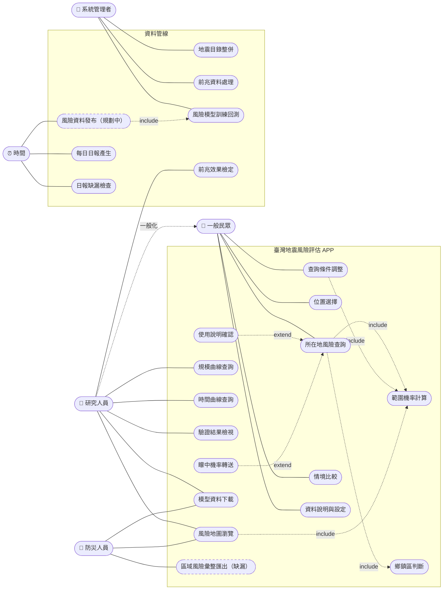

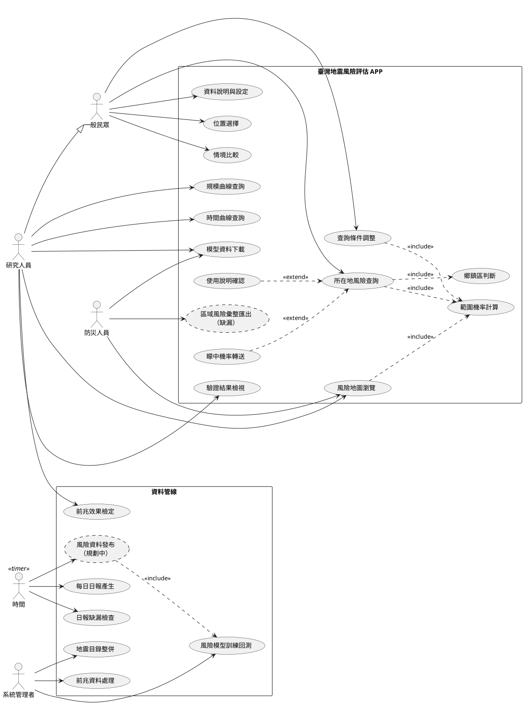

### 圖 2 類別圖（設計類別圖，依程式碼）

**文字說明**：依第 7 章表 7-3「設計類別圖」的寫法：完整的型別、能見度、有方向的關聯，只標目的端的數集。
- **上半部是 APP**：`State` 組合了 `Place`、`Cond`，並持有一份 `Feed`；`Feed` 組合了 `DataStatus`、多筆 `RecentEvent` 和 `BacktestRow`。`PointAssessment` 繼承 `Assessment`。控制類別 `HazardCore`、`TownLookup` 以 «control» 標示（實際上是 TypeScript 模組的函式集合）。
- **下半部是管線**：`Catalog` 依賴 `Grid`；`Config` 組合 `Region`、聚合多個 `ExternalFeatureSpec`；三種評分模型實現同一個隱含介面 `ScoringModel`（`fit`、`score`，屬於鴨子型別，程式裡沒有明確定義這個介面）；`Stream` 使用 `Manifest` 與 `RawDisposer`。

```mermaid
classDiagram
  direction TB
  class State {
    +feed: Feed
    +place: Place
    +cond: Cond
    +locate: Locate
    +mapLayer: string
    +scope: string
    +basemap: string
    +smooth: number
    +mapFull: boolean
  }
  class Place {
    +lat: number
    +lon: number
    +label: string
    +detail?: string
    +source: PlaceSource
    +accuracyM?: number
  }
  class Cond {
    +radiusKm: number
    +T: number
    +m: number
  }
  class Feed {
    +version: 1
    +mock: boolean
    +issued_at: string
    +grid: GridSpec
    +params: b, m_ref
    +horizons_days: number[]
    +cells: lat[], lon[]
    +n_full: number[][]
    +n_bg: number[][]
  }
  class DataStatus {
    +catalog_end: string
    +gap_days: number
    +n_provisional: number
    +sources: string[]
    +undercount_by_horizon: Record
  }
  class RecentEvent {
    +time: string
    +lat: number
    +lon: number
    +depth_km: number
    +ml: number
    +source: string
  }
  class BacktestRow {
    +m: number
    +horizon_days: number
    +auc: number
    +ratio: number
    +n_events: number
  }
  class Assessment {
    +p: number
    +pBg: number
    +ratio: number
  }
  class PointAssessment {
    +coverage: number
    +covered: boolean
  }
  class HazardCore {
    <<control>>
    +assessPoint(feed, lat, lon, radiusKm, m, T) PointAssessment
    +cellProbabilities(feed, m, T, which) number[]
    +magnitudeAtProbability(feed, w, T, p) number
    +isVerified(feed, m, T) boolean
  }
  class TownLookup {
    <<control>>
    +loadTowns() Promise~TownIndex~
    +describePlace(idx, lat, lon, accuracyM) PlaceText
  }
  class TownIndex {
    +towns: TownShape[]
    +toleranceM: number
    +source: string
  }
  class TownShape {
    +code: string
    +county: string
    +name: string
    +bbox: number[4]
    +polys: Float64Array[][]
  }
  State *-- "1" Place
  State *-- "1" Cond
  State --> "1" Feed
  Feed *-- "1" DataStatus
  Feed *-- "*" RecentEvent
  Feed *-- "*" BacktestRow
  PointAssessment --|> Assessment
  HazardCore ..> Feed : reads
  HazardCore ..> PointAssessment : creates
  TownLookup ..> TownIndex : builds
  TownIndex *-- "*" TownShape

  class Grid {
    <<dataclass>>
    +lat_min: float
    +lat_max: float
    +lon_min: float
    +lon_max: float
    +deg: float
    +shape() tuple
    +cell_index(lat, lon) tuple
    +frame() DataFrame
  }
  class HazardParams {
    <<dataclass>>
    +m_ref: float = 3.5
    +b: float
    +mu: float
    +K: float
    +alpha: float
    +c: float
    +p: float
    +sigma_bg: float
    +sigma_st: float
    +floor_frac: float
    +lookback_days: float
  }
  class Catalog {
    +grid: Grid
    +time: datetime64[]
    +ml: float[]
    +flat: int[]
    +before(t0) int
    +counts(lo, hi, min_ml) ndarray
  }
  class Config {
    <<dataclass>>
    +tag: str
    +region: Region
    +cell_deg: float
    +horizon_days: int
    +target_ml: float
    +decluster_method: str
    +models: list
    +load(path)$
    +validate()
  }
  class Region {
    <<dataclass>>
    +lat_min, lat_max, lon_min, lon_max: float
  }
  class ExternalFeatureSpec {
    <<dataclass>>
    +name: str
    +path: str
    +lookback_days: int
    +aggs: list
  }
  class ScoringModel {
    <<interface>>
    +name: str
    +fit(X, y)
    +score(X) ndarray
  }
  class RandomModel
  class ColumnScore
  class LogisticModel
  class Manifest {
    +seen(digest) bool
    +add(rec)
  }
  class RawItem {
    +name: str
    +read_bytes() bytes
  }
  class RawDisposer {
    +wants_keep(date) bool
    +done(item, date, ok)
  }
  class Stream {
    +run(items, submit)
  }
  Catalog --> "1" Grid
  Config *-- "1" Region
  Config o-- "*" ExternalFeatureSpec
  RandomModel ..|> ScoringModel
  ColumnScore ..|> ScoringModel
  LogisticModel ..|> ScoringModel
  Stream --> "1" Manifest
  Stream --> "1" RawDisposer
  Stream ..> RawItem : processes
```

```plantuml
@startuml
skinparam classAttributeIconSize 0
package "APP (TypeScript)" {
  class State {
    +feed : Feed
    +place : Place
    +cond : Cond
    +locate : Locate
    +mapLayer : String
    +scope : String
    +basemap : String
    +smooth : Number
    +mapFull : Boolean
  }
  class Place {
    +lat : Number
    +lon : Number
    +label : String
    +detail : String [0..1]
    +source : String
    +accuracyM : Number [0..1]
  }
  class Cond {
    +radiusKm : Number
    +T : Number
    +m : Number
  }
  class Feed {
    +version : Number
    +mock : Boolean
    +issued_at : String
    +horizons_days : Number[*]
    +n_full : Number[*][*]
    +n_bg : Number[*][*]
  }
  class DataStatus {
    +catalog_end : String
    +gap_days : Number
    +sources : String[*]
  }
  class RecentEvent {
    +time : String
    +ml : Number
    +depth_km : Number
    +source : String
  }
  class BacktestRow {
    +m : Number
    +horizon_days : Number
    +auc : Number
    +ratio : Number
    +n_events : Number
  }
  class Assessment {
    +p : Number
    +pBg : Number
    +ratio : Number
  }
  class PointAssessment {
    +coverage : Number
    +covered : Boolean
  }
  class HazardCore <<control>> {
    +assessPoint(feed, lat, lon, radiusKm, m, T) : PointAssessment
    +cellProbabilities(feed, m, T, which) : Number[*]
    +isVerified(feed, m, T) : Boolean
  }
  class TownLookup <<control>> {
    +loadTowns() : TownIndex
    +describePlace(idx, lat, lon, accuracyM) : PlaceText
  }
  class TownIndex {
    +toleranceM : Number
  }
  class TownShape {
    +code : String
    +county : String
    +name : String
  }
  State *-- "1" Place
  State *-- "1" Cond
  State --> "1" Feed
  Feed *-- "1" DataStatus
  Feed *-- "*" RecentEvent
  Feed *-- "*" BacktestRow
  PointAssessment --|> Assessment
  HazardCore ..> Feed : <<use>>
  TownLookup ..> TownIndex : <<create>>
  TownIndex *-- "*" TownShape
}
package "管線 (Python)" {
  class Grid <<dataclass>> {
    +lat_min : float
    +deg : float
    +shape() : tuple
    +cell_index(lat, lon) : tuple
  }
  class HazardParams <<dataclass>> {
    +m_ref : float = 3.5
    +b : float
    +mu : float
    +K : float
    +alpha : float
    +p : float
  }
  class Catalog {
    +before(t0) : int
    +counts(lo, hi, min_ml) : ndarray
  }
  class Config <<dataclass>> {
    +tag : str
    +target_ml : float
    +{static} load(path) : Config
    +validate()
  }
  class Region <<dataclass>>
  class ExternalFeatureSpec <<dataclass>>
  interface ScoringModel {
    +fit(X, y)
    +score(X) : ndarray
  }
  class RandomModel
  class ColumnScore
  class LogisticModel
  class Stream {
    +run(items, submit)
  }
  class Manifest {
    +seen(digest) : bool
    +add(rec)
  }
  class RawDisposer
  class RawItem
  Catalog --> "1" Grid
  Config *-- "1" Region
  Config o-- "*" ExternalFeatureSpec
  RandomModel ..|> ScoringModel
  ColumnScore ..|> ScoringModel
  LogisticModel ..|> ScoringModel
  Stream --> "1" Manifest
  Stream --> "1" RawDisposer
  Stream ..> RawItem
}
@enduml
```

### 圖 3 循序圖（UC-01 所在地風險查詢）＋ 系統循序圖與操作合約

**文字說明（設計層的循序圖）**：民眾開啟 APP 後，`main.ts` 先等使用說明確認（`main.ts:297`），再呼叫瀏覽器定位。拿到座標後，先用「目前位置」重畫一次（這時已經呼叫 `assessPoint` 算出機率），接著非同步載入界線檔、判斷鄉鎮區，完成後再重畫。`alt` 片段表示定位失敗的替代流程。

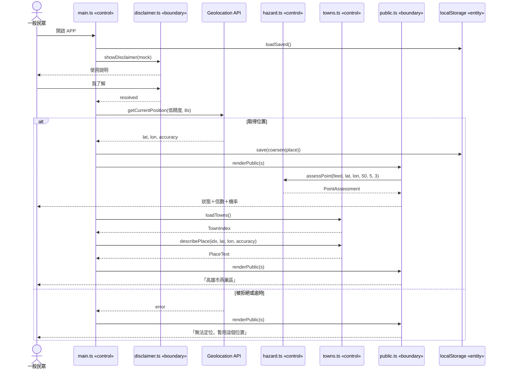

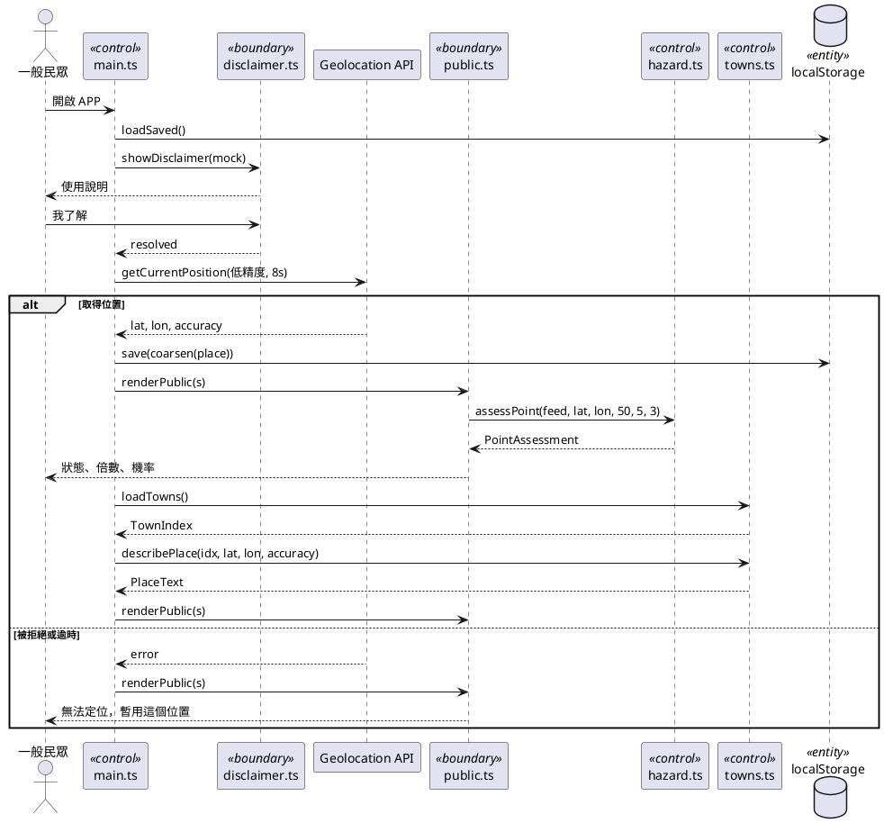

**系統循序圖（SSD，依第 12 章：系統當黑箱、操作名稱不用中文、標出參數、回覆是回傳值）**：

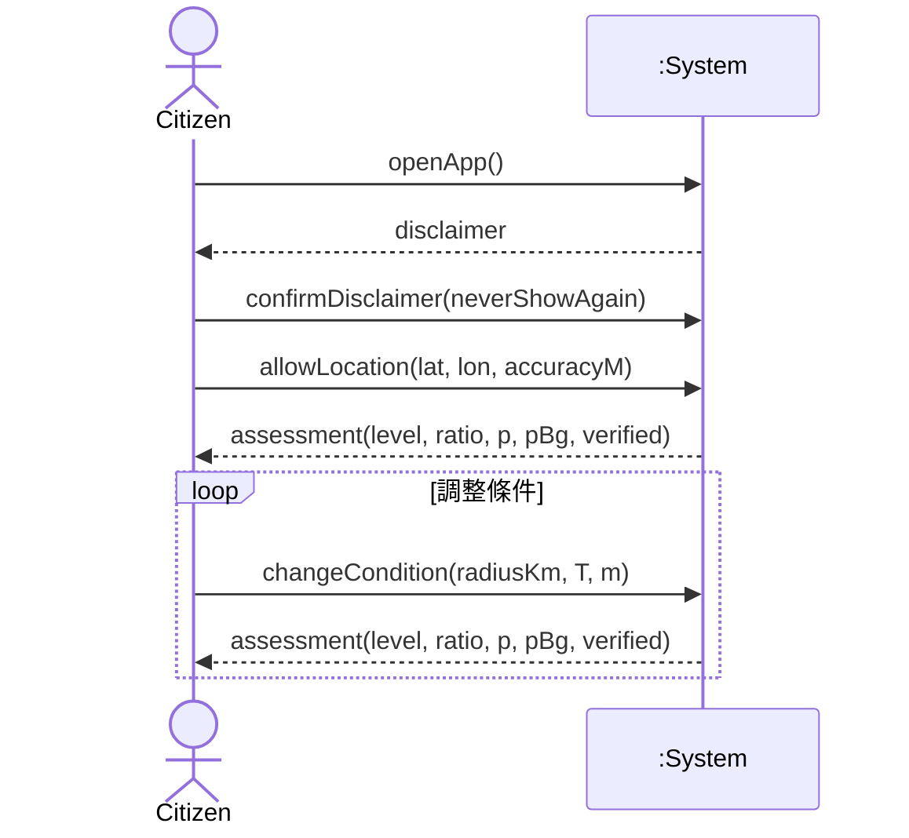

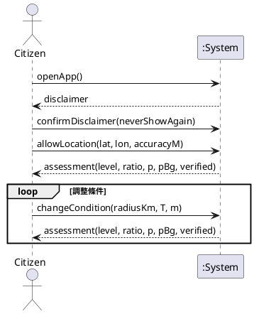

**操作合約（第 12 章，依 SSD 的系統操作）**：

| 欄位 | allowLocation(lat, lon, accuracyM) | changeCondition(radiusKm, T, m) |
|---|---|---|
| 責任 | 以使用者位置為圓心評估風險，並判斷鄉鎮區 | 依新條件重新評估 |
| 類型 | 系統操作 | 系統操作 |
| 參照 | UC-01 | UC-03 |
| 前置條件 | 使用說明已確認；feed 已載入 | 已經有位置 |
| 後置條件 | ① 建立一個 `Place`（source＝gps）（物件建立）② `State.place` 改成這個 `Place`，`State.locate`＝"ok"（屬性變動）③ 本機存檔的座標降為 0.01°（屬性變動） | ① `State.cond` 的三個屬性改變（屬性變動）② 本機存檔更新 |
| 輸出 | `PointAssessment`；鄉鎮區文字 | `PointAssessment` |
| 例外 | 座標在網格外 → `covered`＝false；界線檔載入失敗 → 改用最近的縣市 | T 超出 1 小時到 30 天 → **目前會丟例外**（應該改成限制在範圍內，審查 Q6） |

### 圖 4 活動圖（UC-01，含泳道）

**文字說明**：三條泳道分別是民眾、APP、瀏覽器。有兩個判斷節點：「定位成功？」「涵蓋率 ≥ 50%？」；鄉鎮區判斷和畫面顯示是非同步進行（先顯示機率，再更新地名），所以用分岔與會合表示。

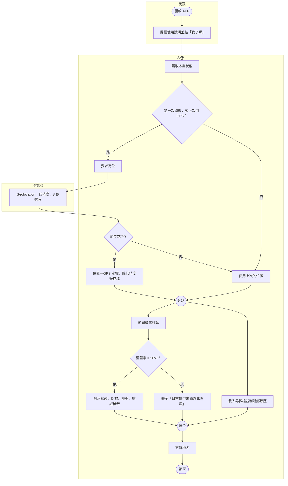

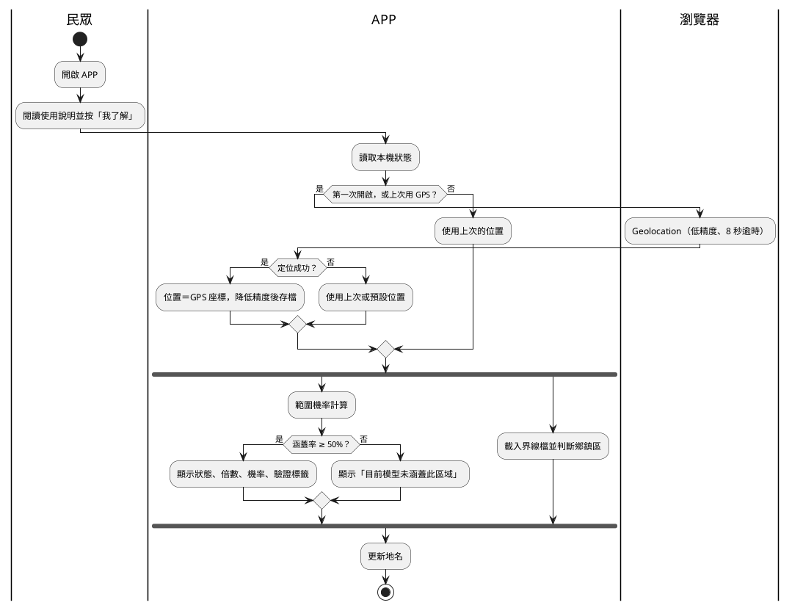

### 圖 5 狀態機圖

**文字說明（5-A 定位狀態）**：依 `state.ts` 的 `Locate` 型別（idle、pending、ok、denied）和 `main.ts:142-177` 的移轉。觸發事件寫在箭頭上，防衛條件用 `[ ]`。

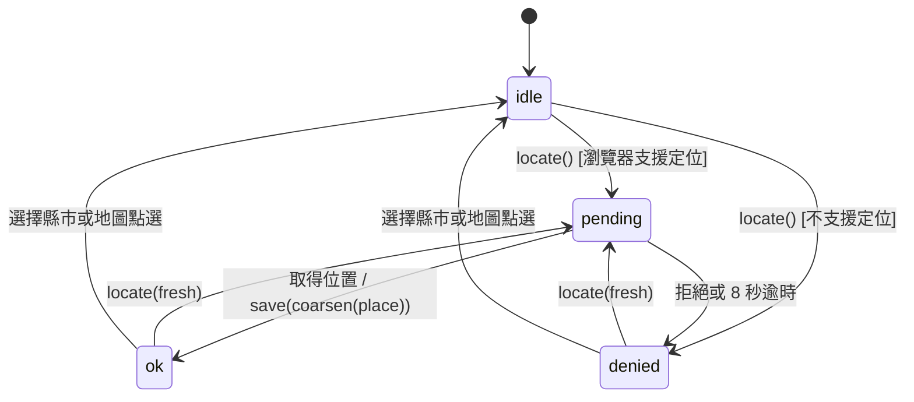

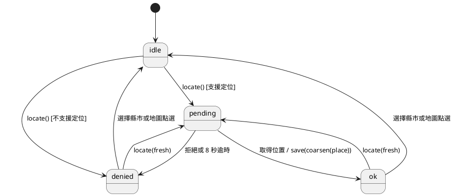

**文字說明（5-B 首頁狀態顯示）**：依 `public.ts:65-90`、`format.ts:12-21`。「未涵蓋」優先於所有等級；等級只看倍數 r。

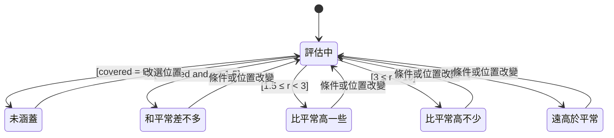

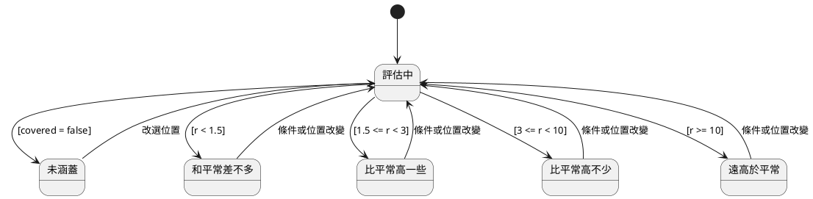

### 圖 6 元件圖

**文字說明**：APP 由五個元件組成，透過**需要的介面** `IFeed`（feed.json）取得模型輸出、透過 `ITiles` 取得底圖、透過 `IGeolocation` 取得位置。管線端的「風險模型」元件**提供** `IFeed`；「風險資料發布」元件目前不存在（虛線），所以 APP 現在用 `MockFeed` 代替。

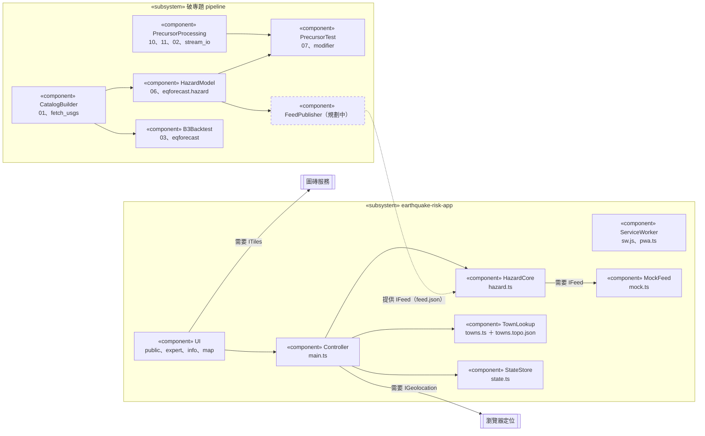

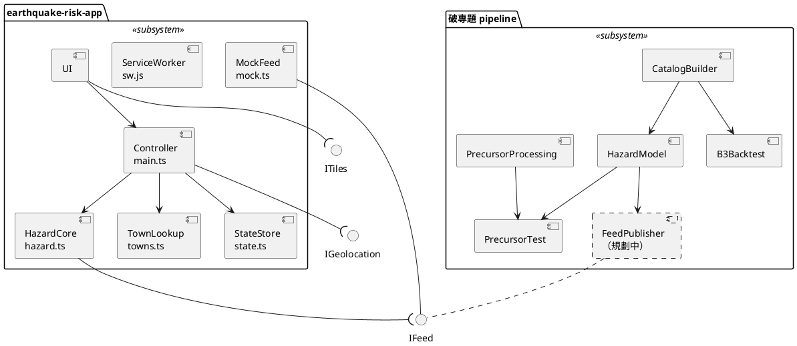

### 圖 7 部署圖

**文字說明**：一共有六個節點。

1. **使用者手機**：瀏覽器執行 PWA，以 localStorage 和 Cache Storage 保存資料。
2. **GitHub Pages**：提供靜態檔。
3. **GitHub Actions 執行器**：Ubuntu＋Python 3.13，負責 CI；規劃中的每小時發布也會在這裡執行。
4. **開發者電腦**：Windows，原始資料放在 E 槽，負責跑大部分的管線。
5. **Claude 雲端排程**：產生每日日報。
6. **外部資料與圖磚伺服器**。

所有節點之間都以 HTTPS 溝通。依第 7 章的繪製原則，只標出必要的工件，不畫到網路設備的層級。

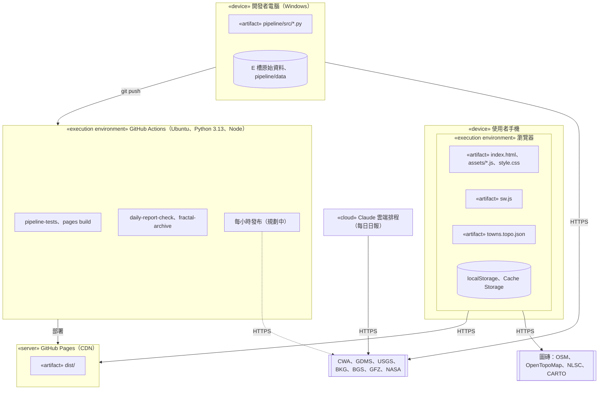

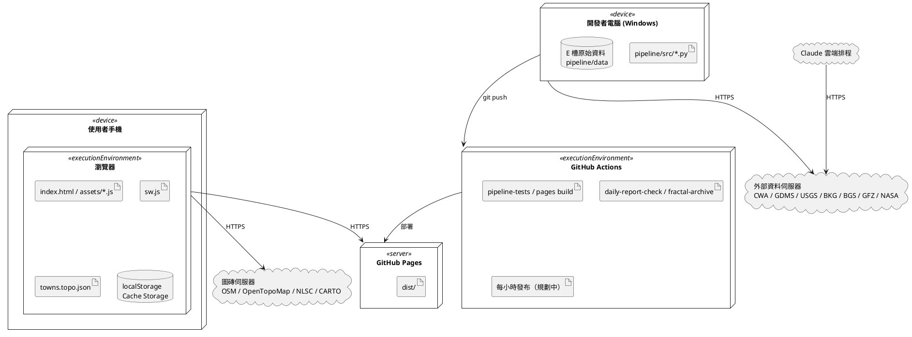

---

## UML 完整度自評

| 圖 | 新版（本文件） | 舊版 `docs/uml/` | 和程式碼的對應 |
|---|---|---|---|
| 使用案例圖 | ✅ | 有，但描述舊系統 | 新版每個 UC 都有程式進入點（見 03） |
| 類別圖 | ✅ 設計類別圖 | 有，但類別在程式碼中不存在 | 新版的屬性取自 `state.ts`、`schema.ts`、`hazard.py`、`config.py` |
| 循序圖、SSD、操作合約 | ✅ | 舊版只有循序圖 | 依 `main.ts:142-177, 289-299` |
| 活動圖 | ✅ | 有（舊流程） | 依 UC-01 |
| 狀態機圖 | ✅ 兩張 | 有（舊流程） | 依 `Locate` 型別、`format.ts` 的門檻 |
| 元件圖 | ✅ | 有（舊流程） | 依 import 圖（01 專案掃描 2.1） |
| 部署圖 | ✅ | 有（舊流程） | 依 workflows、`pages.yml` |
| 溝通圖、時序圖、互動概觀圖、套件圖、物件圖 | ✗ | ✗ | 教材有教但這個專題用不到，可以省略 |

**建議**：把 `docs/uml/` 移到 `docs/legacy/uml_2026-11-02/`，並在 README 指向本文件。
