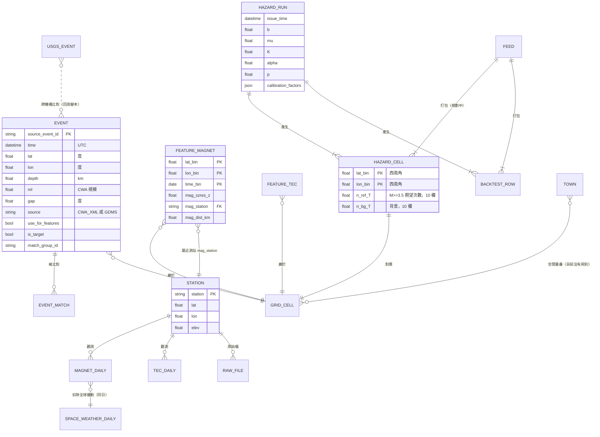

# 06 資料模型分析與架構評估

> 本系統**沒有資料庫**：資料以檔案（Parquet、JSON、JSONL、TopoJSON）和瀏覽器的 localStorage 保存。ER 模型描述的是「這些檔案之間實際存在的實體與關係」，主鍵和外鍵**沒有由資料庫強制**，完整性完全靠程式維持。

---

## 第一部分：資料模型

### 1. 實體與屬性（Entities & Attributes）

| 實體 | 主鍵（邏輯上） | 主要屬性 | 實體檔案 | 產生者 |
|---|---|---|---|---|
| EVENT 地震事件 | `source_event_id` | time（UTC）、lat、lon、depth、ml、gap、source、use_for_features、is_target、gap_quality、match_group_id | `pipeline/data/events.parquet` | `01_build_catalog.py:250-265` |
| EVENT_MATCH 跨來源比對 | (`match_group_id`, `source`, `source_event_id`) | confidence、dt_s、dist_km、ddepth_km、matcher_version、matched_at | `pipeline/data/catalog/event_matches.parquet` | `01_build_catalog.py:164-206` |
| USGS_EVENT 國際目錄事件 | `source_event_id` | time、lat、lon、depth、mag、mag_type、mag_type_norm、gap、horiz_err_km、status、net…（共 25 欄） | `usgs.parquet` | `fetch_usgs.py:98-101` |
| STATION 測站 | `station` | lat、lon、elev | **沒有獨立的表**（座標重複存在每一筆日資料裡） | 隱含在 10、11 的輸出 |
| RAW_FILE 原始檔處理紀錄 | `sha256` | name、size、status、error、station、date、coverage | `manifest.jsonl` | `10_process_magnet.py:120-128`、`11_process_gnss_tec.py:176-210` |
| MAGNET_DAILY 地磁日資料 | (`station`, `date`) | lat、lon、elev、coverage、ULF 特徵 | `magnet_daily.parquet` | `10_process_magnet.py:61-83` |
| TEC_DAILY、TEC_15MIN 電離層 | (`station`, `date`)、(`station`, `time`) | vtec_mean、vtec_max、hours_covered；vtec | `tec_daily.parquet`、`tec_15min.parquet` | `11_process_gnss_tec.py:83-113` |
| SPACE_WEATHER_DAILY 太空天氣 | `date` | Kp、ap、Dst、AE、F10.7、SN、IMF Bz | `space_weather_daily.parquet` | `00_download_space_weather.py:142` |
| GRID_CELL 網格 | (`lat_bin`, `lon_bin`) | 0.2°；西南角座標 | 沒有獨立的表（由 `Grid.frame()` 產生） | `hazard.py:53-57` |
| FEATURE_MAGNET、FEATURE_TEC 前兆特徵 | (`lat_bin`, `lon_bin`, `time_bin`) | mag_pol_z、mag_sz_z、mag_szref_z、mag_sznet_z、mag_szres_z、mag_station、mag_dist_km；tec_* | `features_magnet.parquet`、`features_tec.parquet` | `02_clean_features.py:72-73, 285-318` |
| HAZARD_RUN 模型參數 | 發布時間＋訓練期（沒有正式 ID） | params（b、mu、K、alpha、p…）、fit_info、calibration_factors、grid | `pipeline/data/hazard/params.json` | `06_hazard_model.py:221-226` |
| HAZARD_CELL 最新風險表 | (`lat_bin`, `lon_bin`) | `n_ref_{T}d`、`n_bg_{T}d`，共 10 個時間長度（**寬表**） | `hazard_latest.parquet` | `06_hazard_model.py:105-115` |
| BACKTEST_ROW 回測結果 | (`m`, `horizon_days`) | n_events、base_rate、auc_full、auc_bg、n_ratio_*、gain_* | `backtest.csv` | `06_hazard_model.py:49-102` |
| FEED APP 資料包 | `issued_at` | grid、params、horizons_days、cells、n_full、n_bg、data_status、recent、backtest | `feed.json`（規劃中；目前是 `mock.ts`） | `schema.ts:4-23` |
| SAVED_STATE 本機設定 | localStorage 的鍵 | place（已降精度）、cond、basemap、smooth、mapLayer；`eqrisk.disclaimer`、`eqrisk.installHint`、CARTO 金鑰 | 瀏覽器 localStorage | `state.ts:63-116`、`disclaimer.ts:8`、`main.ts:39`、`basemaps.ts:49` |
| TOWN 鄉鎮市區 | `TOWNCODE` | COUNTYNAME、TOWNNAME、多邊形 | `src/data/towns.topo.json` | `scripts/build-towns.mjs` |

### 2. ER 模型（概念與關係）



### 3. 邏輯資料模型（正規化後應有的樣子）

依第三正規化（3NF）整理。標 ⚠ 的是**目前實體檔案和邏輯模型不一致**的地方：

| 關聯表 | 屬性（底線＝主鍵、* ＝外鍵） | 說明 |
|---|---|---|
| Station | <u>station</u>, lat, lon, elev, kind | ⚠ 目前沒有這張表。測站座標重複存在每一筆日資料裡，02 再用中位數重新推算（`02_clean_features.py:245, 291`），**座標可能前後不一致** |
| Event | <u>event_id</u>, time, lat, lon, depth, ml, gap, source, catalog_version | ⚠ `use_for_features` 和 `is_target` 是「篩選結果」，不是事件本身的屬性。把兩種篩選混在同一張表，正是審查 M1（b 值偏低）的根因 |
| EventMatch | <u>match_group_id, event_id*</u>, confidence, dt_s, dist_km | — |
| HazardRun | <u>run_id</u>, issue_time, train_start, train_end, params…, **events_sha256** | ⚠ 目前沒有 run_id，也沒有記錄用的是哪一版的 events，**無法追溯資料來源** |
| HazardCell | <u>run_id*, lat_bin, lon_bin, horizon_days</u>, n_full, n_bg | ⚠ 目前是寬表，欄名直接嵌入浮點數（例如 `n_ref_0.04167d`，`06_hazard_model.py:113`）；長表（每列一個時間長度）比較不容易出錯 |
| BacktestRow | <u>run_id*, m, horizon_days</u>, … | 同上，目前缺少 run_id |

### 4. 實體資料模型（目前的儲存方式）

| 資料 | 格式 | 位置 | 大小與數量 | 「索引」 | 完整性怎麼維持 |
|---|---|---|---|---|---|
| 原始目錄、地磁、GNSS | CSV、XML、IAGA、RINEX（壓縮） | E 槽（不進版控） | 數百 GB【需確認】 | 檔名中的日期與測站 | `manifest.jsonl` 用 SHA-256 去重（`stream_io.py:231-275`） |
| 中間產物 | Parquet（pyarrow 26） | `pipeline/data/`（`.gitignore`） | — | 依時間排序；`Catalog` 用 `searchsorted` 做二分搜尋（`hazard.py:94-96`） | 程式產生時去重；**沒有 schema 檢查** |
| 模型輸出 | JSON、CSV、Parquet | `pipeline/data/hazard/` | 500 格 × 20 欄 | — | — |
| 報告 | Markdown、PNG | `docs/reports/`（進版控） | — | — | 由程式產生（不手寫數字） |
| APP 資料 | JSON（feed）、TopoJSON | GitHub Pages | feed 數十 KB；界線檔 305 KB | 前端建 `Map`（`hazard.ts:90-107`） | TypeScript 型別**只在編譯時檢查**，執行時沒有驗證 |
| 使用者設定 | localStorage JSON | 瀏覽器 | < 1 KB | — | `sanitize`（`state.ts:76-93`） |

**單位與座標**：時間一律 UTC（CWA XML 原本是 +08:00，在 `01_build_catalog.py` 轉換）；經緯度是十進位度數（WGS84，鄉鎮界線是 TWD97，兩者差距在公尺以下）；深度單位 km；規模在 CWA、GDMS 是 ML，USGS 是混合類型（`mag_type_norm` 做了標準化，`fetch_usgs.py:107-110`）。

**資料模型的主要風險**：
1. **篩選旗標混在事實表裡**（M1 的根因）。
2. **沒有 run_id 和資料版本**：報告上的數字無法追溯到是哪一版的 events 產生的。
3. **feed.json 沒有執行時的格式驗證**：Phase 2 接上外部資料後，格式錯誤會直接讓畫面壞掉，外部字串也可能造成 XSS（見 09 程式碼審查）。
4. **事件 ID 用「時間＋座標」組成**（`01_build_catalog.py:116-123`）：只要來源修訂了座標，ID 就會改變。

---

## 第二部分：架構評估

### 1. SOLID

| 原則 | 符合的地方 | 違反的地方（證據） |
|---|---|---|
| S 單一職責 | `hazard.py`（只有數學）、`towns.ts`、`smooth.ts`、`geomag/iaga.py` | `main.ts`（路由、事件、定位、儲存、組裝 HTML，299 行）；`06_hazard_model.py`（回測、匯出、畫圖、寫報告）；`stream_io.py`（壓縮檔、manifest、刪除策略、串流，425 行）；`12_quality_report.py`（423 行） |
| O 開放封閉 | 底圖用清單擴充（`basemaps.ts:33`）；B3 用設定檔驅動（`configs/*.json`） | 03 用 if/elif 依名稱建立模型（`03_train_backtest.py:214-220`），新增模型要改程式；hazard 的規模、時間長度寫死在程式（`06_hazard_model.py:36-39`） |
| L 里氏替換 | 三種評分模型可以互換（`models.py`：`fit`、`score`、`name`） | — |
| I 介面隔離 | — | `Feed` 是一個大介面，每個畫面只用到一部分，但都拿到整份（例如 `expert.ts` 直接讀 `feed.data_status`） |
| D 依賴反轉 | APP 的計算核心只依賴 `Feed` 型別（`hazard.ts:2`） | APP 直接寫死資料來源 `makeMockFeed()`（`main.ts:22`），沒有 `FeedSource` 抽象，換成真資料要改進入點；Python 腳本寫死 `BASE_DIR / "pipeline" / "data"`（`06_hazard_model.py:32-33`），只有 01 支援 `EQ_DATA_DIR` 環境變數 |

### 2. Clean Architecture（依賴方向必須由外往內）

```text
外：框架與 I/O      Leaflet、DOM、localStorage、fetch │ pandas I/O、matplotlib、HTTP
     ↓
介面轉接            ui/*.ts、format.ts               │ report.py、write_report、plot_map、iaga.py、rinex.py
     ↓
使用案例            main.ts                           │ 0x_*.py 腳本
     ↓
內：實體與規則      core/hazard.ts、geo/towns.ts       │ eqforecast/hazard.py、modifier.py、metrics.py
```

- **APP**：內層（`core/hazard.ts`）沒有依賴外層，**符合**。違反之處：`ui/expert.ts:162, 195` 在介面轉接層重做了內層的規則（ECB V2）。
- **管線**：內層（`eqforecast/hazard.py`）只依賴 numpy、pandas、scipy，可以接受。違反之處：使用案例層的腳本互相動態載入（`04_estimate_mc.py` 動態載入 `01_build_catalog.py`；`12_quality_report.py:56-72` 動態載入 10、11），變成**同一層之間的橫向耦合**。

### 3. 分層架構（Layered）

| 層 | APP | 管線 |
|---|---|---|
| 展現 | `ui/` | `report.py`、`docs/reports` |
| 應用 | `main.ts` | 腳本 |
| 領域 | `core/`、`geo/` | `eqforecast/`、`geomag/`、`gnss_tec/` |
| 資料 | `data/`、`state.ts` | Parquet I/O（散落在各腳本） |

**違反**：展現層跳過應用層直接讀資料層（ECB V1）；展現層直接寫 localStorage（ECB V4）。管線沒有獨立的資料存取層，每支腳本自己 `read_parquet`、自己組路徑。

### 4. MVC（教材的 VCM）

- **Model**：`state.ts`、`data/`、`core/`
- **View**：`ui/*.ts`（以字串樣板產生 HTML）
- **Controller**：`main.ts` 的事件處理（`main.ts:183-264`）

**違反**：View 自己做計算（`expert.ts:162, 195`）；Controller 自己組裝畫面（`main.ts:85-111`）。

### 5. Feature-based

- **APP**：依技術類型分資料夾（`core`、`geo`、`data`、`ui`），`ui/` 裡面才是依功能分（public、expert、info）。屬於**混合式**。以目前約 2,500 行的規模，這樣是合理的。
- **管線**：`geomag/`、`gnss_tec/` 是依領域分（feature-based，正確）；`0x_*.py` 依處理階段編號，適合批次管線。

### 6. 可支撐的使用者規模

詳見第一輪審查 4.2 節。重點：架構是靜態網站＋手機端計算，所以**使用者數量幾乎不影響後端**。

| 規模 | 會先出問題的地方 |
|---|---|
| 1,000 人 | 無 |
| 10,000 人 | 底圖（OSM、OpenTopoMap 的使用政策） |
| 100,000 人 | 圖磚必須自架或付費；GitHub Pages 流量【需確認官方限制】；推播需要後端 |

**真正的瓶頸在資料端**：GDMS 要手動下載、CWA 有限流、`trailing_factor` 計算很慢。
