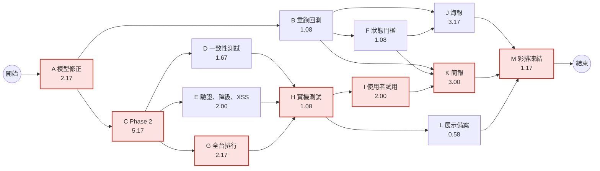
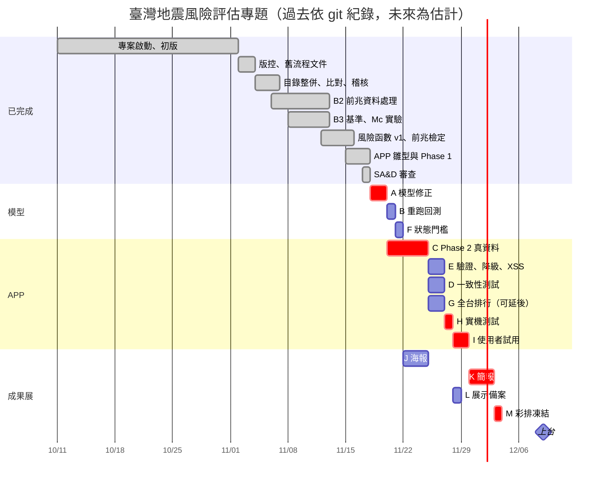

# 08 專案管理文件：可行性、WBS、PERT、CPM、甘特圖、里程碑、風險清單

> 方法依教材第 9 章（WBS 三層、甘特圖、CPM/PERT、三點估算）與第 10 章（可行性四個面向、風險清單、風險與問題的區分）。
> **過去**的時程依 git 提交紀錄（破專題第一個提交是 2026-10-11，APP 是 2026-11-15）；**未來**的工期是我的估計，請依你的實際狀況調整。PERT 的計算公式照教材：TE＝(O＋4M＋P)÷6。

---

## 1. 可行性分析（第 10 章）

| 面向 | 核心問題 | 查核方式 | 結論 |
|---|---|---|---|
| 技術 | 能做得出來嗎？ | 已經有可以運作的模型、回測、APP 雛型；Python 144 個、APP 44 個測試 | ✅ 可行。剩下的技術風險在「每小時的真資料管線」（Phase 2） |
| 經濟 | 成本和效益合理嗎？ | 現金成本：GitHub Actions、Pages 免費額度、自己的電腦，**約 0 元**；主要成本是時間 | ✅ 可行。效益（防災教育、研究基準）**很難換算成金額**，依第 10 章的建議「另訂觀察指標，避免硬湊金額」，所以**不計算 ROI、NPV**，改用 SRS 的 G1–G4 指標 |
| 組織 | 使用者會接受嗎？ | 11-15 有手機試用回饋，並據此修改設計 | ◐ 需要 12/9 前做 3–5 人的試用（G3） |
| 法律 | 符合規範嗎？ | 政府資料開放授權、OSM ODbL、OpenTopoMap CC-BY-SA 已標示；位置不外送；ExpTech 條款（免 Token、勿轉發） | ✅ 可行。CWA API 條款與金鑰保護要在 Phase 2 再確認 |

**整合判斷**：可行。但依第 10 章的案例檢核，「原型可以運作」不代表可以全面上線，還要補上**使用流程試用**與**資料移轉測試**（Phase 2）。

---

## 2. WBS（第 9 章，三層）

第一層是專案目標，第二層是相依任務組，第三層是任務（✅ 完成、◐ 進行中、□ 未開始）。

```text
0 臺灣地震風險評估專題（12/9 上台）
├── 1 專題管理
│   ├── 1.1 範圍與需求（SRS、Use Case）                  ✅ 11-17
│   ├── 1.2 風險管理（本文件）                           ✅ 11-17
│   └── 1.3 SA&D 文件與審查                              ✅ 11-17
├── 2 資料取得
│   ├── 2.1 地震目錄（GDMS、CWA XML、USGS）              ✅
│   ├── 2.2 前兆資料（地磁 8 站、GNSS、INTERMAGNET）       ✅
│   └── 2.3 太空天氣指數                                 ✅
├── 3 資料處理
│   ├── 3.1 目錄整併、跨來源比對、Mc                     ✅
│   ├── 3.2 前兆串流處理與特徵                           ✅
│   └── 3.3 資料品質報告與視覺化                         ✅
├── 4 模型
│   ├── 4.1 B3 主震基準回測                              ✅
│   ├── 4.2 連續式風險函數 v1                            ✅
│   ├── 4.3 前兆檢定（地磁，負結果）                      ✅
│   └── 4.4 模型修正（M1、M3、M4、Q1）＋重跑              ◐ 本輪
├── 5 APP
│   ├── 5.1 Phase 1：PWA、免責聲明、鄉鎮判斷、地圖         ✅ 11-17
│   ├── 5.2 Phase 2：feed 匯出、每小時更新、驗證、降級、XSS 修正  □
│   ├── 5.3 Phase 3：全台排行（其餘延到 12/9 後）          □
│   └── 5.4 實機測試（Android、iPhone）                  □
├── 6 驗證
│   ├── 6.1 單元測試                                     ✅
│   ├── 6.2 TS 與 Python 一致性測試                       □
│   └── 6.3 使用者試用（3–5 人）                          □
└── 7 成果展
    ├── 7.1 海報                                         □
    ├── 7.2 簡報                                         □
    ├── 7.3 展示備案（離線、錄影）                        □
    └── 7.4 彩排與程式凍結                               □
```

---

## 3. PERT（剩餘工作，2026-11-18 起）

單位：工作天。O＝樂觀、M＝最可能、P＝悲觀。

| 代號 | 活動（WBS） | 前置 | O | M | P | TE | 變異數 ((P−O)/6)² |
|---|---|---|---|---|---|---|---|
| A | 模型修正 M1、M3、M4、Q1（4.4） | — | 1 | 2 | 4 | 2.17 | 0.250 |
| B | 重跑回測、更新報告（4.4） | A | 0.5 | 1 | 2 | 1.08 | 0.063 |
| C | Phase 2：feed 匯出＋每小時排程（5.2） | A | 3 | 5 | 8 | 5.17 | 0.694 |
| D | TS 與 Python 一致性測試（6.2） | C | 1 | 1.5 | 3 | 1.67 | 0.111 |
| E | feed 驗證、資料源失效降級、XSS 修正（5.2） | C | 1 | 2 | 3 | 2.00 | 0.111 |
| F | 用回測決定狀態門檻 | B | 0.5 | 1 | 2 | 1.08 | 0.063 |
| G | 全台排行（5.3） | C | 1 | 2 | 4 | 2.17 | 0.250 |
| H | 實機測試（5.4） | D、E、G | 0.5 | 1 | 2 | 1.08 | 0.063 |
| I | 使用者試用（6.3） | H | 1 | 2 | 3 | 2.00 | 0.111 |
| J | 海報（7.1） | B、F | 2 | 3 | 5 | 3.17 | 0.250 |
| K | 簡報（7.2） | B、F、I | 2 | 3 | 4 | 3.00 | 0.111 |
| L | 展示備案（7.3） | H | 0.5 | 0.5 | 1 | 0.58 | 0.007 |
| M | 彩排與凍結（7.4） | J、K、L | 1 | 1 | 2 | 1.17 | 0.028 |

**PERT 網路圖（AON：工作標在節點內）**：



## 4. CPM（要徑分析）

**順推（ES、EF）與逆推（LS、LF）**，寬裕時間＝LS − ES（以程式計算，未經中途四捨五入）：

| 活動 | ES | EF | LS | LF | 寬裕 | 要徑 |
|---|---|---|---|---|---|---|
| A | 0.00 | 2.17 | 0.00 | 2.17 | 0.00 | ★ |
| B | 2.17 | 3.25 | 10.25 | 11.33 | 8.08 | |
| C | 2.17 | 7.33 | 2.17 | 7.33 | 0.00 | ★ |
| D | 7.33 | 9.00 | 7.83 | 9.50 | 0.50 | |
| E | 7.33 | 9.33 | 7.50 | 9.50 | 0.17 | |
| F | 3.25 | 4.33 | 11.33 | 12.42 | 8.08 | |
| G | 7.33 | 9.50 | 7.33 | 9.50 | 0.00 | ★ |
| H | 9.50 | 10.58 | 9.50 | 10.58 | 0.00 | ★ |
| I | 10.58 | 12.58 | 10.58 | 12.58 | 0.00 | ★ |
| J | 4.33 | 7.50 | 12.42 | 15.58 | 8.08 | |
| K | 12.58 | 15.58 | 12.58 | 15.58 | 0.00 | ★ |
| L | 10.58 | 11.17 | 15.00 | 15.58 | 4.42 | |
| M | 15.58 | 16.75 | 15.58 | 16.75 | 0.00 | ★ |

- **要徑：A → C → G → H → I → K → M，期望工期 16.75 天**，標準差 √1.507 ≈ 1.23 天。
- 可用時間：11/18 到 12/8 共 21 天。在 20 天內完成的機率約 99.6%（Z＝2.63）；在 17 天內完成的機率約 58%（Z＝0.20）。
- **但 CPM 假設資源無限**。這個專題只有一個人，**全部活動的工作量加總是 26.33 人天，超過可用的 21 天約 25%**（資源過載）。

**資源調整建議**：
1. **G 全台排行**降為 Could，等 12/9 之後再做（省 2.17 天）。G 是要徑上的活動，拿掉之後要徑變成 A → C → E → H → I → K → M（16.58 天）。
2. **程式類活動**（A、C、D、E）交給 AI 助理做，你負責審查；你同時做**文件類活動**（J 海報、K 簡報的架構）。
3. **E 的 XSS 修正**只要幾行（`esc()`），可以和 A 一起先做掉。

## 5. 甘特圖



## 6. 里程碑

| # | 日期 | 里程碑 | 狀態 | 證據 |
|---|---|---|---|---|
| M0 | 2026-10-11 | 專案啟動 | ✅ | 第一個提交 |
| M1 | 2026-11-02 | 納入版控（舊 PowerShell 流程與文件） | ✅ | 13 個提交 |
| M2 | 2026-11-05 | 第一次全面稽核 | ✅ | `docs/PROJECT_AUDIT.md` |
| M3 | 2026-11-13 | 連續式風險函數 v1 回測完成 | ✅ | `docs/reports/hazard_v1` |
| M4 | 2026-11-15 | APP 雛型上線（假資料） | ✅ | APP 的第一個提交 |
| M5 | 2026-11-17 | APP Phase 1；SA&D 全面審查 | ✅ | APP 96cd43f；`docs/sad/` |
| M6 | 2026-11-20 | 模型修正、重跑回測 | □ | 活動 A、B |
| M7 | 2026-11-27 | Phase 2 真資料上線 | □ | 活動 C、E |
| M8 | 2026-12-03 | 實機測試、使用者試用、門檻定案 | □ | 活動 H、I、F |
| M9 | 2026-12-07 | 海報、簡報定稿，程式凍結 | □ | 活動 J、K、M |
| M10 | 2026-12-09 | 上台報告 | □ | — |

## 7. 風險清單（第 10 章格式：事件、機率／影響、措施、負責角色）

機率與影響分高、中、低三級，是本專案的教學判斷。

| # | 可能事件 | 機率 | 影響 | 預防或減輕措施 | 負責 | 觸發指標 |
|---|---|---|---|---|---|---|
| R1 | 時程不足（資源過載 25%） | 高 | 高 | 全台排行延後；程式交給 AI、文件自己做 | 學生 | 11/27 時 Phase 2 還沒上線 |
| R2 | 修正 M1、M3 之後，回測結果變差 | 中 | 高 | 誠實呈現新舊比較；簡報主打方法與驗證，不主打單一數字 | 學生 | 增益下降超過 30% |
| R3 | CWA API 的條款、限流、金鑰出問題 | 中 | 高 | 先查條款；以 USGS 當備援；金鑰放在 Secrets | 學生 | 排程連續 3 次失敗 |
| R4 | 展示當天網路不穩 | 中 | 高 | PWA 離線開啟；準備錄影與截圖 | 學生 | — |
| R5 | 被誤讀成「地震預報」 | 中 | 高 | 免責聲明；簡報第一頁就說明限制；不使用綠色與「安全」 | 學生、指導老師 | 試用者誤解 |
| R6 | 原始資料只存在 E 槽，沒有備份 | 中 | 高 | 備份到外接硬碟或雲端 | 學生 | — |
| R7 | GDMS 正式目錄落後約 1.5 個月 | 高 | 中 | 用暫時資料補缺口，並揭露可能低估的比例 | 學生 | `gap_days` 大於 45 |
| R8 | GitHub Actions 排程延遲或失敗 | 中 | 中 | 超過 2 小時沒更新就標示「已過期」（E） | 學生 | `issued_at` 超過 2 小時 |
| R9 | feed 遭注入惡意字串（XSS） | 低 | 高 | `esc()` 加上執行時驗證（H1、H2） | 學生 | — |
| R10 | 圖磚服務的流量政策 | 低（展示期間） | 中 | 預設改用國土測繪中心 | 學生 | 圖磚回應 403、429 |
| R11 | 單人開發，生病或缺席 | 低 | 高 | 文件化；AI 助理的記憶與交接 | 學生 | — |
| R12 | Windows 編碼造成程式中斷 | 高 | 中 | 本輪修正（Q1） | AI 助理 | 測試失敗 |

**已發生的問題**（第 10 章：風險是尚未發生的，問題是已經發生的）：

| 問題 | 處理 |
|---|---|
| 舊文件（README、`docs/uml`）和程式不一致 | 已記錄（01 專案掃描 3.2），待移到 `legacy/` |
| 第一輪審查有兩個錯誤（G6、行號偏移） | 已在本輪更正，並註明 |
| 地磁前兆檢定是負結果 | 照實報告；列為未來工作（需要更多樣本與置換檢定） |
