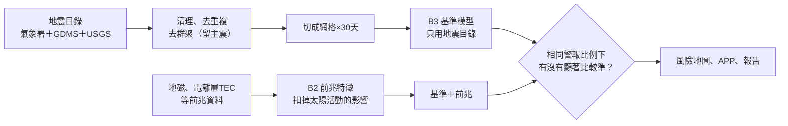

# 專案現況白話報告

> 整理日期：2026-11-12　｜　對象：專題作者本人　｜　目的：看完能回答「我在做什麼、做到哪、為什麼這樣做、接下來做什麼」
>
> 標記：**[事實]** 已從檔案或執行結果確認；**[判斷]** 我的解讀或建議；**[未驗證]** 還沒查證。

---

## 0. 三句話結論

1. **這個專題不是在「預測地震」，而是在「公平地檢驗某個訊號到底有沒有用」。** 你已經有一把量尺（B3 基準模型），接下來是把地磁、電離層等「前兆」放上去量。
2. **量尺已經做好，要量的東西只做好一半。** 地磁 8 站已處理完並做成特徵；電離層（TEC）2018–2026 的資料還沒下載；「加前兆有沒有比較準」這個核心問題**還沒有答案**。
3. **離期末成果最遠的是「給人看的東西」**：風險地圖、APP、圖表一個都還沒開始；課程的系統分析文件也和實際程式對不起來。

---

## 1. 這個專題到底在做什麼

### 1.1 用天氣預報來比喻

想像你要評估一個「降雨預報員」準不準：

- 他說「明天台北會下雨」，結果下了，算**命中**。
- 他說會下、結果沒下，算**誤報**。
- 他沒說、結果下了，算**漏報**。

但只看命中率會被騙：一個人如果**每天都喊全台下雨**，命中率是 100%，可是毫無用處。所以要加一個限制：**「你最多只能對 5% 的地區發警報」**，在這個限制下比誰抓到的多。

本專題把同一套邏輯搬到地震上：

| 天氣比喻 | 本專題的對應 | 實際設定 [事實] |
|---|---|---|
| 一個縣市 | 一個**網格** | 0.2° × 0.2°（約 20 公里見方），全區 500 格 |
| 明天 | 一個**預報窗** | 30 天 |
| 下雨 | **目標地震** | 規模 ML ≥ 5.5 的「主震」 |
| 最多喊 5% 的地區 | **警報比例 τ** | 1%、2%、5%、10% |
| 亂猜的預報員 | **隨機警報** | 對照組 |
| 「這裡以前常下雨」 | **相對強度 RI** | 以前地震多的地方，以後也容易有 |

### 1.2 為什麼要「去群聚」

大地震後面會跟著一大串餘震。如果把餘震也算成「要預測的目標」，那只要在大地震發生後對同一個地方一直喊，就會命中很多次，但這不是真本事。

所以先把前震、餘震拿掉，只留「主震」。研究區內 ML ≥ 5.5 的地震有 371 筆，去掉前震餘震後剩 **129 筆主震**（65% 是餘震類）[事實]。

報告裡有一張對照表證明這件事：不去群聚的話，模型分數會虛胖 0.09 [事實]。**很多宣稱「前兆有效」的研究就是輸在這一步。**

### 1.3 整條流程

- **B3**＝量尺：只靠過去的地震紀錄能預報到多準。
- **B2**＝要量的東西：把地磁、電離層資料整理成「每個網格每一天的異常程度」。
- 最後的菱形是整個專題的核心問題。**目前走到菱形前面，還沒有答案。**

---

## 2. 目前做到哪裡

| 模組 | 白話說明 | 狀態 | 依據 |
|---|---|---|---|
| 地震目錄整併 | 把三個來源的地震紀錄合成一份、去掉重複 | ✅ 完成 | `events.parquet`；PR #1、#2、#4 已合併 |
| 完備規模 Mc | 太小的地震以前測不到，要找出「多大以上才算記錄完整」 | ✅ 完成（隨年份變動） | `04_estimate_mc.py` |
| **B3 基準模型** | 量尺本身 | ✅ 完成 | `docs/reports/b3_baseline/` |
| 太空天氣指數 | 太陽活動強度（Kp、Dst），用來排除太陽造成的假異常 | ✅ 完成 | 1990 至今 |
| 地磁資料處理 | 8 個測站、2018–2026 | ✅ 完成（15,689 站日，失敗 0） | `E:\123\processed\magnet` |
| 地磁特徵 | 轉成每格每天的異常值，並扣掉全區共同擾動 | ✅ 今天完成 | `E:\123\processed\features` |
| TEC 資料處理 | 電離層電子含量 | ⚠️ 程式好了，**2018–2026 資料還沒下載** | 只有少量試跑資料 |
| **前兆比較報告** | 核心問題的答案 | ❌ **還沒做** | FR-B2-22 |
| 置換檢定、CSI | 更嚴格的統計檢查 | ❌ 還沒做 | 你 11/11 決定要加 |
| GNSS 地殼形變 | 地面有沒有慢慢變形 | ⏳ 來源找到了，下載中 | Zenodo，2010–2024 |
| 地電 | 地下電流 | ⏳ 每小時自動收集中，還太短不能用 | `移轉/` |
| 視覺化、風險地圖 | 給人看的圖 | ❌ 還沒開始 | FR-B2-24 |
| APP | 期初提案承諾的成果 | ❌ 還沒開始 | — |
| 課程 SA&D 文件 | 需求、UML、資料字典 | ⚠️ 內容和實際程式不符 | `PROJECT_OVERVIEW.md` 第 4 節 |

### 2.1 目前唯一有數字的成果：B3 基準 [事實]

測試期 2018–2026，共 38 個目標：

| 模型 | 綜合分數 ASS（0.5＝亂猜，1＝完美） | 只對 10% 網格發警報時抓到幾個 |
|---|---|---|
| 隨機亂猜 | 0.486 | 2 / 38 |
| 相對強度 RI（以前常震的地方） | 0.776 | 11 / 38 |
| 邏輯斯迴歸（多種目錄特徵） | 0.773 | 16 / 38 |

怎麼讀這張表：

- **「以前常震的地方以後也常震」已經比亂猜好很多**，而且統計上顯著。
- **比較複雜的模型並沒有贏過這個簡單規則**（差 −0.003，信賴區間跨過 0）。
- **誤報率約 99.7%**：即使是最好的模型，發出的警報絕大多數都落空。這是地震的本質（單一格子 30 天內發生 ML ≥ 5.5 的機率本來就極低），不是程式寫壞。

**[判斷]** 第三點要在報告和口試主動講。這個專題的價值是「誠實量出能做到多少」，不是「做出能預測地震的 APP」。

---

## 3. 過去做了什麼、為什麼

| 時間 | 做了什麼 | 為什麼 |
|---|---|---|
| 10 月上旬 | 期初提案；Codex 產生一批 PowerShell 腳本與文件 | 起步 |
| 11/2 | 全面盤點（`PROJECT_OVERVIEW.md`） | 發現三條路線互相矛盾；舊的特徵檔是**隨機假資料**；腳本跑不起來 |
| 11/2 | 決定以 Python 管線為準，目標訂為 ML ≥ 5.5 | 讓後面所有工作有同一個基準 |
| 11/2–11/10 | 做出 B3 基準模型 | 沒有量尺就無法判斷前兆有沒有用 |
| 11/3 起 | 每日地震日報（雲端自動） | 累積每天的紀錄 |
| 11/4–11/10 | 加入 USGS 目錄、跨來源比對 | 確認不同機構的目錄對得起來 |
| 11/7–11/12 | B2：地磁與 TEC 的處理程式、8 站地磁處理 | 準備「要量的東西」 |
| 11/10 | Mc 改成隨年份變動 | 1990 年代儀器少，小地震記錄不全；固定門檻會偏 |
| 11/12（今天） | 見第 7 節 | — |

### 3.1 幾個「為什麼這樣做」

- **為什麼背景值只用過去的資料？** 如果用到未來的資料，等於考試時偷看答案，回測分數會假高。程式有測試專門檢查「改掉未來的值，過去的結果不變」。
- **為什麼磁暴日要排除？** 太陽風暴會讓全球地磁一起亂跳，和地震無關。不排除就會把太陽的影響誤認成前兆。
- **為什麼缺資料不補 0？** 補 0 會被模型當成「這裡很安全」，但其實是「不知道」。
- **為什麼不能用金門當參考站？** 原本想用金門（離本島遠）當「沒有地震影響的對照」。結果金門只有 103 天資料可用。今天改成兩個替代做法：和其他測站的中位數比、以及扣掉由太陽活動指數預期的值。實測太陽活動的影響從相關 +0.36 降到接近 0。

---

## 4. 目前欠缺什麼

依「對期末成果的影響」排序：

| # | 欠缺 | 影響 | 誰能做 |
|---|---|---|---|
| 1 | **前兆比較報告**（加地磁有沒有比較準） | 這是專題的核心結論，沒有它就沒有結果可講 | 我可以跑，程式都在 |
| 2 | **TEC 2018–2026 資料** | 提案承諾三種資料（地磁、TEC、GNSS），目前只有地磁可用 | **你要去 GDMS 下載**（需要你的帳號） |
| 3 | **置換檢定與 CSI** | 樣本少時，一般的顯著性檢定不夠穩；這是防止「碰巧」的保險 | 我可以寫 |
| 4 | **視覺化與風險地圖** | 期末海報、簡報需要圖 | 我可以做，要你決定樣式 |
| 5 | **APP（Streamlit）** | 提案承諾的成果 | 我可以做，但要等 1 有結果 |
| 6 | **SA&D 文件重寫** | 課程作業要求；現有文件描述的是另一套系統 | 我可以改，要你確認課程要求 |
| 7 | 地磁資料品質報告（正式版） | 說明資料哪裡有缺 | 我可以跑 |
| 8 | GNSS 形變資料處理 | 第二階段 | 下載完成後再評估 |

---

## 5. 有什麼問題

### 5.1 會影響結論的問題

| 問題 | 白話說明 | 嚴重度 |
|---|---|---|
| **主震太少** | 前兆資料只有 2018 年後，這段期間主震約 38 個；切成訓練、驗證、測試後，測試期可能只剩十幾個。樣本這麼少，「有效」或「無效」都很難下定論 | 高 |
| **地磁資料實際從 2020-10 才夠用** | 新特徵在 2019 年幾乎沒有值，2021 年起才每年 1,000 筆以上 [事實]。但 B3 前兆設定的訓練期是 2018–2022，等於訓練期大半沒有地磁資料 | 高 |
| **扣除共同擾動有副作用** | 「和其他測站比」這個做法，會把涵蓋全台的訊號一起扣掉，只剩單站附近的異常 | 中 |
| **地磁沒有換儀器紀錄** | 儀器更換會造成數值跳動，可能被誤認成異常；TEC 有處理，地磁沒有紀錄可查 | 中 |
| **花蓮、台東兩站不能用** | 這兩站的儀器只量總磁場，算不出需要的指標；偏偏東部是地震最多的地方 | 中 |
| **提案的 k = 0.658 重現不出來** | 用現有資料怎麼算都不是這個數字，而且提案對它的解釋方向相反 | 中（口試會被問） |
| **GNSS 形變只到 2024 年底** | 公開版資料沒有 2025–2026 | 低 |

### 5.2 工程與管理上的問題

| 問題 | 說明 |
|---|---|
| **進度分散** | 程式分散在好幾個分支與 PR；PR #8（B2）、PR #6（稽核報告）還沒合併。主資料夾今天才更新到最新 |
| **電腦資源緊** | 8 GB 記憶體、C 槽約 8 GB，大型資料只能放 E 槽 |
| **地電下載排程不穩** | 應該每小時跑一次，但 11/12 只成功 6 次，有一次回報失敗，原因未查 [未驗證] |
| **資料沒有備份** | `E:\123` 的處理結果只有一份 [判斷] |
| **碎形日報存檔是公開的** | 存在公開 repo 的分支，等於公開轉載別人的網頁 |

---

## 6. 需要哪些驗證

| # | 要驗證什麼 | 怎麼驗 | 狀態 |
|---|---|---|---|
| 1 | 加前兆後有沒有顯著比基準好 | 同一批測試目標做配對比較（McNemar、ΔASS 信賴區間） | ❌ |
| 2 | 結果是不是碰巧 | 置換檢定：把前兆的時間整段平移後重跑很多次，看真實結果排第幾。要整段平移，不能逐點打亂，否則會破壞訊號本身的連續性 | ❌ |
| 3 | 有沒有偷看未來（洩漏） | 逐一檢查 B3 的特徵、切分、標準化是否只用過去資料 | ⚠️ 有基本檢查，尚未完整稽核 |
| 4 | 新的地磁特徵有沒有物理意義 | 挑幾個已知磁暴日與平靜日，人工看數值是否合理 | ❌ |
| 5 | 地磁資料品質 | 每站每年可用率、缺口、疑似換儀器日 | ⚠️ 程式好了，正式報告未產出 |
| 6 | 改變設定結論會不會翻盤 | 換網格大小、深度限制、去群聚參數重跑 | ⚠️ 基準模型做過，前兆還沒 |
| 7 | 碎形日報宣稱的命中率是否高於隨機 | 累積每日存檔後，和「隨機挑一區一週」的基準比 | ⏳ 今天開始存檔，至少要累積數月 |
| 8 | GNSS 形變檔案格式與品質 | 下載完成後檢視 | ⏳ 下載中 |
| 9 | 每日存檔排程是否真的每天跑 | 11/13 起看 `fractal-archive` 分支的 `index.jsonl` 有沒有逐日增加 | ⏳ |

---

## 7. 今天（11/12）做了什麼

| 項目 | 結果 |
|---|---|
| 整理主資料夾 | 61 項只搬不刪，137 個檔案搬移前後雜湊一致；有紀錄與還原腳本（`_archive/2026-11-12_整理/`） |
| 金門參考站替代方案 | 新增兩個地磁特徵，110 項測試通過；太陽活動的影響由 +0.36 降到接近 0 |
| 地磁特徵檔重產 | 62 萬筆網格日，放在 `E:\123\processed\features` |
| B3 前兆設定 | 已加入兩個新特徵 |
| TGM 形變資料 | 確認可從 Zenodo 免註冊取得（151 MB，CC BY 4.0），下載中 |
| 碎形日報每日存檔 | GitHub 每天自動存三次，第一份已存 |
| 更新主資料夾的 main | 已從落後 24 個版本更新到最新；為此移開 7 個內容相同的舊副本（有紀錄） |

---

## 8. 你接下來要做什麼

### 8.1 只有你能做的事

1. **下載 TEC（GNSS）2018–2026 資料**：到 GDMS 依 `docs/b2_download_plan/README.md` 的清單下載，放進 `E:\123\GDMS_INBOX`。這是目前最大的缺口，需要你的帳號。
2. **決定要不要合併 PR #8（B2）與 PR #6（稽核報告）**：合併後主資料夾才會有 B2 的程式。
3. **確認期末繳交項目與日期**：海報、簡報、報告、SA&D 文件各要什麼。我手上沒有這些資訊 [未驗證]。
4. **電腦保持開機**到 GNSS 形變檔下載完。
5. **和指導老師確認方向**：主震太少、結果可能是「前兆沒有顯著幫助」。這仍然是有價值的結論，但最好先讓老師知道。

### 8.2 我可以接著做的事（建議順序）

1. 跑**前兆比較報告**（先只有地磁），得到核心問題的第一版答案。
2. 寫**置換檢定與 CSI**。
3. 產出**地磁資料品質報告**。
4. 檢查 B3 有沒有**洩漏**。
5. 做**視覺化**（測站異常時間序列、網格地圖）。
6. TEC 資料到位後，重跑 1–3。

### 8.3 期末前的最低目標 [判斷]

如果時間不夠，最少要有這四樣才算完整：

- 基準模型結果（已有）
- 一份「加地磁前兆」的比較結果，不論有效或無效
- 兩三張能放上海報的圖
- 一段誠實的限制說明（主震少、資料短、誤報率高）

---

## 9. 名詞小辭典

| 名詞 | 白話 |
|---|---|
| 地震目錄 | 地震的清單：時間、位置、深度、規模 |
| ML | 芮氏規模 |
| 完備規模 Mc | 多大以上的地震才算「幾乎都有被記錄到」 |
| 主震、去群聚 | 把前震、餘震拿掉，只留一串地震裡最主要的那個 |
| 網格 | 把地圖切成一格一格 |
| 預報窗 | 一次預報涵蓋的時間長度（這裡是 30 天） |
| 警報比例 τ | 一次最多對多少比例的網格發警報 |
| POD（命中率） | 實際發生的地震裡，有多少比例事先被警報涵蓋 |
| FAR（誤報率） | 發出的警報裡，有多少比例落空 |
| CSI | 命中 ÷（命中＋誤報＋漏報），同時考慮漏報與誤報 |
| ASS | 不同警報比例下的綜合分數；0.5 是亂猜，1 是完美 |
| 相對強度 RI | 「以前地震多的地方，以後也容易有」的簡單規則 |
| 邏輯斯迴歸 | 一種把多個特徵加權後算出機率的基本模型 |
| 回測 | 假裝回到過去，只用當時已知的資料做預報，再對答案 |
| 洩漏 | 模型不小心用到「當時不可能知道」的資料 |
| 置換檢定 | 把資料打亂重跑很多次，看真實結果是不是比打亂的明顯好 |
| ULF、極化比 | 地磁超低頻的變化；垂直與水平強度的比值，文獻認為地震前可能升高 |
| TEC | 電離層的電子含量，由 GNSS 衛星訊號推算 |
| Kp、Dst | 衡量太陽活動造成地磁擾動強度的全球指數 |
| GNSS 形變 | 用衛星定位量測站位置的緩慢移動，反映地殼變形 |
| PR | GitHub 上「請求把修改合併進正式版」的單位 |
| worktree | 同一個專案的另一份工作副本，讓不同工作互不干擾 |

---

## 10. 資料與檔案在哪裡

| 東西 | 位置 |
|---|---|
| 正式程式 | GitHub `Azazelowo/earthquake-risk-project` 的 `main`；主資料夾已同步 |
| B2 程式（未合併） | PR #8 |
| 原始地震目錄 | 主資料夾 `earthquake_data/`、`E-A0073-002/`（不可搬） |
| 地磁原始檔與處理結果 | `E:\123\GDMS_INBOX`、`E:\123\processed\magnet` |
| 地磁特徵 | `E:\123\processed\features` |
| GNSS 形變 | `E:\123\TGM_GNSS\zenodo_23551543_v3`（下載中） |
| 地電 | 主資料夾 `移轉/geoelectric_data`（排程每小時下載，不可搬） |
| 每日地震日報 | GitHub `daily-reports` 分支 |
| 碎形日報存檔 | GitHub `fractal-archive` 分支 |
| 今天整理移走的舊檔 | 主資料夾 `_archive/2026-11-12_整理/` |
| 行政文件（提案、同意書） | 主資料夾 `行政文件/` |
