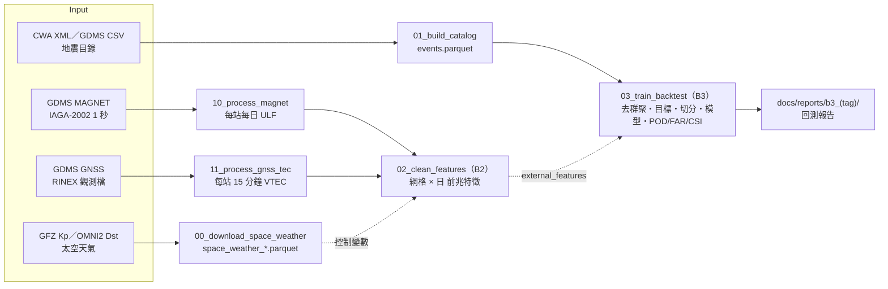

# 資料管線（pipeline）

以 Python 實作的地震風險評估資料管線。根目錄的 `scripts/*.ps1` 是早期 PowerShell 版本，已不再維護。



## 為什麼資料不在 git 裡

原始資料（CWA XML、GDMS CSV、RINEX、太空天氣）合計數百 MB，且可以從官方來源重新下載，所以只放在本機。
程式透過環境變數 `EQ_DATA_DIR` 找到資料位置；沒有設定時，預設為專案根目錄。
中間產物一律寫到 `pipeline/data/`（不進版控）；報告與圖寫到 `docs/reports/`（進版控）。

## 環境設定

```powershell
py -3.13 -m venv .venv
.\.venv\Scripts\Activate.ps1
pip install -r requirements.txt
```

> Python 3.15 alpha 目前沒有對應的 numpy 版本，請用 3.13。

## 執行

```powershell
# 資料放在其他資料夾時才需要設定
$env:EQ_DATA_DIR = "C:\path\to\破專題"

python pipeline\src\00_download_space_weather.py   # Kp、Dst 等（約 5 分鐘，之後可加 --offline）
python pipeline\src\01_build_catalog.py
python pipeline\src\10_process_magnet.py --inbox <下載資料夾> --delete-raw     # B2：地磁
python pipeline\src\11_process_gnss_tec.py --inbox <下載資料夾> --delete-raw   # B2：TEC
python pipeline\src\12_quality_report.py           # B2：資料品質報告（涵蓋率、缺口、失敗檔案、換儀器）
python pipeline\src\02_clean_features.py           # B2：網格 × 日 前兆特徵
python pipeline\src\03_train_backtest.py --config pipeline\configs\b3_precursor.json   # 目錄 vs 目錄＋前兆
python pipeline\src\03_train_backtest.py --sanity-check
python pipeline\src\03_train_backtest.py --config pipeline\configs\b3_cell0p5.json
python pipeline\src\case_ndh5_tec.py --download --rinex-dir E:\123\GNSS_ETEC    # NDH5 TEC 個案

python -m unittest discover -s pipeline\tests -v   # 單元測試（合成資料，不需要本機資料）
```

## 各步驟

| 步驟 | 輸入（`EQ_DATA_DIR` 底下） | 輸出（`pipeline/data/`） | 說明 |
|---|---|---|---|
| `00_download_space_weather.py` | 網路：GFZ Kp、NASA OMNI2 | `space_weather_hourly.parquet`、`space_weather_daily.parquet`；原始檔在 `地震預測/太空天氣指數/raw/` | Kp、ap、Ap、Dst、AE、F10.7、SN、IMF Bz；每日磁暴旗標。是**控制變數**，不是前兆 |
| `01_build_catalog.py` | `E-A0073-002/*.xml`、`earthquake_data/raw/GDMS地震目錄_*.csv` | `events.parquet`、`catalog/event_matches.parquet` | 統一轉成 UTC、Mc=2.0、來源內去重、CWA XML × GDMS 跨來源比對（見下方說明）、標記特徵事件與目標事件（見下表） |
| `10_process_magnet.py` | 收件匣（GDMS MAGNET 日檔 `.sec`、資料夾或 zip） | `magnet/magnet_daily.parquet`、`magnet/minute/`、`manifest.jsonl` | 88888／99999 → 缺值、F 由 XYZ 計算；1 分鐘平均；夜間（台灣 00–04 時）ULF Sz、Sh、Sz/Sh。處理完可刪原始檔 |
| `11_process_gnss_tec.py` | 收件匣（GDMS GNSS `.YYo(.gz)`）；網路：BKG 星曆、CODE 每月 DCB | `tec/tec_15min.parquet`、`tec/tec_daily.parquet`、`manifest.jsonl` | 每站 15 分鐘 VTEC；記錄儀器識別、DCB 來源與距今天數。多核心平行 |
| `12_quality_report.py` | `magnet/`、`tec/` 的 `manifest.jsonl` 與 `daily/*.json` | `docs/reports/b2_data_quality/`（README 與 CSV） | 每站每年可用率、需補抓的站年（附備選站）、≥ 7 天缺口、失敗檔案與原因、DCB 沿用天數、儀器更換日。不需原始檔與網路 |
| `02_clean_features.py` | 上面兩者的輸出、`space_weather_daily.parquet` | `features_magnet.parquet`、`features_tec.parquet`、`station_anomalies.parquet` | 0.2° 網格 × 日。背景只用過去的寧靜日；換儀器不跨段；地磁取 150 km 內、TEC 取 300 km 內最近測站 |
| `03_train_backtest.py` | `events.parquet`、設定檔 `pipeline/configs/*.json` | `b3_<tag>/`（預測、目標、特徵、`metrics.json`） | **B3 基準模型**：去群聚、目標定義、時間切分、POD／FAR／CSI。報告在 `docs/reports/b3_<tag>/` |
| `case_ndh5_tec.py` | `地震預測/測地法/GNSS_ETEC/*.24o`；下載廣播星曆與 DCB 到 `地震預測/測地法/aux/` | `tec/ndh5_vtec_15min.parquet`（與 `.csv`） | 2024 花蓮地震的單一個案展示。報告在 `docs/reports/case_ndh5_2024hualien/` |

### `events.parquet` 的兩個標記欄位

| 欄位 | 條件 | 用途 | 筆數 |
|---|---|---|---|
| `use_for_features` | Gap ≤ 110° 或 Gap 未知 | 計算地震活動特徵（震頻、b 值等） | 124,752 |
| `is_target` | ML ≥ 5.5，**不論 Gap** | 回測的目標事件 | 443 |

**為什麼目標事件不看 Gap**：外海地震的測站只在陸地一側，Gap 本來就偏大。若用 Gap≤110 刪除目標事件，
443 筆會只剩 240 筆，被刪掉的 203 筆中有 173 筆在東部外海（例如 2004 年 ML 7.1，Gap 243°），
模型會系統性地看不到外海大地震。Gap 過大但規模不到 5.5 的事件，兩種用途都用不到，所以不輸出。

### 跨來源比對（`event_matches.parquet`）

規格見 PR #4 的 `docs/phase2/catalog_event_matching_spec.md`。CWA XML 是 GDMS 四捨五入到整秒、座標取到小數三位的版本，所以：

| 等級 | 條件 | 2026-11-05 實測 |
|---|---|---|
| `high` | \|dt\| ≤ 1 秒 且 距離 ≤ 1 km | 72,238 組 |
| `medium`（需人工確認） | 其餘 \|dt\| ≤ 2 秒 且 距離 ≤ 10 km | 8 組 |

- 一對一配對；`events.parquet` 每組只留 GDMS 那筆（high 和 medium 都合併），並多一欄 `match_group_id`。
- `event_matches.parquet` 每筆原始紀錄一列（476,156 列），記錄群組、可信度、`pair_with`、`dt_s`、`dist_km`、`ddepth_km`、`matcher_version`。
- 和舊版（60 秒／0.3° 方框，只檢查時間最近的一筆）相比：**多合併 42 筆舊版漏掉的重複**（全是 high），**不再合併 15 筆其實是不同地震的紀錄**（時間差 11–59 秒或距離 12–36 km），但會**漏掉 2–3 筆時間或位置被修訂過的重複**（2019-09-21 02:24、2025-07-15 14:16，可能還有 2025-12-05 00:00；都是 ML<4）。ML≥5.5 目標事件數不變（443）。

## B3 框架（`src/eqforecast/`）

| 模組 | 做什麼 | 為什麼這樣設計 |
|---|---|---|
| `decluster.py` | Gardner–Knopoff／Uhrhammer 視窗法 | 餘震會讓「最近有地震就發警報」看起來很準。目標只留主震，前兆才不會被記上餘震的功勞 |
| `targets.py` | 發布時間 t0 每 30 天一次；目標 = [t0, t0+30 天) 內該網格有無 ML≥5.5 主震 | 特徵只用 t0 之前的資料，標籤只用 t0 之後的資料，兩者不重疊 |
| `splits.py` | 訓練 1991–2012、驗證 2013–2017、測試 2018 起；跨界的預報窗丟掉（purge） | 地震在時間上群聚，隨機切分等於偷看答案 |
| `features.py` | 目錄特徵（ML≥3，取「占全區比例」）；`external_features()` 接 B2 的前兆 | ML≥3 高於各年代的 Mc；比例可抵銷測站變密造成的計數成長 |
| `models.py` | 隨機、相對強度 RI、邏輯斯迴歸 | 前兆模型 = 同一個邏輯斯迴歸 + 前兆特徵，差異才能歸因於前兆 |
| `metrics.py` | 每個 t0 對分數前 τ 的網格發警報；POD／FAR／CSI、Molchan、ASS、McNemar、bootstrap | 相同 τ 才能公平比較；不偷看未來的分數分布 |

**接上前兆**：在設定檔加 `external_features`（格式見 [B3 報告第 9 節](../docs/reports/b3_baseline/README.md)），
重跑 `03_train_backtest.py`，報告會自動多出「邏輯斯 + 前兆」與配對檢定。
`--sanity-check` 會加入純雜訊與「作弊」特徵，確認比較方法不會產生假發現、也偵測得到真的改善。

## 已知限制

- B2 前兆特徵只有 2018 年之後，`b3_precursor.json` 因此把訓練／驗證／測試都放在 2018–2026 內；主震約 38 筆，信賴區間很寬。
- TEC 的衛星 DCB 用 CODE 每月值（與 CAS 每日值相差約 0.3 ns）；接收機偏差逐日估計，同站逐日波動約 2 TECU。
- 地磁沒有儀器更換紀錄可查，只能從資料涵蓋率與數值跳動判斷。下載清單與處理步驟見 [docs/b2_download_plan/](../docs/b2_download_plan/README.md)。
- `gnss_tec` 只處理 GPS（不含 GLONASS），接收機偏差用最小標準差法估計。
- 去群聚參數、網格大小、深度門檻都會影響結果，敏感度見 `docs/reports/b3_cell0p5/`、`docs/reports/b3_shallow40/`。
