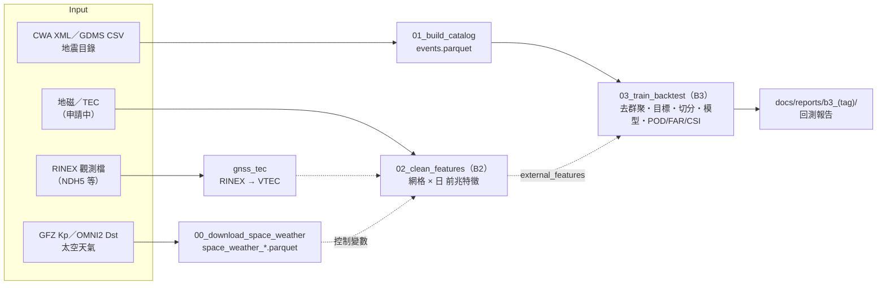

# 資料管線（pipeline）

以 Python 實作的地震風險評估資料管線。根目錄的 `scripts/*.ps1` 是早期 PowerShell 版本，已不再維護。



## 為什麼資料不在 git 裡

原始資料（CWA XML、GDMS CSV、RINEX、太空天氣）合計數百 MB，且可以從官方來源重新下載，所以只放在本機。
程式透過環境變數 `EQ_DATA_DIR` 找到資料位置；沒有設定時，預設為專案根目錄。
中間產物一律寫到 `pipeline/data/`（不進版控）；報告與圖寫到 `docs/reports/`（進版控）。

## 環境設定

```powershell
py -3.13 -m venv .venv
.\.venv\Scripts\Activate.ps1
pip install -r requirements.txt
```

> Python 3.15 alpha 目前沒有對應的 numpy 版本，請用 3.13。

## 執行

```powershell
# 資料放在其他資料夾時才需要設定
$env:EQ_DATA_DIR = "C:\path\to\破專題"

python pipeline\src\00_download_space_weather.py   # Kp、Dst 等（約 5 分鐘，之後可加 --offline）
python pipeline\src\01_build_catalog.py
python pipeline\src\02_clean_features.py           # 沒有前兆資料時會直接報錯（B2，資料到齊後再做）
python pipeline\src\03_train_backtest.py --sanity-check
python pipeline\src\03_train_backtest.py --config pipeline\configs\b3_cell0p5.json
python pipeline\src\case_ndh5_tec.py --download    # NDH5 TEC 個案

python -m unittest discover -s pipeline\tests -v   # 單元測試（合成資料，不需要本機資料）
```

## 各步驟

| 步驟 | 輸入（`EQ_DATA_DIR` 底下） | 輸出（`pipeline/data/`） | 說明 |
|---|---|---|---|
| `00_download_space_weather.py` | 網路：GFZ Kp、NASA OMNI2 | `space_weather_hourly.parquet`、`space_weather_daily.parquet`；原始檔在 `地震預測/太空天氣指數/raw/` | Kp、ap、Ap、Dst、AE、F10.7、SN、IMF Bz；每日磁暴旗標。是**控制變數**，不是前兆 |
| `01_build_catalog.py` | `E-A0073-002/*.xml`、`earthquake_data/raw/GDMS地震目錄_*.csv` | `events.parquet` | 統一轉成 UTC、Mc=2.0、來源內與跨來源去重、標記特徵事件與目標事件（見下表） |
| `02_clean_features.py` | `地震預測/地磁及地電流/*.csv`、`地震預測/電離層電子密度變化/*.csv` | `features.parquet` | 0.2° 網格 × 日。**B2，資料到齊後改寫** |
| `03_train_backtest.py` | `events.parquet`、設定檔 `pipeline/configs/*.json` | `b3_<tag>/`（預測、目標、特徵、`metrics.json`） | **B3 基準模型**：去群聚、目標定義、時間切分、POD／FAR／CSI。報告在 `docs/reports/b3_<tag>/` |
| `case_ndh5_tec.py` | `地震預測/測地法/GNSS_ETEC/*.24o`；下載廣播星曆與 DCB 到 `地震預測/測地法/aux/` | `tec/ndh5_vtec_15min.parquet`（與 `.csv`） | 2024 花蓮地震的單一個案展示。報告在 `docs/reports/case_ndh5_2024hualien/` |

### `events.parquet` 的兩個標記欄位

| 欄位 | 條件 | 用途 | 筆數 |
|---|---|---|---|
| `use_for_features` | Gap ≤ 110° 或 Gap 未知 | 計算地震活動特徵（震頻、b 值等） | 124,776 |
| `is_target` | ML ≥ 5.5，**不論 Gap** | 回測的目標事件 | 443 |

**為什麼目標事件不看 Gap**：外海地震的測站只在陸地一側，Gap 本來就偏大。若用 Gap≤110 刪除目標事件，
443 筆會只剩 240 筆，被刪掉的 203 筆中有 173 筆在東部外海（例如 2004 年 ML 7.1，Gap 243°），
模型會系統性地看不到外海大地震。Gap 過大但規模不到 5.5 的事件，兩種用途都用不到，所以不輸出。

## B3 框架（`src/eqforecast/`）

| 模組 | 做什麼 | 為什麼這樣設計 |
|---|---|---|
| `decluster.py` | Gardner–Knopoff／Uhrhammer 視窗法 | 餘震會讓「最近有地震就發警報」看起來很準。目標只留主震，前兆才不會被記上餘震的功勞 |
| `targets.py` | 發布時間 t0 每 30 天一次；目標 = [t0, t0+30 天) 內該網格有無 ML≥5.5 主震 | 特徵只用 t0 之前的資料，標籤只用 t0 之後的資料，兩者不重疊 |
| `splits.py` | 訓練 1991–2012、驗證 2013–2017、測試 2018 起；跨界的預報窗丟掉（purge） | 地震在時間上群聚，隨機切分等於偷看答案 |
| `features.py` | 目錄特徵（ML≥3，取「占全區比例」）；`external_features()` 接 B2 的前兆 | ML≥3 高於各年代的 Mc；比例可抵銷測站變密造成的計數成長 |
| `models.py` | 隨機、相對強度 RI、邏輯斯迴歸 | 前兆模型 = 同一個邏輯斯迴歸 + 前兆特徵，差異才能歸因於前兆 |
| `metrics.py` | 每個 t0 對分數前 τ 的網格發警報；POD／FAR／CSI、Molchan、ASS、McNemar、bootstrap | 相同 τ 才能公平比較；不偷看未來的分數分布 |

**接上前兆**：在設定檔加 `external_features`（格式見 [B3 報告第 9 節](../docs/reports/b3_baseline/README.md)），
重跑 `03_train_backtest.py`，報告會自動多出「邏輯斯 + 前兆」與配對檢定。
`--sanity-check` 會加入純雜訊與「作弊」特徵，確認比較方法不會產生假發現、也偵測得到真的改善。

## 已知限制

- `02_clean_features.py` 的權重與 `CASCADE_K` 都是暫定值；B2 會改寫成只產出「網格 × 日」特徵，權重交給 B3 學。
- `gnss_tec` 只處理 GPS（不含 GLONASS），接收機偏差用最小標準差法估計。
- 去群聚參數、網格大小、深度門檻都會影響結果，敏感度見 `docs/reports/b3_cell0p5/`、`docs/reports/b3_shallow40/`。
